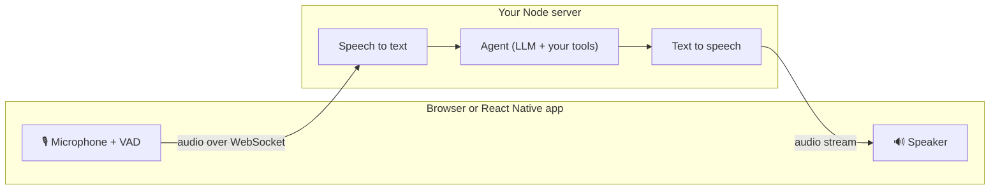

<div align="center">

# 🖐️🎤 Micdrop

**Let your users talk to your app.**

Open source TypeScript SDK for real-time voice conversations with AI,<br />
in the browser and in React Native, running on your own Node server.

[](https://www.npmjs.com/package/@micdrop/web)
[](https://www.npmjs.com/package/@micdrop/server)
[](https://www.npmjs.com/package/@micdrop/client)
[](LICENSE)

[Website](https://micdrop.dev) · [Documentation](https://micdrop.dev/docs) · [Getting started](https://micdrop.dev/docs/getting-started) · [Examples](https://micdrop.dev/docs/examples)

</div>

Micdrop streams your users' speech to your Node server and plays back the answer from the AI models you choose. It handles the microphone, voice activity detection, turn taking, interruptions, echo, audio streaming and reconnections, so you write the agent and nothing else. One call runs in a web app, an iOS app or an Android app against the same server.

## 🎬 See it in action

<table>
  <tr>
    <td width="33%" valign="top">
      <a href="https://www.youtube.com/watch?v=_50KMNZfFDw"></a><br />
      <b>A voice assistant on OpenAI Realtime</b><br />
      <sub>One speech to speech model, with Micdrop handling the turns, the interruptions and the transcript.</sub>
    </td>
    <td width="33%" valign="top">
      <a href="https://www.youtube.com/watch?v=CYvU0B6mMZ8"></a><br />
      <b>A voice assistant on French models</b><br />
      <sub>A call in French, on French providers from the transcription to the voice.</sub>
    </td>
    <td width="33%" valign="top">
      <a href="https://www.youtube.com/watch?v=iVbsAlBMOSo"></a><br />
      <b>A voice assistant on your own machine</b><br />
      <sub>Transcription, agent and voice run locally, with no API key.</sub>
    </td>
  </tr>
  <tr>
    <td width="33%" valign="top">
      <a href="https://www.youtube.com/watch?v=7GVhmaC7Qgo"></a><br />
      <b>A robot that obeys your voice</b><br />
      <sub>Two robots hear the same sentence, one reads it with Jev, the other with Claude.</sub>
    </td>
    <td width="33%" valign="top">
      <a href="https://www.youtube.com/watch?v=85QmRuGO9qg"></a><br />
      <b>A game that plays a famous person</b><br />
      <sub>Ask yes or no questions out loud to find who the game is playing.</sub>
    </td>
    <td width="33%" valign="top">
      <a href="https://www.youtube.com/watch?v=QBb7TRJNQJ4"></a><br />
      <b>A word to find by asking questions</b><br />
      <sub>The game answers each question with yes, probably, I don't know, probably not or no.</sub>
    </td>
  </tr>
</table>

Every demo is open source in [`examples/`](./examples), ready to run with your own API keys.

## 🚀 Quick start

Install the browser client and start a call from a click:

```bash
npm install @micdrop/web
```

```typescript
import { Micdrop } from '@micdrop/web'

button.onclick = () => Micdrop.start({ url: 'ws://localhost:8081' })

Micdrop.on('StateChange', (state) => {
  console.log(state.conversation, state.isAssistantSpeaking)
})
```

Install the server with the providers you want, here Gladia, OpenAI and ElevenLabs:

```bash
npm install @micdrop/server @micdrop/gladia @micdrop/openai @micdrop/elevenlabs ws
```

```typescript
import { MicdropServer } from '@micdrop/server'
import { GladiaSTT } from '@micdrop/gladia'
import { OpenaiAgent } from '@micdrop/openai'
import { ElevenLabsTTS } from '@micdrop/elevenlabs'
import { WebSocketServer } from 'ws'

const wss = new WebSocketServer({ port: 8081 })

wss.on('connection', (socket) => {
  new MicdropServer(socket, {
    firstMessage: 'How can I help you today?',
    stt: new GladiaSTT({ apiKey: process.env.GLADIA_API_KEY }),
    agent: new OpenaiAgent({
      apiKey: process.env.OPENAI_API_KEY,
      systemPrompt: 'You are a helpful assistant',
    }),
    tts: new ElevenLabsTTS({
      apiKey: process.env.ELEVENLABS_API_KEY,
      voiceId: process.env.ELEVENLABS_VOICE_ID,
    }),
  })
})
```

Your app now holds a voice conversation. The [getting started guide](https://micdrop.dev/docs/getting-started) covers React, React Native and troubleshooting.

To hear it before writing any code, run the basic example with a single OpenAI key:

```bash
git clone https://github.com/Godefroy/micdrop.git && cd micdrop
pnpm install
cp examples/basic/.env.example examples/basic/.env   # add your OPENAI_API_KEY
pnpm dev:basic
```

## ⚙️ How it works



The client detects speech locally and streams audio only while the user talks. The server transcribes it, lets your agent answer, and starts speaking the first words while the model is still writing the rest. When the user talks over the assistant, playback stops and the server cancels the LLM and the voice.

You can also replace the three stages with a single speech to speech model, [Gemini Live or the OpenAI Realtime API](https://micdrop.dev/docs/server/realtime), and keep the same client code.

## 🤔 Why Micdrop?

- **It lives in your codebase.** Micdrop is a library inside the Node server you already deploy, so your agent sits next to your database, your auth and your business logic. Your provider keys stay on the server.
- **TypeScript end to end.** The same language from the browser and the phone to the server, with typed events and state.
- **You pick each model.** Choose the best transcription for your language, the LLM for your use case and the voice for your brand. Swapping a provider means changing one line.
- **You pay providers directly.** Micdrop is free under the MIT license, with no per minute fee on top of your AI bills.
- **It runs anywhere, even offline.** Keep the audio inside the EU with European providers, or run the whole call on your own machine with local models.

|                     | Micdrop                                            | Hosted platforms<br /><sub>Vapi, Retell AI</sub> | Agent frameworks<br /><sub>Pipecat, LiveKit Agents</sub>           |
| ------------------- | -------------------------------------------------- | ------------------------------------------------ | ------------------------------------------------------------------ |
| Where the call runs | In your own Node server                            | On the vendor's servers                          | In an agent service next to your app, often behind a WebRTC server |
| Languages           | TypeScript everywhere                              | Any, through a REST API and webhooks             | Python first, LiveKit Agents also has a Node SDK                   |
| Cost                | Free, you pay each provider                        | A fee per minute on top of the providers         | Free, plus the servers that carry the audio                        |
| Phone numbers       | Bring your own, Micdrop covers web and mobile apps | Included                                         | Through SIP or Twilio                                              |

Detailed comparisons with [Vapi](https://micdrop.dev/blog/alternative-to-vapi), [Retell AI](https://micdrop.dev/blog/alternative-to-retell-ai), [Pipecat](https://micdrop.dev/blog/alternative-to-pipecat) and [LiveKit Agents](https://micdrop.dev/blog/alternative-to-livekit-agents).

## 🔌 Providers

| Package                                        | Speech to text |                Agent (LLM)                |  Text to speech   | Speech to speech |
| ---------------------------------------------- | :------------: | :---------------------------------------: | :---------------: | :--------------: |
| [`@micdrop/openai`](./packages/openai)         |       ✅       |                    ✅                     |        ✅         | ✅ Realtime API  |
| [`@micdrop/gemini`](./packages/gemini)         |       ✅       |                    ✅                     |        ✅         |  ✅ Gemini Live  |
| [`@micdrop/mistral`](./packages/mistral)       |   ✅ Voxtral   |                    ✅                     | ✅ Voxtral Speech |                  |
| [`@micdrop/ai-sdk`](./packages/ai-sdk)         |                | ✅ any [AI SDK](https://ai-sdk.dev) model |                   |                  |
| [`@micdrop/gladia`](./packages/gladia)         |       ✅       |                                           |                   |                  |
| [`@micdrop/gradium`](./packages/gradium)       |       ✅       |                                           |        ✅         |                  |
| [`@micdrop/elevenlabs`](./packages/elevenlabs) |                |                                           |        ✅         |                  |
| [`@micdrop/cartesia`](./packages/cartesia)     |                |                                           |        ✅         |                  |

**Local models**, with no API key and no data leaving your machine:

| Package                                        | Runs                                                       | Languages              |
| ---------------------------------------------- | ---------------------------------------------------------- | ---------------------- |
| [`@micdrop/whisper`](./packages/whisper)       | Speech to text in your Node process                        | Multilingual           |
| [`@micdrop/kokoro`](./packages/kokoro)         | Text to speech in your Node process                        | English                |
| [`@micdrop/phonon`](./packages/phonon)         | Gradium Phonon text to speech through WebAssembly          | Five languages         |
| [`@micdrop/piper`](./packages/piper)           | Piper text to speech                                       | Around forty languages |
| [`@micdrop/pocket-tts`](./packages/pocket-tts) | Kyutai Pocket TTS in your Node process, with voice cloning | English                |
| [`@micdrop/qwen-tts`](./packages/qwen-tts)     | Qwen3 TTS on an mlx-audio server                           | Ten languages          |

For a local agent, point [`@micdrop/ai-sdk`](./packages/ai-sdk) at Ollama or any server speaking the OpenAI protocol.

Any other provider plugs into the same interfaces: write a [custom agent](https://micdrop.dev/docs/ai-integration/custom-integrations/custom-agent), [speech to text](https://micdrop.dev/docs/ai-integration/custom-integrations/custom-stt) or [text to speech](https://micdrop.dev/docs/ai-integration/custom-integrations/custom-tts), and add a [fallback](https://micdrop.dev/docs/ai-integration/fallback-strategies/agent-fallback) that takes over when a provider fails.

## ✨ Features

**In the browser and on the phone**

- [Voice activity detection](https://micdrop.dev/docs/client/vad) by volume or with Silero, and [turn detection](https://micdrop.dev/docs/client/turn-detection) that waits through a hesitation
- Interruptions with echo detection, so the assistant never answers its own voice
- [Call state](https://micdrop.dev/docs/client/call-state) and a [live transcript](https://micdrop.dev/docs/client/display-conversation-messages) to build your UI
- [Microphone and speaker selection](https://micdrop.dev/docs/client/devices-management), [mute](https://micdrop.dev/docs/client/mute-unmute-call), [pause and resume](https://micdrop.dev/docs/client/pause-resume-call)
- [React hooks](https://micdrop.dev/docs/client/react-hooks) and a [React Native](https://micdrop.dev/docs/react-native) client with native audio
- Automatic reconnection and [latency settings](https://micdrop.dev/docs/client/latency)

**On the server**

- [Tool calls](https://micdrop.dev/docs/server/tools) that run your own code during the call
- [Intent classification](https://micdrop.dev/docs/server/classifier) and [data extraction](https://micdrop.dev/docs/server/extract) on each turn
- [Semantic turn detection](https://micdrop.dev/docs/server/semantic-turn-detection) with Smart Turn
- [Authentication and call parameters](https://micdrop.dev/docs/server/auth-and-parameters), [first message](https://micdrop.dev/docs/server/first-message), [automatic hang up](https://micdrop.dev/docs/server/auto-end-call)
- [Audio recording](https://micdrop.dev/docs/server/recording-audio), [noise filtering](https://micdrop.dev/docs/server/noise-filtering), [resumed conversations](https://micdrop.dev/docs/server/resume-conversation)
- [Dictation](https://micdrop.dev/docs/server/dictation) mode, with ears only
- Works with plain `ws`, [Fastify](https://micdrop.dev/docs/server/with-fastify) or [NestJS](https://micdrop.dev/docs/server/with-nestjs)

## 📦 Packages

| Package                                            | Description                                                                           |
| -------------------------------------------------- | ------------------------------------------------------------------------------------- |
| [`@micdrop/web`](./packages/web)                   | Browser client: microphone, playback and connection to the server                     |
| [`@micdrop/react-native`](./packages/react-native) | The same client on iOS and Android                                                    |
| [`@micdrop/react`](./packages/react)               | React hooks, for the browser and React Native                                         |
| [`@micdrop/server`](./packages/server)             | Server orchestrating speech to text, agent and text to speech                         |
| [`@micdrop/client`](./packages/client)             | Protocol, call state and VAD shared by both clients, installed for you                |
| [`@micdrop/smart-turn`](./packages/smart-turn)     | Semantic end of turn detection, usable on its own in any voice app                    |
| [`@micdrop/typesafe`](./packages/typesafe)         | Jev, TypeSafe's System One model, classifying each turn in a few hundred milliseconds |

## 🧪 Examples

Clone the repository, run `pnpm install`, copy the example's `.env.example` to `.env`, then run its command from the root.

| Example                                              | Command                     | What it shows                                                      |
| ---------------------------------------------------- | --------------------------- | ------------------------------------------------------------------ |
| [Basic](./examples/basic)                            | `pnpm dev:basic`            | One button, one server, OpenAI only. Around 150 lines.             |
| [Dictation](./examples/dictation)                    | `pnpm dev:dictation`        | Speech to text into a text area, with no agent and no voice        |
| [Advanced](./examples/advanced)                      | `pnpm dev:advanced`         | React and Fastify, with every provider selectable from the browser |
| [React Native](./examples/react-native)              | `pnpm dev:react-native`     | A voice call in an Expo app on iOS and Android                     |
| [World](./examples/demo-world)                       | `pnpm dev:world`            | A 3D planet that talks and reshapes itself during the conversation |
| [Storyteller](./examples/demo-storyteller)           | `pnpm dev:storyteller`      | A campfire story, with audio tags performed by ElevenLabs          |
| [Support](./examples/demo-support)                   | `pnpm dev:support`          | A support line routing each turn from Jev's classification         |
| [Slides](./examples/demo-slides)                     | `pnpm dev:slides`           | A slide deck built by voice                                        |
| [Robot](./examples/demo-robot)                       | `pnpm dev:robot`            | Voice commands for a robot, Jev racing Claude                      |
| [Twenty questions](./examples/demo-twenty-questions) | `pnpm dev:twenty-questions` | A guessing game answered by Jev                                    |

## 🤖 Build with a coding agent

Install the [Context7 MCP](https://github.com/upstash/context7) so Cursor, Claude Code or any other agent reads the current Micdrop documentation, then prompt it to "build a Micdrop voice call (use context7)".

## 🏭 Used in production

[Raconte](https://www.raconte.ai) runs its AI voice interviews on Micdrop, in the browser, with Gladia, Mistral, Gradium, OpenAI and ElevenLabs on the server. Micdrop was first built for Raconte, then open sourced.

Using Micdrop in your product? Open a pull request to add it here.

## 🤝 Contributing

Issues and pull requests are welcome. [DEVELOPMENT.md](DEVELOPMENT.md) explains how to build, test and publish the packages.

## 📄 License

MIT, see [LICENSE](LICENSE). Created by [Godefroy de Compreignac](https://github.com/Godefroy).

## 🙏 Acknowledgements

Thanks to [ricky0123/vad](https://github.com/ricky0123/vad) for voice activity detection in the browser, and to the Pipecat team for the open [Smart Turn](https://huggingface.co/pipecat-ai/smart-turn-v3) model.
