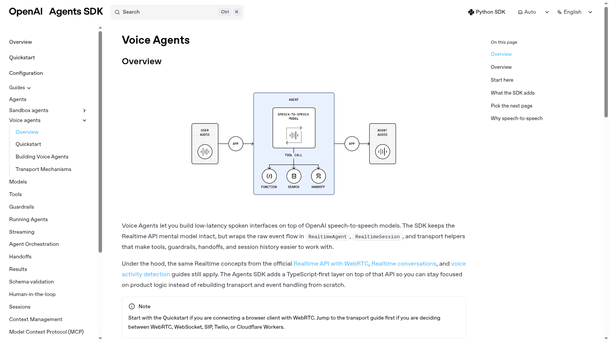
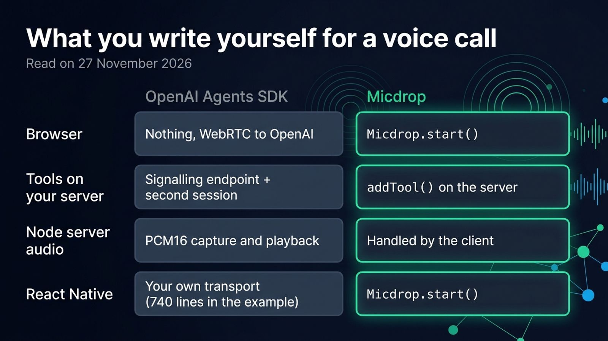
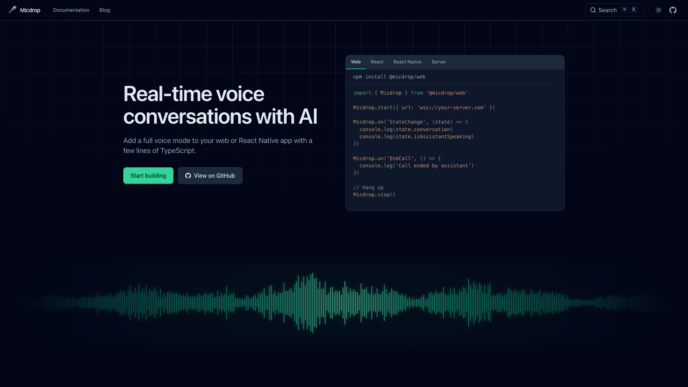
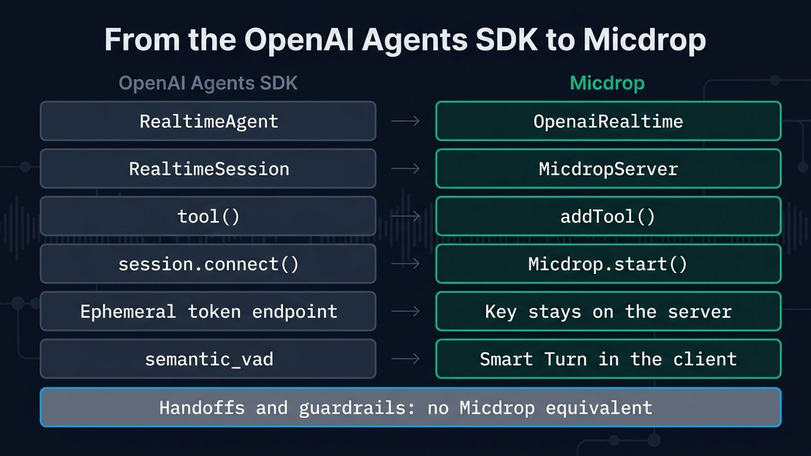

TypeScript teams look for an alternative to the OpenAI Agents SDK when they want to keep the choice of models and providers for a voice agent, or need it in a React Native app without writing the audio transport. The [OpenAI Agents SDK](https://openai.github.io/openai-agents-js/) for TypeScript runs voice agents through its `RealtimeAgent` and `RealtimeSession` classes, on OpenAI's speech-to-speech models only. [Micdrop](/) is an open source TypeScript library for real-time voice conversations with AI. It runs the same OpenAI Realtime model from your own Node server, can move the call to Gemini Live or to a pipeline of separate providers, and ships the same client for the web and for React Native. LiveKit Agents, Mastra and Pipecat are the other options a TypeScript team usually weighs.

We maintain Micdrop, so read the comparison with that in mind. The facts about the OpenAI Agents SDK come from its documentation and its repository, read on 27 November 2026, when its latest stable release was 0.22.0.



## What the OpenAI Agents SDK does well

The OpenAI Agents SDK is OpenAI's own agent framework, under the MIT licence, with a Python and a TypeScript version. The TypeScript repository, `openai/openai-agents-js`, has about 4,000 stars. Its npm package, `@openai/agents`, was downloaded around 2.2 million times in the week of 20 to 26 November 2026. OpenAI's team ships a release most weeks.

For voice, the SDK wraps the Realtime API in a `RealtimeAgent` you describe once and a `RealtimeSession` that runs it. When a browser connects with a short-lived token over WebRTC, the SDK opens the microphone and plays the answer with no audio code on your side. On top of that, the session handles the parts that take time to get right:

- function tools defined with Zod, approval before a tool runs, and hosted MCP tools
- handoffs from one realtime agent to another during the call
- output guardrails that check the transcript of an answer and stop it when it breaks a rule
- interruptions, with the assistant's audio truncated to what the user actually heard
- a conversation history you can read and edit, and traces of each session
- transports for a Node server over WebSocket, for SIP calls, for Twilio and for Cloudflare Workers

A team that has already chosen OpenAI's models gets a voice agent in the browser with less code than with any other option here.

## Why TypeScript teams look for an OpenAI Agents SDK alternative

### The realtime path runs on OpenAI's API only

Every transport the SDK ships for voice connects to the OpenAI Realtime API. The WebSocket transport accepts a custom URL, which lets you reach Azure OpenAI or any endpoint speaking the same protocol, but the session still sends OpenAI's events. The SDK's text agents can run other vendors' models through an adapter for the Vercel AI SDK. That adapter covers text agents only, so a `RealtimeAgent` stays on OpenAI. To reach Gemini Live or another speech-to-speech API, the documentation tells you to implement the `RealtimeTransportLayer` interface and emit its events yourself.

### A pipeline of separate providers is outside the TypeScript SDK

A pipeline transcribes the user with one provider, answers with a model from another and speaks with a voice from a third. It lets you pick an ElevenLabs or Cartesia voice, a European provider for the data, or a model that [often costs less per minute than a speech-to-speech model](/blog/openai-realtime-api-vs-pipeline). The Python version of the SDK has a `VoicePipeline` that chains speech-to-text, an agent and text-to-speech. The TypeScript version ships only the realtime path. A second provider that takes over when the first one fails is also outside the SDK, so an OpenAI outage stops the call.

### The SDK handles audio only in the browser

The WebRTC transport, the one that opens the microphone and plays the voice, relies on browser APIs. Everywhere else, the audio is your code:

- On a Node server, the WebSocket transport hands you raw PCM16 chunks to play and expects raw chunks back. The documentation says you handle capture and playback, stop the playback yourself on an interruption, and pause the capture yourself to mute, since `mute()` throws on that transport.
- In React Native, the SDK has worked since version 0.15, in August 2026, but the app provides the transport. OpenAI's Expo example builds one on `react-native-webrtc`, in a transport file that alone runs to 740 lines, before the microphone permission and the audio routing.
- In React, the SDK provides no hooks. The call state, the volume meters and the device list are UI code you write.

### Tools run in the browser unless you add a server

With the default WebRTC transport, the `RealtimeSession` runs in the browser, and so do its tools. A tool that reads your database or charges a card has to call your backend through an endpoint you secure. To keep the tools and the session on your server, the transport guide describes a six-step pattern: the browser sends its WebRTC offer to your server, the server creates the call with OpenAI, then opens a second `RealtimeSession` over WebSocket on the same call to receive the events and run the tools. OpenAI ships an example of this pattern. It works, but it adds a signalling endpoint and a second connection per call.

{/* IMAGE regen: api.py image, infographic, 1600x900. Scene: "Title at the top in a modern clean bold sans-serif: \"What you write yourself for a voice call\" Subtitle: \"Read on 27 November 2026\" A table of four rows and two columns of cards. Column headers: left \"OpenAI Agents SDK\" with muted slate grey cards, right \"Micdrop\" with emerald bordered cards. Row labels on the far left, in white: \"Browser\", \"Tools on your server\", \"Node server audio\", \"React Native\". Row 1: left \"Nothing, WebRTC to OpenAI\", right \"Micdrop.start()\". Row 2: left \"Signalling endpoint + second session\", right \"addTool() on the server\". Row 3: left \"PCM16 capture and playback\", right \"Handled by the client\". Row 4: left \"Your own transport (740 lines in the example)\", right \"Micdrop.start()\". Wide 16:9 layout, flat vector style, monospace font for code names, generous spacing." Infographic: regenerate if the SDK ships a React Native transport or server audio helpers. Last data sync: 2026-11-27. */}


## Other alternatives to the OpenAI Agents SDK in TypeScript

- [LiveKit Agents](https://github.com/livekit/agents-js) has a Node SDK, `@livekit/agents`, under Apache 2.0, with OpenAI, Google and xAI realtime models, pipelines of separate providers, fallback adapters, telephony and React Native. An agent joins a WebRTC room, so you run a LiveKit media server or pay for LiveKit Cloud. We compared [LiveKit Agents and Micdrop](/blog/alternative-to-livekit-agents) in detail.
- [Mastra](https://mastra.ai) is a TypeScript agent framework, under Apache 2.0 outside its enterprise folders. Its voice packages connect a Mastra agent to OpenAI Realtime, Gemini Live, xAI and Amazon Nova Sonic. Its `CompositeVoice` class combines a speech-to-text and a text-to-speech provider. Mastra's voice classes run on the server. To reach a browser, its realtime voice guide builds on LiveKit, with a worker process and a LiveKit server or LiveKit Cloud.
- [Pipecat](https://pipecat.ai), built by Daily under BSD 2-Clause, has official JavaScript, React and React Native clients and the widest provider catalogue of the open source frameworks. Its server is Python, so a TypeScript team deploys a second service. We compared [Pipecat and Micdrop](/blog/alternative-to-pipecat).
- The [Vercel AI SDK](https://ai-sdk.dev) has an experimental realtime hook for the browser that connects to OpenAI, Gemini, xAI and Mistral speech-to-speech models.

Our ranking of [voice AI SDKs for JavaScript](/blog/top-voice-ai-sdks-javascript) compares these SDKs with the hosted services that bill per minute.

## How Micdrop approaches a voice agent differently

Micdrop is a set of MIT-licensed TypeScript packages. The client runs in the browser or in a React Native app, captures the microphone, detects speech, plays the answer and stops it when the user interrupts. The server package, `@micdrop/server`, accepts the WebSocket connection on the Node server you already run and orchestrates the conversation there.



### Keep GPT-Realtime and run it from your Node server

[`OpenaiRealtime`](/docs/realtime/openai-realtime) runs the OpenAI Realtime API from your server, on `gpt-realtime-2.1` by default. The OpenAI key stays on your server, so you build no token endpoint. The tools run next to your database:

```typescript
import { MicdropServer } from '@micdrop/server'
import { OpenaiRealtime } from '@micdrop/openai'
import { z } from 'zod'

const realtime = new OpenaiRealtime({
  apiKey: process.env.OPENAI_API_KEY || '',
  systemPrompt: 'You are the booking assistant of a dental clinic',
  reasoningEffort: 'minimal',
})

realtime.addTool({
  name: 'book_appointment',
  description: 'Book an appointment for the caller',
  inputSchema: z.object({ date: z.string(), time: z.string() }),
  execute: async ({ date, time }) => bookAppointment(date, time),
  emitOutput: true, // The browser receives the call and its result
})

new MicdropServer(socket, { realtime, generateFirstMessage: true })
```

The browser side is one call:

```typescript
import { Micdrop } from '@micdrop/web'

await Micdrop.start({ url: 'wss://your-app.com/call' })
```

A Realtime session lasts sixty minutes at most. When the connection drops, `OpenaiRealtime` reconnects and sends the conversation so far to the new session, so a long call carries on.

### Move the call to Gemini Live or a pipeline by changing one class

`MicdropServer` takes either a realtime model or a pipeline, with the same client code in both cases. [Gemini 3.8 Live](/docs/realtime/gemini-live) costs about a quarter of GPT-Realtime-2.1 per minute. You swap it in by changing one class:

```typescript
import { GeminiLive } from '@micdrop/gemini'

new MicdropServer(socket, {
  realtime: new GeminiLive({
    apiKey: process.env.GEMINI_API_KEY || '',
    systemPrompt: 'You are the booking assistant of a dental clinic',
  }),
})
```

For a pipeline, you pass a speech-to-text, an agent and a text-to-speech instead, each from [the provider you pick](/docs/providers): Gladia or Mistral to transcribe, any model of the Vercel AI SDK to answer, ElevenLabs, Cartesia or a local Kokoro to speak. A stack of Mistral, Gladia and Gradium keeps [the audio and the transcripts in Europe](/docs/providers/sovereign-voice-ai). Tools declared with `addTool()` work the same on the agent of a pipeline and on a realtime model.

### A second provider takes over when the first one fails

In a pipeline, each role accepts a list of providers. [`FallbackAgent`](/docs/agents/fallback), `FallbackSTT` and `FallbackTTS` switch to the next provider when one fails after its retries. That provider answers from the same conversation. When your model vendor has an outage, the user waits a little longer for one answer while the call goes on.

### The same call code on the web and in React Native

[`@micdrop/react-native`](/docs/react-native) runs the same client as the browser package, with a different import. It asks for the microphone permission, sets up the audio session as a phone call, which turns on the phone's echo cancellation, and connects to the same `MicdropServer` as your web app. Your web and mobile apps share one server, one prompt and one set of tools. The package is young, at version 0.2. It needs an Expo development build, as any native audio code does. We also explained how to [reach the OpenAI Realtime API from React Native](/blog/openai-realtime-api-react-native) with and without WebRTC.

### The client detects speech and exposes the call state

The client [detects speech in the browser](/docs/client/vad) and sends audio only while the user talks. [Smart Turn](/docs/client/turn-detection) is an open model that judges from the audio whether a sentence sounds finished, so the agent waits through a pause in the middle of a sentence, whichever model answers. The [React hooks](/docs/client/react-hooks) of `@micdrop/react` give you the call state, errors, the end of the call and the volume of the microphone and the speaker, on the web and in React Native.

## OpenAI Agents SDK vs Micdrop, feature by feature

We checked both projects on 27 November 2026, with the OpenAI Agents SDK at version 0.22.0 and `@micdrop/server` at 2.11.0.

| | OpenAI Agents SDK | Micdrop |
|---|---|---|
| **Speech-to-speech models** | OpenAI Realtime, or an endpoint speaking its protocol such as Azure OpenAI | OpenAI Realtime and Gemini Live |
| **Pipeline of separate providers** | Python SDK only | Yes, with OpenAI, Gemini, Mistral, ElevenLabs, Cartesia, Gladia, Gradium, the Vercel AI SDK and local engines |
| **Fallback to a second provider** | No | Yes, for the agent, the speech-to-text and the text-to-speech |
| **Browser audio** | Built in, over WebRTC to OpenAI | Built in, over a WebSocket to your server |
| **Node server audio** | Raw PCM16 you capture and play | Handled by the client |
| **React Native** | Transport written by the app | `@micdrop/react-native`, version 0.2 |
| **React hooks** | No | `@micdrop/react` |
| **Tools** | Zod, approvals, hosted MCP | Zod, run on your server |
| **Handoffs and guardrails** | Yes | No |
| **Tracing** | Yes, in the OpenAI dashboard | No |
| **Telephony** | SIP, Twilio | No |
| **Licence and community** | MIT, about 4,000 stars, maintained by OpenAI | MIT, 100 stars, one maintainer |

## What the OpenAI Agents SDK and Micdrop cost

Both libraries are free under the MIT licence. You pay the model and voice providers they call, on your own API keys. Neither library adds a fee per minute.

The bill depends on the model. OpenAI counts one audio token per 100 ms heard and one per 50 ms spoken. On a minute where the user and the agent each talk for thirty seconds, the audio alone comes to these amounts at the rates of the [OpenAI](https://developers.openai.com/api/docs/pricing) and [Gemini](https://ai.google.dev/gemini-api/docs/pricing) price lists, read on 27 November 2026:

| Model | Per minute | 1,000 minutes a month | 10,000 minutes a month | 100,000 minutes a month |
|---|---|---|---|---|
| GPT-Realtime-2.1 ($32 and $64 per million audio tokens) | $0.048 | $48 | $480 | $4,800 |
| GPT-Realtime-2.1-mini ($10 and $20 per million) | $0.015 | $15 | $150 | $1,500 |
| Gemini 3.8 Live (Micdrop only) | About $0.012 | About $12 | About $120 | About $1,200 |

Micdrop runs all three models, while the OpenAI Agents SDK runs the two GPT-Realtime ones. A real call costs more than its audio, because OpenAI bills the conversation history again on every answer, at a cached rate. Reasoning and the transcription of the user also add to the bill. A 10-minute call on GPT-Realtime-2.1 comes to [about $0.57 before transcription](/blog/openai-realtime-api-pricing). A pipeline of small OpenAI models costs about $0.23 for the same call. In TypeScript, that pipeline needs Micdrop or another framework, since the SDK ships only the realtime path.

The rest of the cost is engineering time. With the SDK in the browser, it is close to zero until you need the tools on your server, a mobile app or another provider. With Micdrop, you run the WebSocket endpoint in your Node server while the client handles the audio on every platform.

## Who should choose which

Choose the OpenAI Agents SDK when:

- the product is a web app that talks to OpenAI's models and nothing else, with tools that can run in the browser or call your API
- you need handoffs between several specialised agents, or guardrails on what the agent says
- the agent answers phone calls over SIP or Twilio
- your company buys OpenAI through Azure
- you want traces of each voice session in the OpenAI dashboard
- the lowest latency matters most, since the browser talks straight to OpenAI over WebRTC, without a hop through your server

Choose Micdrop when:

- you want GPT-Realtime today and the option to move to Gemini Live, or to a pipeline with your own voice and model, without rewriting the client
- the tools and the API keys must stay on your Node server
- the same voice agent ships in a web app and a React Native app
- an outage at one provider should hand over to another
- you accept a young project with one maintainer, no telephony and no hosted dashboard

If you are starting a new voice feature in a TypeScript web or React Native app and expect to compare models, start on Micdrop with `OpenaiRealtime`, then try Gemini Live or a pipeline once the product works. If OpenAI is a settled choice and the agent lives in the browser, start on the OpenAI Agents SDK. Its quickstart gets you talking to the model in a few minutes.

## What adopting Micdrop involves

### Starting fresh

You install the client package and the server package, then add a WebSocket route to the server you already run, with [Fastify](/docs/server/with-fastify), [NestJS](/docs/server/with-nestjs) or the `ws` package. A first call runs in [about five minutes](/docs/getting-started), while wiring Micdrop into an existing application takes hours. What takes longer is what neither library provides: storing transcripts, a call history and a dashboard. With the SDK, OpenAI's traces cover part of that. With Micdrop, you [save the messages](/docs/server/save-messages) in your own database and build the screens yourself.

### Migrating from the OpenAI Agents SDK

The prompt, the tools and the model carry over. The Zod schemas of your tools move unchanged to `addTool()`. `OpenaiRealtime` takes the same model names and voices. The browser code shrinks to `Micdrop.start()`. Since the key stays on your server, you delete the token endpoint.

| OpenAI Agents SDK | Micdrop |
|---|---|
| `RealtimeAgent` with `instructions` | `OpenaiRealtime` with `systemPrompt` |
| `RealtimeSession` | `new MicdropServer(socket, { realtime })` |
| `tool()` with a Zod schema | `addTool()` with a Zod schema |
| Ephemeral token endpoint | No equivalent, the key stays on the server |
| `session.connect()` in the browser | `Micdrop.start()` |
| `history_updated` event | Conversation items sent to the client |
| `semantic_vad` turn detection | Speech detection in the client, with [Smart Turn](/docs/client/turn-detection) |
| Handoffs | One agent per call |
| Output guardrails | No equivalent |

{/* IMAGE regen: api.py image, infographic, 1600x900. Scene: "Title at the top in a modern clean bold sans-serif: \"From the OpenAI Agents SDK to Micdrop\" Two columns of six rows, each row a pair of cards joined by a thin arrow pointing from left to right. Left column header: \"OpenAI Agents SDK\" with muted slate grey cards. Right column header: \"Micdrop\" with emerald bordered cards. Rows, exactly as written: Row 1: \"RealtimeAgent\" → \"OpenaiRealtime\" Row 2: \"RealtimeSession\" → \"MicdropServer\" Row 3: \"tool()\" → \"addTool()\" Row 4: \"session.connect()\" → \"Micdrop.start()\" Row 5: \"Ephemeral token endpoint\" → \"Key stays on the server\" Row 6: \"semantic_vad\" → \"Smart Turn in the client\" Below the two columns, one wide muted grey card with a sky blue border, reading: \"Handoffs and guardrails: no Micdrop equivalent\" Wide 16:9 layout, flat vector style, monospace font for the card labels, generous spacing." */}


The cutover happens one route at a time. Point a test page at the new WebSocket endpoint while the SDK keeps serving production, compare the two on the same prompt, then switch the front end. A project built on handoffs needs the most rework, since Micdrop runs one agent per call.

## Frequently asked questions

<FaqList>
  <FaqItem question="Is there an alternative to the OpenAI Agents SDK for voice agents?">
    Yes, several. Micdrop is an MIT-licensed TypeScript library that runs OpenAI Realtime or Gemini Live from your Node server, or a pipeline of separate providers, with the same client on the web and in React Native. LiveKit Agents has a Node SDK built on a WebRTC media server. Mastra connects its TypeScript agents to several speech-to-speech models. Pipecat covers the most providers, with a Python server. The OpenAI Agents SDK remains the most direct option when you only use OpenAI's models in a browser.
  </FaqItem>
  <FaqItem question="Does the OpenAI Agents SDK support TypeScript?">
    Yes. The OpenAI Agents SDK has a TypeScript version, `@openai/agents` on npm, next to the Python one. Its realtime classes, `RealtimeAgent` and `RealtimeSession`, run voice agents in the browser over WebRTC and on a Node server over WebSocket. Both versions are MIT-licensed and maintained by OpenAI.
  </FaqItem>
  <FaqItem question="Can the OpenAI Agents SDK use models other than OpenAI's?">
    For text agents, yes, through its adapter for the Vercel AI SDK. For voice agents, every built-in transport connects to the OpenAI Realtime API or an endpoint speaking its protocol, such as Azure OpenAI. Reaching another speech-to-speech model means writing your own transport. Micdrop runs [OpenAI Realtime and Gemini Live](/docs/realtime) behind the same client, or a pipeline with any provider for each role.
  </FaqItem>
  <FaqItem question="Is the OpenAI Agents SDK free?">
    Yes. The OpenAI Agents SDK is free and MIT-licensed. You pay for the OpenAI models it calls. A minute of conversation split evenly between the user and the agent costs about $0.048 in audio on GPT-Realtime-2.1 and $0.015 on GPT-Realtime-2.1-mini, before the history and the transcription. Micdrop is free under the same licence.
  </FaqItem>
  <FaqItem question="Does the OpenAI Agents SDK work in React Native?">
    Yes, since version 0.15 in August 2026, with a transport the app provides. The built-in WebRTC transport only works in a browser, so OpenAI's Expo example writes its own on `react-native-webrtc`, plus the microphone permission and the audio routing. Micdrop's React Native package runs the same client as its browser package and connects to your Node server with no transport to write.
  </FaqItem>
  <FaqItem question="Should I start on the OpenAI Agents SDK or on Micdrop?">
    Start on the OpenAI Agents SDK if OpenAI is a settled choice, the agent lives in a browser, or you need handoffs, guardrails or phone calls. Start on Micdrop if you want to keep the choice between OpenAI, Gemini and a pipeline of providers, run the tools on your Node server, or ship the same agent in a React Native app.
  </FaqItem>
</FaqList>

## Getting started

```bash
npm install @micdrop/web @micdrop/server @micdrop/openai
```

You can [run a first voice call in about five minutes](/docs/getting-started), then pass `OpenaiRealtime` as [the `realtime` option](/docs/realtime) to keep the model you use today.

The OpenAI Agents SDK is the most direct way to put OpenAI's voice models in a browser, and the right pick for handoffs, guardrails and phone calls on OpenAI. Micdrop suits a TypeScript team that wants the same model running from its own server, a React Native app on the same backend, and the freedom to move the call to Gemini Live or to a pipeline when a lower price or another voice matters.
