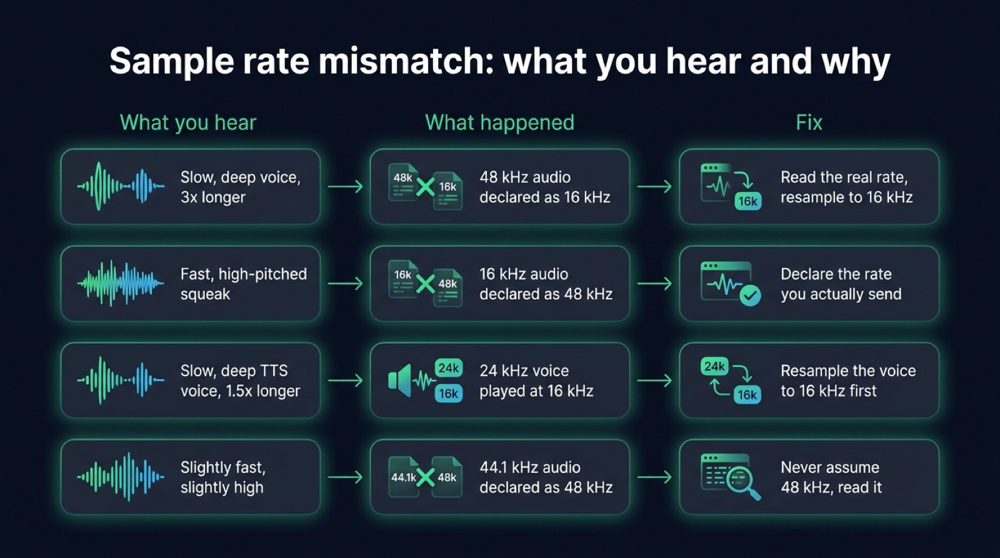
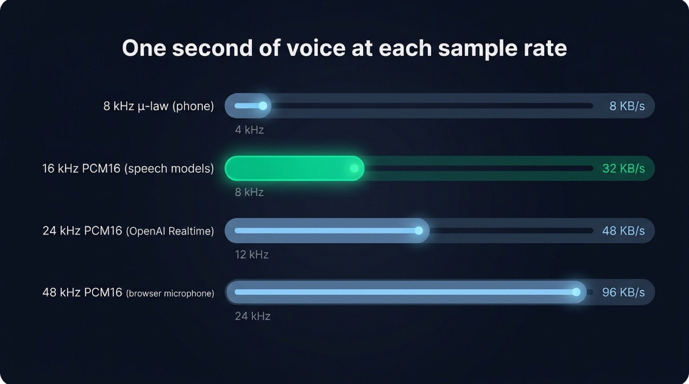
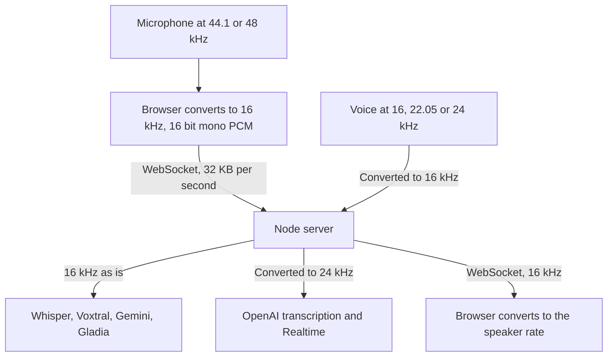

The audio sampling rate is the number of times per second a recording measures the sound wave, given in hertz: 16,000 measurements a second is 16 kHz. A voice agent handles three rates at once. The browser microphone records at 44.1 or 48 kHz, most speech to text models read 16 kHz (OpenAI's Realtime API wants 24 kHz), and voice engines generate at 16, 22.05 or 24 kHz. Each boundary between two of them needs a conversion. A rate declared wrong at one boundary is the usual reason an agent mishears its user or speaks like a slowed tape. This article lists the rate each stage uses, what a conversion costs, why sending more than the model reads brings nothing, and which format to stream to a speech model.

## What the audio sampling rate measures

A microphone produces a continuous wave. To store it, the sound card measures its height at regular intervals. Each measurement is a sample. The sampling rate says how many samples are taken per second.

The rate sets the highest frequency the recording can hold, which is half the rate. Engineers call that limit the Nyquist frequency. A 16 kHz recording carries sound up to 8 kHz, and a 48 kHz one up to 24 kHz, beyond what an adult hears. The human voice carries most of what makes words intelligible between 300 Hz and 3,400 Hz, the band the telephone network was designed for. Consonants such as "s" and "f" put energy higher, up to about 8 kHz, which is why speech recognition settled on 16 kHz.

| Sampling rate | Highest frequency kept | Where you meet it |
| --- | --- | --- |
| 8 kHz | 4 kHz | Phone calls, Twilio Media Streams, G.711 μ-law and A-law |
| 16 kHz | 8 kHz | Speech recognition, Whisper, voice activity detection, Bluetooth headsets in call mode |
| 22.05 kHz | 11 kHz | Some Piper voices and older text to speech models |
| 24 kHz | 12 kHz | OpenAI Realtime API, Gemini voice output, Kokoro, Qwen3-TTS |
| 44.1 kHz | 22 kHz | CDs, many laptop and USB microphones |
| 48 kHz | 24 kHz | Video, WebRTC, most browsers and operating systems |

## The browser microphone records at the rate of the device

`getUserMedia` accepts a `sampleRate` constraint, but Chrome ignores it. A Chromium change from 2017 removed the sample rate, sample size and channel count constraints from the device selection code, because that code only looked at what the hardware reports. You ask for 16 kHz and receive the rate of the device, usually 48 kHz, sometimes 44.1 kHz.

The Web Audio API adds a second rate. An `AudioContext` runs at the preferred rate of the output device unless you pass one. Chrome accepts `new AudioContext({ sampleRate: 16000 })` and converts the microphone on the fly. Firefox refuses: connecting a microphone stream to a context at another rate throws a `NotSupportedError`, which its own test suite checks. Bluetooth headsets add a third case. In call mode they switch to the hands-free profile, which carries the microphone at 16 kHz, or 8 kHz on older devices.

So the code that captures the microphone has to read the rate it actually gets, every time. An `AudioWorklet` sees it as a global named `sampleRate` and can send it along with the samples:

```js
class PcmProcessor extends AudioWorkletProcessor {
  process(inputs) {
    const channel = inputs[0]?.[0]
    if (channel) {
      // `sampleRate` is the real rate of the context, 44100 or 48000 in practice
      this.port.postMessage({ frames: new Float32Array(channel), sampleRate })
    }
    return true
  }
}

registerProcessor('pcm-processor', PcmProcessor)
```

The page then converts those frames to the rate the server expects, once, before they leave the browser. Sending 16 kHz rather than 48 kHz divides the upload by three. A neural [voice activity detector in the browser](/blog/voice-activity-detection-browser) such as Silero needs the conversion anyway, since it reads 8 or 16 kHz only.

## The sample rate each speech model and voice expects

Each provider documents its own rate, which rarely matches the next one's. [Micdrop](/), an open source TypeScript library for real-time voice conversations with AI, integrates most of these engines, so we read their rates straight from its code. AssemblyAI, Deepgram and Twilio appear as well, since you will meet them in other stacks.

Speech to text models read audio at these rates:

| Speech to text | Rate it reads | Format |
| --- | --- | --- |
| Whisper, run locally | 16 kHz | Float or 16 bit PCM, mono |
| Mistral Voxtral Realtime | 16 kHz | 16 bit PCM, mono |
| Gemini transcription and Gemini Live | 16 kHz | 16 bit PCM, declared as `audio/pcm;rate=16000` |
| Gladia | 8, 16, 32, 44.1 or 48 kHz | WAV PCM, μ-law or A-law |
| OpenAI transcription and Realtime API | 24 kHz, or 8 kHz in G.711 | 16 bit PCM, base64 in JSON |
| AssemblyAI streaming | 16 kHz or more recommended | 16 bit PCM or μ-law, mono |
| Deepgram streaming | Any rate, declared with the encoding | Raw PCM needs `sample_rate`, a container carries its own |
| Twilio Media Streams | 8 kHz, fixed | μ-law, base64 |

Text to speech engines generate audio at these rates:

| Text to speech | Rate it generates |
| --- | --- |
| ElevenLabs | Chosen per request, `pcm_16000` among others |
| Cartesia | Chosen per request, 16 kHz in Micdrop |
| Gradium | Chosen per request, 8, 16, 24 or 48 kHz |
| OpenAI TTS and Gemini TTS | 24 kHz |
| Kokoro and Qwen3-TTS | 24 kHz |
| Piper | 16 kHz for the low quality voices, 22.05 kHz for the others |

The hosted voices let you ask for the rate you need, so the cheapest conversion is the one the provider does for you. Local engines generate at their own rate, which differs from one [local text to speech engine](/blog/local-tts-node-kokoro-vs-piper) to another. Kokoro and Qwen3-TTS produce 24 kHz, while Piper changes rate from one voice to the next and writes it in the voice's JSON file. A [voice stack that runs entirely on your machine](/docs/ai-integration/local-models) has to convert each of them on the server.

## A sample rate mismatch makes the voice slow and deep, or fast and high

Raw audio carries no label. A stream of 16 bit numbers holds no record of how many of them make a second, so the receiver uses the rate you declare. When you declare the wrong rate, the audio plays at the wrong speed and at the wrong pitch.

Audio recorded at 48 kHz and declared as 16 kHz lasts three times longer and sounds more than an octave lower. A speech model fed with it returns nonsense, or nothing. The reverse turns the voice into a fast, high-pitched squeak. A 24 kHz voice played at 16 kHz is 1.5 times slower and seven semitones lower. Every word stays intelligible, so it is tempting to blame the voice engine.

The 44.1 against 48 kHz confusion is the hardest to spot. Audio recorded at 44.1 kHz and declared as 48 kHz plays 8.8% faster and about one and a half semitones higher. Everyone still understands it, so it can stay unnoticed through a whole demo.

The quickest check is to listen. Dump the raw bytes your server receives to a file and play them at the rate you declared, here with ffmpeg's player:

```bash
ffplay -f s16le -ar 16000 -ch_layout mono received.pcm
```

If the voice sounds normal, the rate is right. If it sounds too slow or too fast, fix the step that declared the rate.

{/* IMAGE regen: api.py image, infographic, 1600x900. Scene: "A diagnostic chart on a dark surface, four horizontal rows stacked from top to bottom, each row made of three rounded cards side by side linked by thin emerald arrows: a symptom card on the left, a cause card in the middle, a fix card on the right. Column headers at the top of each column: 'What you hear', 'What happened', 'Fix'. Row 1: 'Slow, deep voice, 3x longer' / '48 kHz audio declared as 16 kHz' / 'Read the real rate, resample to 16 kHz'. Row 2: 'Fast, high-pitched squeak' / '16 kHz audio declared as 48 kHz' / 'Declare the rate you actually send'. Row 3: 'Slow, deep TTS voice, 1.5x longer' / '24 kHz voice played at 16 kHz' / 'Resample the voice to 16 kHz first'. Row 4: 'Slightly fast, slightly high' / '44.1 kHz audio declared as 48 kHz' / 'Never assume 48 kHz, read it'. Each text is written once and only once. Title at the top in a modern clean bold sans-serif: 'Sample rate mismatch: what you hear and why'. Generous spacing, flat vector style."
    Infographic only: regenerate if the rates of the browser or of the providers change. Last data sync: 2026-10-14. */}


## What a resampling step costs

Converting audio from one rate to another computes new samples between the old ones. The simplest method, linear interpolation, reads two neighbouring samples and takes a weighted average. Going from 16 to 24 kHz that means 24,000 small calculations a second per call, a negligible load for a server. The delay is just as small. A streaming resampler keeps only the last sample of a chunk to compute the next one, which holds back 62.5 microseconds of audio at 16 kHz.

The hard part is keeping track of the position. Audio arrives in chunks, sometimes with a 16 bit sample cut in two by the network, so the resampler has to carry its position between two samples over from one chunk to the next. A resampler that starts from zero on each chunk adds a tiny jump every 100 ms, which you hear as a regular crackle. Micdrop's server package exports `Pcm16Resampler`, which keeps that state between chunks, so feeding it a stream chunk by chunk gives the same audio as converting it all at once:

```ts
import { Pcm16Resampler } from '@micdrop/server'

// A voice engine that returns 24 kHz PCM, sent to a client that plays 16 kHz
const resampler = new Pcm16Resampler(24000, 16000)

for await (const chunk of engineAudio) {
  socket.send(resampler.process(chunk))
}

// The next sentence is a new stream, start it from a clean state
resampler.reset()
```

Lowering the rate also costs some quality. Before dropping from 48 to 16 kHz, a careful resampler filters out everything above 8 kHz, because sound above the new limit folds back into the audible band as noise, an effect called aliasing. Linear interpolation skips that filter. Micdrop accepts that loss, since speech carries little energy above 8 kHz and the conversion has to run on every chunk in the browser. For music, or a recording you keep, use a filtering resampler such as libsamplerate, the Speex resampler or ffmpeg's `aresample`.

Convert as few times as you can. Each conversion approximates the samples it computes. Going up also adds no information: 16 kHz audio converted to 24 kHz for OpenAI still stops at 8 kHz.

## Audio above the model's rate only adds bytes

Whisper converts whatever you give it to 16 kHz before computing its spectrogram, and most streaming speech models do the same on their side. Sending 48 kHz audio means paying for three times the bytes so the provider can throw two thirds of them away.

The bytes matter on the upload, which is the narrow side of a mobile connection. Raw 16 bit mono PCM weighs 32 KB a second at 16 kHz and 96 KB a second at 48 kHz. An API that takes audio as base64 inside JSON adds a third on top. A fibre line carries that easily. On a weak 4G uplink, a phone takes longer to send it, which delays the moment the model hears the end of the sentence.

The voice going back to the user is the one place where a higher rate can be heard. A 24 kHz voice keeps sound up to 12 kHz, and on good headphones it sounds crisper than the same voice at 16 kHz. Micdrop sends 16 kHz both ways so the client handles a single format. The browser then converts that audio to the rate of the speaker for playback.

{/* IMAGE regen: api.py image, infographic, 1600x900. Scene: "Four horizontal bars on a dark surface, read from top to bottom, comparing one second of mono speech audio. Each bar has its label on the left and its value at the end of the bar, bar length proportional to the value. Bar 1 labelled '8 kHz μ-law (phone)', value '8 KB/s'. Bar 2 labelled '16 kHz PCM16 (speech models)', value '32 KB/s', this bar highlighted in bright emerald. Bar 3 labelled '24 kHz PCM16 (OpenAI Realtime)', value '48 KB/s'. Bar 4 labelled '48 kHz PCM16 (browser microphone)', value '96 KB/s'. Under each label, a small grey line giving the highest frequency kept: '4 kHz', '8 kHz', '12 kHz', '24 kHz'. Each text is written once and only once. Title at the top in a modern clean bold sans-serif: 'One second of voice at each sample rate'. Generous spacing, flat vector style."
    Infographic only: regenerate if the rates compared change. Last data sync: 2026-10-14. */}


## PCM audio is the format a voice pipeline carries

PCM, for pulse code modulation, stores each sample as a plain number, one after the other, with no compression. Three settings describe a PCM stream, and both ends have to agree on all three:

- the sampling rate, such as 16 kHz,
- the bit depth, the size of each number,
- the number of channels.

Speech pipelines use 16 bit signed integers, written little endian, which providers call `pcm_s16le`, `linear16` or `audio/pcm`. Sixteen bits give 65,536 levels and about 96 dB between the quietest and the loudest sound, more than a microphone in a room delivers. The Web Audio API hands out 32 bit floats between -1 and 1, so the browser converts them before sending:

```ts
function floatToPcm16(input: Float32Array): Int16Array {
  const output = new Int16Array(input.length)
  for (let i = 0; i < input.length; i++) {
    const sample = Math.max(-1, Math.min(1, input[i]))
    output[i] = sample < 0 ? sample * 0x8000 : sample * 0x7fff
  }
  return output
}
```

Speech uses one channel. A second channel doubles the bytes and gives a speech model nothing it can use, so record and send mono.

A WAV file is PCM with a 44 byte header in front, which holds the rate, the depth and the channel count. A raw PCM stream drops that header, so the rate travels in the provider's parameters or in your own protocol. The slow, deep voices and the high squeaks of a rate mismatch come from that missing header.

## The best audio format to send to a speech to text API

For a live conversation, send raw 16 bit mono PCM at the rate the model reads: 16 kHz for most providers, 24 kHz for OpenAI. The provider reads it without decoding, every streaming API accepts it, and a 100 ms chunk at 16 kHz weighs 3.2 KB.

For a recorded file, a lossless format at 16 kHz or more keeps everything the model needs. FLAC compresses to about half the size of the same WAV without losing a sample.

Compressed formats trade bytes for quality. Opus keeps a voice clear at a few tens of kilobits per second, which is why WebRTC uses it. Some speech APIs accept it directly. A low bitrate MP3 removes detail the model would have used. Phone audio arrives as 8 kHz μ-law. Converting it to 16 kHz restores nothing above 4 kHz, so pick a model trained for telephone audio rather than resampling it. Sending PCM over a WebSocket or Opus over WebRTC is a separate choice, with its own [trade-offs between WebSocket and WebRTC for a voice agent](/blog/websocket-or-webrtc-voice-agent).

## How Micdrop handles sample rates

Micdrop picks one format for the whole conversation: 16 bit mono PCM at 16 kHz, from the browser to the server and back. Every integration converts to and from it, so changing provider never changes what the browser sends.

On the browser side, `@micdrop/client` reads the rate the device actually delivers, converts each 100 ms of speech to 16 bit PCM at 16 kHz and sends it over the WebSocket. It adapts when the rate changes during a call, for instance when a Bluetooth headset connects. For playback, it converts the 16 kHz audio it receives to the rate of the speaker. All of that happens inside the [Micdrop browser client](/docs/client), which also manages the microphone and the speaker.

On the server side, each integration of `@micdrop/server` declares the rate its provider expects. The OpenAI transcription and Realtime integrations convert 16 kHz to 24 kHz on the way in, and OpenAI TTS, Gemini, Kokoro, Piper, Pocket TTS and Qwen3-TTS convert their output to 16 kHz on the way out. ElevenLabs, Cartesia and Gradium are asked for 16 kHz directly.



An integration you write yourself emits 16 kHz PCM, with `Pcm16Resampler` converting the output of a provider that speaks at another rate. You then [pass your integration to `MicdropServer`](/docs/server) like a bundled one.

Doing the same work by hand means writing an `AudioWorklet`, the float to 16 bit conversion and a resampler that keeps its position between chunks, then handling a rate change in the middle of a call and one conversion per provider and per direction. A hosted platform handles it for you and charges by the minute: ElevenLabs Agents charged $0.08 a minute on every plan, with the LLM billed on top, when we read [its pricing](https://elevenlabs.io/pricing/agents) on September 24, 2026. Micdrop is MIT licensed and runs on your server with your own provider keys. In exchange, you host that server yourself and build the call history and the dashboard a platform would give you.

## Frequently asked questions

<FaqList>
  <FaqItem question="What is the sampling rate in audio?">
    The sampling rate is the number of measurements of the sound wave a
    recording takes per second, given in hertz. At 16 kHz the recording holds
    16,000 samples a second and keeps sound up to 8 kHz, half the rate. Speech
    recognition uses 16 kHz, phone calls 8 kHz, and CDs 44.1 kHz.
  </FaqItem>
  <FaqItem question="What is the best sampling rate for speech recognition?">
    16 kHz suits most speech recognition models, since they were trained on it
    and convert anything else to it. OpenAI's Realtime API is an exception and
    expects 24 kHz. Phone audio at 8 kHz works with models trained on telephone
    speech.
  </FaqItem>
  <FaqItem question="Is 44.1 kHz or 48 kHz better for a voice agent?">
    Neither changes what a speech model hears, since both get converted to 16
    or 24 kHz. What matters is reading which of the two the device delivers.
    Audio recorded at 44.1 kHz and declared as 48 kHz plays 8.8% too fast.
  </FaqItem>
  <FaqItem question="What sample rate does Whisper use?">
    Whisper reads audio at 16 kHz, mono. Its feature extractor converts any
    other rate to 16 kHz before computing the spectrogram, so sending more
    only adds bytes.
  </FaqItem>
  <FaqItem question="What is PCM audio?">
    PCM stores audio as a plain sequence of numbers, one per sample, with no
    compression. A PCM stream is described by its sampling rate, its bit depth
    and its number of channels. Voice pipelines use 16 bit mono PCM, often
    called pcm_s16le or linear16.
  </FaqItem>
  <FaqItem question="What is the best audio format for speech to text?">
    For streaming, send raw 16 bit mono PCM at the rate the model reads, usually 16
    kHz. For a file, use FLAC or WAV at 16 kHz or more. Opus works when the
    bandwidth is tight, and a low bitrate MP3 removes detail the model uses.
  </FaqItem>
</FaqList>

---

A voice agent uses three sampling rates: the device's rate in the browser, 16 kHz for most speech models, and 16 to 24 kHz for the voices. Read the real rate at the microphone, convert once to what the model reads, keep the resampler's state between chunks, and send 16 bit mono PCM.

[Micdrop](/) does that conversion in the browser and in each server integration, so your code only sees 16 kHz audio. You can [run a first voice call in about five minutes](/docs/getting-started), then plug in the speech to text and the voice of your choice.
