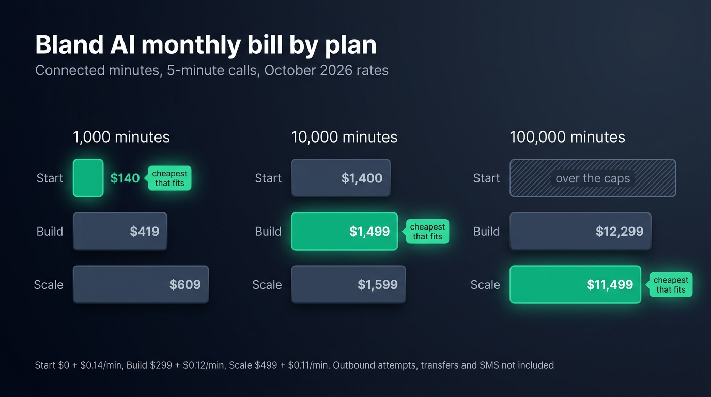
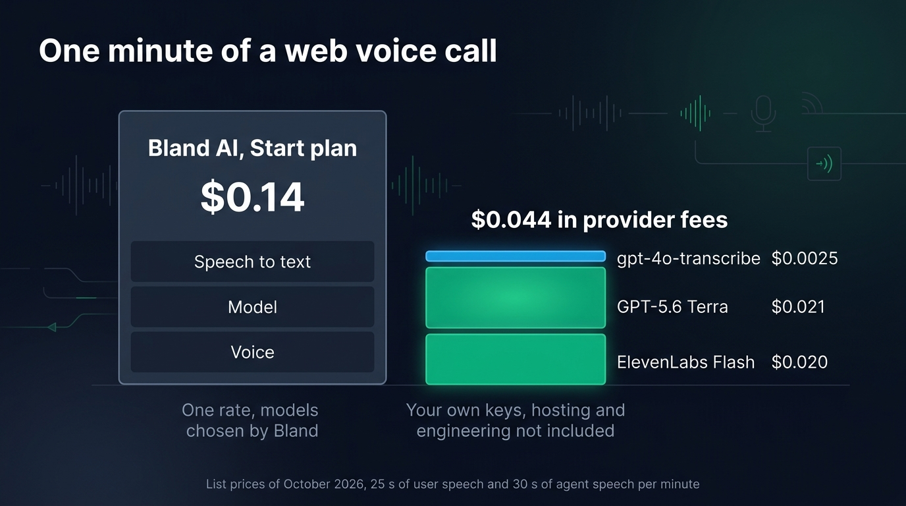
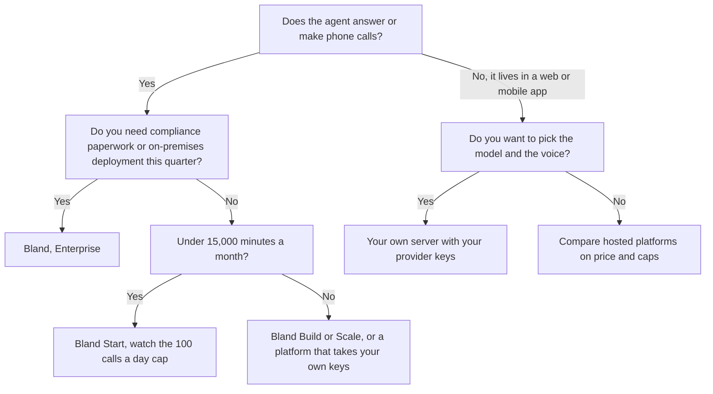

[Bland AI](https://www.bland.ai) charges $0.14 a minute of connected call on its free Start plan, $0.12 on Build at $299 a month and $0.11 on Scale at $499 a month, according to its [pricing page](https://www.bland.ai/pricing) and [billing documentation](https://docs.bland.ai/platform/billing) on October 23, 2026. That rate covers speech to text, the language model and the voice, with no token charges. Outbound calls add $0.015 per attempt, transfers $0.03 to $0.05 a minute and SMS $0.02 a message. At 10,000 minutes of web calls a month, Bland's Start plan comes to about $1,400, while the same volume on GPT-5.6 Terra, ElevenLabs Flash and gpt-4o-transcribe billed directly costs about $440 in provider fees.

Bland is a hosted platform for phone agents. It runs its own models and its own telephony. We split its bill into lines, price 1,000, 10,000 and 100,000 minutes a month on each plan, then price a comparable call in your own Node server and list the cases where Bland's bundle is worth paying for.

## Bland AI pricing in short

| Plan | Monthly fee | Per connected minute | Transfer on a Bland number | Concurrent calls | Calls per day, per hour | Voice clones |
| --- | --- | --- | --- | --- | --- | --- |
| Start | $0 | $0.14 | $0.05 a minute | 10 | 100, 100 | 1 |
| Build | $299 | $0.12 | $0.04 a minute | 50 | 2,000, 1,000 | 5 |
| Scale | $499 | $0.11 | $0.03 a minute | 100 | 5,000, 1,000 | 15 |
| Enterprise | custom | custom | custom | unlimited | unlimited | unlimited |

These lines apply on every plan:

- $0.015 per outbound call attempt on Bland's telephony, charged even when the call fails to connect.
- $0.02 per SMS, inbound or outbound.
- $0.01 per agent message in the web widget.
- Norm, the assistant that drafts agents for you, is billed in tokens, separately from calls.
- Call time is prorated to the second.

The public pricing page shows Start, Build and Enterprise. Scale appears in the billing documentation, along with Agent Phone, a $29.99 monthly plan with unlimited minutes and SMS in the US and Canada, limited to one call at a time and 50 calls a day.

## How the per-minute rate is built

Bland runs the transcription, the model and the voice on its own infrastructure, so it sells them as one rate per connected minute. The invoice has no separate line for tokens or characters, since no outside provider bills you. The bill is easy to forecast: minutes times the plan rate.

Bland counts the full duration of the conversation, silences included. Twenty seconds of a user reading something on screen cost the same as twenty seconds of talk.

Bland also makes three choices for you:

- Bland picks the model and does not publish which one runs behind its two settings, `base` and `turbo`. The faster `turbo` cannot transfer calls, navigate phone menus or call custom tools.
- Bland picks the voice too, since every agent speaks with Bland's speech engine. It caps voice clones per plan, one on Start and fifteen on Scale, and lists no price for them.
- Bland picks the providers as well, since its public API takes no OpenAI, Gemini or ElevenLabs key of your own.

Since you cannot pick a cheaper voice or a smaller model, only the plan changes the rate.

Bland's billing documentation and its pricing page describe telephony in two different ways. According to the billing documentation, Bland bills calls over the phone network and over SIP at the plan rate, and absorbs Twilio's $0.004 a minute termination fee. The FAQ of the pricing page says telephony is billed separately, on your own carrier or on Bland's Twilio at cost. Both pages agree on the case of your own Twilio account: you pay the carrier directly, Bland charges only its per-minute rate and nothing for transfers. Ask Bland which rule applies to your account before you budget a phone operation. A call from the browser uses no phone line, so this question only concerns phone agents.

## Monthly fees, attempt fees, transfers and call caps

On a paid plan, you pay a monthly fee in exchange for a lower rate. Build saves $0.02 a minute over Start for $299 a month, so it costs less from about 15,000 minutes a month. Scale saves another $0.01 a minute for $200 more than Build, so it costs less than Build from 20,000 minutes.

On an outbound campaign, you pay the $0.015 per attempt on top of the minutes. A list of 1,000 numbers costs $15 to dial before anyone picks up, and the same again for each retry, failed calls included.

Transfers to a human cost $0.05 a minute on Start, $0.04 on Build and $0.03 on Scale while the caller talks to your team. On a warm transfer, the agent that briefs your colleague is billed at the full plan rate while it is active. With your own Twilio account, Bland charges nothing for transferred time.

When a plan reaches its daily, hourly or concurrent limit, Bland rejects the next call instead of charging it. On an outbound campaign, you set the volume yourself and can keep it under your plan's caps. When users call your agent whenever they like, your calls can exceed a cap on a busy day, so you may need a bigger plan than the price alone suggests.

## What Bland costs at 1,000, 10,000 and 100,000 minutes a month

Take an agent that answers web or inbound calls averaging five minutes. We spread the calls over 22 working days of 8 hours, with three times the average load in the busiest hour, the same assumptions we used to [price Retell AI by the minute](/blog/retell-ai-pricing).

| Minutes a month | Calls a day | Peak concurrent calls | Start | Build | Scale |
| --- | --- | --- | --- | --- | --- |
| 1,000 | about 9 | 1 | $140 | $419 | $609 |
| 10,000 | about 91 | about 3 | $1,400 | $1,499 | $1,599 |
| 100,000 | about 909 | about 28 | over the caps | $12,299 | $11,499 |

At 1,000 minutes, Start is the obvious choice at $140 a month.

At 10,000 minutes, Start stays the cheapest on paper at $1,400. With 91 calls on an average day, though, your agent gets more than 100 calls on a busy Monday, so Bland turns the extra callers away. Build costs $99 more a month and raises the cap to 2,000.

At 100,000 minutes, Start is out: 909 calls a day and 28 at once are far past its limits. Scale is the cheapest plan at $11,499, about $0.115 a minute. These monthly totals leave out outbound attempts, transfers, SMS and phone numbers.

{/* IMAGE regen: api.py image, infographic, 1600x900. Scene: "Infographic showing a Bland AI monthly bill by plan, as a grouped horizontal bar chart. Title at top left, in a modern clean bold sans-serif: 'Bland AI monthly bill by plan'. Subtitle: 'Connected minutes, 5-minute calls, October 2026 rates'. Three groups, one per volume, each with three bars labelled Start, Build and Scale. Group '1,000 minutes': Start '$140', Build '$419', Scale '$609'. Group '10,000 minutes': Start '$1,400', Build '$1,499', Scale '$1,599'. Group '100,000 minutes': Start shown as a hatched empty bar with the label 'over the caps', Build '$12,299', Scale '$11,499'. In each group, the cheapest bar that fits the caps is bright emerald with a small tag 'cheapest that fits': Start in the first group, Build in the second, Scale in the third. The other bars are muted slate. Bar lengths strictly proportional to their dollar values within each group, whatever their colour: in the first group the $609 bar is more than four times as long as the $140 bar, in the second group the three bars are almost the same length, in the third group the $12,299 bar is slightly longer than the $11,499 bar. Footer small text: 'Start $0 + $0.14/min, Build $299 + $0.12/min, Scale $499 + $0.11/min. Outbound attempts, transfers and SMS not included'. Wide 16:9 layout, generous spacing, labels in white and light slate."
    Infographic only: regenerate if Bland changes its plan fees, minute rates or call caps. Last data sync: 2026-10-23. */}


## Running the same conversation with your own providers

The other way to pay for a voice agent is to call speech to text, the model and text to speech from your own server, on your own keys. Each provider then bills what it processed: seconds of audio for transcription, tokens for the model, characters for the voice. Here is one minute of the reference conversation we priced for [Vapi's per-minute fees](/blog/vapi-pricing), where the user speaks for 25 seconds and the agent for 30.

| Line | Basis | Per minute |
| --- | --- | --- |
| gpt-4o-transcribe | 25 s of audio at about $0.006 a minute | $0.0025 |
| GPT-5.6 Terra | 10,000 input and 100 output tokens | $0.021 |
| ElevenLabs Flash | about 500 characters at $40 per million | $0.020 |
| Total in provider fees | | about $0.044 |

ElevenLabs bills [the voice per character](/blog/elevenlabs-api-pricing-voice-agent), so the voice costs nothing while the user speaks or the line is silent. The model costs more as the prompt and the number of turns grow, though prompt caching lowers it. The models differ from Bland's, so treat the comparison as a price for a comparable conversation rather than for an identical one.

At 1,000, 10,000 and 100,000 minutes, the provider fees come to about $44, $440 and $4,400 a month, against $140 and $1,400 on Start and $11,499 on Scale. Bland costs about $96, $960 and $7,100 more a month. At 10,000 minutes, the gap grows to about $1,060 if you need Build for the busy days. The provider figures leave out the server, the engineering time and telephony.

{/* TODO ANECDOTE: compare this computed example with the provider bill per minute Raconte pays in production, if the owner allows it to be published (question 03d8f118). */}

{/* IMAGE regen: api.py image, infographic, 1600x900. Scene: "Infographic comparing one minute of a web voice call on two setups, side by side. Title at top left, in a modern clean bold sans-serif: 'One minute of a web voice call'. Left: a single solid block, muted slate with a thin grey border, labelled 'Bland AI, Start plan' with the price '$0.14' in large type, and three small labels inside the block, stacked: 'Speech to text', 'Model', 'Voice', all fused into the one block. Under it: 'One rate, models chosen by Bland'. Right: a much shorter stacked bar in three separate segments with small gaps, each with its label and price to its right: 'gpt-4o-transcribe' '$0.0025' (thin sky blue segment), 'GPT-5.6 Terra' '$0.021' (emerald segment), 'ElevenLabs Flash' '$0.020' (emerald segment). Above the right bar, a bold total: '$0.044 in provider fees'. Under it: 'Your own keys, hosting and engineering not included'. Heights proportional: the right bar about a third of the left block. Footer small text: 'List prices of October 2026, 25 s of user speech and 30 s of agent speech per minute'. Wide 16:9 layout, generous spacing, labels in white and light slate."
    Infographic only: regenerate if Bland, OpenAI or ElevenLabs change the prices used in the worked example. Last data sync: 2026-10-23. */}


On your own server you then run what Bland ran for you. [Micdrop](/) is an open source TypeScript library for real-time voice conversations with AI. It handles turn-taking and interruptions: `@micdrop/web` takes care of the microphone, voice activity detection and playback in the browser, and `@micdrop/server` runs the conversation in your Node server with the providers you choose. The library is MIT licensed and free. This server runs the stack of the worked example:

```typescript
import { MicdropServer } from '@micdrop/server'
import { OpenaiAgent, OpenaiSTT } from '@micdrop/openai'
import { ElevenLabsTTS } from '@micdrop/elevenlabs'
import { WebSocketServer } from 'ws'

const wss = new WebSocketServer({ port: 8081 })

wss.on('connection', (socket) => {
  new MicdropServer(socket, {
    firstMessage: 'Hi, what can I help you with?',
    agent: new OpenaiAgent({
      apiKey: process.env.OPENAI_API_KEY,
      model: 'gpt-5.6-terra',
      systemPrompt: 'You answer questions about our product.',
    }),
    stt: new OpenaiSTT({
      apiKey: process.env.OPENAI_API_KEY,
      model: 'gpt-4o-transcribe',
    }),
    tts: new ElevenLabsTTS({
      apiKey: process.env.ELEVENLABS_API_KEY,
      voiceId: process.env.ELEVENLABS_VOICE_ID,
      modelId: 'eleven_flash_v2_5',
    }),
  })
})
```

To change the model or the voice, you change one constructor, while the browser code stays the same. Micdrop sets no daily cap. How many calls run at once depends on your server and on your providers' limits, such as 20 concurrent Flash requests on an ElevenLabs Pro plan.

You build the rest yourself:

- Telephony, since Micdrop connects a browser or a React Native app to your server over a WebSocket and has no SIP layer. Answering a phone number takes a telephony provider and the code that bridges its audio to your server, or a platform that already does it.
- Transcripts and the call history, which you [save as messages](/docs/server/save-messages) in your own tables when Micdrop emits them.
- A dashboard for whoever reviews calls, and the alerts when a provider degrades.
- Hosting for the Node process, with the capacity your peak needs.

You can run a first call in about five minutes. Wiring Micdrop into an existing application takes hours rather than days, while the dashboard, the call history and telephony take longer. Micdrop has a single maintainer and no support contract. Products like [Raconte.ai](https://raconte.ai), built by Micdrop's maintainer, and [Cibli](https://cibli.fr) run on it in production. To weigh the move on more than price, see what it takes to [move a web agent off Bland](/blog/alternative-to-bland-ai), Pathways and tools included.

## When Bland is worth the price

Bland is worth its rate when your product runs on phone calls. It sells inbound and outbound calling, batch campaigns from a CSV, transfers to a human, SMS with the same agent logic, and memory of a caller across channels. Conversational Pathways lets people outside engineering edit the flows. Rebuilding all of that would cost more than you would save on provider fees for a long time.

It is also worth it when a regulated buyer needs paperwork now. Bland lists SOC 2 Type II, HIPAA, PCI DSS and GDPR. Its Enterprise plan adds a BAA, on-premises or private cloud deployment, data residency and forward deployed engineers who build the first agent with you. Because Bland runs every model itself, a single company processes the call.

Bland also makes sense at low volume. At 1,000 minutes a month, the gap with your own pipeline is about $96, less than a day of engineering. At 100,000 minutes, though, the gap reaches about $7,100 a month, enough to pay for hosting, a dashboard and the person who maintains them.

Bland is harder to justify when the agent lives inside a web app. You then pay for telephony you do not use, run on models you cannot pick, and expose your own data through public HTTP endpoints for Bland to call during the conversation.



## Frequently asked questions

<FaqList>
  <FaqItem question="How much does Bland AI cost per minute?">
    In October 2026, Bland AI charges $0.14 a minute on Start with no monthly fee, $0.12 on Build at $299 a month and $0.11 on Scale at $499 a month, with speech to text, the model and the voice included. Each outbound call attempt on Bland's telephony adds $0.015, transfers add $0.03 to $0.05 a minute, and SMS cost $0.02 a message. Enterprise is a custom contract. Before December 5, 2025, Bland charged a flat $0.09 a minute.
  </FaqItem>
  <FaqItem question="Is there a free plan for Bland AI?">
    Yes. Start has no monthly fee, needs no card and comes with two credits. It also includes an inbound number, which Bland values at $15 a month. Bland does not publish what a credit is worth. Once the credits run out, every connected minute costs $0.14. Start allows 10 concurrent calls and 100 calls a day.
  </FaqItem>
  <FaqItem question="Is Bland AI any good?">
    For phone automation in regulated industries, yes. Bland came out of Y Combinator, raised a $50 million Series C in June 2026, and lists SOC 2 Type II, HIPAA and PCI DSS. Its G2 rating is high, on a small number of reviews. Reviewers most often criticise the learning curve of Pathways. Bland advertises responses in under 400 ms, a figure worth measuring on your own calls. For developers, the main limit is that you run on Bland's models and voices.
  </FaqItem>
  <FaqItem question="Is Bland AI cheaper than Vapi or Retell AI?">
    It depends on the models you want. For a web agent on GPT-5.6 Terra and ElevenLabs Flash, [Vapi comes to about $0.103 a minute](/blog/vapi-pricing) and [Retell AI to $0.159 before add-ons](/blog/retell-ai-pricing). Bland charges $0.11 to $0.14 by plan, but with its own models, so the same stack is not available there. Bland's pricing page argues that most production stacks on Vapi cost $0.13 to $0.30 a minute once the providers are added. A cheaper model or voice lowers the Vapi and Retell bills, while Bland's rate stays the same whatever the call needs.
  </FaqItem>
  <FaqItem question="Which AI calling agent is the best?">
    The best choice depends on the channel and on who runs the code. For phone agents, Vapi suits developers who want their own provider keys, Retell AI has the deepest contact center integrations, and Bland suits regulated enterprises that want one vendor for every layer. For a voice feature inside a web app, an open source library on your own server lets you pick each provider. You can [compare every voice agent platform on price, hosting and data location](/blog/top-ai-voice-agent-platforms).
  </FaqItem>
  <FaqItem question="Does Bland AI charge for failed calls?">
    Yes, on its own telephony. Each outbound call attempt costs $0.015, including attempts that nobody answers or that fail to connect. A call rejected because your plan reached its daily, hourly or concurrent cap is not charged.
  </FaqItem>
  <FaqItem question="Can I use my own LLM or API keys with Bland AI?">
    No. Bland's public API offers two model settings, `base` and `turbo`, and no option to bring your own model or provider key. You can bring your own Twilio account or SIP trunk for telephony. To pick the model, the transcription and the voice yourself, use a platform that accepts your keys or run the conversation on your own server.
  </FaqItem>
</FaqList>

---

Bland's price is one rate per plan, $0.14, $0.12 or $0.11 a minute, with the model, the voice and the transcription included. The attempt fee, transfers and SMS come on top. Each plan also caps the number of calls. For phone calls in a regulated industry, you pay Bland for telephony, compliance and a team you would otherwise hire. For a voice feature inside a web app, the same conversation on providers you pay directly costs about a third of the Start bill in provider fees, plus the hosting and the call history you build yourself. [Micdrop](/) runs that conversation in your Node server. With your own provider keys, you can [start a first call in five minutes](/docs/getting-started).
