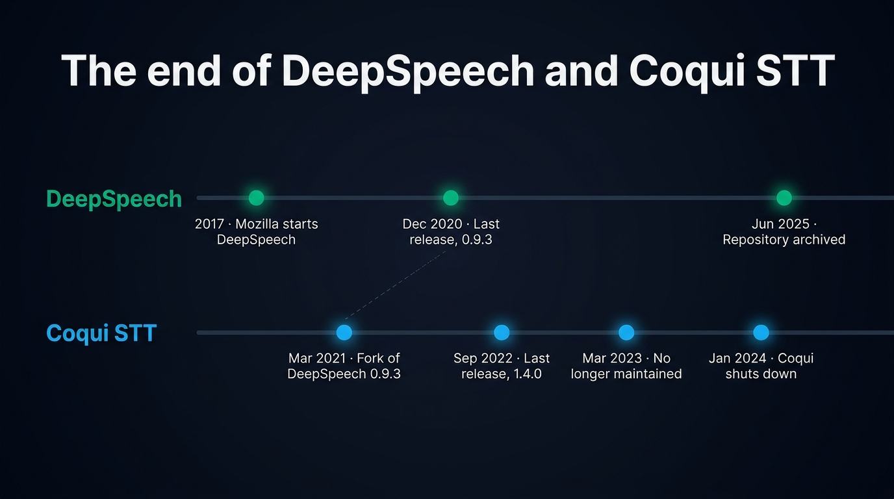
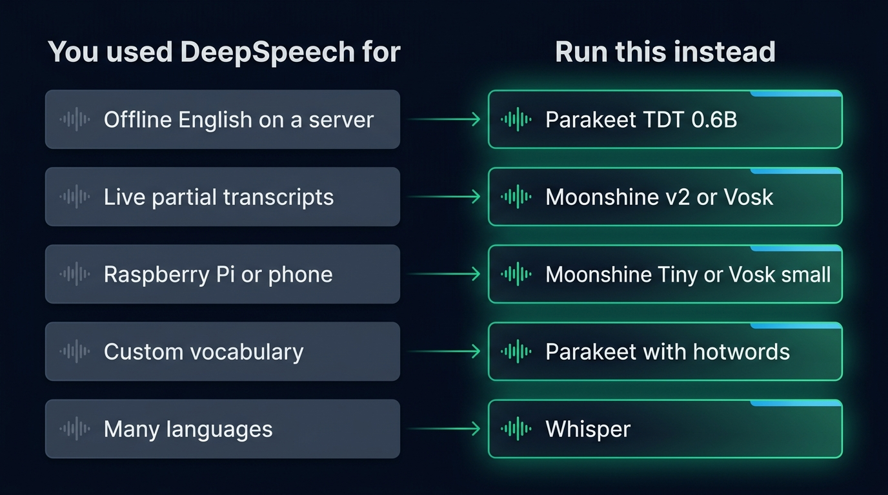
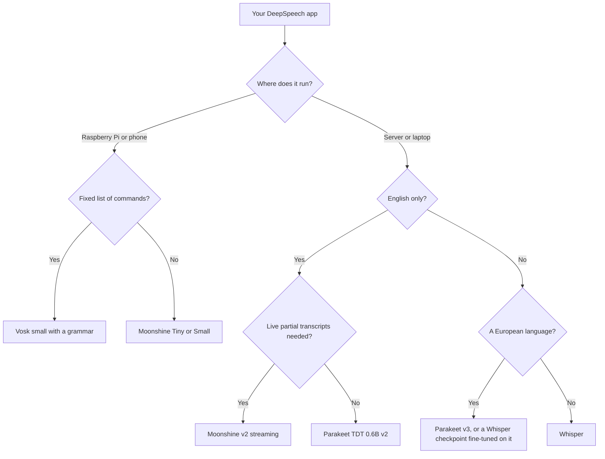

Mozilla DeepSpeech is discontinued. Its last release, 0.9.3, came out in December 2020. Four and a half years later, on 19 June 2025, Mozilla marked the [GitHub repository](https://github.com/mozilla/DeepSpeech) as discontinued and archived it. [Coqui STT](https://github.com/coqui-ai/STT), the fork that kept the project going, has been unmaintained since March 2023. To replace either one, pick by what you used it for. NVIDIA Parakeet is the most accurate choice for English transcription on a server. Moonshine and Vosk fit on a Raspberry Pi and stream live partial transcripts. Whisper covers 99 languages and installs in Node with one npm command. All four run offline. Their main models allow commercial use, except a few Vosk models. All four read the same 16 kHz mono audio DeepSpeech expected, so your audio capture code stays as it is.

This post covers what happened to both projects, what stops working if you keep them, and which current model replaces each DeepSpeech use, with the code to port a Node integration.

## What happened to Mozilla DeepSpeech

Mozilla's machine learning team started DeepSpeech in 2017. It implemented Baidu's [Deep Speech research paper](https://arxiv.org/abs/1412.5567) on TensorFlow, with the code and the trained English model released under MPL 2.0. For several years it was the open speech to text engine developers reached for when the audio had to stay on the device. It streamed, it ran on a Raspberry Pi 4 through TensorFlow Lite, and it shipped bindings for Python, Node, .NET, Java and C.

In August 2020, Mozilla laid off about 250 employees. Reuben Morais, one of the DeepSpeech maintainers at Mozilla, then wrote on the project forum that the team did not know what the restructuring meant for DeepSpeech. Version 0.9.3, published on 10 December 2020, turned out to be the last release. The planned 1.0 never shipped. In 2021 Mozilla moved the project to an advisory role. Its last code change dates from November of that year.

The repository stayed open with no new commits until 19 June 2025. That day Mozilla added one line to its README, "This project is now discontinued", and archived it, which makes it read-only. The models and binaries remain downloadable from the releases page.

## What happened to Coqui STT

Coqui, a startup founded by people from Mozilla's speech team, forked DeepSpeech in 2021. Its first release, in March 2021, was compatible with DeepSpeech 0.9.3 and its models. Coqui STT 1.0 followed in October 2021 with new English models. Community members also trained models for dozens of languages on Mozilla's Common Voice data and shared them in a model zoo.

The last release, 1.4.0, came out in September 2022. In March 2023 Coqui added a note to the README saying the project was no longer actively maintained, since the field had moved on to newer models such as Whisper. Coqui also took the model zoo website offline. The models stay available in the releases of the [coqui-ai/STT-models](https://github.com/coqui-ai/STT-models/releases) repository. On 3 January 2024 Coqui announced on its website that the company was shutting down. The STT repository is still open, but nobody has committed to it since.

{/* IMAGE regen: api.py image, infographic, 1600x900. Scene: "A clean horizontal timeline infographic on a dark background, two parallel tracks running left to right. Top track labeled 'DeepSpeech' in emerald, bottom track labeled 'Coqui STT' in sky blue. Milestones are small glowing dots with a short label under each, placed in chronological order. Top track milestones, exactly: '2017 · Mozilla starts DeepSpeech', 'Dec 2020 · Last release, 0.9.3', 'Jun 2025 · Repository archived'. Bottom track milestones, exactly: 'Mar 2021 · Fork of DeepSpeech 0.9.3', 'Sep 2022 · Last release, 1.4.0', 'Mar 2023 · No longer maintained', 'Jan 2024 · Coqui shuts down'. A thin dashed line links 'Dec 2020 · Last release, 0.9.3' to 'Mar 2021 · Fork of DeepSpeech 0.9.3'. Title at the top, modern clean bold sans-serif: 'The end of DeepSpeech and Coqui STT', with nothing written under it: no subtitle, no tagline, no brand description. No other text, no logos." */}


## What breaks if you keep DeepSpeech running

A DeepSpeech integration that works today keeps working as long as nothing around it changes. It usually breaks on the next upgrade of Node, Python, the operating system or the machine.

- The `deepspeech` npm package bundles prebuilt binaries for Node 10 to 15 and Electron 5 to 11. Node 15 reached its end of life in June 2021. Coqui's `stt` package goes up to Node 17, which reached its end of life in June 2022. On Node 22 or 24, `npm install` finds no binary and falls back to a source build of a TensorFlow 1.15 native client.
- Both npm packages ship a `darwin-x64` binary only. An Apple Silicon Mac runs them under Rosetta 2 with an x64 build of Node, if at all.
- DeepSpeech Python wheels stop at Python 3.9, which reached its end of life in October 2025. Coqui STT wheels stop at Python 3.10, which reached its end of life in October 2026.
- The `deepspeech-gpu` package needs CUDA 10.0, too old for current NVIDIA cards.
- Both projects stopped patching their native code and their dependencies.

Accuracy is the other reason to move. Mozilla measured a 7.06% word error rate for its final English model on LibriSpeech test-clean, a set of clearly read audiobook recordings. It also warned that the model worked best on clean audio and had a bias towards US male accents. On the same set, NVIDIA reports 1.69% for Parakeet TDT 0.6B v2 and Alpha Cephei 5.69% for its large Vosk English model. Recent models are also scored on harder audio, such as meetings, calls and accented speech, in the current [ranking of open source speech to text models](/blog/top-open-source-speech-to-text-models). DeepSpeech was never measured there. Compare models on one test set at a time, since [word error rate depends on the audio and on how the text is normalized](/blog/what-is-automatic-speech-recognition#word-error-rate-and-what-it-hides).

## Which model replaces each DeepSpeech use

Each replacement does part of what DeepSpeech did, so start from the feature you relied on.

| What you used DeepSpeech for | DeepSpeech feature | Replacement | From Node |
|---|---|---|---|
| Offline English transcription on a server | `model.stt()` on a finished clip | Parakeet TDT 0.6B v2, CC BY 4.0 | `sherpa-onnx-node` |
| Live partial transcripts | `createStream()` and `intermediateDecode()` | Moonshine v2 streaming (MIT), Vosk (Apache 2.0) | `sherpa-onnx-node`, `vosk` or `vosk-koffi` |
| Raspberry Pi or a phone | The 47 MB `.tflite` model | Moonshine Tiny (34M parameters), Vosk small (40 MB) | `sherpa-onnx-node`, `vosk` or `vosk-koffi` |
| Product names, surnames, commands | The KenLM scorer and `addHotWord()` | Parakeet with hotwords, Vosk grammars, Granite Speech keyword biasing | `sherpa-onnx-node`, `vosk`, Transformers.js |
| A language other than English | Coqui's model zoo | Whisper (99 languages), Parakeet v3 (25 European), Omnilingual ASR (1,600+) | `@micdrop/whisper`, `sherpa-onnx-node`, a Python service for Omnilingual ASR |
| A model trained on your own data | DeepSpeech's training scripts | Fine-tuned Whisper, or Parakeet fine-tuned in NVIDIA NeMo | `@micdrop/whisper` for a Whisper export |

{/* IMAGE regen: api.py image, infographic, 1600x900. Scene: "A clean two-column mapping infographic on a dark background. Left column header 'You used DeepSpeech for', right column header 'Run this instead', in a modern clean bold sans-serif. Five rows, each a muted slate card on the left linked by a thin glowing emerald arrow to a brighter card on the right. Rows, left label then right label, exactly: 'Offline English on a server' to 'Parakeet TDT 0.6B'; 'Live partial transcripts' to 'Moonshine v2 or Vosk'; 'Raspberry Pi or phone' to 'Moonshine Tiny or Vosk small'; 'Custom vocabulary' to 'Parakeet with hotwords'; 'Many languages' to 'Whisper'. Each left card has a small faded waveform icon, each right card a small bright waveform icon. No other text, no logos, no numbers beyond those in the labels." */}


### Parakeet for English accuracy on a server

[NVIDIA Parakeet TDT 0.6B](https://huggingface.co/nvidia/parakeet-tdt-0.6b-v2) is the closest thing to a drop-in upgrade for a DeepSpeech server. It is a 600M parameter model under CC BY 4.0. Version 2 transcribes English only, while version 3 covers 25 European languages and detects which one it hears. It writes punctuation and capitals, which DeepSpeech never did, gives a timestamp for each word, and reads the audio at its real length instead of padding it to a fixed window.

Parakeet transcribes finished sentences only. In a voice app, voice activity detection cuts the audio into sentences first, so the transcript of each sentence comes back once the user stops speaking. [sherpa-onnx](https://github.com/k2-fsa/sherpa-onnx), an Apache 2.0 runtime, publishes int8 exports of both versions and a Node addon with prebuilt binaries for Linux, Windows and macOS on Intel and Apple Silicon.

The same addon also supports hotwords, as DeepSpeech's `addHotWord()` did. Pass a list of phrases when you create a stream, with the `modified_beam_search` decoding method, so the model favors their spelling. In the sherpa-onnx hotwords example, adding "Phoebe" as a hotword fixes a transcript that read "Phebe".

### Moonshine and Vosk for small devices and live transcripts

[Moonshine](https://github.com/moonshine-ai/moonshine), from Moonshine AI, was built for the hardware DeepSpeech targeted. Its v2 streaming models come in three sizes, Tiny at 34M parameters, Small at 123M and Medium at 245M, all under MIT. They transcribe while the user speaks and return partial results, the role `intermediateDecode()` played in DeepSpeech. Moonshine AI reports a latency of 802 ms for Medium on a Raspberry Pi 5. Streaming models exist for English, by far the most used, and for Arabic, German, Japanese, Mandarin, Spanish, Tagalog and Vietnamese. sherpa-onnx runs the v2 models from Node.

[Vosk](https://alphacephei.com/vosk/), from Alpha Cephei, will feel the most familiar if you come from DeepSpeech. It is built on Kaldi, streams partial results, runs on a Raspberry Pi, and has small models of 31 to 82 MB in more than 20 languages. Its Node recognizer accepts a `grammar`, a list of phrases it limits itself to, which suits command-and-control apps built on the DeepSpeech scorer. Check the license of each model, since a few are AGPL or non-commercial. Its official `vosk` npm package was last published in May 2022 and depends on `ffi-napi`, which is hard to build on a recent Node. A community package, `vosk-koffi`, last published in May 2025, binds the same library through Koffi instead. Vosk makes more errors than Parakeet on conversation, so keep it for small devices and fixed vocabularies.

### Whisper for languages and a one-command install in Node

Most former DeepSpeech projects moved to [Whisper](https://github.com/openai/whisper), the model Coqui named in its README when it stopped STT. Whisper transcribes 99 languages, writes punctuation, and is MIT licensed, with large-v3 under Apache 2.0. It is the only model here that installs in Node with one npm command and runs inside the Node process through Transformers.js, with no native addon to build.

Whisper reads every sentence as a thirty second window and pads short ones with silence, so a two second sentence costs almost as much to transcribe as a long one. Whisper `base` takes about 440 ms on a three second sentence and `small` about a second, on the CPU of a MacBook Pro M2 with weights already loaded. Outside English, a checkpoint fine-tuned on the language of the call does better than a heavier generic one. A French fine-tune of `whisper-small` made 2% word errors on five test sentences, against 17% for large-v3-turbo. Moonshine, Parakeet and Vosk need a native package to [run speech to text locally in Node](/blog/local-speech-to-text-node): `sherpa-onnx-node` for Moonshine and Parakeet, `vosk` or `vosk-koffi` for Vosk.



## DeepSpeech vs Whisper

Whisper is the more accurate of the two and covers far more languages. DeepSpeech transcribed American English, with an experimental Mandarin model, and wrote lowercase text with no punctuation. Whisper writes punctuated text in 99 languages and handles accents and background noise much better, since OpenAI trained the original model on 680,000 hours of audio collected from the web.

DeepSpeech kept one advantage, streaming: it emitted words while the user spoke. Whisper `tiny` is about the same size, 45 MB in `q8` against 47 MB for the quantized DeepSpeech model, but it has no streaming mode and pads every sentence to thirty seconds. If you replace DeepSpeech for live transcription on a small device, take Moonshine or Vosk. For transcription of finished sentences on a laptop or a server, Whisper or Parakeet is the upgrade.

## Porting a DeepSpeech Node integration

A typical DeepSpeech integration in Node loads the model and the scorer, adds a few hotwords, then transcribes a buffer of 16-bit PCM at 16 kHz:

```typescript
import DeepSpeech from 'deepspeech'

const model = new DeepSpeech.Model('deepspeech-0.9.3-models.pbmm')
model.enableExternalScorer('deepspeech-0.9.3-models.scorer')
model.addHotWord('micdrop', 10)

// Raw PCM, 16 bits, 16 kHz, mono
const text = model.stt(pcmBuffer)
```

With Parakeet through `sherpa-onnx-node`, the code reads the same audio, converted to floats. Download the int8 Parakeet export from the sherpa-onnx releases page, then run:

```typescript
import { pcm16ToFloat32 } from '@micdrop/server'

// sherpa-onnx-node ships no type declarations
const sherpa = require('sherpa-onnx-node')

const dir = './sherpa-onnx-nemo-parakeet-tdt-0.6b-v2-int8'

const recognizer = new sherpa.OfflineRecognizer({
  featConfig: { sampleRate: 16000, featureDim: 80 },
  modelConfig: {
    transducer: {
      encoder: `${dir}/encoder.int8.onnx`,
      decoder: `${dir}/decoder.int8.onnx`,
      joiner: `${dir}/joiner.int8.onnx`,
    },
    tokens: `${dir}/tokens.txt`,
    numThreads: 2,
    provider: 'cpu',
    modelType: 'nemo_transducer',
  },
})

const stream = recognizer.createStream()
stream.acceptWaveform({
  sampleRate: 16000,
  samples: pcm16ToFloat32(pcmBuffer),
})
recognizer.decode(stream)
const text = recognizer.getResult(stream).text
```

You can drop the `.scorer` file, since Parakeet's transducer has its own internal language model. To keep your hotwords, add `decodingMethod: 'modified_beam_search'`, `modelingUnit: 'bpe'` and a `bpeVocab` file to the config, then pass the phrases to `createStream('Micdrop/Phoebe')`. The sherpa-onnx hotwords example shows how to derive that vocabulary file from `tokens.txt` in a few lines. `pcm16ToFloat32` comes from `@micdrop/server` here, but any conversion of 16-bit samples to floats between -1 and 1 works.

## Running the replacement in a voice app with Micdrop

If your DeepSpeech integration listened to a microphone in a web or mobile app, the model was the easy part. You also had to capture the audio, detect when the user stopped speaking, send the sentence to the server and handle a user who talks over the answer. [Micdrop](/), an open source TypeScript library for real-time voice conversations with AI, handles those four jobs in the browser, on iOS and Android, and in a Node server.

Micdrop already integrates Whisper. [`@micdrop/whisper`](/docs/ai-integration/provided-integrations/whisper) runs it inside the Node process, so replacing DeepSpeech in a voice app takes one class:

```typescript
import { MicdropServer } from '@micdrop/server'
import { WhisperSTT } from '@micdrop/whisper'

new MicdropServer(socket, {
  stt: new WhisperSTT({ model: 'base', language: 'en' }),
  // ... agent and tts, or nothing for a dictation server
})
```

Run the server with no agent and no text to speech and you get a [dictation server](/docs/server/dictation), which is what many DeepSpeech apps were. Parakeet, Moonshine and Vosk plug into the same `stt` option once you [wrap their runtime in a custom speech to text class](/docs/ai-integration/custom-integrations/custom-stt), with a `transcribe()` method that collects one sentence of audio and emits a `Transcript` event. The Parakeet code written for `sherpa-onnx-node` fits in that method. The client's voice activity detection already cuts the audio into sentences, so an offline model like Parakeet works there without a streaming mode.

Micdrop is only a library, with no hosting, dashboard or call history. You run the server and store the transcripts yourself, as you did with DeepSpeech.

## Frequently asked questions

<FaqList>
  <FaqItem question="Is Mozilla DeepSpeech still maintained?">
    Mozilla stopped maintaining it. The last release, 0.9.3, came out on 10 December 2020. The last code change followed in November 2021. On 19 June 2025 Mozilla marked the repository as discontinued and archived it on GitHub. The models and binaries remain downloadable from the releases page, under MPL 2.0.
  </FaqItem>
  <FaqItem question="Is Coqui STT still maintained?">
    Coqui STT has been unmaintained since March 2023, when Coqui added a note saying so to its README. Its last release, 1.4.0, dates from September 2022. The company itself shut down in January 2024. The models remain in the releases of the coqui-ai/STT-models repository on GitHub.
  </FaqItem>
  <FaqItem question="What is the best alternative to DeepSpeech?">
    It depends on what you used it for. NVIDIA Parakeet TDT 0.6B v2 is the most accurate replacement for English on a server, at 1.69% word errors on LibriSpeech test-clean against 7.06% for DeepSpeech. Moonshine and Vosk replace it on a Raspberry Pi and for live partial transcripts. Whisper covers 99 languages and runs inside Node through Transformers.js.
  </FaqItem>
  <FaqItem question="Is Whisper better than DeepSpeech?">
    Yes, Whisper is more accurate and covers far more languages. It writes punctuated text in 99 languages and handles accents and noise much better than DeepSpeech, which transcribed American English in lowercase. DeepSpeech kept one advantage, streaming, since Whisper has no streaming mode and pads every sentence to thirty seconds. For live transcription on small devices, Moonshine or Vosk are the closer replacements.
  </FaqItem>
  <FaqItem question="Does DeepSpeech run on a recent Node version or on Apple Silicon?">
    It runs only through workarounds. The deepspeech npm package ships binaries for Node 10 to 15 and Electron 5 to 11, and on macOS for Intel only. Coqui's stt package goes up to Node 17. On a current Node, installation falls back to building the TensorFlow native client from source. On an Apple Silicon Mac, it runs under Rosetta 2 with an x64 build of Node, if at all.
  </FaqItem>
  <FaqItem question="Can I still use DeepSpeech offline on a Raspberry Pi?">
    Its TensorFlow Lite build still runs on a Raspberry Pi 4 with the Raspbian Buster generation it targeted. For a new device, Moonshine Tiny or Small and the small Vosk models run on a Raspberry Pi with current software and stream partial results the same way. Moonshine AI reports a latency of 802 ms for its Medium model on a Raspberry Pi 5.
  </FaqItem>
</FaqList>

## Getting started

Pick the replacement from the job DeepSpeech did for you. Use Parakeet for accurate English on a server, Moonshine or Vosk for a small device or live partial transcripts, and Whisper for many languages with the simplest install in Node. Then test it on a few of your own recordings, names and numbers included, since benchmark recordings rarely sound like the people who will use your app. For a language other than English, start from the [Whisper checkpoint that fits it best](/docs/ai-integration/local-models/speech-to-text). If the transcription feeds a voice app, you can [start a first voice call with Micdrop in about five minutes](/docs/getting-started).
