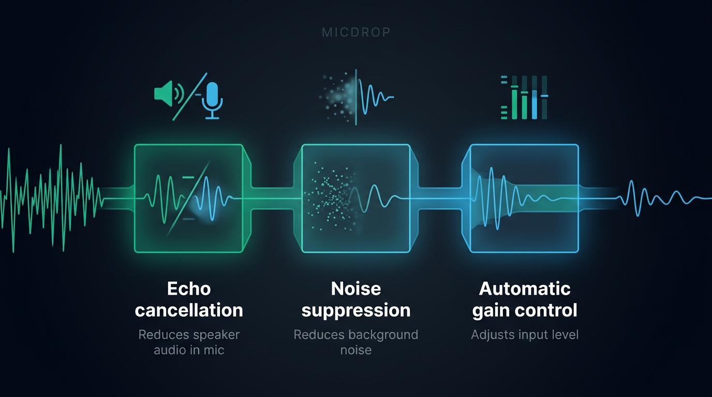
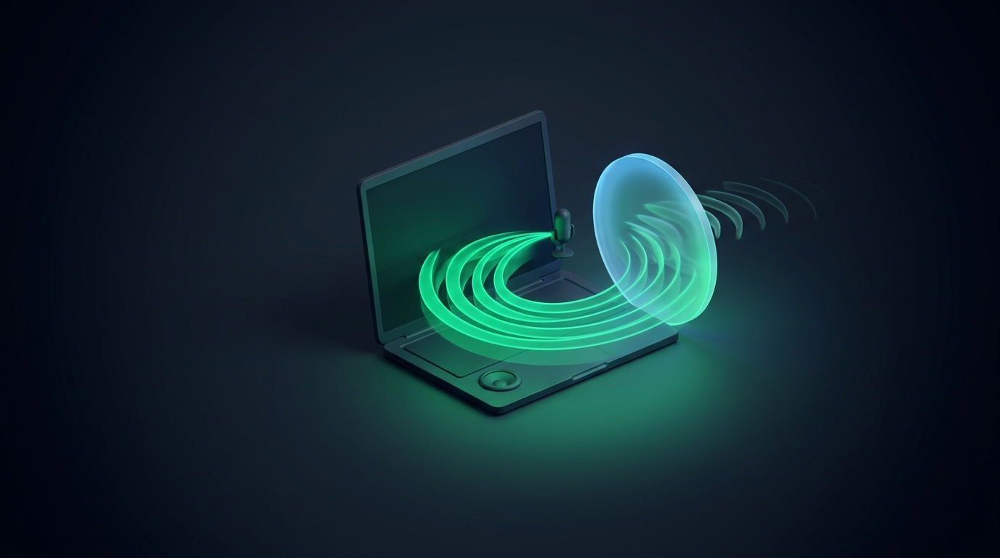
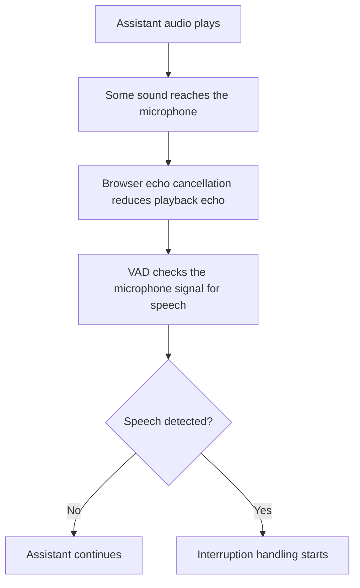

Your voice agent reads an answer aloud, then its own voice comes back through the microphone and cuts it off. That loop can happen even when speech detection works as intended: the detector hears speech, but it cannot tell whether the speaker was you or the assistant coming through a loudspeaker. Browser acoustic echo cancellation asks the microphone system to reduce that playback before your app processes the audio. It helps with ordinary laptop and phone setups, while the result still varies with the device, output route and room.

## Why does a voice agent hear itself?

A voice agent playing through speakers creates an acoustic path from the speaker to the microphone. The microphone captures both the person speaking and some of the assistant’s output. If the app sends that mixed signal to voice activity detection (VAD), VAD can classify the assistant’s voice as new speech. The agent may then stop its own answer, transcribe its own words or start another turn.

Headphones change the path. They keep most of the assistant’s sound close to the ears instead of sending it into the room, so less playback reaches the microphone. That makes headphones a useful diagnostic: if the loop stops when you plug them in, playback echo is probably involved. They do not explain every false interruption, since VAD can also react to a cough, another speaker or a sharp sound.

Echo cancellation tries to estimate the sound from the output and reduce it in the microphone signal. The browser or audio system can use a reference to what it played, then adapt as the room, speaker and microphone change. The result depends on the hardware and software path. A loud external speaker, a microphone far from the speaker or a new audio route can leave audible echo behind.

The browser’s `echoCancellation` audio constraint asks for this processing on a microphone track. The [Media Capture and Streams specification](https://www.w3.org/TR/mediacapture-streams/#dom-mediatrackconstraintset-echocancellation) defines it as a request to attempt cancellation. With the Boolean value `true`, the browser decides what audio to remove.

## What do the browser’s microphone constraints do?

`getUserMedia()` accepts several audio constraints that affect the captured signal. They address different problems, so turning on one does not replace the others.

| Constraint | What it asks the browser to do | What remains unknown |
| --- | --- | --- |
| `echoCancellation` | Reduce sound played by the system in the microphone signal | Whether cancellation handles every speaker, room or route |
| `noiseSuppression` | Reduce background noise in the captured audio | Whether speech recognition will become more accurate |
| `autoGainControl` | Adjust microphone level automatically | Whether the captured voice will sound natural in every setting |

The [MDN reference for `getUserMedia()` audio constraints](https://developer.mozilla.org/en-US/docs/Web/API/MediaTrackConstraints) describes these as constraints the browser attempts to satisfy. A simple Boolean request is generally a preference. An exact constraint is stricter and can make the request fail when the required setting is unavailable, so use `exact` only when your app handles that failure.

{/* IMAGE regen: api.py image, infographic, 1600x900. Scene: "Create a clear, wide three-column infographic comparing browser microphone processing stages. Render these exact labels: “Echo cancellation”, “Noise suppression”, “Automatic gain control”. Under each, one short exact caption: “Reduces speaker audio in mic”, “Reduces background noise”, “Adjusts input level”. Show a microphone waveform entering three separate processing blocks, with a distinct simple icon above each block: speaker-wave subtraction, soft noise particles disappearing around a voice waveform, and a level meter settling to a stable height. Keep the order left to right. Do not imply that any filter removes every unwanted sound or improves recognition accuracy. No extra text. Landscape 1600x900." */}


### How can I check whether echo cancellation is on?

Inspect the microphone track’s current settings after `getUserMedia()` resolves. `getConstraints()` tells you what your code asked for. `getSettings()` reports the current settings the browser applied, which is the more useful check when you need to know what the microphone track is using. MDN notes that some properties can be absent when a browser or context does not report them.

```typescript
const stream = await navigator.mediaDevices.getUserMedia({
  audio: {
    echoCancellation: true,
    noiseSuppression: true,
  },
})

const track = stream.getAudioTracks()[0]
const settings = track.getSettings()

console.log({
  echoCancellation: settings.echoCancellation,
  noiseSuppression: settings.noiseSuppression,
  autoGainControl: settings.autoGainControl,
})
```

Treat the values carefully. `echoCancellation: false` means the track reports cancellation off. `true` means the browser reports it on, not that it has removed all echo in your room. When the browser omits a value, listen to a recording from the track to check the result. `getSupportedConstraints()` can tell you which constraint names the browser recognizes, but it does not confirm that the microphone track ended up with the requested setting. The [MDN guide to constraints, capabilities and settings](https://developer.mozilla.org/en-US/docs/Web/API/Media_Capture_and_Streams_API/Constraints) explains the difference.

Check the track after changing microphone devices too. Each new track can have different capabilities and settings. Test in the browsers and on the devices your application supports, with the same output route people will use. Test the laptop, microphone and room together to find out how much playback reaches its microphone. If you are also choosing a call transport, [WebSocket and WebRTC for browser voice agents](/blog/websocket-or-webrtc-voice-agent) explains what WebRTC contributes beyond microphone processing.

{/* TODO ANECDOTE: Add a verified browser and device combination where echoCancellation was reported as true but playback still triggered VAD, including the output route and what resolved it. */}

## Where does browser echo cancellation fall short?

The most predictable setup gives the browser a clean relationship between the microphone and the audio it plays. Built-in laptop speakers and a built-in microphone are often close to that pattern. A USB speaker, a second sound card, Bluetooth headset, external monitor or system-level audio route can change the output path. The cancellation system may not have a useful reference for every sound that reaches the microphone, or its estimate may lag behind a changing route.

Echo cancellation targets playback from the device, not every competing voice or environmental noise. Noise suppression may reduce steady sounds such as a fan, but it can also alter the voice signal. Listen to the audio your server receives. A recording from the real microphone and room shows whether the reported setting worked well enough.

Headphones remain the simplest fallback when the assistant’s voice still triggers VAD. For a browser call that must work over speakers, test at the highest expected playback volume and with the microphone in its expected position. If echo still reaches the detector, pause VAD during assistant playback or disable interruptions for that setup. Your application can also offer a clear microphone and speaker selector. Your app can list and switch its microphone and output devices.

{/* IMAGE regen: api.py image, illustration, 1600x900. Scene: "Show the acoustic feedback loop in a laptop voice call: a compact speaker emits an emerald audio waveform that curves toward a nearby microphone, while a clean, translucent circular cancellation field intercepts most of the wave before it reaches the mic. A faint residual ripple continues past the field to suggest cancellation has limits. Minimal geometric composition, clear silhouette, no words, landscape 1600x900." */}


## What does echo cancellation change about interruptions?

VAD answers whether the microphone signal contains speech. It does not know who produced that speech. When an assistant’s voice leaks into the microphone, VAD can flag it as a new utterance and trigger an interruption. Echo cancellation reduces one common source of that false trigger before VAD sees the audio.

Echo cancellation changes the microphone signal. VAD classifies the signal it receives, while turn detection decides whether the speaker has finished. Test each layer separately. The [guide to browser VAD](/blog/voice-activity-detection-browser) covers speech detection, while [voice-agent barge-in handling](/blog/voice-agent-interruption-barge-in) covers stopping playback and managing the interrupted turn.

A voice client can disable interruptions when the microphone track explicitly reports `echoCancellation: false`. That choice keeps the assistant’s playback from triggering a new user turn. An `undefined` setting alone does not mean cancellation is off.

A client that disables interruptions this way protects its turn logic, while the browser and platform handle the audio processing. If cancellation is reported as enabled but the room still feeds assistant audio into the microphone, test with headphones or turn interruptions off for that setup.



## How is noise suppression different from echo cancellation?

Noise suppression reduces sounds such as steady fan noise, traffic or keyboard noise in the microphone signal. Echo cancellation targets audio played through the system’s output and captured again by the microphone. Automatic gain control adjusts the input level. A developer choosing among these settings should begin with the actual problem: an assistant interrupted by its own voice points to echo, while a fan that masks speech points to background noise.

The browser’s built-in noise suppression is the simplest option because it is part of microphone capture. It may also change speech, especially when the input contains music, multiple speakers or quiet voices. Chrome’s [description of how noise suppression can affect echo cancellation](https://developer.chrome.com/blog/disabling-hardware-noise-suppression) shows why these processing stages need to be tested together. Compare the captured audio with the setting on and off using the same microphone and room. Then check which version your speech recognizer handles better.

RNNoise is an open source noise-suppression library from Xiph.Org. Jean-Marc Valin, the paper’s author, describes RNNoise’s hybrid signal-processing and neural-network approach for real-time speech enhancement in his [2018 paper](https://doi.org/10.1109/mmsp.2018.8547084). The [project repository](https://github.com/xiph/rnnoise) provides the library, and [Shiguredo’s RNNoise build](https://github.com/shiguredo/rnnoise-wasm) runs it through WebAssembly in a browser. You must integrate and evaluate that extra processing stage. RNNoise is not an echo canceller.

Commercial options such as Krisp provide more specialized noise processing. For example, [LiveKit’s noise-cancellation documentation](https://docs.livekit.io/transport/media/noise-cancellation/) distinguishes browser-side WebRTC processing from enhanced noise cancellation provided through LiveKit Cloud. That distinction matters when comparing choices: some filters run on the user’s device, while others run in a service that receives the audio. Check where processing happens, what audio it needs, what it costs and whether it fits your privacy requirements before adopting one.

| Approach | Where processing runs | Good first use | Trade-off |
| --- | --- | --- | --- |
| Browser `noiseSuppression` | Browser or device audio stack | Basic microphone cleanup | Behavior varies with browser and hardware |
| RNNoise through WebAssembly | Your browser application | Custom, client-side noise filtering | You integrate and test another processing stage |
| Krisp or a provider filter | Vendor SDK or provider service | A managed noise-filtering feature | Check supported platforms, data path and commercial terms |

Use these tools for background noise and keep acoustic echo cancellation as a separate processing step. Combining several noise filters can also change the speech twice, which may make recognition worse. Start with one processing path, record real examples and compare the audio that reaches your recognizer.

## What changes in React Native and native apps?

A browser requests echo cancellation through `getUserMedia()`. A native mobile app relies on its audio session and platform audio engine. A phone may route audio through its earpiece, loudspeaker, wired headphones or Bluetooth, and those routes can behave differently. If the assistant still reaches the microphone, route its voice to the earpiece or headphones, then test again. A native client can also disable interruptions during playback. Check the native audio session for its processing state, since browser APIs such as `MediaStreamTrack.getSettings()` describe browser tracks. Read [how React Native routes microphone and speaker audio](/docs/react-native/audio-output) for a call-oriented setup.

## How Micdrop handles browser audio processing

[Micdrop](/), an open source TypeScript library for real-time voice conversations, requests `echoCancellation: true` and `noiseSuppression: true` when its browser client opens the microphone. It does not request `autoGainControl` or ship a separate echo canceller or noise filter. The browser and device decide how to satisfy the requests. Micdrop reads `echoCancellation` from the microphone track’s `getSettings()` result and disables interruptions when the browser explicitly reports `false`. When interruptions are disabled, its client pauses VAD during assistant playback and for 300 ms afterward, so the assistant’s voice cannot open a new user turn during that window.

The browser’s capture stack processes microphone audio before Micdrop passes it into the VAD and conversation pipeline. To allow interruptions when the browser reports cancellation, set the option explicitly or leave its default:

```typescript
import { Micdrop } from '@micdrop/web'

await Micdrop.start({
  url: 'ws://localhost:8081',
  disableInterruption: false,
})
```

Micdrop’s Silero VAD follows the algorithm used by [ricky0123/vad](https://github.com/ricky0123/vad), an open source browser VAD project. An application can provide a custom microphone driver through `Mic.setDriver()`, which supplies audio frames in the format Micdrop expects. Micdrop has no built-in switch that wires an RNNoise output stream into the call. The [browser client reference](/docs/client) covers its microphone, speaker, VAD and connection APIs.

Test the chosen microphone and output route before enabling interruptions for every device. The browser’s reported setting tells you what it applied, and a real recording shows whether the room still feeds playback into the microphone.

## Frequently asked questions

<FaqList>
  <FaqItem question="How can I get my microphone to stop echoing?">
    Ask the browser for `echoCancellation: true`, then inspect the microphone track with `getSettings()` and listen to a recording from the actual device and room. If playback still leaks into the microphone, use headphones, reduce speaker volume or pause interruptions while the assistant speaks.
  </FaqItem>
  <FaqItem question="How do I turn on echo cancellation in a browser?">
    Set `echoCancellation: true` in the audio constraints passed to `navigator.mediaDevices.getUserMedia()`. The browser treats this as a request, so check the resulting track settings and test the captured audio.
  </FaqItem>
  <FaqItem question="What does noise suppression do?">
    Noise suppression reduces background sounds in microphone audio. Echo cancellation targets sound played by the device that returns through the microphone, so the two settings address different problems.
  </FaqItem>
  <FaqItem question="Which is better, RNNoise or Speex?">
    The better choice depends on your audio, runtime and integration constraints. RNNoise uses a recurrent neural network for real-time noise suppression, while the [SpeexDSP preprocessor](https://speex.org/docs/api/speex-api-reference/group__SpeexPreprocessState.html) includes noise suppression and automatic gain control. Compare them with recordings from your actual environment and speech recognizer. Neither replaces echo cancellation.
  </FaqItem>
</FaqList>

Request browser echo cancellation when an assistant’s voice returns through its own microphone. Check the setting the browser applied, then listen to the audio from the real device and room. If the assistant still triggers VAD, use headphones or disable interruptions for that setup. If you are implementing the call in TypeScript, [start a voice call with Micdrop](/docs/getting-started) and test its microphone and speaker path on the devices you plan to support.
