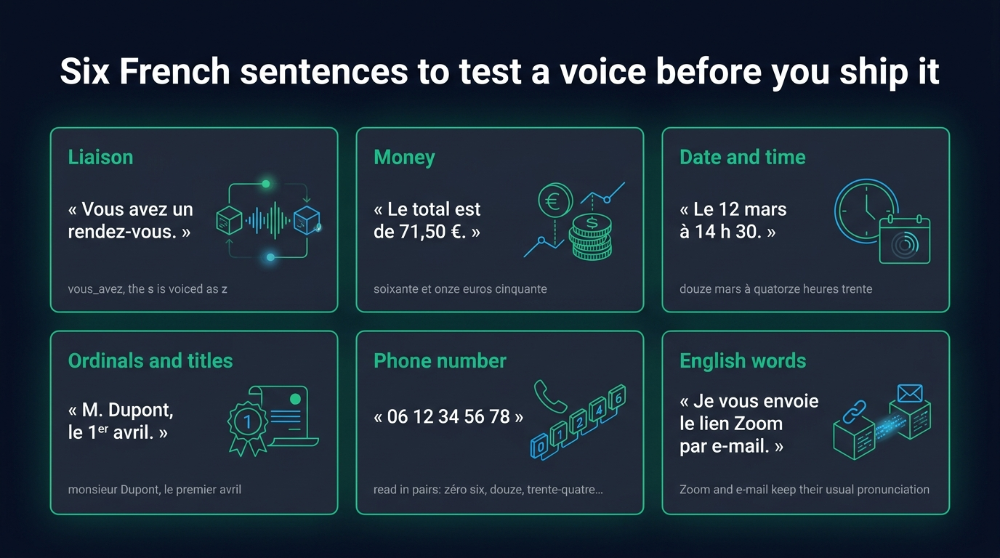
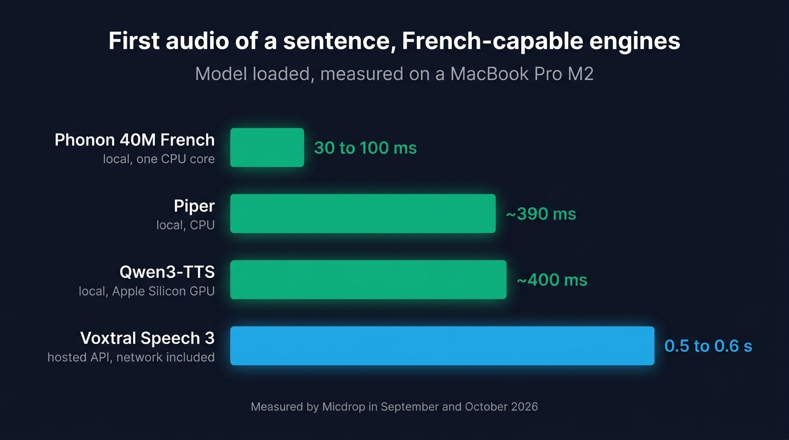
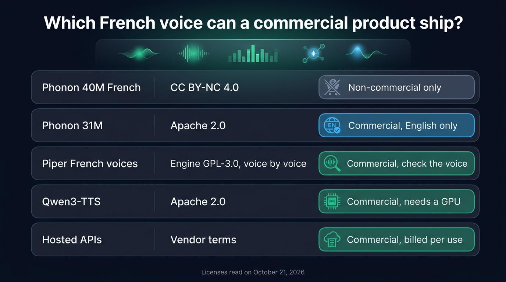
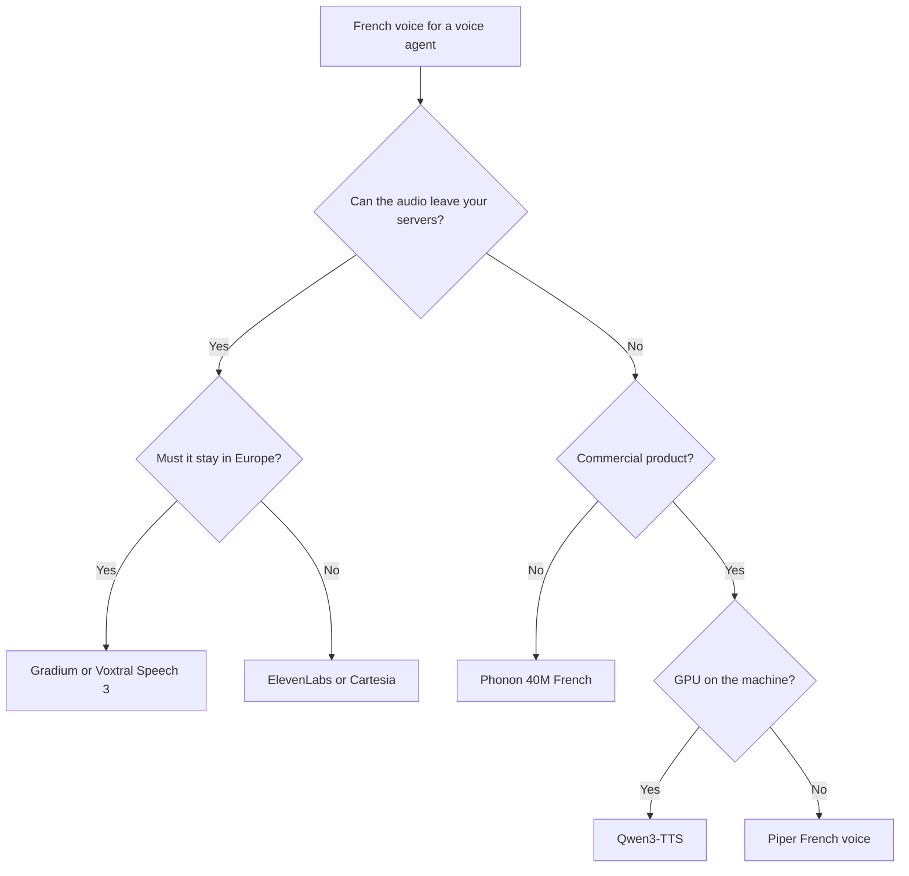

French text to speech for a voice agent comes down to two options: a hosted API that streams French audio from its servers, or a model that runs next to your Node server. Among hosted APIs, [Gradium](https://gradium.ai) and Mistral's Voxtral Speech 3 generate the audio in Europe, while ElevenLabs and Cartesia have the largest French voice catalogs. Among local models, Phonon 40M French gave the fastest first audio we measured, 30 to 100 ms on one CPU core, but its license allows non-commercial use only. A commercial product that keeps its French voice local can run Piper on a CPU or Qwen3-TTS on a GPU.

We measured Phonon 40M French on a MacBook Pro M2 on October 21, 2026, checked its French with a Whisper round trip, and set it against the local engines we had already measured on the same laptop. The prices and voices of the hosted APIs were read on the same day. We compared them on what a real-time voice agent needs: a fast first word, correct French numbers and dates, and a license you can ship.

## The short answer by situation

| Your situation | Pick | Why |
| --- | --- | --- |
| The audio has to stay in Europe | Gradium or Voxtral Speech 3 | Both are French companies with an EU endpoint |
| The voice is what sells the product | ElevenLabs or Cartesia | The largest French catalogs, and voice cloning |
| The call never leaves your machine, non-commercial project | Phonon 40M French | The fastest first audio we measured, on a CPU |
| The call never leaves your machine, commercial product | A Piper French voice, or Qwen3-TTS on a GPU | Licenses that allow commercial use |
| You already pay for Google or Azure | Their French neural voices | One more API on an account you already have |

## What French asks of a text to speech engine

A voice that reads English well can still get French wrong. Most of the errors come from text normalization, the step before synthesis where the engine turns written text into the words a person would say.

- A liaison links the two words of "vous avez" or "les amis" with a z sound. A model trained on French learns liaisons, while a model trained on English reads each word on its own.
- 71 is "soixante et onze" in France and "septante et un" in Belgium and Switzerland. 90 is "quatre-vingt-dix" in France and "nonante" in both of those countries. In French, prices are written with a decimal comma and the currency after the number, as in 71,50 €.
- "12 mars à 14 h 30" is read "douze mars à quatorze heures trente". An agent that books appointments writes times this way.
- "1er" is read "premier", and "M. Dupont" is read "monsieur Dupont".
- French phone numbers are read in pairs, "zéro six, douze, trente-quatre".
- A French agent mentions Zoom links, e-mails and product names, which the voice has to say the way a French speaker would.

Most hosted APIs normalize the text on their servers, with rules you rarely see. Phonon applies the rules of the language you give it, so `12 mars à 14 h 30` comes out right when the language is French. When an engine reads digits badly, ask the agent in its system prompt to write numbers, dates and times in words. It adds a few characters per answer and leaves the engine plain words to read.

{/* IMAGE regen: api.py image, infographic, 1600x900. Scene: "A grid of six cards, three columns by two rows, on a dark surface. Each card has a short English heading in emerald, a French test sentence in white inside quotation marks, and below it, in small grey text, how a French speaker says it. Card 1 heading 'Liaison', sentence '« Vous avez un rendez-vous. »', note 'vous‿avez, the s is voiced as z'. Card 2 heading 'Money', sentence '« Le total est de 71,50 €. »', note 'soixante et onze euros cinquante'. Card 3 heading 'Date and time', sentence '« Le 12 mars à 14 h 30. »', note 'douze mars à quatorze heures trente'. Card 4 heading 'Ordinals and titles', sentence '« M. Dupont, le 1er avril. »', note 'monsieur Dupont, le premier avril'. Card 5 heading 'Phone number', sentence '« 06 12 34 56 78 »', note 'read in pairs: zéro six, douze, trente-quatre…'. Card 6 heading 'English words', sentence '« Je vous envoie le lien Zoom par e-mail. »', note 'Zoom and e-mail keep their usual pronunciation'. Title at the top in a modern clean bold sans-serif: 'Six French sentences to test a voice before you ship it'. Flat vector style, generous spacing, each card with a thin emerald outline." */}


## Hosted APIs that speak French

Six hosted APIs built for voice agents speak French. The prices come from each vendor's pricing page, read on October 21, 2026. We timed Voxtral Speech 3 and Gemini ourselves. The other latency figures come from the vendors. ElevenLabs also published a benchmark that timed Cartesia and OpenAI.

| API | French | First audio | Price | Audio generated in the EU |
| --- | --- | --- | --- | --- |
| [ElevenLabs](/docs/ai-integration/provided-integrations/elevenlabs) | Flash v2.5, Multilingual v2 (France and Canada), v4 Turbo | About 150 ms median for v4 Turbo, by ElevenLabs | $40 per 1M characters on Flash v2.5 and v4 Turbo, $80 on Multilingual v2 | Enterprise data residency |
| [Cartesia](/docs/ai-integration/provided-integrations/cartesia) Sonic 3.6 | `fr-FR` and `fr-CA` locales | 262 ms median in the ElevenLabs test, under 90 ms by Cartesia | $37 to $50 per 1M characters, depending on the plan | No EU endpoint documented |
| [Gradium](/docs/ai-integration/provided-integrations/gradium) | One of its five languages | 258 ms median, by Gradium | 1 credit per character, $36 to $58 per 1M depending on the plan | EU endpoint |
| [Voxtral Speech 3](/docs/ai-integration/provided-integrations/mistral) (Mistral) | Four preset French voices, and cloning | 0.5 to 0.6 s, measured | $13 per 1M characters | EU endpoint |
| [Gemini TTS](/docs/ai-integration/provided-integrations/gemini) | Follows the language of the text | About 1 s to 3 s depending on the model, measured | $0.50 per 1M text tokens and $10 per 1M audio tokens on 2.5 Flash | No |
| [OpenAI](/docs/ai-integration/provided-integrations/openai) `gpt-4o-mini-tts` | Speaks French with voices tuned for English | 814 ms median in the ElevenLabs test | $0.60 per 1M text tokens and $12 per 1M audio tokens | No |

ElevenLabs has the broadest choice of French voices, plus cloning, with Multilingual v2 in a France and a Canada variant. Watch the numbers on Flash v2.5. ElevenLabs skips number normalization on that model by default to save latency. Turning it on (`apply_text_normalization`) requires an Enterprise plan, so dates and prices can come out wrong on the other plans. ElevenLabs recommends switching to Multilingual v2 for phone numbers, or sending them already written in words.

Cartesia Sonic 3.6 takes a `fr-FR` or `fr-CA` locale, which sets the accent when the voice supports it. A separate setting controls how dates, times and numbers are read. ElevenLabs and Cartesia differ more on [price and concurrency](/blog/cartesia-vs-elevenlabs) than on latency.

Gradium is a Paris company that came out of the Kyutai research lab. Its free plan includes 45,000 credits a month, about an hour of audio. The paid plans run from $13 to $1,615 a month. Micdrop's integration calls its EU endpoint by default. We go through [Gradium's French voices and its EU hosting](/blog/gradium-text-to-speech-souverain) in more detail, in French.

Voxtral Speech 3, listed as Voxtral TTS 3 on Mistral's pricing page, costs the least of the six at $13 per million characters. Its French preset voices are Marie (`voice_592`), Camille (`voice_3141`), Manon (`voice_3137`) and Lea (`voice_589`). Mistral serves it from `api.eu.mistral.ai`. Mistral's speech endpoint expects the whole text in one request, so Micdrop sends one request per sentence. In our test, each sentence started playing about half a second after we sent it.

Gemini TTS and OpenAI's `gpt-4o-mini-tts` speak French without a French voice of their own. Gemini's voices follow the language of the text, and `gpt-4o-mini-tts` takes instructions in plain words, such as a slower delivery. Both are on their way out: Google plans to shut its current TTS models down from November 17, 2026, and OpenAI retires `gpt-4o-mini-tts` on January 6, 2027.

Google Cloud Text-to-Speech, Azure AI Speech and Acapela also sell French voices. Google's Chirp 3 HD voices cover `fr-FR` and `fr-CA` at $30 per million characters after a free first million. Its Standard and WaveNet voices cost $4 per million. Azure lists French neural voices such as Denise and Henri, plus multilingual ones such as Vivienne, with half a million free characters a month. Acapela Group, founded in Mons, Belgium, sells on-device SDKs with French and Belgian French voices, priced on request.

## Local French voices in Node

Five engines run next to a Node server without an API key: Phonon, Piper, Kokoro, Pocket TTS and Qwen3-TTS. Three of them speak French in Node.

### Phonon 40M French, measured

Phonon is Gradium's on-device text to speech model, built on Kyutai's Pocket TTS. Gradium publishes it on Hugging Face in seven variants, one of them trained on French alone, `gradium/phonon-40m-fr`. Its runtime is compiled to WebAssembly, so it runs on a worker thread of the Node process, with no native addon and no Python.

On a MacBook Pro M2, on one CPU core, we measured:

| Measure | Phonon 40M French |
| --- | --- |
| Loading the model and speaking the first word | 0.7 to 0.9 s |
| First audio of a sentence, model loaded | 30 to 100 ms |
| Generation speed | About 5 times faster than real time |
| Memory of the Node process | About 450 MB |

The model sends its audio in frames of 80 ms, so the user hears the start of a sentence while the end is still being generated. Whisper transcribed our French test sentences back almost word for word, the date and the time included.

Gradium's `phonon-voices` catalog, under Apache 2.0, includes 15 French voices from France, Noémie among them. Every voice works with every Phonon model.

### The English model trap

Phonon also comes in a smaller English model, Phonon 31M, under Apache 2.0. It is the only Phonon model free for commercial use, so it is tempting to give it a French voice and French text. We tried. Whisper turned "comment puis-je vous aider aujourd'hui" into "comment please J. vous aider au George Huit".

The French voice changed the timbre and nothing else. The model read every word with English phonemes. **For French, the language of the model matters more than the voice.** Check what language a checkpoint was trained on before you pick a voice for it.

### Piper, Kokoro, Pocket TTS and Qwen3-TTS

[Piper](/docs/ai-integration/provided-integrations/piper) speaks French through voices trained one language at a time, such as `fr_FR-siwis-medium`. The French voices are siwis, upmc, tom, mls and gilles, in low or medium quality. Each voice is a file of a few dozen megabytes that runs on the CPU. Piper put out its first sound after about 390 ms on the same laptop. Its engine is GPL-3.0, so Micdrop runs it as a separate process.

[Kokoro](/docs/ai-integration/provided-integrations/kokoro) has a French voice upstream, `ff_siwis`, in the Python package. `kokoro-js`, the JavaScript port that runs in Node, lists English voices only and throws on any other id. Pocket TTS has a French checkpoint at Kyutai with no ONNX conversion, so the Node addon runs the English model alone. In Node, both speak English only.

[Qwen3-TTS](/docs/ai-integration/provided-integrations/qwen-tts) reads ten languages from one checkpoint, French among them. In a test of nine French sentences across four of its speakers, Whisper transcribed eight word for word. It needs an Apple Silicon GPU through an mlx-audio server, takes about 2.5 GB of memory, and put out its first sound after about 400 ms. Its weights are under Apache 2.0.

We compared the latency, memory use and setup of these engines on English text when we benchmarked [local text to speech in Node](/blog/local-tts-node-kokoro-vs-piper).

{/* IMAGE regen: api.py image, infographic, 1600x900. Scene: "A horizontal bar chart on a dark surface, four bars read from top to bottom, each with its label on the left, a small grey tag under the label, and its value at the end of the bar. Bar 1 labelled 'Phonon 40M French', tag 'local, one CPU core', value '30 to 100 ms', in bright emerald, the shortest bar at about one sixth of the width. Bar 2 labelled 'Piper', tag 'local, CPU', value '~390 ms', in emerald, about two thirds of the width. Bar 3 labelled 'Qwen3-TTS', tag 'local, Apple Silicon GPU', value '~400 ms', in emerald, about two thirds of the width. Bar 4 labelled 'Voxtral Speech 3', tag 'hosted API, network included', value '0.5 to 0.6 s', in sky blue, the full width. Bar lengths strictly proportional to the values, 600 ms filling the full width. Title at the top in a modern clean bold sans-serif: 'First audio of a sentence, French-capable engines'. Subtitle: 'Model loaded, measured on a MacBook Pro M2'. Small footer text: 'Measured by Micdrop in September and October 2026'. Flat vector style, generous spacing."
    Regenerate if a measurement changes. Last data sync: 2026-10-21. */}


## Licenses before you ship

Phonon 40M French, the fastest local French voice we measured, is licensed for non-commercial use only. Check the license of the weights and of each voice, and for Piper the license of the engine too.

| Engine | Weights | French voice | Commercial use |
| --- | --- | --- | --- |
| Phonon 40M French | CC BY-NC 4.0, gated on Hugging Face | 15 voices in the catalog | No |
| Phonon 31M | Apache 2.0 | Reads French with English phonemes | Yes, in English |
| Piper | Engine under GPL-3.0 | `siwis` and `mls` CC BY 4.0, `upmc` CC BY-SA 4.0, `gilles` CC0, `tom` AGPLv3 | Yes, with the voice's terms |
| Qwen3-TTS | Apache 2.0 | Its nine speakers read French | Yes |
| Hosted APIs | The vendor's terms | The vendor's catalog | Yes, billed per character or token |

Phonon's 40M models, French and multilingual alike, carry the CC BY-NC 4.0 license, which forbids commercial use. You can prototype with Phonon 40M French and run it in research, but a product that sells calls needs another voice. The `phonon-voices` catalog repository is tagged Apache 2.0, and Micdrop's `@micdrop/phonon` package is MIT, so neither of them restricts you.

Piper's engine moved to GPL-3.0 in 2025 when it absorbed espeak-ng. Micdrop runs the binary as a separate process, which keeps your application out of the GPL, while shipping the binary inside your own distribution brings its terms with it. Each Piper voice carries its own license. `siwis` asks for attribution under CC BY 4.0. `tom` comes under AGPLv3, a copyleft license written for software, so have its terms checked before you ship it. Read the model card of the voice you download.

{/* IMAGE regen: api.py image, infographic, 1600x900. Scene: "Five horizontal rows on a dark surface, one per engine, each row a rounded card with the engine name on the left, its license in the middle, and a verdict badge on the right. Row 1: 'Phonon 40M French', license 'CC BY-NC 4.0', badge 'Non-commercial only' in muted slate grey. Row 2: 'Phonon 31M', license 'Apache 2.0', badge 'Commercial, English only' in sky blue. Row 3: 'Piper French voices', license 'Engine GPL-3.0, voice by voice', badge 'Commercial, check the voice' in emerald. Row 4: 'Qwen3-TTS', license 'Apache 2.0', badge 'Commercial, needs a GPU' in emerald. Row 5: 'Hosted APIs', license 'Vendor terms', badge 'Commercial, billed per use' in emerald. Title at the top in a modern clean bold sans-serif: 'Which French voice can a commercial product ship?'. Small footer text: 'Licenses read on October 21, 2026'. Flat vector style, generous spacing, thin separators between rows."
    Regenerate if a license changes. Last data sync: 2026-10-21. */}




## How we tested

Phonon read French sentences through Micdrop's TTS interface on a MacBook Pro M2, with the model loaded and warmed up three seconds beforehand. The script started a timer when it sent the text, stopped it at the first audio chunk, and collected the PCM audio at 16 kHz. It then passed that audio to Whisper `base`, running locally with the language set to French, and compared the transcript with the input.

The test sentences cover two of the cases French voices get wrong first: a liaison, in "comment puis-je vous aider aujourd'hui ?", and a date with a time, "12 mars à 14 h 30". A transcript that matches word for word shows the words are intelligible. How natural the voice sounds is a separate question, so listen to the recordings before you pick one.

The script takes about eighty lines of TypeScript and runs against any engine in Micdrop once you change the line that creates the voice. Piper and Qwen3-TTS were measured earlier on the same laptop for our local engine benchmark. Voxtral Speech 3 was timed from the same laptop through Micdrop, so its figure includes the network round trip to Mistral.

## A French voice in Micdrop

[Micdrop](/) is an open source TypeScript library for real-time voice conversations with AI. It handles the microphone, speech detection, interruptions and audio streaming between the browser and your Node server. Micdrop's integrations for the six hosted APIs and the five local engines share one TTS interface.

Phonon 40M French takes two options, the model and a French voice:

```typescript
import { PHONON_MODELS, PhononTTS } from '@micdrop/phonon'
import { MicdropServer } from '@micdrop/server'

const tts = new PhononTTS({
  model: PHONON_MODELS['phonon-40m-fr'].model,
  voice: 'Noémie', // Also sets French number and date reading
})

new MicdropServer(socket, {
  tts,
  // ... stt and agent
})
```

The weights are gated on Hugging Face, so accept their terms on the model page and set `HF_TOKEN` before the first run. The package downloads the model once and starts offline afterwards.

For a hosted French voice in Europe, [Gradium](/docs/ai-integration/provided-integrations/gradium) and [Mistral](/docs/ai-integration/provided-integrations/mistral) plug into the same `tts` option:

```typescript
import { GradiumTTS } from '@micdrop/gradium'
import { MistralTTS } from '@micdrop/mistral'

// Gradium, EU endpoint by default
const gradium = new GradiumTTS({
  apiKey: process.env.GRADIUM_API_KEY || '',
  voiceId: process.env.GRADIUM_VOICE_ID || '', // A French voice
})

// Voxtral Speech 3 on Mistral's EU endpoint
const voxtral = new MistralTTS({
  apiKey: process.env.MISTRAL_API_KEY || '',
  voiceId: 'voice_592', // Marie, French
  baseUrl: 'https://api.eu.mistral.ai',
})
```

A local voice and a hosted one also work together. [FallbackTTS](/docs/ai-integration/fallback-strategies/tts-fallback) tries the first engine and replays the unspoken text to the next one when it fails, so a call can start on Piper and move to Voxtral Speech 3 if the local process crashes:

```typescript
import { FallbackTTS } from '@micdrop/server'
import { PiperTTS } from '@micdrop/piper'
import { MistralTTS } from '@micdrop/mistral'

const tts = new FallbackTTS({
  factories: [
    () => new PiperTTS({ modelPath: './voices/fr_FR-siwis-medium.onnx' }),
    () =>
      new MistralTTS({
        apiKey: process.env.MISTRAL_API_KEY || '',
        voiceId: 'voice_592',
        baseUrl: 'https://api.eu.mistral.ai',
      }),
  ],
})
```

Without Micdrop, you would write these clients yourself. Micdrop's Gradium client takes about 360 lines of TypeScript and its Voxtral Speech 3 client about 150, most of them spent on streaming, interruptions and reconnections. You would write the browser code on top of that.

The other route is a hosted platform. [Vapi](https://vapi.ai/pricing) charged $0.05 a minute on October 19, 2026, with each provider billed on top. Micdrop is MIT licensed and runs on your server with your own keys, so you pay each provider directly with no platform fee, and nothing for the voice with a local engine. In exchange, you host the server and build the call history and the dashboard a platform would give you. Products such as [Raconte](https://raconte.ai), built by Micdrop's maintainer, and [Cibli](https://cibli.fr) run on Micdrop.

For a whole European stack, with Mistral as the agent and the transcription next to the voice, follow the setup for a [sovereign voice AI](/docs/ai-integration/sovereign-voice-ai).

## Frequently asked questions

<FaqList>
  <FaqItem question="What is the best French text to speech for a voice agent?">
    It depends on where the audio may go. Gradium and Voxtral Speech 3 generate
    French on European servers, ElevenLabs and Cartesia have the largest French
    catalogs, and Voxtral Speech 3 is the cheapest API built for voice agents,
    at $13 per million characters. On your own machine, Phonon 40M French starts speaking in 30 to
    100 ms on a CPU, but its license allows non-commercial use only. A
    commercial product can run Piper or Qwen3-TTS instead.
  </FaqItem>
  <FaqItem question="Is there a free French text to speech API?">
    Gradium's free plan includes about an hour of audio a month, Google Cloud
    gives the first million Chirp 3 HD characters for free, and Azure gives
    half a million neural characters a month. A local engine costs nothing per
    character: Piper's French voices run on any CPU, and Qwen3-TTS runs on an
    Apple Silicon GPU.
  </FaqItem>
  <FaqItem question="Which open source text to speech speaks French?">
    Piper has French voices such as `fr_FR-siwis-medium`, Qwen3-TTS reads
    French with all nine of its speakers, and Phonon 40M French is an open
    weight model trained on French alone. Kokoro has one French voice,
    `ff_siwis`, in its Python package, while the JavaScript port lists English
    voices only. Phonon 40M is licensed for non-commercial use only, Qwen3-TTS
    is under Apache 2.0, and each Piper voice has its own license.
  </FaqItem>
  <FaqItem question="Can I use Phonon 40M French in a commercial product?">
    Its weights are gated on Hugging Face behind Gradium's terms and
    licensed under CC BY-NC 4.0, which forbids commercial use. Phonon 31M is under
    Apache 2.0, but it speaks English only and turns French into gibberish.
    For a commercial product, use Gradium's hosted French voices, a Piper
    French voice or Qwen3-TTS.
  </FaqItem>
  <FaqItem question="Does ElevenLabs read French numbers and dates correctly?">
    Multilingual v2 normalizes numbers, but Flash v2.5 skips that step by default to
    save latency. The setting that turns it on, `apply_text_normalization`,
    is reserved for Enterprise plans on that model. If you stay on Flash v2.5,
    ask your agent to write numbers, prices, dates and times in words in its
    system prompt.
  </FaqItem>
  <FaqItem question="How do I get a French accent in English text to speech?">
    Use a voice recorded by a French speaker and keep the text in English. With
    Pocket TTS, the bundled `frenchAccent` recording gives the timbre and the
    accent while the words stay English. Eleven v4 Turbo follows a `[strong
    French accent]` direction in the text, and `gpt-4o-mini-tts` takes the
    accent as an instruction.
  </FaqItem>
</FaqList>

You can [start a first voice call in about five minutes](/docs/getting-started), then swap in the French voice that fits your license and your data constraints.
