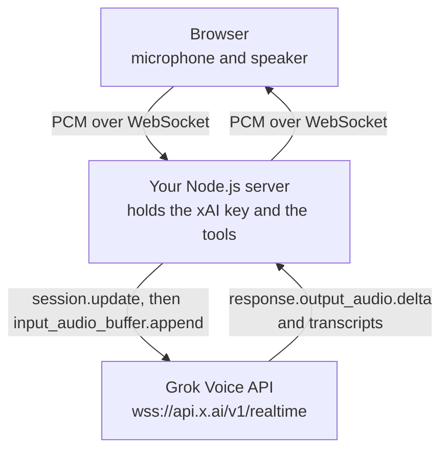
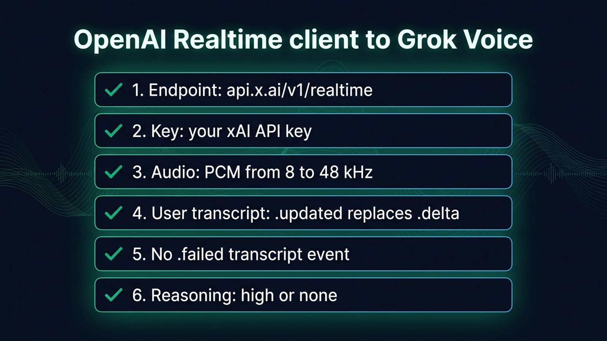
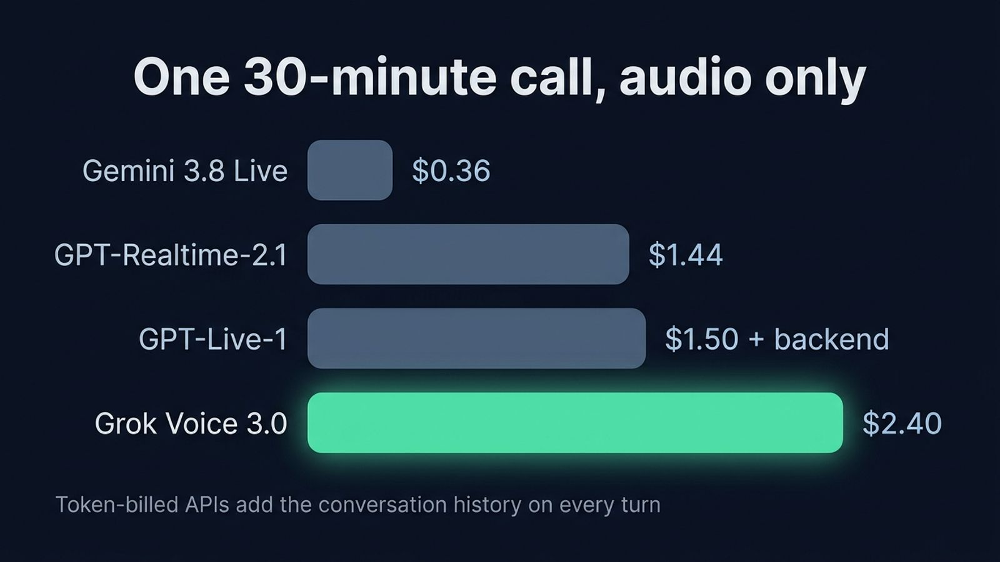

The Grok Voice API is xAI's speech to speech API: your server opens a WebSocket to `wss://api.x.ai/v1/realtime`, streams the user's audio, and receives the model's voice and transcript in return. It accepts the events of the OpenAI Realtime API, so most of a client written for OpenAI carries over. Grok Voice 3.0, the current model, costs a flat $0.08 per minute of session. In this tutorial, we build a voice agent on it with a TypeScript Node.js server and a browser client. We cover the session settings, the events that differ from OpenAI's, tool calls, browser tokens, voices, pricing against GPT-Realtime-2.1 and Gemini Live, and where the audio is processed. The specifications and prices of Grok come from [xAI's voice agent documentation](https://docs.x.ai/developers/model-capabilities/audio/voice-agent) and its other documentation pages, read on 21 November 2026.

## Which Grok Voice model to use

xAI released Grok Voice 3.0 on 14 October 2026. It ranks first among the [speech to speech APIs for voice agents](/blog/top-speech-to-speech-apis-voice-agents) on the [Artificial Analysis speech to speech leaderboard](https://artificialanalysis.ai/speech-to-speech), with an overall score of 86.9. It starts speaking 0.81 seconds after the end of the question.

The API takes three model IDs:

- `grok-voice-3.0`, the current model
- `grok-voice-latest`, an alias that points to `grok-voice-3.0` today and will follow the next release
- `grok-voice-2.0`, which xAI marks as deprecated

Version 3.0 kept the endpoint, the session parameters, the events and the price of 2.0. Moving an existing integration means changing the model name. Pin `grok-voice-3.0` in production, since an alias changes the model under a running app on the day xAI ships a new one.

## Connect to Grok Voice from a Node.js server

You need an xAI API key and the `ws` package. The key goes in the `Authorization` header, which is why this connection belongs on a server. The first event sets up the session, then the audio flows both ways as base64 JSON:

```typescript
import WebSocket from 'ws'

const socket = new WebSocket(
  'wss://api.x.ai/v1/realtime?model=grok-voice-3.0',
  { headers: { Authorization: `Bearer ${process.env.XAI_API_KEY}` } }
)

socket.on('open', () => {
  socket.send(
    JSON.stringify({
      type: 'session.update',
      session: {
        instructions: 'You book appointments. Answer in short spoken sentences.',
        voice: 'eve',
        turn_detection: { type: 'server_vad' },
        audio: {
          input: { format: { type: 'audio/pcm', rate: 16000 } },
          output: { format: { type: 'audio/pcm', rate: 16000 } },
        },
      },
    })
  )
})

// Microphone audio, PCM 16 bits mono at 16 kHz
export function sendAudio(chunk: Buffer) {
  socket.send(
    JSON.stringify({
      type: 'input_audio_buffer.append',
      audio: chunk.toString('base64'),
    })
  )
}

socket.on('message', (data) => {
  const event = JSON.parse(data.toString())
  switch (event.type) {
    case 'response.output_audio.delta':
      playAudio(Buffer.from(event.delta, 'base64'))
      break
    case 'response.output_audio_transcript.delta':
      process.stdout.write(event.delta)
      break
    case 'input_audio_buffer.speech_started':
      stopPlayback() // The user speaks over the answer
      break
    case 'error':
      console.error(event.error)
      break
  }
})
```

`playAudio` and `stopPlayback` stand for your audio output, a speaker on a device or a socket to the browser. With `server_vad`, Grok decides when the user has finished speaking and answers on its own. Set `turn_detection` to `null` to decide it yourself: send `input_audio_buffer.commit` when the turn ends, then `response.create` to get the answer.

OpenAI's Realtime API takes PCM at 24 kHz only, while Grok accepts 8, 16, 22.05, 24, 32, 44.1 and 48 kHz. A server that already holds 16 kHz audio, as most speech pipelines do, sends it as it is and receives the answer at the same rate.



## Configure the session

`session.update` carries every setting, so sending it again during the call changes the instructions, the tools or the transcription hints.

| Field | Values | What it changes |
|---|---|---|
| `instructions` | Text | The system prompt |
| `voice` | `eve` by default, another built-in voice or a custom voice ID | The voice of the answers |
| `reasoning.effort` | `high` by default, or `none` | Reasoning before the answer, `none` answering faster |
| `turn_detection.type` | `server_vad`, or `null` | Who ends the user's turn, Grok or your code |
| `turn_detection.idle_timeout_ms` | Milliseconds | Grok speaks again after this much silence from the user |
| `audio.input.format`, `audio.output.format` | `audio/pcm` at 8 to 48 kHz, `audio/pcmu`, `audio/pcma`, `audio/opus` | Codec and sample rate |
| `audio.*.transport` | `json` by default, or `binary` | Base64 in JSON events, or raw binary WebSocket frames |
| `audio.input.transcription.language_hint` | A BCP-47 code | Biases the transcription of the user toward one language |
| `audio.input.transcription.keyterms` | Up to 100 terms of 50 characters | Names and jargon the transcription should recognise |
| `audio.output.speed` | 0.7 to 1.5 | Speaking pace |
| `replace` | A map of phrases | How the voice pronounces a word, with the transcript left unchanged |
| `resumption.enabled` | `true` or `false` | Lets a dropped connection rejoin the conversation |

The `pcmu` and `pcma` codecs are the 8 kHz G.711 formats of phone lines, so a telephony bridge can pass its audio through with no conversion. Binary transport skips the base64 encoding, which grows each chunk by a third.

With `resumption.enabled`, save the ID of the `conversation.created` event and reconnect with `?conversation_id=<id>`. Grok restores the transcripts, the tool calls and their results. The history expires after 30 minutes without activity.

## What differs from the OpenAI Realtime API

Grok Voice reuses OpenAI's event names for the session, the audio buffer, the conversation items and the responses. A client written for OpenAI's WebSocket keeps its structure. These are the points to change:

| | OpenAI Realtime API | Grok Voice API |
|---|---|---|
| Endpoint | `wss://api.openai.com/v1/realtime` | `wss://api.x.ai/v1/realtime` |
| Transports | WebRTC, WebSocket, SIP | WebSocket, SIP |
| PCM sample rate | 24 kHz | 8 kHz to 48 kHz |
| Partial user transcript | `...input_audio_transcription.delta`, one piece at a time | `...input_audio_transcription.updated`, the whole transcript so far |
| Failed user transcript | `...input_audio_transcription.failed` | Never sent |
| `conversation.item.retrieve`, `conversation.item.done`, `rate_limits.updated` | Supported | Unsupported |
| Reasoning effort | `minimal` to `xhigh` | `high` or `none` |
| Built-in tools | Remote MCP servers | Remote MCP servers, web search, X search, file search |
| Additions | | `force_message`, `resumption`, `replace` |

The transcript change is the one that breaks code silently. A client that appends each `.delta` to a string will repeat the sentence on Grok, since every `.updated` event carries the full text again. Replace the string instead of appending to it, or wait for `conversation.item.input_audio_transcription.completed`, which both APIs send. xAI documents the partial events for the `grok-transcribe` transcription model.

A client that waits for a `.failed` event to give up on a transcript will wait forever on Grok. Put a timeout on it.

{/* IMAGE regen: api.py image, infographic, 1600x900. Scene: "A vertical checklist titled 'OpenAI Realtime client to Grok Voice' in a modern clean bold sans-serif. Six rows, each with an emerald check mark on the left and one line of text: '1. Endpoint: api.x.ai/v1/realtime', '2. Key: your xAI API key', '3. Audio: PCM from 8 to 48 kHz', '4. User transcript: .updated replaces .delta', '5. No .failed transcript event', '6. Reasoning: high or none'. Each row sits on a dark rounded card with thin sky blue borders. Generous spacing, left aligned text, no icons other than the check marks."
    Infographic only: regenerate if xAI changes its endpoint, audio formats, transcription events or reasoning settings. Last data sync: 2026-11-21. */}


## Call your own functions from Grok Voice

Declare your functions in `session.update`, with a JSON schema for their parameters. Grok runs its built-in tools (web search, X search, file search and remote MCP servers) on its side. Your functions run in your code, which receives the call in `response.done`:

```typescript
socket.send(
  JSON.stringify({
    type: 'session.update',
    session: {
      tools: [
        {
          type: 'function',
          name: 'find_slot',
          description: 'Find the next free appointment slot on a given day',
          parameters: {
            type: 'object',
            properties: { day: { type: 'string', format: 'date' } },
            required: ['day'],
          },
        },
        { type: 'web_search' },
      ],
    },
  })
)

socket.on('message', async (data) => {
  const event = JSON.parse(data.toString())
  if (event.type !== 'response.done') return
  const calls = event.response.output.filter(
    (item: any) => item.type === 'function_call'
  )
  if (calls.length === 0) return
  for (const call of calls) {
    const result = await findSlot(JSON.parse(call.arguments))
    socket.send(
      JSON.stringify({
        type: 'conversation.item.create',
        item: {
          type: 'function_call_output',
          call_id: call.call_id,
          output: JSON.stringify(result),
        },
      })
    )
  }
  // One answer for all the results
  socket.send(JSON.stringify({ type: 'response.create' }))
})
```

When the model calls several functions in one turn, send every output first, then a single `response.create`. xAI asks for this order because one `response.create` per output would make the model answer several times.

## Connect a browser without exposing your key

A browser WebSocket cannot set an `Authorization` header. xAI solves this with short-lived tokens. Your server asks for one with its API key, then hands it to the page:

```typescript
// On your server
const response = await fetch('https://api.x.ai/v1/realtime/client_secrets', {
  method: 'POST',
  headers: {
    Authorization: `Bearer ${process.env.XAI_API_KEY}`,
    'Content-Type': 'application/json',
  },
  body: JSON.stringify({ expires_after: { seconds: 300 } }),
})
const { value } = await response.json()
```

The page passes the token as a subprotocol, prefixed with `xai-client-secret.`:

```typescript
// In the browser
const socket = new WebSocket('wss://api.x.ai/v1/realtime?model=grok-voice-3.0', [
  `xai-client-secret.${value}`,
])
```

A token lasts up to an hour. The browser then captures the microphone, encodes PCM, plays the answer and stops playback when the user interrupts, all in code you write. Your tools either run in the page, or the page relays each call to your server over a channel of your own.

You can also keep the session on your server. The browser streams its audio to your Node process over your own WebSocket. Your server talks to xAI, runs the tools and stores the transcript. You add one hop, but the key, the prompt and the tools stay on your infrastructure. The same server can then talk to a phone app, which is how a team usually ends up [running a realtime API from React Native](/blog/openai-realtime-api-react-native) without WebRTC.

## Voices, languages and voice cloning

`eve` is the default voice. xAI's examples also use `ara` and `rex`. `GET https://api.x.ai/v1/tts/voices` lists the full set, which the Voice Agent API shares with xAI's text to speech API. Every voice speaks every supported language.

Grok detects the language of the user on its own among more than 20, including Arabic, Bengali, Turkish and Vietnamese. Spanish and Portuguese take a regional code, `es-MX` or `es-ES`, `pt-BR` or `pt-PT`. Pass one as `language_hint` when you know it, and list the names of your products in `keyterms`.

The Custom Voices API clones a voice from a recording of up to 120 seconds. The `voice_id` it returns goes in the session's `voice` field, so a brand voice works in the agent the day you create it.

## Grok Voice API pricing against GPT-Realtime and Gemini Live

[xAI's pricing](https://docs.x.ai/developers/models) for Grok Voice 3.0 is $0.08 per minute of session, $4.80 an hour, plus $0.004 for each text input. You pay the same rate whoever speaks and however long the conversation history gets. GPT-Realtime-2.1 and Gemini Live bill audio tokens and charge the history again on every turn, so their cost per minute grows as a call gets longer.

| API | Billing | One minute, split evenly | A 30-minute call, audio only |
|---|---|---|---|
| xAI Grok Voice 3.0 | $0.08 per minute of session | $0.08 | $2.40 |
| OpenAI GPT-Live-1 | $0.05 per minute of session, plus the backend model's tokens | $0.05 plus the backend | $1.50 plus the backend |
| OpenAI GPT-Realtime-2.1 | $32 per million audio tokens heard, $64 per million spoken | About $0.048 | About $1.44 plus the history |
| Google Gemini 3.8 Live | $3 per million audio tokens heard, $12 per million spoken | About $0.012 | About $0.36 plus the history |

The OpenAI and Google figures come from their pricing pages on 17 October 2026, the same figures we use to [rank the speech to speech APIs for voice agents](/blog/top-speech-to-speech-apis-voice-agents). A minute split evenly means thirty seconds of the user and thirty of the agent.

Grok has the highest audio price per minute of the four, before GPT-Live-1's backend model is counted. It also has the simplest bill to forecast: a 30-minute call costs $2.40 whatever was said, while the bills of the token-billed APIs grow with the history they charge again on each turn. GPT-Realtime-2.1 charges twice as much for the audio it speaks as for the audio it hears, so on a short call where the agent talks most, its cost comes closer to Grok's. For high volumes, Gemini Live costs about a seventh of Grok. GPT-Live and Gemini Live also [differ on more than price](/blog/gpt-live-vs-gpt-realtime-vs-gemini-live).

{/* IMAGE regen: api.py image, infographic, 1600x900. Scene: "A horizontal bar chart titled 'One 30-minute call, audio only' in a modern clean bold sans-serif. Four horizontal bars, one per row, each with its label on the left and its price on the right of the bar. Row 1: 'Gemini 3.8 Live' with a short bar and '$0.36'. Row 2: 'GPT-Realtime-2.1' with a medium bar and '$1.44'. Row 3: 'GPT-Live-1' with a slightly longer bar and '$1.50 + backend'. Row 4: 'Grok Voice 3.0' with the longest bar, highlighted in the emerald accent, and '$2.40'. Bar lengths are proportional to 0.36, 1.44, 1.50 and 2.40. Under the chart, a small caption line: 'Token-billed APIs add the conversation history on every turn'. Generous margins, flat bars with rounded ends, no gridlines, no axis numbers. Render no other text at all: no brand name, no header line, no tagline above the title."
    Infographic only: regenerate if a provider changes its price per minute or audio token. Last data sync: 2026-11-21. */}


Concurrency depends on what the account has spent with xAI since 1 January 2026. [xAI's rate limits](https://docs.x.ai/developers/rate-limits) allow 10 `grok-voice-3.0` sessions at a time on a new account and 200 on an account past $5,000 of spend. Tiers unlock as you spend and never go down. xAI also offers an enterprise plan on request. Plan your launch around those 10 sessions.

## Where Grok Voice processes the audio

xAI lists two endpoints for its API, according to its [regional endpoints page](https://docs.x.ai/developers/advanced-api-usage/regions). The global `api.x.ai` may route a request between regions for capacity, so the processing location is not guaranteed. The US endpoint `us.api.x.ai` serves two text models and none of the voice APIs. No European endpoint appears for voice. xAI tells customers with data location requirements to contact its sales team instead.

You need another provider today for audio that has to stay in Europe. OpenAI's EU endpoint, Gemini Live on Vertex AI in the EU, Amazon Nova Sonic in Stockholm and Deepslate Opal in Germany all process speech in Europe. A pipeline of European providers is another way to keep a [voice agent's data in Europe](/docs/providers/sovereign-voice-ai).

## Write a Grok Voice class for Micdrop

[Micdrop](/) is an open source TypeScript library for real-time voice conversations with AI, with a browser client and a Node.js server. It ships two realtime models, OpenAI Realtime and Gemini Live, and no Grok Voice integration. The `Realtime` class of `@micdrop/server` is built for adding one, though. A provider class extends it and implements the calls to its API. Micdrop handles the browser client, the microphone, the voice detection, the playback, the interruptions and the order of the transcripts, which work the same as with the two built-in models.

Here is a minimal Grok Voice class built on `Realtime`. It compiles against the current `@micdrop/server` types:

```typescript
import {
  MicdropConversationToolCall,
  Realtime,
  RealtimeOptions,
} from '@micdrop/server'
import WebSocket from 'ws'
import z, { toJSONSchema } from 'zod'

export interface GrokVoiceOptions extends RealtimeOptions {
  apiKey: string
  model?: string
  voice?: string
}

// Micdrop streams PCM 16 bits at 16 kHz, a rate Grok Voice takes both ways
const SAMPLE_RATE = 16000

export class GrokVoice extends Realtime<GrokVoiceOptions> {
  private socket: WebSocket
  private open = false
  private pending: string[] = []
  private responseId?: string
  private cancelled = new Set<string>()

  constructor(options: GrokVoiceOptions) {
    super(options)
    const model = options.model || 'grok-voice-3.0'
    this.socket = new WebSocket(`wss://api.x.ai/v1/realtime?model=${model}`, {
      headers: { Authorization: `Bearer ${options.apiKey}` },
    })
    this.socket.on('open', () => {
      this.open = true
      this.sendSession()
      this.pending.forEach((event) => this.socket.send(event))
      this.pending = []
    })
    this.socket.on('message', (data) =>
      this.handleEvent(JSON.parse(data.toString()))
    )
    this.socket.on('close', () => this.emit('Failed'))
  }

  destroy() {
    super.destroy()
    this.socket.close()
  }

  protected openTurn() {}

  protected appendAudio(chunk: Buffer) {
    this.send({
      type: 'input_audio_buffer.append',
      audio: chunk.toString('base64'),
    })
  }

  protected closeTurn() {
    this.send({ type: 'input_audio_buffer.commit' })
    this.send({ type: 'response.create' })
  }

  protected clearTurn() {
    this.send({ type: 'input_audio_buffer.clear' })
  }

  protected generate() {
    this.send({ type: 'response.create' })
  }

  protected speakText(text: string) {
    this.send({
      type: 'response.create',
      response: {
        instructions: `Say exactly this text and nothing else: ${text}`,
      },
    })
  }

  protected cancelAnswer() {
    if (!this.responseId) return
    this.cancelled.add(this.responseId)
    this.send({ type: 'response.cancel', response_id: this.responseId })
    this.responseId = undefined
  }

  protected updateTools() {
    if (this.open) this.sendSession()
  }

  protected injectMessage(role: 'user' | 'assistant' | 'system', text: string) {
    this.send({
      type: 'conversation.item.create',
      item: {
        type: 'message',
        role,
        content: [
          { type: role === 'assistant' ? 'output_text' : 'input_text', text },
        ],
      },
    })
  }

  private send(event: object) {
    const data = JSON.stringify(event)
    if (this.open) this.socket.send(data)
    else this.pending.push(data)
  }

  private sendSession() {
    const format = { type: 'audio/pcm', rate: SAMPLE_RATE }
    this.socket.send(
      JSON.stringify({
        type: 'session.update',
        session: {
          instructions: this.options.systemPrompt,
          voice: this.options.voice || 'eve',
          // The Micdrop client tells when the user starts and stops speaking
          turn_detection: null,
          audio: {
            input: { format, transcription: { model: 'grok-transcribe' } },
            output: { format },
          },
          tools: this.tools.map((tool) => ({
            type: 'function',
            name: tool.name,
            description: tool.description,
            parameters: toJSONSchema(tool.inputSchema || z.object()),
          })),
        },
      })
    )
  }

  private isCurrent(responseId: string) {
    return responseId === this.responseId && !this.cancelled.has(responseId)
  }

  private handleEvent(event: any) {
    switch (event.type) {
      case 'response.created':
        this.responseId = event.response.id
        break
      case 'response.output_audio.delta':
        if (this.isCurrent(event.response_id)) {
          this.emitAudio(Buffer.from(event.delta, 'base64'))
        }
        break
      case 'response.output_audio_transcript.delta':
        if (this.isCurrent(event.response_id)) {
          this.addAnswerTranscript(event.delta)
        }
        break
      case 'conversation.item.input_audio_transcription.completed':
        this.addUserTranscript(event.transcript || '')
        this.commitUserTranscript()
        break
      case 'response.done':
        this.onResponseDone(event.response)
        break
      case 'error':
        this.log('Grok Voice error:', event.error)
        break
    }
  }

  private async onResponseDone(response: any) {
    if (this.cancelled.delete(response.id)) return
    if (response.id !== this.responseId) return
    this.responseId = undefined

    const calls = (response.output ?? []).filter(
      (item: any) => item.type === 'function_call'
    )
    if (calls.length === 0) {
      this.endAnswer()
      return
    }

    // Send every function output, then ask for one spoken answer
    let skipAnswer = true
    for (const call of calls) {
      const toolCall: MicdropConversationToolCall = {
        role: 'tool_call',
        toolCallId: call.call_id,
        toolName: call.name,
        parameters: call.arguments,
      }
      const result = await this.runTool(toolCall)
      if (!result.skipAnswer) skipAnswer = false
      this.send({
        type: 'conversation.item.create',
        item: {
          type: 'function_call_output',
          call_id: call.call_id,
          output: JSON.stringify(result.output ?? null),
        },
      })
    }
    if (skipAnswer) this.endAnswer()
    else this.send({ type: 'response.create' })
  }
}
```

You pass it to the server in place of `OpenaiRealtime` or `GeminiLive`, and the browser connects with `Micdrop.start({ url })` as it would to any Micdrop server:

```typescript
import { MicdropServer } from '@micdrop/server'
import { WebSocketServer } from 'ws'
import { z } from 'zod'
import { GrokVoice } from './GrokVoice'

const wss = new WebSocketServer({ port: 8081 })

wss.on('connection', (socket) => {
  const realtime = new GrokVoice({
    apiKey: process.env.XAI_API_KEY || '',
    systemPrompt: 'You book appointments. Answer in short spoken sentences.',
  })
  realtime.addTool({
    name: 'find_slot',
    description: 'Find the next free appointment slot on a given day',
    inputSchema: z.object({ day: z.string() }),
    execute: async ({ day }) => findSlot(day),
  })
  new MicdropServer(socket, { generateFirstMessage: true, realtime })
})
```

The class stays short because Micdrop already handles the hard parts of a call. The client detects speech in the browser, so Grok's own detection stays off and the call behaves the same whether it runs on Grok, OpenAI or Gemini. The `Realtime` base class drops the audio of an interrupted answer, waits for the user's transcript before writing the answer into the conversation, and runs the [tools you add with `addTool()`](/docs/server/tools) on your server. The browser receives the conversation as messages, which your code can also [save one by one](/docs/server/save-messages) as they arrive.

This version leaves out three things the built-in `OpenaiRealtime` handles in its 462 lines:

- reconnecting when the socket drops, which Grok's `resumption` option would make simpler
- truncating the interrupted answer in the model's memory with `conversation.item.truncate`, which Grok supports
- matching each response to the request that asked for it when a request is refused

Read the source of [`OpenaiRealtime`](https://github.com/Godefroy/micdrop/blob/main/packages/openai/src/OpenaiRealtime.ts) before you ship. Its event handling is close enough to Grok's that you can copy the missing parts from it.

You can run Grok Voice in three other ways. You can write the whole client yourself, from the browser's microphone capture and playback to interruptions and the conversation history, which is what Micdrop's client and server packages contain. You can also use the Grok Voice plugin of LiveKit Agents or Pipecat, two open source frameworks used mostly from Python. A hosted platform like [Vapi](https://vapi.ai) gives you phone numbers and a dashboard, and charges $0.05 a minute on top of the providers' bills. Micdrop runs on your server with your own keys and adds nothing to the bill. In exchange, you take on the parts a platform would provide: hosting, call history and a dashboard.

## Frequently asked questions

<FaqList>
  <FaqItem question="Is the Grok Voice API free?">
    No, Grok Voice 3.0 costs $0.08 per minute of session, $4.80 an hour, plus $0.004 per text input. xAI bills the minutes of the session, whoever speaks. Close the session when the call ends.
  </FaqItem>
  <FaqItem question="Does Grok have a voice API?">
    Yes, xAI offers a speech to speech Voice Agent API over WebSocket at `wss://api.x.ai/v1/realtime`, with the `grok-voice-3.0` model, plus separate text to speech and speech to text APIs. The voices are shared between the Voice Agent API and text to speech.
  </FaqItem>
  <FaqItem question="Is the Grok Voice API compatible with the OpenAI Realtime API?">
    It mostly is. It uses the same event names for the session, the audio buffer, the conversation and the responses, so you mainly change the URL and the key. The partial transcript of the user arrives as a cumulative `.updated` event instead of `.delta`, a few events are missing, and the sample rate, the reasoning settings and the built-in tools differ.
  </FaqItem>
  <FaqItem question="Can Grok Voice call my own functions?">
    Yes, declare them as `function` tools in `session.update` with a JSON schema. Grok returns the calls in `response.done`, your code runs them and sends each result as a `function_call_output` item, then asks for one answer with `response.create`. Web search, X search, file search and remote MCP servers run on xAI's side.
  </FaqItem>
  <FaqItem question="Is Grok Voice 2.0 still available?">
    xAI marks `grok-voice-2.0` as deprecated. Version 3.0 uses the same endpoint, settings, events and price, so switching means changing the model name.
  </FaqItem>
  <FaqItem question="Can I use Grok Voice with Micdrop?">
    Micdrop ships no Grok Voice integration, but you can write one on its `Realtime` class in about two hundred lines of TypeScript. The browser client, the voice detection, the interruptions and the tools then work as they do with OpenAI Realtime and Gemini Live.
  </FaqItem>
</FaqList>

## Start with the Realtime class

Grok Voice 3.0 has the highest overall score among speech to speech APIs, a bill you can forecast per minute and a protocol close enough to OpenAI's that your client carries over. Audio costs more per minute on Grok than on GPT-Realtime-2.1 or Gemini Live, though. xAI also documents no European endpoint for it today. If you want to try it without tying your front end to xAI, write a `GrokVoice` class on `Realtime` and pass it to a Micdrop server. Moving to GPT-Realtime or Gemini Live later means changing one constructor. You can [run a realtime model on a Micdrop server](/docs/realtime) with the built-in classes first, or [start a voice app in five minutes](/docs/getting-started).
