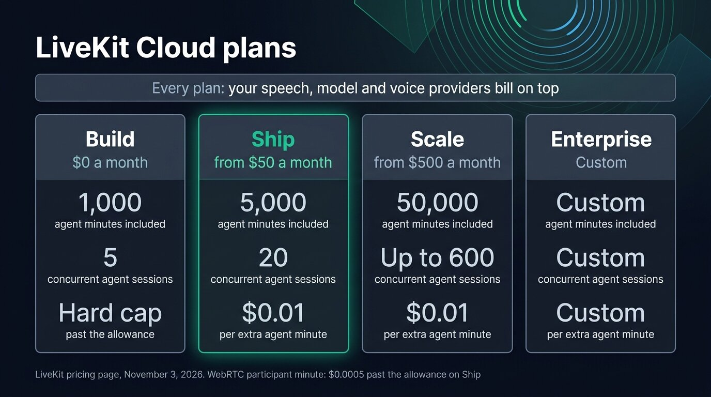
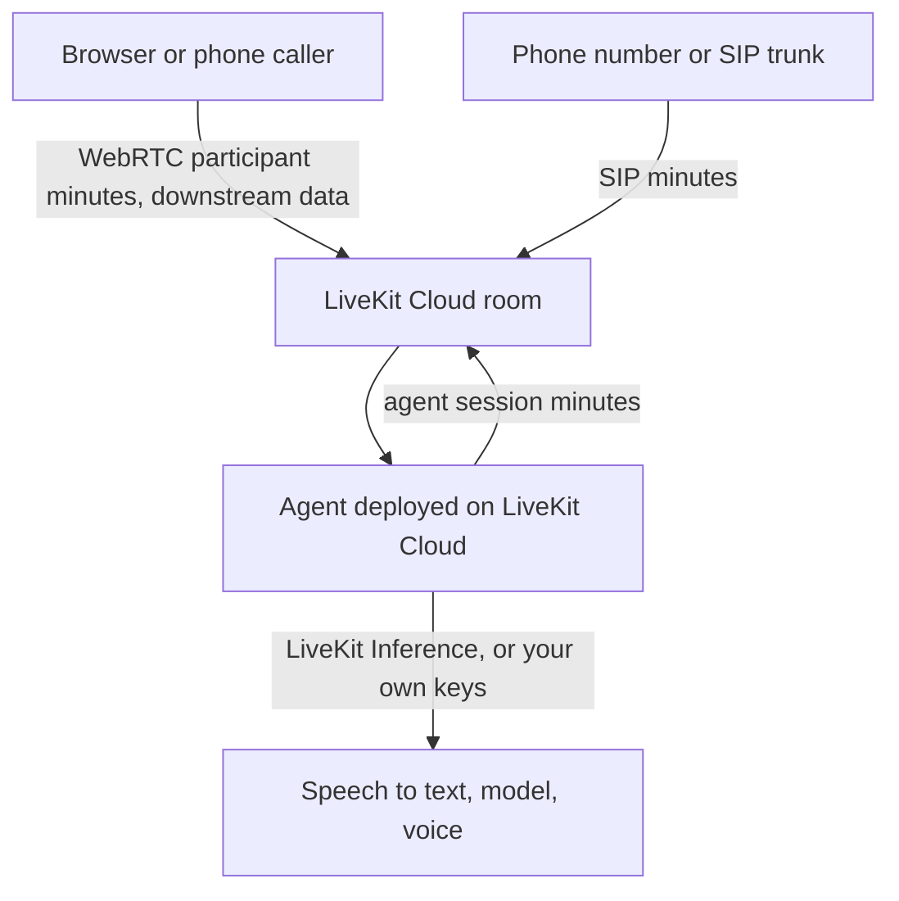
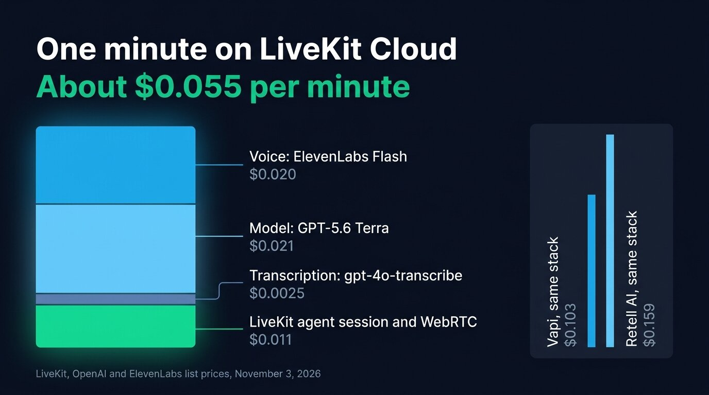
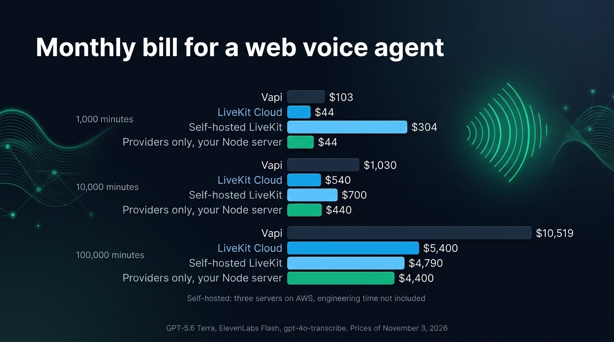

[LiveKit](https://livekit.com) is free to self-host. LiveKit Cloud starts free with 1,000 agent session minutes a month, then costs $50 a month on Ship and $500 on Scale, plus $0.01 for each extra agent minute, according to [LiveKit's prices on November 3, 2026](https://livekit.com/pricing). Your speech to text, model and voice providers bill on top, either directly on your own keys or through LiveKit Inference. A web voice agent on a common stack comes to about $0.055 a minute on LiveKit Cloud, of which $0.011 goes to LiveKit.

LiveKit is an open source WebRTC media server with an agent framework on top, LiveKit Agents, in Python and Node. The company raised a $100 million Series C at a $1 billion valuation in January 2026. Below, we split the LiveKit Cloud bill into its meters, price one minute of conversation with the same stack we used for [Vapi's pricing](/blog/vapi-pricing), then work out the monthly bill at 1,000, 10,000 and 100,000 minutes on LiveKit Cloud, on your own LiveKit servers, and with no media server at all.

## LiveKit pricing in short

| | Build | Ship | Scale | Enterprise |
| --- | --- | --- | --- | --- |
| Monthly price | $0 | from $50 | from $500 | Custom |
| Agent session minutes included | 1,000 | 5,000 | 50,000 | Custom |
| Extra agent session minute | hard cap | $0.01 | $0.01 | Custom |
| Concurrent agent sessions | 5 | 20 | up to 600 | Custom |
| Agent deployments | 1 | 2 | 4 | Custom |
| WebRTC participant minutes included | 5,000 | 150,000, then $0.0005 | 1.5 million, then $0.0004 | Custom |
| Downstream data included | 50 GB | 250 GB, then $0.12 per GB | 3 TB, then $0.10 per GB | Custom |
| LiveKit Inference credits | $2.50 | $5 | $50 | Custom |
| Third-party SIP minutes included | 1,000 | 5,000, then $0.004 | 50,000, then $0.003 | Custom |
| US local phone number | 1 free | 1 free, then $1 a month | 1 free, then $1 a month | Custom |
| Session recordings included | 1,000 minutes | 5,000, then $0.005 a minute | 50,000, then $0.005 a minute | Custom |
| Support | Community | Email | Email | Slack channel and SLA |

These are LiveKit's prices on November 3, 2026. The Build plan stops at its allowances instead of billing overage: once a quota is reached, [new operations of that kind fail](https://docs.livekit.io/deploy/admin/quotas-and-limits/). On Scale and Enterprise, LiveKit signs the business associate agreement that HIPAA, the US health privacy law, requires for health data.

{/* IMAGE regen: api.py image, infographic, 1600x900. Scene: "Infographic of four pricing cards side by side, of equal width, each with a header, a price, and three large figures stacked vertically with a small caption under each. Card 1 header 'Build', price '$0 a month', figures: '1,000' caption 'agent minutes included', '5' caption 'concurrent agent sessions', 'Hard cap' caption 'past the allowance'. Card 2 header 'Ship', price 'from $50 a month', figures: '5,000' caption 'agent minutes included', '20' caption 'concurrent agent sessions', '$0.01' caption 'per extra agent minute'. Card 3 header 'Scale', price 'from $500 a month', figures: '50,000' caption 'agent minutes included', 'Up to 600' caption 'concurrent agent sessions', '$0.01' caption 'per extra agent minute'. Card 4 header 'Enterprise', price 'Custom', figures: 'Custom' caption 'agent minutes included', 'Custom' caption 'concurrent agent sessions', 'Custom' caption 'per extra agent minute'. The Ship card has a thin emerald outline, the others a slate outline. A band across the top of all four cards reads: 'Every plan: your speech, model and voice providers bill on top'. Title at top left, in a modern clean bold sans-serif: 'LiveKit Cloud plans'. Footer small text: 'LiveKit pricing page, November 3, 2026. WebRTC participant minute: $0.0005 past the allowance on Ship'. Wide 16:9 layout, generous spacing, labels in white and light slate."
    Infographic only: regenerate if LiveKit changes its plans, their prices or their allowances. Last data sync: 2026-11-03. */}


## What LiveKit Cloud bills

A voice agent call on LiveKit Cloud runs through a room. The browser joins the room as a participant and your agent joins it as another one. LiveKit then meters each part of the call separately.



### Agent session minutes

LiveKit Cloud meters agent session time when the agent is deployed on its infrastructure. LiveKit [bills agent sessions](https://docs.livekit.io/deploy/admin/billing/) "in increments of 1 second with a 10-second minimum per session", from the moment the agent connects to the room until the room ends or the agent leaves. LiveKit still bills 10 seconds for a call where the agent connects and the user never answers. Past the plan allowance, each minute costs $0.01 on Ship and Scale.

LiveKit applies the agent session meter to agents "deployed to LiveKit Cloud" and lists no such charge for an agent you run on your own servers. If that agent connects to a LiveKit Cloud project, you still pay for the room it joins.

### WebRTC participant minutes and data

LiveKit counts minutes for every participant in the room, the agent included. A LiveKit team member [confirmed an estimate on the community forum](https://community.livekit.io/t/agent-pricing-end-to-end/608) in March 2026. That estimate counted the agent, the user and a recording as three participants for the length of the call. A one-to-one voice call without recording therefore uses two participant minutes per minute. Ship includes 150,000 participant minutes, enough for 75,000 minutes of calls, then charges $0.0005 per extra participant minute.

Downstream data rarely adds to the bill for audio. An Opus voice stream at 32 kbit/s carries about 0.24 MB a minute, so 100,000 minutes of calls send about 24 GB to the browsers, well inside the 250 GB that even Ship includes.

### Telephony

A phone call reaches the room over SIP. Every plan includes one free US local number. Ship and Scale then charge $1 a month per extra number, with inbound minutes at $0.01 past the 100 included on Ship or the 1,000 on Scale. Toll-free numbers cost $2 a month and $0.02 a minute. If you bring a trunk from Twilio or another carrier, LiveKit bills its own SIP minutes at $0.004 on Ship or $0.003 on Scale, on top of what the carrier bills for its minutes.

### LiveKit Inference, or your own provider keys

LiveKit Inference resells speech to text, language models and voices behind your LiveKit key, so one bill covers the whole pipeline. Build includes $2.50 of credits and Ship $5, which LiveKit puts at about 50 and 100 minutes of conversation. Scale includes $50 and gets lower rates on some models. LiveKit Inference [bills models by tokens, transcription by connection time and voices by characters](https://livekit.com/pricing/inference):

- GPT-5.6 Terra costs $2 per million input tokens and $12 per million output tokens, the same as OpenAI's own list price.
- Nova-3, Deepgram's speech to text model, costs $0.0048 per minute of connection on Build and Ship, $0.0042 on Scale.
- Sonic 3, Cartesia's voice model, costs $50 per million characters on Build and Ship, $37.50 on Scale.

LiveKit Inference sold neither ElevenLabs voices nor gpt-4o-transcribe on November 3, 2026. LiveKit Agents still runs them through its plugins on your own API keys, with the providers billing you directly. LiveKit Inference also sells audio turn detection at $0.50 per 1,000 requests and adaptive interruption at $1.20 per 1,000 requests, both free for agents deployed on LiveKit Cloud.

## A minute of a voice agent on LiveKit Cloud, line by line

Take a voice agent inside a web app, deployed on LiveKit Cloud. It runs on GPT-5.6 Terra, speaks with ElevenLabs Flash and transcribes with gpt-4o-transcribe, the stack we used to [price a minute on Retell AI](/blog/retell-ai-pricing) and on Vapi, so you can compare the three bills line for line. A typical minute holds 25 seconds of user speech, 30 seconds of agent speech and four turns. The model reads a 1,500 token system prompt and the whole history again on every turn, so it takes about 10,000 input tokens and returns 100 output tokens a minute.

| Line | Basis | Per minute |
| --- | --- | --- |
| Agent session | one agent, past the plan allowance | $0.010 |
| WebRTC participant minutes | user and agent, past the plan allowance | $0.001 |
| gpt-4o-transcribe, own key | 25 s of user speech at $0.006 a minute | $0.0025 |
| GPT-5.6 Terra, own key | 10,000 input and 100 output tokens at $2 and $12 per million | $0.021 |
| ElevenLabs Flash, own key | about 500 characters at $40 per million | $0.020 |
| Turn detection | included for agents deployed on LiveKit Cloud | $0 |
| Total, web call | | about $0.055 |
| Total, inbound call on a LiveKit US number | plus $0.01 of inbound minutes | about $0.065 |

The model and voice prices come from [OpenAI's API prices](https://developers.openai.com/api/docs/pricing) and [ElevenLabs' API prices](https://elevenlabs.io/pricing/api). ElevenLabs counts about 1,000 characters per minute of audio, so 30 seconds of agent speech is about 500 characters. OpenAI bills only the user's speech when the plugin sends it audio cut by voice activity detection. A streaming transcriber that bills connection time charges the full minute.

LiveKit takes $0.011 of this minute, a fifth of the bill. Vapi charges $0.050 of hosting for the same minute and bills transcription for the whole call on both channels, for a total of $0.103. Retell AI comes to $0.159 before add-ons.

The same agent on LiveKit Inference, with Deepgram Nova-3 and Cartesia Sonic 3 in place of the two models that Inference lacks, costs about $0.062 a minute. Nova-3 bills the whole minute of connection, $0.0048, and Sonic 3 costs $0.025 for 500 characters. Inference costs a little more than your own keys here, and puts the three providers on one LiveKit bill.

{/* IMAGE regen: api.py image, infographic, 1600x900. Scene: "Infographic showing how one minute of a LiveKit Cloud web call adds up. A single vertical stacked bar on the left, built from four segments, bottom to top, each with its label and price to its right, connected by thin lines: 'LiveKit agent session and WebRTC' '$0.011', 'Transcription: gpt-4o-transcribe' '$0.0025', 'Model: GPT-5.6 Terra' '$0.021', 'Voice: ElevenLabs Flash' '$0.020'. The LiveKit segment is in bright emerald, the three provider segments are sky blue and slate, all heights strictly proportional to their prices, so the model and voice segments are the largest. At the top of the bar, a bold total: 'About $0.055 per minute'. To the right of the bar, a smaller comparison column with two thin bars at the same scale, labelled 'Vapi, same stack' '$0.103' and 'Retell AI, same stack' '$0.159'. Title at top left, in a modern clean bold sans-serif: 'One minute on LiveKit Cloud'. Footer small text: 'LiveKit, OpenAI and ElevenLabs list prices, November 3, 2026'. Wide 16:9 layout, lots of breathing room, labels in white and light slate."
    Infographic only: regenerate if LiveKit changes its agent minute or WebRTC prices, or OpenAI or ElevenLabs change the prices used in the worked example. Last data sync: 2026-11-03. */}


## LiveKit Cloud at 1,000, 10,000 and 100,000 minutes a month

The plan depends on volume and on concurrency. This example spreads the calls over 22 working days of 8 hours, with three times the average load in the busiest hour, so the peak reaches one call at once at 1,000 minutes, about 3 at 10,000 and about 29 at 100,000. Ship allows 20 concurrent agent sessions, so 100,000 minutes needs Scale.

| Minutes per month | Plan | LiveKit usage | LiveKit bill | Providers at $0.044 | Total |
| --- | --- | --- | --- | --- | --- |
| 1,000 | Build | inside the 1,000 included minutes | $0 | $44 | $44 |
| 10,000 | Ship | $50 plan, plus 5,000 extra agent minutes at $0.01 | $100 | $440 | $540 |
| 100,000 | Scale | $500 plan, plus 50,000 extra agent minutes at $0.01 | $1,000 | $4,400 | $5,400 |

At 1,000 minutes the Build plan covers the calls for free, with no margin. In a month at 1,050 minutes, the last calls would fail, so a product in production usually moves to Ship at $50 for the overage billing and email support. WebRTC participant minutes stay inside the allowance at all three volumes: 200,000 at 100,000 minutes, against the 1.5 million of Scale. Recording every call would add $250 a month at that volume, since Scale includes 50,000 minutes of recordings and charges $0.005 for each extra minute.

Vapi bills $10,519 for the same 100,000 minutes and the same providers, including its $29 Core package and the 19 extra call lines that a peak of 29 concurrent calls requires. The difference is mostly Vapi's $0.05 hosting fee against LiveKit's $0.01 agent minute.

## Self-hosting LiveKit

The LiveKit server, LiveKit Agents and the SIP gateway are open source under Apache 2.0, so running them on your own machines costs nothing in licences. You pay for the servers, and for the time someone spends running them.

A self-hosted deployment has two parts:

- The media server, which has to be [reachable on TCP 7880 and 7881 and on the UDP range 50000 to 60000](https://docs.livekit.io/transport/self-hosting/deployment/), with a domain, a certificate from a trusted authority, and the embedded TURN server on TLS for users behind strict firewalls. LiveKit recommends Redis in production and compute-optimized instances, since the server is bound by CPU and bandwidth.
- The agent workers, which register with the media server over a WebSocket and need no inbound port. LiveKit [recommends 4 cores and 8 GB per agent server](https://docs.livekit.io/deploy/custom/deployments/) as a starting point, for 10 to 25 concurrent sessions depending on the components.

At 100,000 minutes and a peak of 29 calls, you need two agent servers and one media server. On AWS, a c7i.xlarge with 4 vCPU and 8 GB costs $0.1785 an hour on demand in us-east-1, about $130 a month, so three of them come to about $390 a month. The providers still cost $4,400, for a total of about $4,790 against $5,400 on LiveKit Cloud. A second media server for redundancy brings the total to about $4,920. At 1,000 or 10,000 minutes, one media server and one agent server already cost about $260 a month, more than the whole LiveKit share of the Cloud bill.

Self-hosting also changes what turn detection costs. LiveKit [gives self-hosted agents 7,500 turn detection requests a month](https://docs.livekit.io/deploy/admin/quotas-and-limits/) on its hosted model. Past that allowance, you pay $0.50 per 1,000 requests on a paid LiveKit Cloud plan, which starts at $50 a month. Without a paid plan, the agent falls back to a smaller local model. At four turns a minute, 100,000 minutes make 400,000 requests. If you keep the hosted model, you pay about $196 a month for the requests past the allowance, plus $50 for Ship.

The saving comes to about $600 a month at that volume, or about $350 if you keep LiveKit's hosted turn detection, before counting the time your team spends running the servers. Someone has to keep the UDP ports open through your infrastructure, renew certificates, upgrade the server, scale the workers and get paged when a region goes down. A few days of that work each month usually cost more than the saving. TURN also costs bandwidth when it relays a session, since the server receives every relayed packet and sends it out again. Fora Soft, a studio that builds WebRTC products, puts the share of relayed sessions at [15 to 25% in consumer apps](https://www.forasoft.com/learn/video-streaming/articles-streaming/turn-bandwidth-calculator).

Self-hosting pays off when you already run media servers, when your data must stay on your own machines, or at volumes where LiveKit's per-minute charges add up to more than an engineer's salary. Otherwise, LiveKit Cloud is the cheaper way to run LiveKit.

## Running the voice loop without a media server

A browser talking to your own server is a one-to-one call. A WebSocket carries the call's audio through the same load balancers and proxies as your HTTPS traffic, so you skip the room, the UDP ports and the TURN relay. WebRTC still handles lost packets better on poor networks, as we explained when choosing between [WebSocket and WebRTC for a voice agent](/blog/websocket-or-webrtc-voice-agent).

[Micdrop](/) is an open source TypeScript library for real-time voice conversations with AI. `@micdrop/client` handles the microphone, voice activity detection and playback in the browser, while `@micdrop/server` runs the conversation, turn-taking and interruptions inside your existing Node server, on the [providers you choose](/docs/ai-integration) with your own keys. Micdrop is free and MIT licensed. This server runs the stack of the worked example:

```typescript
import { MicdropServer } from '@micdrop/server'
import { OpenaiAgent, OpenaiSTT } from '@micdrop/openai'
import { ElevenLabsTTS } from '@micdrop/elevenlabs'
import { WebSocketServer } from 'ws'

const wss = new WebSocketServer({ port: 8081 })

wss.on('connection', (socket) => {
  new MicdropServer(socket, {
    firstMessage: 'Hi, what can I help you with?',
    agent: new OpenaiAgent({
      apiKey: process.env.OPENAI_API_KEY,
      model: 'gpt-5.6-terra',
      systemPrompt: 'You answer questions about our product.',
    }),
    stt: new OpenaiSTT({
      apiKey: process.env.OPENAI_API_KEY,
      model: 'gpt-4o-transcribe',
    }),
    tts: new ElevenLabsTTS({
      apiKey: process.env.ELEVENLABS_API_KEY,
      voiceId: process.env.ELEVENLABS_VOICE_ID,
      modelId: 'eleven_flash_v2_5',
    }),
  })
})
```

The bill is then the providers alone, about $0.044 a minute, so $44, $440 and $4,400 a month at 1,000, 10,000 and 100,000 minutes, on top of the Node server you already run. LiveKit's $0.011 a minute disappears, along with the second process to deploy. In exchange, Micdrop gives you no hosting, dashboard, call history, telephony, video or multi-party rooms. You build transcript storage and the call history yourself. Micdrop also has a single maintainer and no support contract.

{/* TODO ANECDOTE: compare this computed example with the provider bill per minute Raconte pays in production, if the owner allows it to be published (question 03d8f118). Add one first-person sentence on why Micdrop was written rather than built on LiveKit Agents once question 440eaf17 is answered. */}

You can run a first call in about five minutes, while wiring Micdrop into an existing application takes a few hours. Products like [Raconte.ai](https://raconte.ai), built by Micdrop's maintainer, and [Cibli](https://cibli.fr), a recruitment platform where candidates answer out loud, run on it in production. If you are coming from LiveKit Agents, we mapped [LiveKit's API to Micdrop's for a migration](/blog/alternative-to-livekit-agents).

{/* IMAGE regen: api.py image, infographic, 1600x900. Scene: "Infographic comparing a monthly bill at three volumes, as grouped horizontal bars. Title at top left, in a modern clean bold sans-serif: 'Monthly bill for a web voice agent'. Three rows, each with four bars: a slate bar labeled 'Vapi', a sky-blue bar labeled 'LiveKit Cloud', a lighter sky-blue bar labeled 'Self-hosted LiveKit', and an emerald bar labeled 'Providers only, your Node server'. Row '1,000 minutes': Vapi '$103', LiveKit Cloud '$44', Self-hosted LiveKit '$304', Providers only '$44'. Row '10,000 minutes': Vapi '$1,030', LiveKit Cloud '$540', Self-hosted LiveKit '$700', Providers only '$440'. Row '100,000 minutes': Vapi '$10,519', LiveKit Cloud '$5,400', Self-hosted LiveKit '$4,790', Providers only '$4,400'. Bar lengths proportional within each row. A small note under the chart: 'Self-hosted: three servers on AWS, engineering time not included'. Footer small text: 'GPT-5.6 Terra, ElevenLabs Flash, gpt-4o-transcribe. Prices of November 3, 2026'. Wide 16:9 layout, labels in white and light slate."
    Infographic only: regenerate if LiveKit, Vapi, AWS, OpenAI or ElevenLabs change the prices used in the worked example. Last data sync: 2026-11-03. */}


## When LiveKit Cloud is worth its price

- The call involves more than one browser and one server. The room model handles video, screen sharing, several human participants, or a phone caller bridged into the same room as a web user. Rebuilding any of them over a WebSocket would cost more than LiveKit's $0.01 a minute for a long time.
- You run phone agents. LiveKit gives you a US number at $1 a month, inbound minutes at $0.01 and SIP trunks from any carrier, where Vapi charges $0.05 a minute before telephony.
- Your users call over weak networks. WebRTC sends audio over UDP and skips a lost packet, where TCP holds back every packet behind it until the resend arrives. On a train or in a basement, that difference is audible.
- You want LiveKit without running servers. LiveKit Cloud costs $0.011 a minute, less than a quarter of Vapi's $0.05 hosting fee, with observability and recordings included and no media server to operate.

If you are also weighing Pipecat, the other open source framework, we compared [Pipecat and LiveKit Agents](/blog/pipecat-vs-livekit-agents).

## Frequently asked questions

<FaqList>
  <FaqItem question="Is LiveKit free or paid?">
    Both. The LiveKit media server, LiveKit Agents and the SIP gateway are open source under Apache 2.0, free to run on your own servers. LiveKit Cloud has a free Build plan with 1,000 agent session minutes and 5,000 WebRTC participant minutes a month, and up to 5 concurrent agent sessions. The Build plan stops at those limits instead of billing overage. The paid plans start at $50 a month for Ship and $500 for Scale.
  </FaqItem>
  <FaqItem question="How much does LiveKit cost?">
    LiveKit Cloud costs $0 on Build, from $50 a month on Ship and from $500 on Scale, with each agent session minute past the allowance at $0.01 and each WebRTC participant minute at $0.0005 on Ship. A web voice agent on GPT-5.6 Terra, ElevenLabs Flash and gpt-4o-transcribe costs about $0.055 a minute past the plan allowances in November 2026. At 10,000 minutes a month, the bill comes to $540 on Ship, providers included.
  </FaqItem>
  <FaqItem question="How much does LiveKit Inference cost?">
    LiveKit Inference bills models by tokens, transcription by connection time and voices by characters. GPT-5.6 Terra costs $2 per million input tokens and $12 per million output tokens, Deepgram Nova-3 $0.0048 a minute, and Cartesia Sonic 3 $50 per million characters, with lower rates on some models for Scale. Each plan includes credits: $2.50 on Build, $5 on Ship and $50 on Scale.
  </FaqItem>
  <FaqItem question="Can LiveKit be self-hosted?">
    Yes, the media server and LiveKit Agents run on your own machines under Apache 2.0. You need a media server with open UDP ports, a domain with a trusted certificate and TURN over TLS, plus agent servers that LiveKit sizes at 4 cores and 8 GB for 10 to 25 concurrent sessions. At 100,000 minutes a month, three such servers cost about $390 on AWS, against $1,000 of LiveKit Cloud usage.
  </FaqItem>
  <FaqItem question="Is LiveKit cheaper than Vapi and Retell AI?">
    Yes, LiveKit is cheaper with the same providers. A web call on GPT-5.6 Terra, ElevenLabs Flash and gpt-4o-transcribe costs about $0.055 a minute on LiveKit Cloud, $0.103 on [Vapi](/blog/vapi-pricing) and $0.159 on [Retell AI](/blog/retell-ai-pricing) before add-ons. Vapi and Retell AI include more of the product, though: a call dashboard, call history and phone routing that you configure rather than code.
  </FaqItem>
  <FaqItem question="What are some alternatives to LiveKit?">
    Pipecat is the other main open source framework, in Python, with a managed cloud at $0.01 a minute. Vapi and Retell AI are hosted platforms billed per minute. Dograh is a self-hostable platform with telephony and a visual builder. Micdrop runs the voice loop inside your Node server over a WebSocket, for voice inside a web app. The [open source voice agent frameworks](/blog/open-source-voice-agent-frameworks) differ mostly on language, transport and licence.
  </FaqItem>
</FaqList>

---

LiveKit charges little for what it runs: $0.01 an agent minute and a fraction of a cent of WebRTC, against $0.05 on Vapi, with free self-hosting for teams ready to operate it. At 100,000 minutes, LiveKit itself costs $1,000 a month next to $4,400 of providers. When the call is one browser talking to your own server, that $1,000 and the media server behind it buy a room you do not need. [Micdrop](/) runs the conversation inside your Node server instead. With your own provider keys, you can [start a first call in five minutes](/docs/getting-started).
