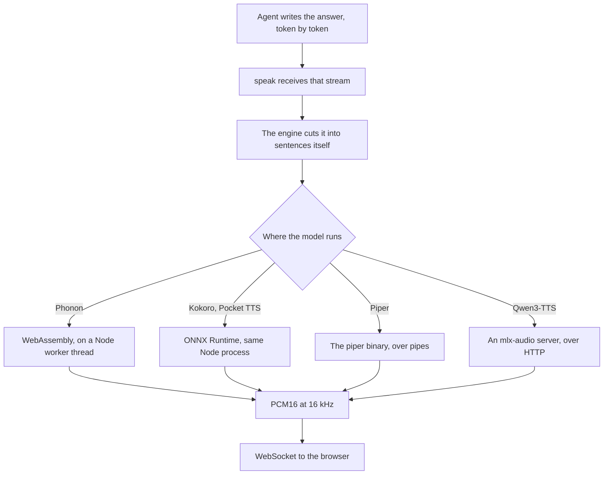

Running the voice locally removes the per-character bill, the network round trip, and the question of what a provider does with every sentence your assistant speaks. Five engines make that practical from a Node server today. Each one is the best on a different measure.

Phonon speaks first, 30 to 100 ms after it is handed a sentence, on a single CPU core. Pocket TTS clones a voice from a few seconds of audio. Piper covers 43 languages on any CPU. Kokoro installs in one npm command and asks for nothing else. Qwen3-TTS sounds closest to a hosted voice and reads ten languages, but it needs a GPU. Every number here comes from the [local model measurements](/docs/ai-integration/local-models) taken on a MacBook Pro M2, on the CPU for Phonon, Pocket TTS, Piper and Kokoro, and on the Apple Silicon GPU for Qwen3-TTS.

## What runs locally in Node today

| Engine                                                              | Runs                    | Languages | First sound    | Voice comes from                         |
| ------------------------------------------------------------------- | ----------------------- | --------- | -------------- | ---------------------------------------- |
| [Phonon](/docs/ai-integration/provided-integrations/phonon)         | On a Node worker thread | 5         | 30 to 100 ms   | A catalog of 102 voices                  |
| [Pocket TTS](/docs/ai-integration/provided-integrations/pocket-tts) | In the Node process     | English   | 250 to 430 ms  | A few seconds of reference audio         |
| [Piper](/docs/ai-integration/provided-integrations/piper)           | In a subprocess         | 43        | ~390 ms        | A voice file you download                |
| [Kokoro](/docs/ai-integration/provided-integrations/kokoro)         | In the Node process     | English   | 900 to 1300 ms | A catalog bundled with the model         |
| [Qwen3-TTS](/docs/ai-integration/provided-integrations/qwen-tts)    | On an mlx-audio server  | 10        | ~400 ms        | Nine speakers, a description or a sample |

Qwen3-TTS generates audio with a language model, so it needs more computation than the other four and runs outside Node. `@micdrop/qwen-tts` sends each sentence over HTTP to an [mlx-audio](https://github.com/Blaizzy/mlx-audio) server, which holds the weights on the Apple Silicon GPU. In exchange you get the voice closest to a hosted one, style instructions such as `"speak slowly"`, and a voice designed from a description or cloned from three seconds of audio.

Two familiar options stay out of this comparison. The Web Speech API lives in the browser rather than in Node, and it is rarely local even there, since most platforms send the text to a server. The macOS `say` command ties you to one operating system and to the voices Apple ships with it.

## Phonon, Kokoro and Pocket TTS run inside Node, Piper as a subprocess

Kokoro and Pocket TTS sit on ONNX Runtime, through different bindings. Kokoro arrives through [Transformers.js](https://huggingface.co/docs/transformers.js), which fetches its weights from Hugging Face on first use, so `npm install @micdrop/kokoro` is the whole setup. Pocket TTS goes through the [sherpa-onnx](https://k2-fsa.github.io/sherpa/onnx/tts/pocket.html) native addon, which ships prebuilt binaries, and asks you to download and extract a 98 MB archive once.

Phonon runs on WebAssembly instead. Gradium wrote its runtime in Rust and publishes it compiled as [`phonon-tts`](https://www.npmjs.com/package/phonon-tts), so `@micdrop/phonon` needs neither a native addon nor Python. It generates on a worker thread, which keeps the event loop of your server free while it synthesizes a sentence, and downloads its 65 MB English model from Hugging Face on first use.

Piper asks for more. You install its binary with `pip install piper-tts` and download a voice as a pair of files. Micdrop then spawns the executable and talks to it over pipes: one utterance per line on standard input, raw PCM16 on standard output.



The engines also differ in what you deploy. Kokoro adds a dependency to your `package.json` and nothing else. Phonon adds the same, plus a Hugging Face token if you pick one of its gated 40M models. Pocket TTS adds an archive to fetch at build time. Piper adds a Python interpreter to your container image, a voice file to ship or download at boot, and a process to supervise. Qwen3-TTS adds a whole server, a 2.6 GB checkpoint the server downloads on its first request, and a GPU to run it on.

Micdrop keeps that Piper process alive across sentences rather than spawning one per sentence, so the voice loads once. On an interruption it kills the process and starts the replacement at once. The replacement loads its voice while the user is still speaking, so it is ready by the time the next answer begins.

## Running one from Node

A Micdrop TTS is a small class you can drive on its own, with no server and no WebSocket. It takes a stream of text and emits PCM16 audio at 16 kHz, [the rate the browser client expects](/blog/audio-sample-rate-voice-agent).

```typescript
import { TTS } from '@micdrop/server'
import { createWriteStream } from 'fs'
import { PassThrough } from 'stream'

// Speaks one sentence and saves the audio to a file
function speak(tts: TTS, text: string, path: string) {
  const start = Date.now()
  const file = createWriteStream(path)
  let quiet: NodeJS.Timeout | undefined
  let first = true

  tts.on('Audio', (chunk) => {
    if (first) {
      console.log(`First sound after ${Date.now() - start} ms`)
      first = false
    }
    file.write(chunk)
    // No end event exists, so the file closes once the chunks stop coming
    clearTimeout(quiet)
    quiet = setTimeout(() => file.end(), 500)
  })

  const textStream = new PassThrough()
  tts.speak(textStream)
  textStream.end(text)
}
```

The five engines differ only in their constructor.

```typescript
import { PhononTTS } from '@micdrop/phonon'

speak(
  new PhononTTS({ voice: 'Easton' }),
  'Hello, how can I help?',
  'phonon.pcm'
)
```

```typescript
import { KokoroTTS } from '@micdrop/kokoro'

speak(
  new KokoroTTS({ voice: 'britishFemale' }),
  'Hello, how can I help?',
  'kokoro.pcm'
)
```

```typescript
import { PiperTTS } from '@micdrop/piper'

speak(
  new PiperTTS({ modelPath: './voices/fr_FR-siwis-medium.onnx' }),
  'Bonjour, comment puis-je vous aider ?',
  'piper.pcm'
)
```

```typescript
import { PocketTTS } from '@micdrop/pocket-tts'

speak(
  new PocketTTS({ modelDir: './sherpa-onnx-pocket-tts-int8-2026-01-26' }),
  'Hello, how can I help?',
  'pocket.pcm'
)
```

```typescript
import { Qwen3TTS } from '@micdrop/qwen-tts'

// Needs an mlx-audio server listening on http://localhost:8000
speak(
  new Qwen3TTS({ voice: 'Serena', language: 'fr-FR' }),
  'Bonjour, comment puis-je vous aider ?',
  'qwen.pcm'
)
```

Those files hold raw PCM16 at 16 kHz, the format the browser client expects, so `ffplay -f s16le -ar 16000 -ch_layout mono kokoro.pcm` plays one back. In a real integration you forward each chunk instead of writing it, which is what `MicdropServer` does when it pushes them onto the WebSocket as they arrive.

Audio comes back as a stream of chunks rather than as one buffer, so the first words are playable while the rest is still being generated. A TTS signals no end of utterance either, since the engine stops when the agent stops writing and the browser plays whatever reaches it. A consumer that needs a boundary draws its own, which is why that function closes the file on a timer.

Constructing an engine starts loading it, so a `speak` called on the very next line measures the load as well as the synthesis. Give it a second before the first call to reproduce the latency figures, or measure the second sentence instead.

`speak()` takes a `Readable` rather than a string because the agent writes its answer token by token. Each engine carries its own sentence splitter and synthesizes each sentence as soon as it is complete, so nothing upstream has to buffer the answer or cut it up first. Handing it a whole sentence at once is the simplest case.

<Callout type="tip" title="From one class to a whole conversation">
  [MicdropServer](/docs/server) wires this same object to a WebSocket, next to
  speech to text and an agent. You can [run a complete voice conversation on
  your machine](/docs/ai-integration/local-models), with Ollama for the agent
  and Whisper for the transcription.
</Callout>

## Latency, measured

| Measure                         | Phonon                            | Pocket TTS          | Piper               | Kokoro                 | Qwen3-TTS                |
| ------------------------------- | --------------------------------- | ------------------- | ------------------- | ---------------------- | ------------------------ |
| Runs on                         | One CPU core                      | CPU                 | CPU                 | CPU                    | Apple Silicon GPU        |
| First sound, model loaded       | 30 to 100 ms                      | 250 to 430 ms       | ~390 ms             | 900 to 1300 ms         | ~400 ms                  |
| Loading the model or voice      | 0.7 to 0.9 s, first word included | ~470 ms             | ~1 s                | ~1.5 s in `q8`         | Server warm-up at start  |
| Compute per second of audio     | ~0.2 s                            | ~0.2 s              | Far below real time | 0.4 to 0.9 s           | ~0.75 s                  |
| Rest of a multi-sentence answer | Streamed in 80 ms frames          | Streamed as written | Almost free         | Same cost as the first | Streamed in 0.5 s chunks |

The five engines reach their first sound by different routes. Phonon hands over its audio in frames of 80 ms as it generates them, so the first frame reaches the client before the model has written the rest of the sentence. Pocket TTS emits chunks while it is still generating the end of the sentence, so the user hears the opening words early. Piper spends almost all of its time on loading the voice. Micdrop pays that cost when you construct the `PiperTTS` instance, so every sentence after it costs almost nothing. Kokoro synthesizes a whole sentence before emitting it, which is why its first sound arrives about a second later than Phonon, Pocket TTS and Piper. Qwen3-TTS decodes its audio tokens as it generates them and sends half a second of audio at a time, so a sentence starts playing before the model finishes it. At 0.75 seconds of computation per second of speech it stays ahead of playback, with less margin than Phonon, Pocket TTS and Piper.

Kokoro's gap narrows on a long answer, because the reply goes out sentence by sentence and the user hears the opening while the rest is still being written. A short greeting is a single sentence, so nothing hides the gap. A local call answers in about a second with Phonon, Pocket TTS, Piper or Qwen3-TTS and closer to two with Kokoro. The person on the line hears that extra second.

Phonon, Kokoro and Pocket TTS pay a warm-up on their first inference, so Micdrop runs one word through the model at startup. For Qwen3-TTS, the mlx-audio server loads its checkpoint when the `Qwen3TTS` instance is created. Leave `warmup` on and that cost lands while the call is being set up instead of while somebody waits.

We measured speed only. For accuracy, [Gradium's own benchmarks](https://gradium.ai/content/gradium-phonon-on-device-tts-benchmarks-2026) transcribe the English Seed-TTS set with Whisper large v3. With a fixed voice, Phonon makes 0.83% word errors against 0.89% for NVIDIA's Magpie and 0.90% for Kokoro. When it clones a voice, it makes 1.00% against 1.27% for Pocket TTS and 1.71% for NeuTTS Nano. Gradium also reports [fewer errors than Magpie in French, German and Spanish](https://gradium.ai/blog/phonon-multilingual-smaller-clearer-better).

## Piper covers 43 languages, Qwen3-TTS ten, Phonon five, Kokoro and Pocket TTS only English

Kokoro and Pocket TTS stop at English for different reasons.

Kokoro's upstream model, [Kokoro-82M](https://huggingface.co/hexgrad/Kokoro-82M), ships 54 voices across eight languages, French and Japanese included. `kokoro-js`, the JavaScript port Micdrop builds on, catalogs 28 of them, every one American or British English. The 26 others ship inside the package without ever being listed, and asking for one throws, because the library checks the id against its catalog before anything else. It then reads the language off the first letter of that id and maps it to `en-us` or `en`.

The espeak-ng port underneath speaks many more languages, which `kokoro-js` never asks it for. The Python stack reaches French the same way, through espeak-ng, since [misaki](https://github.com/hexgrad/misaki) carries native modules for English, Japanese, Korean, Chinese, Vietnamese and Hebrew alone.

Kyutai, the lab behind Pocket TTS, publishes French, German, Spanish, Italian and Portuguese checkpoints as well. None of them has an ONNX conversion, and sherpa-onnx publishes the English model alone, as a quantized archive and a full precision one. Hand it French and you get fluent nonsense.

Phonon, the model Gradium built on Pocket TTS, reads English, French, German, Spanish and Portuguese, with one 40M model per language and a multilingual one that reads all five. The 102 voices of its catalog work with every model. Every 40M model is licensed CC BY-NC 4.0, the English one included, so a commercial product keeps Phonon for English, on the 31M model. Pick the model for the language of the call. Whisper transcribed the 40M French model nearly word for word, a date and a time included, while the English 31M model reading the same French came out unintelligible. Phonon 40M French is also the [fastest local French voice we measured](/blog/french-text-to-speech-voice-agent).

Piper handles languages one voice at a time. Each voice is a small VITS model of a few dozen megabytes, trained on a single language, named after its language, its speaker and its quality: `fr_FR-siwis-medium`, `en_GB-alba-medium`, `de_DE-thorsten-high`. The project lists 43 languages, with [samples](https://rhasspy.github.io/piper-samples/) to listen to before you download one.

Qwen3-TTS reads ten languages from a single checkpoint: Chinese, English, French, German, Italian, Japanese, Korean, Portuguese, Russian and Spanish. Each of its nine speakers was recorded in one language and reads all ten, so `Serena`, recorded in Chinese, reads French as accurately as `Ryan`, recorded in English. In a test of nine French sentences across four speakers, Whisper transcribed eight word for word.

<Callout type="tip" title="Keep the voice and the agent in the same language">
  Pairing an English voice with an agent writing French leaves the voice reading
  French words with English phonemes, and nobody understands the result. Make
  the system prompt name the language the voice speaks.
</Callout>

## Memory and the CPU

Kokoro holds about 80 MB once loaded. Phonon holds about 450 MB in the Node process while it generates. Pocket TTS, a 100 million parameter model, holds 350 MB once loaded and rises to around 600 MB while it generates. Piper keeps its memory in a separate process, roughly the size of the voice file, a few dozen megabytes for a `medium` voice. Qwen3-TTS is by far the heaviest, with 2.5 GB held by the mlx-audio server for the default checkpoint.

Put a whole stack together, with a 4B language model in `Q4`, Whisper `base` and Kokoro, and you hold around 4 GB. The same stack with Qwen3-TTS and the French Whisper model holds about 6.5 GB. Some models for [local speech to text in Node](/blog/local-speech-to-text-node) are smaller than Whisper, such as the small English Vosk model, a 40 MB download against 85 MB for Whisper `base`. Latency limits a local call long before memory does on a 16 GB machine, so spend the spare gigabytes on a larger LLM rather than on a heavier transcription model.

Kokoro's `q8` quantized weights load in around a second and a half against 5.8 seconds for `fp32`, and they generate at the same speed, so quantization buys a faster start rather than faster speech.

Phonon runs on a single CPU core through WebAssembly. Kokoro, Pocket TTS and Piper stay on the CPU on a Mac too. Transformers.js declares no GPU device on macOS, WebGPU does not exist in Node with or without a flag, and CoreML ran three to five times slower than the CPU, because it splits the graph into dozens of partitions and spends its time copying tensors between them. Piper's command line has a `--cuda` flag and no Metal equivalent. On Linux with an NVIDIA card, Kokoro, Pocket TTS and Piper have a GPU path worth trying. Measure that path against the [latency and memory of a local call on a Mac](/docs/ai-integration/local-models/performance).

## Piper's engine went GPL in 2025, Phonon's license depends on the model

The original `rhasspy/piper` repository was archived in October 2025 under the MIT license. Development moved to [OHF-Voice/piper1-gpl](https://github.com/OHF-Voice/piper1-gpl), maintained by the Open Home Foundation, under GPL-3.0. The new repository name shows why. Piper now embeds espeak-ng for phonemization instead of reaching it through a separate library, and espeak-ng is GPL, so the engine became GPL with it.

Micdrop drives that binary as a subprocess over pipes instead of linking it into your application. The Free Software Foundation treats that arrangement as two separate programs. Redistributing the binary yourself puts you back under the GPL terms, so check what your deployment actually ships.

Kokoro's weights and `kokoro-js` are both Apache 2.0, so Kokoro is free for commercial use. Pocket TTS is MIT, with its sherpa-onnx addon under Apache 2.0. Piper and Pocket TTS put their conditions on the voices. Piper's voices are licensed one by one, some restrictively by the project's own account. Pocket TTS makes the consent of the person you clone a condition of use. Read the model card of the voice you pick rather than the license of the repository holding it.

Phonon's license depends on the model you load. Phonon 31M in English and the 102 voices of the catalog are Apache 2.0, and the runtime is MIT or Apache 2.0. The 40M models are gated on Hugging Face and licensed CC BY-NC 4.0, which forbids commercial use in English as in every other language.

## Which one to pick

Pick **Phonon** for an English call that has to answer fast. The 31M model, free for commercial use, starts speaking at least 150 ms before every other engine here, on a single core, with 102 voices to choose from and no native addon to build. In French, German, Spanish or Portuguese it suits a prototype or a research project, since those models forbid commercial use.

Pick **Piper** as soon as a commercial call happens in a language other than English on a machine without a GPU. Kokoro and Pocket TTS speak English only, and Phonon's other languages are licensed for non-commercial use. You pay for that with a Python interpreter in your image, a voice file to ship, and a GPL check on what you redistribute. Piper, Whisper and a Qwen3 model served by Ollama are enough for a [voice agent that runs entirely on your machine](/blog/local-voice-agent-ollama-whisper-piper). It answers in about a second in English and about 1.6 seconds in French, both measured on a MacBook Pro M2.

Pick **Pocket TTS** for an English call that needs a specific voice. It clones a voice on the fly from a few seconds of audio, with no training step. Phonon makes a custom voice only through its offline `create_voice` tool. Pocket TTS starts speaking in 250 to 430 ms, close to Piper. You pay 600 MB of memory while it generates and an archive to fetch at build time, and you need the consent of whoever you clone.

Pick **Kokoro** for an English call when you want the shortest setup. One npm dependency is the whole setup, since the weights download on first use. It costs roughly one extra second before the first word, which a person on a call hears.

Pick **Qwen3-TTS** when the voice has to sound like a hosted one and the machine has a GPU. It reads ten languages with one checkpoint, takes a style instruction, and can design or clone a voice. You pay for that with a Python server next to your app, 2.5 GB of memory, and a Mac with Apple Silicon, the only machine mlx-audio runs on. [Running Qwen3-TTS in Node](/docs/ai-integration/provided-integrations/qwen-tts) takes one npm package and one command to start the server.

Run more than one when the language changes from one call to the next. Micdrop takes a TTS instance per call, so an application serving English and French can hand each conversation the engine that suits its language.

All five plug into the same pipeline as the hosted providers, speech to text then agent then voice, so swapping between them, or from ElevenLabs to a local voice, only means replacing the line that creates the engine. Cartesia, Gradium and OpenAI are the hosted [alternatives to ElevenLabs](/blog/elevenlabs-alternatives-typescript), billed per character instead of running on your machine. You can [compare every voice provider side by side](/docs/ai-integration) and [run a first voice call in about five minutes](/docs/getting-started).

## Frequently asked questions

<FaqList>
  <FaqItem question="Is Piper TTS free?">
    Yes, and the terms changed in 2025. The engine now lives at
    OHF-Voice/piper1-gpl under GPL-3.0, after it absorbed espeak-ng, while the
    archived rhasspy/piper repository was MIT. Using it costs nothing either
    way. The GPL affects redistribution. Driving the binary as a subprocess,
    which is how Micdrop uses it, keeps your application separate from the
    engine, while shipping the engine inside your own distribution brings the
    GPL terms with it. The voices are licensed one by one and some are
    restrictive, so read the model card of the voice you download.
  </FaqItem>
  <FaqItem question="Can Kokoro speak French?">
    The upstream Kokoro-82M model holds French voices, and `kokoro-js` never
    lists them. It catalogs 28 voices, all American or British English, and it
    throws on any other id instead of mispronouncing the language. Pocket TTS is
    English only too, since its French checkpoint has no ONNX conversion. Use
    Piper for French. It covers 43 languages with voices trained one language at
    a time, such as `fr_FR-siwis-medium`. Qwen3-TTS also reads French, on a GPU.
    Phonon reads it with its 40M French model, for non-commercial use.
  </FaqItem>
  <FaqItem question="Is Kokoro TTS free for commercial use?">
    Yes. The Kokoro-82M weights are released under Apache 2.0, which allows
    commercial use, and so is `kokoro-js`, the JavaScript port Micdrop builds
    on. The voices ship with the model under the same license. Piper's engine is
    GPL-3.0 with voices licensed one by one. Phonon is free for commercial use
    only with its 31M English model.
  </FaqItem>
  <FaqItem question="What is the fastest local TTS?">
    Phonon puts out its first sound 30 to 100 ms after it receives a sentence,
    on one CPU core of a MacBook Pro M2 with the model loaded. On the same CPU,
    Pocket TTS takes 250 to 430 ms, Piper around 390 ms and Kokoro 900 to 1300
    ms. Qwen3-TTS reaches about 400 ms on the Apple Silicon GPU. Speed alone
    rarely settles the choice. Pocket TTS and Kokoro speak English only, and
    Phonon's other languages forbid commercial use, so a commercial call in
    another language goes to Piper or Qwen3-TTS whatever the numbers say.
  </FaqItem>
  <FaqItem question="Does local text to speech need a GPU?">
    Phonon, Kokoro, Pocket TTS and Piper need none. Phonon runs on a single core
    through WebAssembly. The measurements in this article come from a laptop
    CPU, and on a Mac the CPU is the fastest path available, since
    Transformers.js exposes no GPU device on macOS and CoreML ran three to five
    times slower. On Linux with an NVIDIA card, Kokoro takes `device: 'cuda'`,
    Pocket TTS takes `provider: 'cuda'` and Piper has a `--cuda` flag. Measure
    those three on the hardware you deploy to. Qwen3-TTS needs one, since it
    generates audio with a language model.
  </FaqItem>
  <FaqItem question="What is the best local TTS model?">
    It comes down to the language of the call and the hardware you deploy to. On
    a CPU, pick Phonon for an English call that has to answer fast, Piper for a
    commercial call in any other language, Pocket TTS for a cloned English
    voice, and Kokoro when you want the shortest setup.
    [Qwen3-TTS](/docs/ai-integration/provided-integrations/qwen-tts) sounds more
    natural than all four and reads ten languages with one checkpoint. In
    exchange it needs a GPU, an mlx-audio server running next to your app, and
    2.5 GB of memory once the checkpoint is loaded.
  </FaqItem>
</FaqList>
