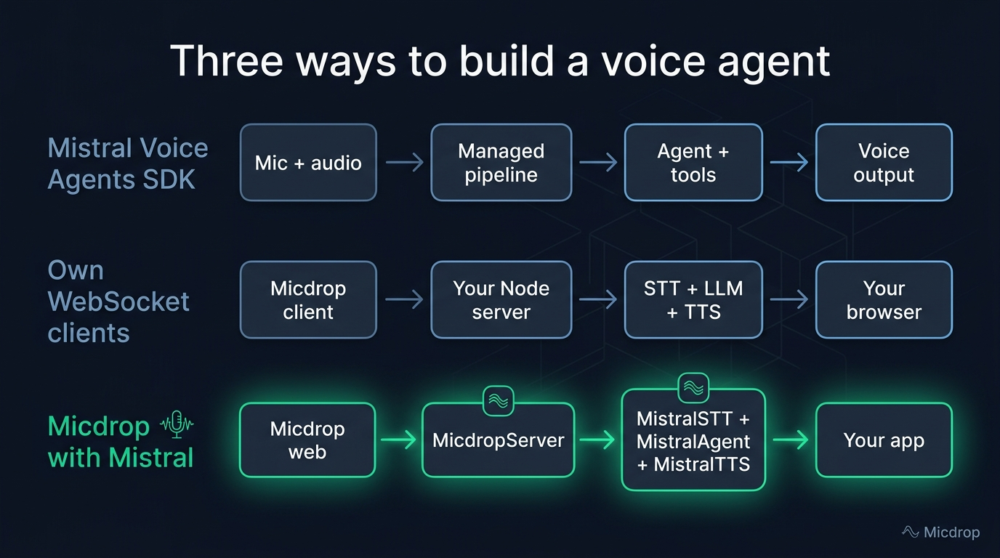
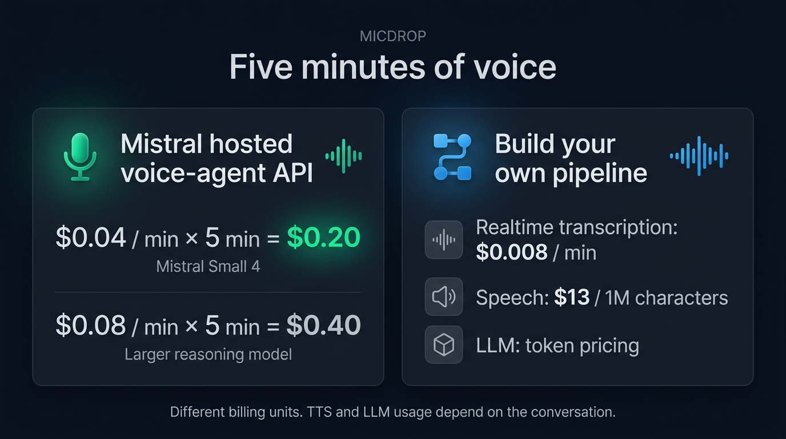

A Mistral voice agent can use Mistral’s Voice Agents SDK for a managed conversation, or a custom pipeline that connects transcription, an LLM and speech output. With [Micdrop](/), an open source TypeScript library for real-time voice conversations, you keep the browser and Node.js pipeline and use Mistral for all three model stages. This tutorial compares the routes and builds the Micdrop version.

Mistral announced Voxtral 3 on October 20, 2026. Its family includes streaming and batch transcription, speech generation, and a voice-agent SDK. Mistral’s [release announcement](https://mistral.ai/news/voxtral-3/) lists separate prices for each service, so a voice agent built from individual APIs has a different bill from the managed voice-agent API.

## What Voxtral 3 includes

Voxtral 3 is a family of speech models and a voice-agent service, with a separate model for each stage. The [Mistral pricing page](https://docs.mistral.ai/inference/pricing/) and launch announcement list these rates:

| Service | What it does | Published price |
| --- | --- | ---: |
| Voxtral Mini Transcribe 3 | Batch transcription | $0.0035 per audio minute |
| Voxtral Small Transcribe 3 | Batch transcription | $0.004 per audio minute |
| Voxtral Mini Transcribe Realtime 3 | Streaming transcription | $0.008 per audio minute |
| Voxtral Mini TTS 3, also called Voxtral Speech 3 | Text to speech | $13 per million characters |
| Voice-agent API with Mistral Small 4 | Managed voice conversation | $0.04 per minute |
| Voice-agent API with a larger reasoning model | Managed voice conversation | $0.08 per minute |

Mistral’s realtime transcription documentation lists 40+ languages, while its launch announcement says more than 35. The provider lists 35+ languages and 50+ dialects for Voxtral Speech 3. These are Mistral’s published specifications. Measured performance depends on the test setup. For Micdrop’s measured comparison of Voxtral Realtime with other speech-to-text models, see [the transcription benchmark](/blog/gpt-4o-transcribe-vs-gemini-vs-voxtral).

For a voice agent, the relevant transcription model is `voxtral-mini-transcribe-realtime-3-0`. The speech model used by Micdrop’s Mistral integration is `voxtral-mini-tts-3-0`. Mistral also has a separate realtime TTS model and WebSocket for sending text as it is generated. The [realtime TTS guide](https://docs.mistral.ai/studio/audio/text-to-speech/speak-in-realtime) documents that path. Micdrop’s current `MistralTTS` sends one complete sentence to the regular speech endpoint, then streams the returned audio chunks to the client.

{/* IMAGE regen: api.py image, infographic, 1600x900. Scene: "A comparison infographic with three horizontal rows showing approaches to building a Mistral voice agent. Exact title: 'Three ways to build a voice agent'. Row one title 'Mistral Voice Agents SDK'. Flow labels 'Mic + audio', 'Managed pipeline', 'Agent + tools', 'Voice output'. Row two title 'Own WebSocket clients'. Flow labels 'Micdrop client', 'Your Node server', 'STT + LLM + TTS', 'Your browser'. Row three title 'Micdrop with Mistral'. Flow labels 'Micdrop web', 'MicdropServer', 'MistralSTT + MistralAgent + MistralTTS', 'Your app'. Show arrows left to right in every row. Highlight the modular Micdrop row in emerald. Use subdued sky blue and slate for the other rows. Keep all labels readable and avoid extra text or numbers." Infographic only: regenerate if an approach, SDK feature or Micdrop integration changes. Last data sync: 2026-11-01. */}


## Three ways to build on Mistral

Mistral’s [Voice Agents SDK](https://docs.mistral.ai/studio/audio/voice-agents/overview) manages microphone audio, transcription, reasoning, tool calls, speech generation and playback in a real-time session. It builds on LiveKit for audio transport. Use it when you want Mistral to manage the entire conversational pipeline and your application mainly supplies instructions, tools and business logic. The service lists $0.04 a minute with Mistral Small 4 as the reasoning model, or $0.08 with a larger model.

You can also write your own WebSocket client and connect to speech and language APIs separately. That gives you control over audio transport, turn handling, provider selection and where the application runs. You also own audio capture and playback, reconnection, interruption handling and the work of connecting the model stages. The Mistral realtime TTS WebSocket accepts text as it is generated. The regular speech endpoint takes a complete text input.

The third route uses Micdrop for the browser-to-server voice pipeline, then Mistral for transcription, the agent and speech. Micdrop handles microphone capture, voice activity detection, WebSocket transport, playback and provider interfaces. Its server runs in your Node application, and you pay Mistral for the APIs you call. Micdrop is MIT licensed and carries no usage fee.

| Approach | Who handles audio and turns? | Provider choice | Published usage price |
| --- | --- | --- | --- |
| Mistral Voice Agents SDK | Mistral’s voice-agent service and LiveKit-based SDK | Mistral voice-agent configuration | $0.04 or $0.08 per minute |
| Your own WebSocket clients | Your application | Each stage can use a different service | Each provider’s model pricing |
| Micdrop with Mistral | Micdrop’s browser client and Node server | Mistral for STT, agent and TTS, with other Micdrop integrations available | Each Mistral API’s model pricing |

Choose based on what you want to operate. Mistral’s SDK covers the live audio session. A custom client gives you direct control. Micdrop provides a TypeScript browser client and server pipeline, with provider integrations you can swap.

## What does a five-minute call cost?

Mistral’s published voice-agent API price gives a direct calculation. Five minutes at $0.04 per minute costs $0.20 with Mistral Small 4. At $0.08 per minute, a larger reasoning model costs $0.40 for the same call duration. These totals use Mistral’s listed per-minute rates. Check the service’s current billing terms before treating them as an all-in production estimate.

A pipeline built from the separate APIs has different units. Five minutes of realtime transcription at $0.008 per minute costs $0.04, assuming the provider bills all five minutes as transcribed audio. Voxtral Speech 3 costs $13 per million characters, or $0.000013 per character. For example, 5,000 characters of generated speech cost $0.065. The Mistral model used as the agent is billed separately under its token pricing.

{/* IMAGE regen: api.py image, infographic, 1600x900. Scene: "A clear pricing infographic with two large side-by-side panels and exact text. Title: 'Five minutes of voice'. Left panel title: 'Mistral hosted voice-agent API'. Show the equation '$0.04 / min × 5 min = $0.20' and below it 'Mistral Small 4'. Second line '$0.08 / min × 5 min = $0.40' and below it 'Larger reasoning model'. Right panel title: 'Build your own pipeline'. Show three separate cost labels: 'Realtime transcription: $0.008 / min', 'Speech: $13 / 1M characters', 'LLM: token pricing'. Add a small clear note along the bottom: 'Different billing units. TTS and LLM usage depend on the conversation.' Highlight the $0.20 figure in emerald, use blue accents for the modular pipeline panel. Exact alignment, large legible typography, simple geometric soundwave and cost symbols, no other numbers or labels." */}


This calculation separates the billing units. Speech output varies with the agent’s answers, and the LLM bill depends on the model, input context and generated tokens. Compare audio, generated text and reasoning work across the two routes.

## Build the Node server with Micdrop

Micdrop’s Mistral integration supplies `MistralSTT`, `MistralAgent` and `MistralTTS`. Install those packages and `ws` for the WebSocket server:

```bash
npm install @micdrop/server @micdrop/web @micdrop/mistral ws
```

The integration page documents [Mistral’s agent, transcription and speech options](/docs/ai-integration/provided-integrations/mistral). Here is a minimal server using one Mistral API key for all three components:

```typescript
import { MistralAgent, MistralSTT, MistralTTS } from '@micdrop/mistral'
import { MicdropServer } from '@micdrop/server'
import { WebSocketServer } from 'ws'

const apiKey = process.env.MISTRAL_API_KEY || ''
const systemPrompt = 'You are a helpful voice assistant. Keep answers concise.'
const wss = new WebSocketServer({ port: 8081 })

wss.on('connection', (socket) => {
  new MicdropServer(socket, {
    agent: new MistralAgent({ apiKey, systemPrompt }),
    stt: new MistralSTT({ apiKey }),
    tts: new MistralTTS({ apiKey, voiceId: 'voice_592' }),
  })
})
```

`voice_592` is Marie, a preset French voice. Micdrop’s Mistral integration lists four French options: Marie, Camille, Manon and Lea. For English, the package default is James (`voice_3150`).

The STT integration sends 16 kHz PCM16 mono audio to Voxtral Realtime. Micdrop’s browser client streams that format, which avoids an extra resampling step. In the repository’s test, realtime STT returned results in under 500 ms and matched Voxtral 2 on the test chunks. The `MistralAgent` uses Mistral’s chat API for the response. `MistralTTS` divides the answer into sentences, sends each one to Mistral’s speech endpoint and streams the resulting audio back through Micdrop.

To add tools, attach them to the agent with `addTool`. The tool’s `execute` function should call your own application logic, such as querying an order or scheduling a visit. The [Micdrop tools guide](/docs/server/tools) shows the schema and event options. Treat each tool as a permission boundary: validate its inputs and authorize the requested action in your server code.

## Start the call in a browser or React app

The browser client connects to the Node server over WebSocket. Start with the [getting started guide](/docs/getting-started) for the rest of the client setup, then open a call from a user action:

```typescript
import { Micdrop } from '@micdrop/web'

await Micdrop.start({ url: 'ws://localhost:8081' })
```

In a production deployment, serve the page over HTTPS and connect with `wss://` to the public WebSocket endpoint. For React, install `@micdrop/react` and read call state with `useMicdropState`, then call `Micdrop.start()` from a button handler. The [React hooks documentation](/docs/client/react-hooks) includes a complete call component.

Mistral’s [browser SDK](https://docs.mistral.ai/studio/audio/voice-agents/browser) creates a session on your server and returns connection credentials to the page. Keep the API key on the server, protect session creation and authorize every tool call in your application.

## Choose a voice, emotion and cloning approach

Voxtral Speech 3 supports preset voices and voice cloning. Mistral’s realtime TTS documentation accepts a short `ref_audio` sample. Its launch page says Pro Voice adaptation uses 30+ minutes of audio. These are two voice adaptation routes, so check the current [voice-cloning documentation](https://docs.mistral.ai/studio/audio/text-to-speech/voice-cloning) before collecting recordings.

Mistral also describes emotion, pace and emphasis controls for Speech 3. In the Micdrop pipeline, the agent can include supported tags in its generated text when its system prompt asks for them. Test each tag and voice with your own phrases before you rely on it. A tag that works with the standalone TTS model may behave differently in a different API mode.

{/* TODO ANECDOTE: Ask the owner how Voxtral Speech 3 sounds against ElevenLabs and Cartesia for naturalness, French pronunciation and expressiveness. Add the first-hand verdict here, with the test language and preset voice, once answered. */}

If you use a cloned voice, get permission from the speaker and keep the source recording under the same access and retention rules as other voice data. The Mistral service and the application that stores the recording can have different retention policies.

## Can the whole agent stay in Europe?

Mistral lists European, US and global API endpoints for Voxtral 3 in its [release announcement](https://mistral.ai/news/voxtral-3/). In the Micdrop integration, `MistralTTS` accepts a `baseUrl` option for Mistral’s European endpoint. `MistralSTT` and `MistralAgent` call the global endpoint, so those two stages need another integration when their requests must stay in Europe.

Set the European base URL on the TTS request:

```typescript
const tts = new MistralTTS({
  apiKey,
  voiceId: 'voice_592',
  baseUrl: 'https://api.eu.mistral.ai',
})
```

For a pipeline that must keep transcription and reasoning in Europe, choose integrations that expose the required endpoint, or use a provider with a documented European region for those stages. See how to [combine Mistral with other European voice providers](/docs/ai-integration/sovereign-voice-ai). The French [TypeScript example of a European voice pipeline](/blog/agent-vocal-ia-souverain) also explains which Mistral stages currently use a European endpoint. Check each provider’s data terms and where your Node server stores transcripts and audio.

## Does Voxtral Speech 3 stream its audio?

Mistral exposes two text-to-speech routes. The regular speech endpoint accepts a complete text input and streams audio chunks as it synthesizes. The separate realtime TTS WebSocket accepts text pieces as the agent writes them, then returns audio as it becomes ready. Mistral explains the difference in its [realtime TTS guide](https://docs.mistral.ai/studio/audio/text-to-speech/speak-in-realtime) and [streamed speech guide](https://docs.mistral.ai/studio/audio/text-to-speech/stream-speech).

Micdrop’s `MistralTTS` currently uses the regular endpoint, one request for each sentence. Its package documentation and test example report first audio after about 0.5 to 0.6 seconds per sentence. The test generated a 3.4-second sentence in 0.85 seconds. Those measurements come from the Micdrop repository’s test setup. Your latency depends on your server and region. See [streaming TTS options and their trade-offs](/blog/streaming-text-to-speech-llm) for the difference between streaming input text and streaming audio output.

## Which build should you pick?

Choose Mistral’s Voice Agents SDK when you want the service to manage the full conversation and the published per-minute rate fits your budget. Choose your own WebSocket clients when you need direct control over transport and model stages and are ready to build the audio path. Choose Micdrop when you want its existing TypeScript browser and Node pipeline, with the option to replace Mistral components later.

Before you ship, check the required language, latency, endpoint region, TTS mode and data retention for the exact models you call. See how to [configure Mistral’s agent, STT and TTS integrations in Micdrop](/docs/ai-integration/provided-integrations/mistral). To [set up your first voice call with the client and server](/docs/getting-started), start with the initial integration steps.

## Frequently asked questions

<FaqList>
  <FaqItem question="How much does Voxtral TTS cost?">
    Voxtral Speech 3 costs $13 per million characters, according to Mistral’s pricing page. The managed voice-agent API has a separate per-minute rate.
  </FaqItem>
  <FaqItem question="How much does Mistral’s voice-agent API cost?">
    Mistral lists $0.04 per minute with Mistral Small 4 as the reasoning model and $0.08 per minute with a larger model. Realtime transcription is priced separately at $0.008 per audio minute.
  </FaqItem>
  <FaqItem question="Does Voxtral TTS stream audio?">
    Yes. The regular Voxtral Speech endpoint can stream audio chunks for a complete text request. A separate realtime TTS WebSocket accepts text as it is being generated and streams speech back while the text arrives. Micdrop’s current `MistralTTS` uses the regular endpoint one sentence at a time.
  </FaqItem>
  <FaqItem question="How many languages does Voxtral Speech 3 support?">
    Mistral lists more than 35 languages and 50+ dialects for Voxtral Speech 3. Preset voices are available in 18 languages. The available preset voice IDs depend on the language, and the Mistral integration page lists the French options used by Micdrop.
  </FaqItem>
  <FaqItem question="Can I run a Mistral voice agent with one API key?">
    Yes. The Micdrop pipeline can use the same Mistral API key for `MistralSTT`, `MistralAgent` and `MistralTTS`. Each API stage is billed separately at its own model rate. Mistral’s managed Voice Agents API is a separate service with its own per-minute price.
  </FaqItem>
  <FaqItem question="Can I use Micdrop’s Mistral integration entirely in Europe?">
    The current Micdrop integration exposes a European `baseUrl` on `MistralTTS`. Its `MistralSTT` and `MistralAgent` use Mistral’s global endpoint. Choose an integration that supports the endpoint required for each stage, then check the provider’s data terms.
  </FaqItem>
</FaqList>

For a Node.js voice agent with a browser client and replaceable integrations, [set up Micdrop with Mistral’s agent, transcription and speech packages](/docs/ai-integration/provided-integrations/mistral). Start with the client and server, then test the Voxtral models, voices and regions your application will use.
