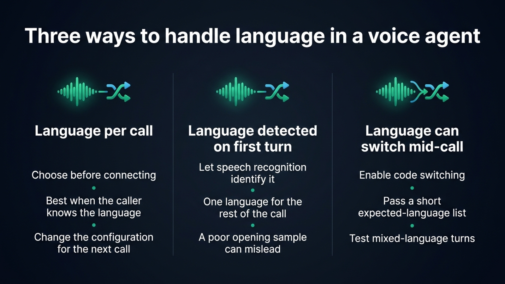
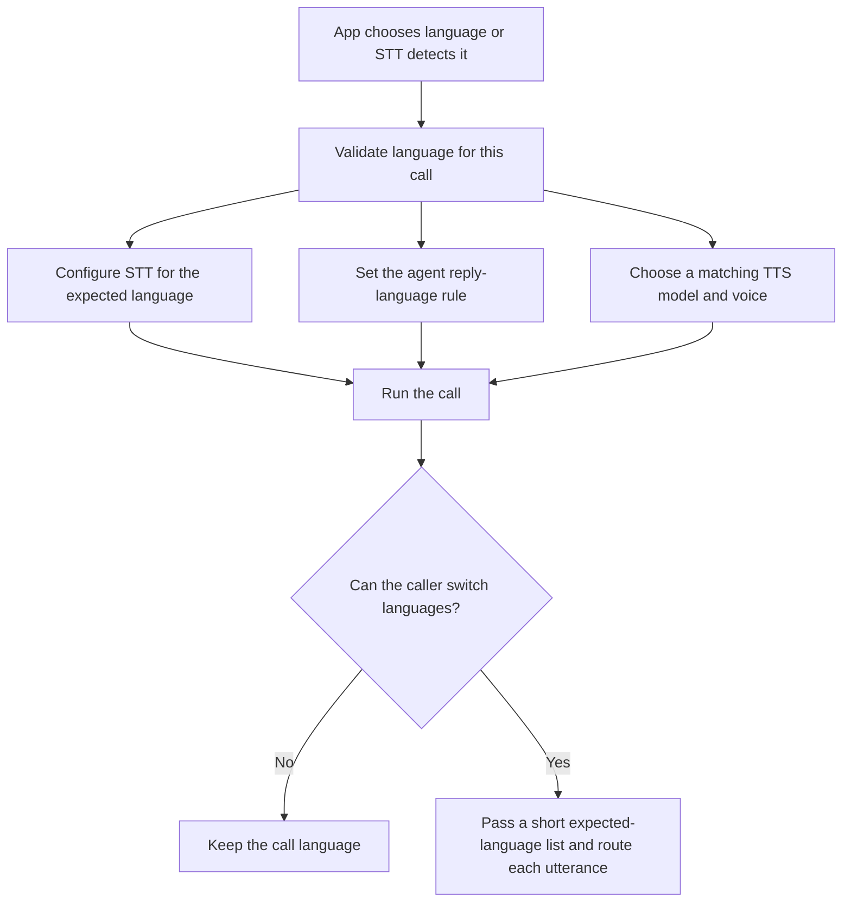
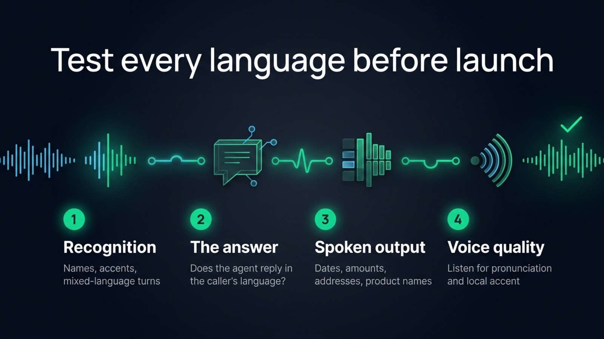

A multilingual voice agent needs more than a speech model with a long language list. The application must decide which language to transcribe, tell the language model how to answer, and choose a voice that pronounces that language naturally. For most products, choose the language before a call starts. Add speech detection when the caller can choose by speaking, and enable code switching only when people may change language during a call.

## Three designs for language choice

The simplest design is one language per call, selected by the app. A user chooses French in settings, your account profile says German, or the phone number routes to a Spanish-speaking queue. You pass that choice to speech recognition, the agent prompt and text to speech. This avoids language detection and gives the components a clear target.

If callers choose by speaking, let speech recognition detect the language from the first utterance. This works well when a call stays in one language. Detection can still get the whole session wrong if the first audio is silence, noise or a greeting in a different language. Gladia documents that when code switching is off and no language is set, it detects the first utterance and reuses that language for the rest of the session.

A conversation that moves between languages needs a different configuration. With Gladia, set `language_config.languages` to the likely languages and `code_switching: true`. Its live transcription can identify the language per utterance. Keep the list focused: Gladia recommends a short list of expected languages because searching broadly can increase misdetections. [Gladia’s language guide](https://docs.gladia.io/chapters/language/code-switching) explains the setting and the returned language labels.

| Design | Choose it when | Watch for |
| --- | --- | --- |
| Language selected before the call | The app or caller already knows the language | Every downstream component must receive the same choice |
| Detection on the first utterance | The caller can start in any supported language, then stays in it | Silence or a different-language greeting can mislead detection |
| Code switching during the call | Speakers may move between a known set of languages | Test each switch and pass a short expected-language list |

The design itself does not set a price. Choosing the language in your app avoids a separate detection request, while automatic detection and code switching follow the speech provider’s billing rules. Check whether the STT provider bills by audio duration, session time or another unit before comparing the total cost of a call.

{/* IMAGE regen: api.py image, infographic, 1600x900. Scene: "A comparison infographic with three clear vertical columns, labelled exactly: 'Language per call', 'Language detected on first turn', 'Language can switch mid-call'. Under each heading render only these exact short lines: Column 1: 'Choose before connecting' / 'Best when the caller knows the language' / 'Change the configuration for the next call'. Column 2: 'Let speech recognition identify it' / 'One language for the rest of the call' / 'A poor opening sample can mislead'. Column 3: 'Enable code switching' / 'Pass a short expected-language list' / 'Test mixed-language turns'. Use a tiny abstract waveform icon in each column, with one simple visual showing an audio stream moving into a selector. Keep the labels short, exact and large enough to read. Title exactly: 'Three ways to handle language in a voice agent'. No extra text." */}


## Transcribe speech in the language the caller uses

For a single-language call, pass the known language when the provider supports it. Explicit language hints can improve recognition and keep the transcript consistent. If your app does not know the language, use a provider’s language detection instead of guessing from the user’s region or browser settings.

Gladia’s live API supports automatic language detection and code switching. Its `GladiaSTT` integration accepts the provider’s session configuration through `settings`, so you can configure the expected languages when creating the STT instance:

```typescript
import { GladiaSTT } from '@micdrop/gladia'

const stt = new GladiaSTT({
  apiKey: process.env.GLADIA_API_KEY || '',
  settings: {
    language_config: {
      languages: ['en', 'fr', 'es'],
      code_switching: true,
    },
  },
})
```

That configuration lets Gladia transcribe each utterance in the detected language. The standard Micdrop `Transcript` event carries the utterance text as a string, so an application that needs the language label for each utterance should also read the provider’s richer transcript events or extend the integration to expose them. Do not assume language metadata reaches the agent just because the STT provider detected it.

Mistral’s Voxtral Realtime can detect a language when the session language is omitted. Its [language table](https://docs.mistral.ai/studio/audio/specs-and-limits/languages) varies by model. Test the accents and code switches your callers use because language coverage alone cannot predict accuracy.

## Keep the agent’s answer in the caller’s language

Pass the selected or detected language to the agent’s instructions. A useful prompt rule names the language explicitly and tells the model to keep names, product terms and quoted text intact:

```typescript
const systemPrompt = `You are a voice assistant.
Answer in ${language}. Keep product names and people's names as they are.
When a caller switches language, answer in the language of their latest complete utterance.`
```

For an app that chooses language before the call, validate the value before using it. Micdrop’s [server parameter guide](/docs/server/auth-and-parameters) shows how `waitForParams` receives and validates connection parameters. You can use the same validated parameter to create the STT provider, the agent prompt and the TTS provider.

For code switching, the application must make the language change visible to the agent. If the transcription integration returns text only, detect the language from the text or extend the integration to pass provider metadata. Then update the conversation instruction or add a language marker to the user message.

Test names, addresses, dates, times, currency and confirmation codes. A value such as `03/04/2027` means different dates in different locales, so pass an unambiguous form or the right locale to the speech model.

## Choose a voice that can actually speak the language

One multilingual voice keeps the assistant’s identity consistent across languages. A different voice per language gives more control over the regional accent, but changes the speaker between calls.

The model matters as much as the recorded voice. In Micdrop’s Phonon testing, Phonon 31M, an English model, read a French sentence with English phonemes even when paired with a French voice. The French Phonon 40M model read the same sentence correctly. The five-language Phonon 40M multilingual model covers English, French, German, Spanish and Portuguese, while its weights carry the CC BY-NC 4.0 license. That license rules out commercial use. The [Phonon integration notes](/docs/ai-integration/provided-integrations/phonon) include the model choices and the language-specific test.

Hosted speech models vary in coverage. ElevenLabs Multilingual v2 supports 29 languages, according to its [model list](https://elevenlabs.io/docs/overview/models). Cartesia Sonic 3.6 supports 44. Its [multilingual voice guide](https://docs.cartesia.ai/build-with-cartesia/capability-guides/multilingual-voices) distinguishes broad language support from a native-sounding accent, while `locale` guides pronunciation and number normalization. Mistral’s Voxtral Speech 3 supports 35 languages, with the voice determining the language. Check the model and voice documentation for your language pair.

Choose the language-specific voice when you create the TTS provider for a call. Micdrop’s `MicdropServer` receives one TTS instance and calls `speak()` on it for each response. The integrations do not switch voice IDs when a caller changes language. For that behavior, write a custom TTS implementation that routes each response to the right provider, or use one multilingual voice for the whole call.

## Configure a language per Micdrop call

Micdrop configures these components when it opens the server connection. Receive and validate the client’s language parameter, then create the speech recognizer, agent and voice with matching settings before constructing `MicdropServer`:
```typescript
import { MicdropServer, waitForParams } from '@micdrop/server'
import { z } from 'zod'
import { OpenaiAgent } from '@micdrop/openai'
import { ElevenLabsTTS } from '@micdrop/elevenlabs'
import { GladiaSTT } from '@micdrop/gladia'

const paramsSchema = z.object({
  language: z.enum(['en', 'fr', 'es']).default('en'),
})

wss.on('connection', async (socket) => {
  const params = await waitForParams(socket, paramsSchema.parse)
  const language = params.language
  const voiceForLanguage: Record<typeof language, string> = {
    en: process.env.ENGLISH_VOICE_ID || '',
    fr: process.env.FRENCH_VOICE_ID || '',
    es: process.env.SPANISH_VOICE_ID || '',
  }

  const stt = new GladiaSTT({
    apiKey: process.env.GLADIA_API_KEY || '',
    settings: {
      language_config: { languages: [language], code_switching: false },
    },
  })

  const agent = new OpenaiAgent({
    apiKey: process.env.OPENAI_API_KEY || '',
    systemPrompt: `Answer in ${language}. Keep names and product terms unchanged.`,
  })

  const tts = new ElevenLabsTTS({
    apiKey: process.env.ELEVENLABS_API_KEY || '',
    voiceId: voiceForLanguage[language],
    language,
  })

  new MicdropServer(socket, { stt, agent, tts })
})
```

`voiceForLanguage` maps validated language codes to voice IDs. Each connection gets the STT, agent and TTS configuration for its language. The language can come from a settings menu, an account profile or the first utterance.

[Micdrop](/) is an open source TypeScript library for real-time voice conversations, with provider integrations that share the same STT, agent and TTS interfaces. You can use the [AI integration guide](/docs/ai-integration) to choose the components for each language instead of rewriting the browser and server pipeline for every vendor.



## Test every language before shipping

Test representative phrases in every supported language, from microphone input through the spoken answer.

{/* TODO ANECDOTE: add the maintainer’s experience testing a multilingual Micdrop voice agent, including any language-switching failure that changed the setup. */}

- Record a clear utterance and a noisy one in each language. Check names, product terms and short phrases the model might mistake for another language.
- If callers can switch languages, test one change between turns and one mixed-language phrase. Confirm that the transcript, agent response and voice all follow the intended behavior.
- Include dates, local number formats, currency, addresses and confirmation codes. Listen to the generated audio, since a plausible transcript does not prove that the spoken number sounds right.
- Test language detection on silence, a greeting, background noise and an accent the product actually expects. Make sure an uncertain result has a fallback, such as asking the caller to choose.
- Check that your voice license permits the product’s use and that the provider supports the regions and data handling your deployment requires.

During testing, log the language the application selected and how it selected it. That record helps you trace a wrong response to detection, agent instructions or voice configuration.

{/* IMAGE regen: api.py image, infographic, 1600x900. Scene: "A four-step multilingual voice-agent test checklist arranged in a clean horizontal sequence with simple geometric audio symbols. Render these exact headings and labels, without any other text: Title: 'Test every language before launch'. Step 1 heading: 'Recognition'. Step 1 line: 'Names, accents, mixed-language turns'. Step 2 heading: 'The answer'. Step 2 line: 'Does the agent reply in the caller’s language?'. Step 3 heading: 'Spoken output'. Step 3 line: 'Dates, amounts, addresses, product names'. Step 4 heading: 'Voice quality'. Step 4 line: 'Listen for pronunciation and local accent'. Show a waveform entering each step and a checked waveform leaving the sequence. Large readable sans-serif, generous spacing, no small print, no extra words, no numbers other than the step sequence." */}


A Whisper round trip can catch a voice that mangles a date or name. It cannot judge accent or rhythm, so listen to each recording too.

## Frequently asked questions

<FaqList>
  <FaqItem question="How does a voice agent detect the language a caller speaks?">
    Use speech recognition with language detection, or ask the caller to choose
    before the call. For language changes during the call, configure code
    switching with the expected languages.
  </FaqItem>
  <FaqItem question="Can a voice agent switch languages during a call?">
    Yes. The application must pass the language change from speech recognition
    to the agent and voice output. Gladia supports code switching, while
    Micdrop’s regular TTS integrations keep the voice configured for the call.
    To switch voices mid-call, write a custom TTS layer or use one multilingual
    voice.
  </FaqItem>
  <FaqItem question="Should I use one voice for every language?">
    Use one multilingual voice for a consistent identity, if it has the right
    accent in every language. Choose separate voices for better regional
    pronunciation. Test the model and voice together because the voice cannot
    make a model trained for another language pronounce it correctly.
  </FaqItem>
  <FaqItem question="What should I test in a multilingual text to speech model?">
    Test natural sentences, names, product terms, addresses, dates, times,
    amounts and confirmation codes in every language. Listen to the output and
    check that local number and date conventions sound right. If callers may
    switch languages, test a switch between turns and inside a phrase.
  </FaqItem>
</FaqList>

Choose the language strategy that matches the call, then test the complete path from the caller’s speech to the agent’s spoken answer. [Connect the speech, agent and voice components with Micdrop’s AI integrations](/docs/ai-integration) in your TypeScript server.
