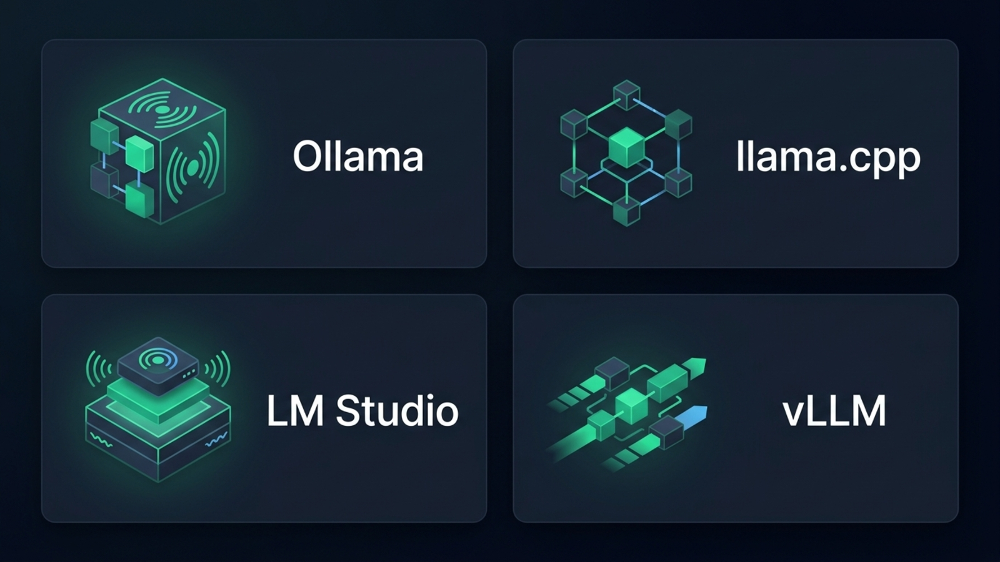
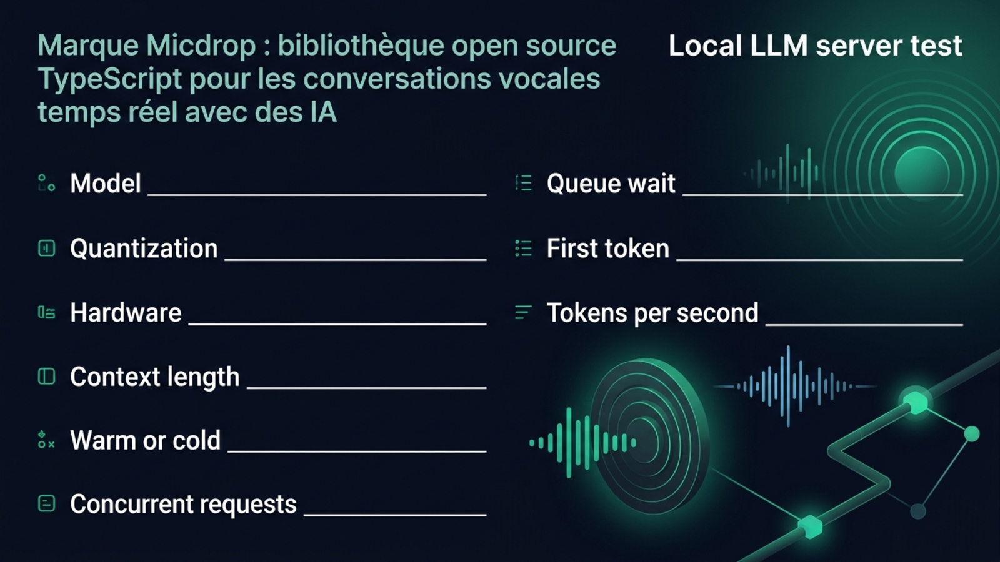
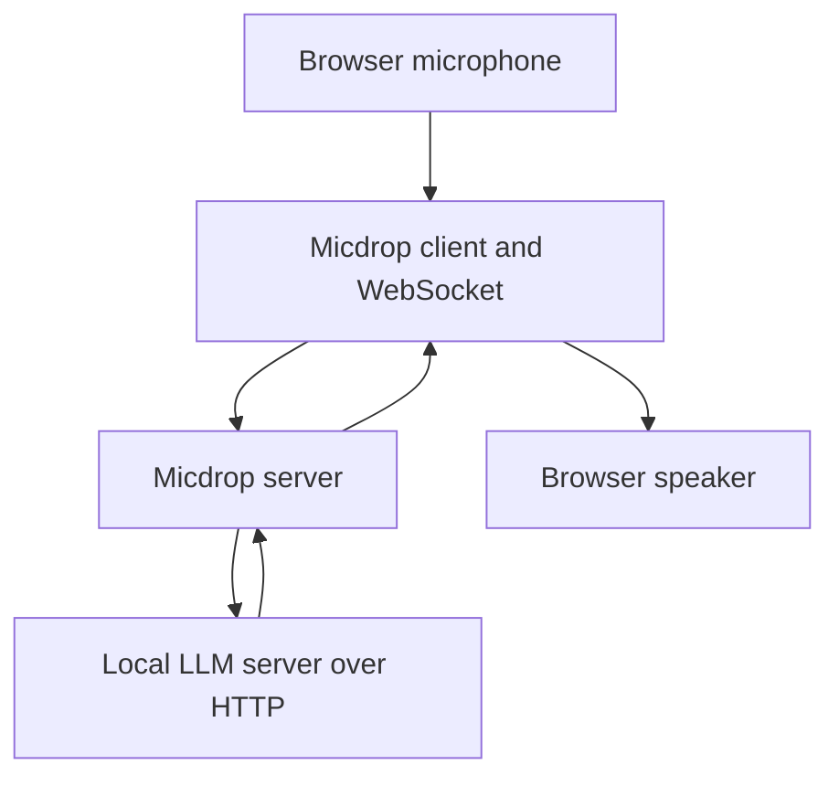

If your app already talks to an OpenAI client, Ollama, llama.cpp, LM Studio and vLLM can all look like a local HTTP server with a familiar chat endpoint. They still make different trade-offs. Ollama prioritizes model management, llama.cpp gives you direct control over a GGUF runtime, LM Studio makes local models easier to inspect and serve, and vLLM targets GPU-backed inference workloads. For a real-time app, choose by the requests you need to handle, the models you can run and the amount of server management you want to own.

This comparison focuses on applications that call a model over HTTP, including TypeScript back ends and voice agents. LM Studio’s desktop chat app gets a short section because it is part of its appeal, while the deeper comparison is about the server behind your code.

## The short answer

| Server | Best fit | API for an app | Concurrency model | Model workflow |
| --- | --- | --- | --- | --- |
| Ollama | Local development and a simple model library | Native Ollama API plus an OpenAI-compatible subset | One request per model by default, configurable when memory allows | Pull from its library or import GGUF and supported Safetensors models |
| llama.cpp | A small, configurable GGUF server | `llama-server` exposes OpenAI-style routes | Server slots and continuous batching | Convert or obtain a GGUF model, then run the server directly |
| LM Studio | Desktop testing that can grow into a local API | OpenAI-compatible endpoints and LM Studio APIs | Concurrent predictions with continuous batching on its llama.cpp engine | Find, download and load GGUF or MLX models in the app |
| vLLM | GPU-backed serving and concurrent workloads | OpenAI-compatible HTTP server | Scheduler and continuous batching for serving | Load supported Hugging Face model weights, commonly Safetensors |

For one developer testing a local model, start with Ollama or LM Studio. Pick llama.cpp for direct GGUF runtime control, and vLLM for GPU-backed serving when you can manage the Python environment and deployment. The llama.cpp vs Ollama choice comes down to how much runtime control you want and how you prefer to manage models. These are fit recommendations, not benchmark rankings. Performance varies with the model, hardware, quantization and context settings.

{/* IMAGE regen: api.py image, infographic, 1600x900. Scene: "Landscape infographic made of exactly four simple equal-sized cards in a two-by-two grid. Each card has one abstract geometric icon and one large exact label: \"Ollama\", \"llama.cpp\", \"LM Studio\", \"vLLM\". Give each card a distinct simple visual metaphor for a local model server, with no brand logos. High contrast, clean generous spacing, readable at a glance. No other text, no numbers, no decorative microtext." Regenerate if the four runtimes in the article change. Last data sync: 2026-10-31. */}


## What each server actually is

[llama.cpp](https://github.com/ggml-org/llama.cpp) is an inference engine and tooling project for GGUF models. Its `llama-server` executable serves a model over HTTP, with OpenAI-style chat completions, completions and embeddings routes. You select the model file and configure the [runtime options](https://github.com/ggml-org/llama.cpp/blob/master/tools/server/README.md).

[Ollama](https://ollama.com) gives you a model library, a daemon and command-line tools to pull and run models. It also imports GGUF files and supported Safetensors model directories through a [`Modelfile`](https://docs.ollama.com/import).

[LM Studio](https://lmstudio.ai) combines model discovery and local chat with a server for code. It also documents a headless mode, llmster. Its [runtimes](https://lmstudio.ai/docs/app) include llama.cpp, and Apple Silicon Macs can use MLX.

[vLLM](https://docs.vllm.ai) serves models on GPU workloads with an OpenAI-compatible API and a scheduler for concurrent requests. It loads Hugging Face model repositories and supports multiple architectures and weight formats, as its [serving guide](https://docs.vllm.ai/en/latest/serving/online_serving/openai_compatible_server/) explains.

## How compatible is the OpenAI API?

A shared endpoint makes a first connection easy, but the implementations differ. All four document an OpenAI-compatible chat completions route and streaming. Parameters, response fields and tool-call formatting depend on the server and model template.

Ollama documents a subset of the OpenAI API at `http://localhost:11434/v1/` in its [compatibility guide](https://docs.ollama.com/api/openai-compatibility). Its current compatibility page lists chat completions, streaming, JSON mode and tools among the supported features, alongside a list of supported request fields. That explicit list is useful: check it before relying on a parameter from the hosted OpenAI API. The native Ollama API also exposes settings such as `keep_alive` that are not part of a generic OpenAI request.

`llama-server` exposes OpenAI-compatible chat completions and supports function calling when it uses a tool-aware chat template. The [llama.cpp function-calling documentation](https://github.com/ggml-org/llama.cpp/blob/master/docs/function-calling.md) calls out the `--jinja` option and notes that a different chat template may be needed for a model. Its API surface also includes server-specific controls. The [server binds to localhost by default](https://github.com/ggml-org/llama.cpp/blob/master/tools/server/README.md), which is a useful starting point when the model should stay on the machine.

LM Studio documents `/v1/chat/completions`, `/v1/responses`, `/v1/completions` and `/v1/embeddings`, among other endpoints, in its [OpenAI-compatible API reference](https://lmstudio.ai/docs/developer/openai-compat). Its [OpenAI compatibility guide](https://lmstudio.ai/docs/developer/openai-compat) shows an existing client configured with `http://localhost:1234/v1`. Its own APIs add server and model-management features alongside the OpenAI-compatible route.

vLLM serves OpenAI-compatible chat completions and a growing set of related routes. Its support for optional fields varies by API and model. For example, its [API documentation](https://docs.vllm.ai/en/latest/serving/online_serving/openai_compatible_server/) describes `parallel_tool_calls` as a request to allow multiple calls, while warning that the model still determines whether it returns more than one. A server can parse a tool call into a valid structure, but the model can still choose the wrong action.

Keep a small compatibility test in your app. Send the same system prompt, one streamed request, one structured-output request and one tool call to each server you might deploy. Check the status code, the first streamed chunk, the final response and the tool arguments. A client library accepting a `baseURL` proves only that it can send the request, not that every server will interpret it the same way.

## First token and throughput in a live conversation

Time to first token and total throughput describe different parts of a turn. Time to first token tells you when the application can begin handling the answer. Throughput tells you how quickly the rest arrives. A voice interface feels both: the first token affects when speech synthesis can start, while a low generation rate can leave pauses inside a longer answer.

A fair ranking needs the same model, workload and hardware on all four servers. The server, model architecture, quantization, prompt length, context size, hardware and number of simultaneous requests all affect the result. A warm model on an Apple Silicon laptop is a different test from several requests to a GPU server. Compare the exact deployment you plan to use rather than applying a benchmark from another model or machine to your setup.

For a useful test, record the model, quantization, hardware, prompt and output length, context limit, warm or cold state, and concurrent request count. Measure queue wait, first streamed token and tokens per second at the concurrency your app expects. Repeat with a cold request to expose model-loading delays.

{/* IMAGE regen: api.py image, infographic, 1600x900. Scene: "A saveable benchmark worksheet card for comparing local inference servers. Landscape 16:9. Use a clean two-column grid with clear spacing, small simple geometric symbols, and highly legible modern bold sans-serif labels. Exact text, with no other words: heading \"Local LLM server test\". First column labels: \"Model\", \"Quantization\", \"Hardware\", \"Context length\", \"Warm or cold\", \"Concurrent requests\". Second column labels: \"Queue wait\", \"First token\", \"Tokens per second\". Leave generous blank ruled space after each configuration label for handwritten notes. No sample numbers, no logos, no charts implying a result. All wording must be exact and spelled as provided." Regenerate if the benchmark fields recommended in the article change. Last data sync: 2026-10-31. */}


{/* TODO ANECDOTE: Add the owner’s controlled comparison of Ollama, llama.cpp, LM Studio and vLLM here if they have run all four on the same machine, model and workload. Include hardware, quantization, concurrency, first-token latency, throughput and measurement date. */}

Warm-up and model retention matter more for the first turn than the server name. [Ollama keeps a model loaded for five minutes by default](https://docs.ollama.com/faq) and lets you change that with `keep_alive` or `OLLAMA_KEEP_ALIVE`. Decide whether keeping a model in memory is worth the memory it occupies.

The project’s [local-model measurements](/docs/ai-integration/local-models/performance) use Ollama for the LLM on a MacBook Pro M2 with 24 GB of memory. They report results for that setup and already-loaded models. Use those figures to understand the documented Micdrop stack, then measure a different server on the hardware where it will run.

## Tool calling depends on the server and the model

Tool calling has two separate jobs. The model decides whether to request a tool and produces its name and arguments. Your application validates the request, runs the function and sends the result back. The server converts between the model’s output format and the API response your code expects.

Ollama [documents tool support](https://docs.ollama.com/capabilities/tool-calling) for its native API and lists tools for its OpenAI-compatible endpoint. llama.cpp supports OpenAI-style function calling with `--jinja`, and may need a chat template that matches the model’s tool format, as its [function-calling guide](https://github.com/ggml-org/llama.cpp/blob/master/docs/function-calling.md) explains. [LM Studio’s tool-use documentation](https://lmstudio.ai/docs/developer/openai-compat/tools) distinguishes native tool support, where a model’s template and format are recognized, from a fallback format whose results vary by model. vLLM requires the right parser and, for automatic tool choice, the matching server configuration. Its [tool-calling documentation](https://docs.vllm.ai/en/latest/features/tool_calling/) notes that structured output can ensure parseable arguments for supported modes, but parseability is not the same as a correct decision.

In practice, test the model and server together. Give the model a harmless tool with a small schema, try a request that should call it and another that should answer without it. Validate malformed or unexpected arguments in your application. Then test streaming tool calls, because tool names and arguments may arrive in pieces and need to be assembled before execution. Keep an application-side allowlist and permission checks between the model and every function it can request.

## One user or many: concurrency and hardware

For one person on a laptop, the server’s ability to share the machine with an editor and browser may matter more than its theoretical throughput. For a service handling several calls at once, capacity, queueing and memory become core design choices.

[Ollama’s FAQ](https://docs.ollama.com/faq) says `OLLAMA_NUM_PARALLEL` defaults to one request per model. It can process more when memory allows, though memory use scales with the parallel request count and context length. The default queue limit is 512. A queue adds waiting rather than serving capacity, so measure delay before generation.

The [llama.cpp server documentation](https://github.com/ggml-org/llama.cpp/blob/master/tools/server/README.md) says continuous batching is enabled by default. `--parallel` controls its request slots, with automatic sizing available. The model, context allocation and available memory set the practical limit.

[LM Studio’s documentation](https://lmstudio.ai/docs/app/advanced/parallel-requests) exposes Max Concurrent Predictions when loading a model, gives a default of four and describes continuous batching for its llama.cpp engine. Check the runtime you loaded before relying on the same behavior across engines.

[vLLM](https://docs.vllm.ai/en/latest/serving/online_serving/) schedules and batches requests for GPU-backed serving. Effective capacity still depends on memory, model size, context length and configuration. Scaling beyond one process brings infrastructure decisions, not just a different client URL.

A concurrency test should reflect your real request pattern. Start several conversations together, keep their prompts and context lengths realistic, and measure the time each one waits before generation and how fast tokens arrive afterward. A single request benchmark cannot show how the service behaves under simultaneous turns.

## Model formats, installation and licensing

The model files you already have can settle the choice. [llama.cpp expects GGUF](https://github.com/ggml-org/llama.cpp/blob/master/docs/models.md). [Ollama imports GGUF and supported Safetensors models](https://docs.ollama.com/import). [LM Studio supports GGUF through llama.cpp and MLX on Apple Silicon](https://lmstudio.ai/docs/app). [vLLM commonly loads Hugging Face repositories in Safetensors format, with PyTorch weights as a fallback](https://docs.vllm.ai/en/stable/design/huggingface_integration/). Check current architecture and format support before downloading or converting a large model.

Setup ranges from Ollama’s `pull` and `run` commands, through LM Studio’s model browser and server, to llama.cpp’s runtime and server flags. vLLM usually belongs in a Python-based GPU service. Check the model license separately from the server license. A permissive runtime does not make every set of weights safe for commercial use, and a model’s license does not grant permission to use every dataset or voice associated with it. Keep the model card and any use restrictions with the deployment record.

## Plug a local server into a voice agent

A local LLM server can sit behind a TypeScript voice application as long as it serves an API the AI SDK client can call. [Micdrop](https://micdrop.dev/), an open source TypeScript library for real-time voice conversations, connects its `AiSdkAgent` to the Vercel AI SDK. Micdrop can connect its local agent to [Ollama, LM Studio or `llama-server` through the OpenAI provider’s chat interface](/docs/ai-integration/local-models/agent).

```typescript
import { createOpenAI } from '@ai-sdk/openai'
import { AiSdkAgent } from '@micdrop/ai-sdk'
import { PiperTTS } from '@micdrop/piper'
import { MicdropServer } from '@micdrop/server'
import { WhisperSTT } from '@micdrop/whisper'

const localModel = createOpenAI({
  // Replace this URL with the server you started.
  // Ollama: http://localhost:11434/v1
  // LM Studio: http://localhost:1234/v1
  // llama-server: use the host and port you configured
  // vLLM: http://localhost:8000/v1
  baseURL: 'http://localhost:11434/v1',
  apiKey: 'local',
})

const agent = new AiSdkAgent({
  model: localModel.chat('your-loaded-model-name'),
  systemPrompt: 'You are a helpful voice assistant.',
})

new MicdropServer(socket, {
  agent,
  stt: new WhisperSTT({ model: 'base', language: 'en' }),
  tts: new PiperTTS({ modelPath: './voices/en_GB-alba-medium.onnx' }),
})
```

The base URL is the main switch in this example. The model name still has to match what the server reports, and a server-specific client option may be needed if the API surface differs. The example uses `.chat()` because local servers commonly expose Chat Completions rather than the OpenAI Responses API. Micdrop handles the conversation pipeline around the agent. You provide the model server, hardware, network boundary and capacity.



For a voice turn, verify that streamed content and tool calls arrive in the shape your agent handles. Begin with a model already tested in your stack. The [local voice-agent example](/blog/local-voice-agent-ollama-whisper-piper) combines Ollama with Whisper and Piper, and the [AI SDK integration documentation](/docs/ai-integration/provided-integrations/ai-sdk) explains the provider connection.

## Which one should you choose?

Choose **Ollama** when you want a straightforward local workflow for pulling and running models, then exposing one to an application. Its defaults suit a developer testing one conversation at a time. Adjust keep-alive and parallel requests when the workload needs them, and confirm the API fields your client uses.

Choose **llama.cpp** when you already have GGUF models or want to configure the inference server directly. It gives you server slots, batching and model-specific options with a small runtime. You choose compatible files and chat templates.

Choose **LM Studio** when browsing and testing models interactively is part of the work. Its local server makes it easy to move from a desktop chat to an HTTP client, and its headless mode suits machines where the graphical app is unnecessary. Verify which runtime and concurrency options are active for the model you loaded.

Choose **vLLM** when the target is a GPU-backed service and concurrent serving is part of the design from the start. Its scheduler and supported model ecosystem are aimed at serving workloads, while installation and operation require more infrastructure knowledge than a local desktop workflow.

When you have narrowed the server down, choose a model that fits its format, hardware and tool-call behavior. The [local LLM guide for Micdrop](/docs/ai-integration/local-models/agent) compares model choices and shows how to connect one to a voice call. To try the full stack, [start a first Micdrop call](/docs/getting-started).

## Frequently asked questions

<FaqList>
  <FaqItem question="Is LM Studio or Ollama faster?">
    Either can be faster, depending on the model, quantization, hardware,
    prompt, context length and concurrent requests. Compare them with the same
    model and settings on the machine where your app will run.
  </FaqItem>
  <FaqItem question="What is the difference between Llama, Ollama and llama.cpp?">
    Llama is a family of models from Meta. Ollama manages and serves local
    models, including Llama models. llama.cpp is an inference project that
    serves compatible models in GGUF format.
  </FaqItem>
  <FaqItem question="Is llama.cpp or vLLM faster?">
    The faster choice depends on the workload. llama.cpp serves GGUF models
    across different kinds of hardware, while vLLM targets GPU-backed serving
    and concurrent workloads. Compare the same model where both runtimes
    support it, and record the hardware, quantization, context and concurrency.
  </FaqItem>
  <FaqItem question="Are there better options than Ollama?">
    For direct GGUF runtime control, try llama.cpp. For model discovery and a
    desktop interface alongside a local API, try LM Studio. For GPU serving
    with concurrent requests, evaluate vLLM. Ollama fits a simple model library
    and local daemon workflow.
  </FaqItem>
  <FaqItem question="Which Ollama model is best for tool calling?">
    Tool-call quality depends on the model and task, not just the server. The
    [local model tests in Micdrop’s documentation](/docs/ai-integration/local-models/agent#tool-calls)
    compare models on specific voice-agent tools. Test your own tool
    descriptions and validate every call in your application.
  </FaqItem>
</FaqList>
