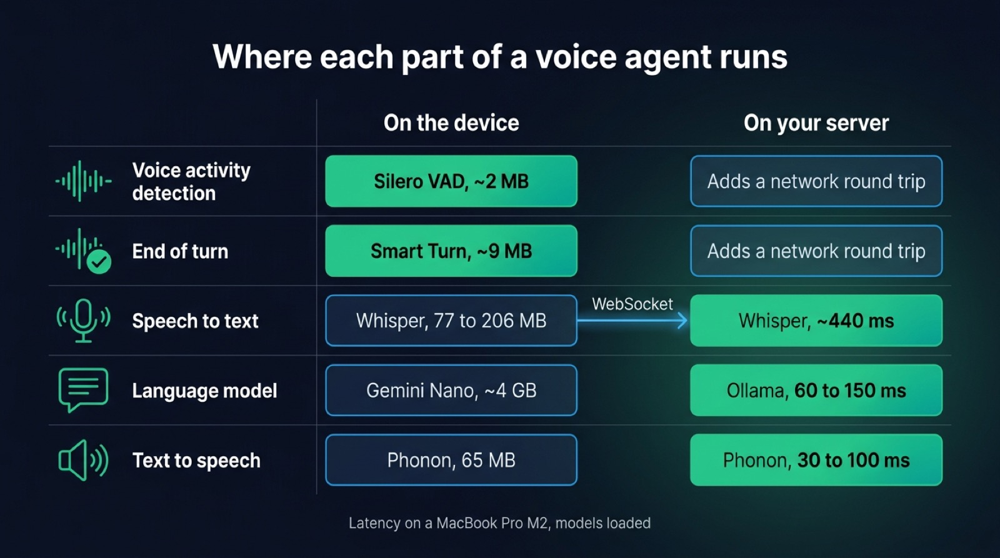
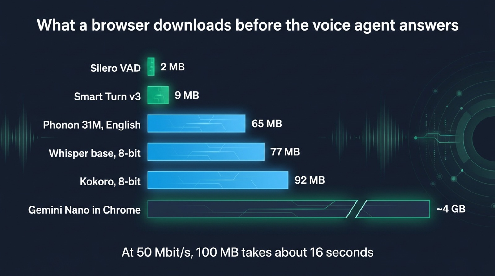
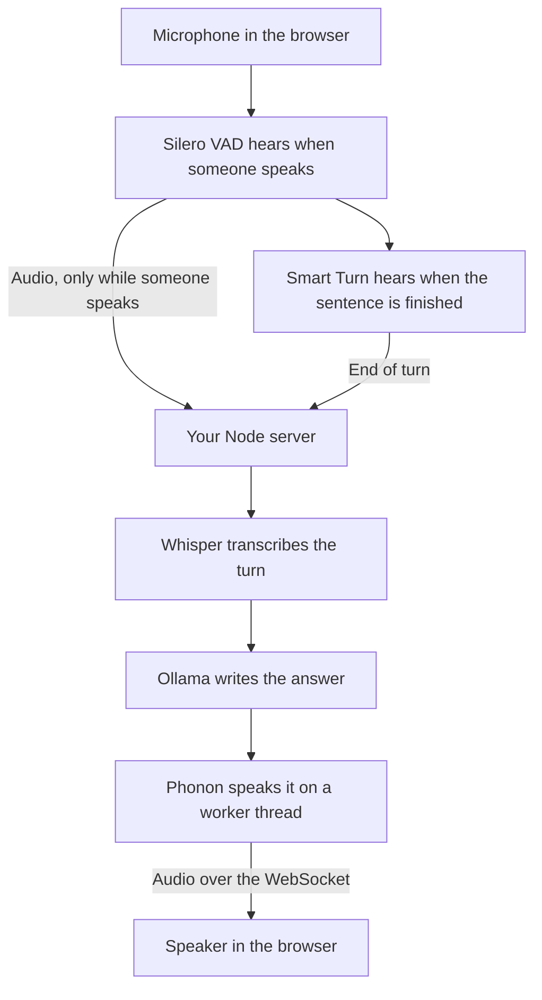

On-device AI means running a model on the hardware of the person using the app, such as their laptop, phone or browser tab, instead of sending the data to a server. For a voice app in 2026, the parts that decide when someone speaks fit on the device: voice activity detection and turn detection run in any recent browser with models of a few megabytes. Speech to text, the language model and the voice can run in a browser too, but each one costs a download of tens of megabytes to several gigabytes and depends on the device the visitor happens to own. Most voice apps get the privacy they are after by running those three models on a server they operate, where the audio leaves the device but stays inside their own infrastructure.

This post goes through each part of a voice agent and where it can run, with the download size and the delay of each option, then shows the split we use in [Micdrop](/), an open source TypeScript library for real-time voice conversations with AI. Micdrop runs detection in the browser and the three models, voice included, in your Node server. The latency figures come from our [measurements of local models](/docs/ai-integration/local-models/performance), taken on a MacBook Pro M2 on 21 October 2026.

## Where each part of a voice agent can run

A voice agent chains five steps. Each one can run on the device or on a server, but the best place changes from one step to the next.

| Part                     | In the browser                                              | In a native phone app                                          | On your own server                                        | Hosted API                                    |
| ------------------------ | ----------------------------------------------------------- | -------------------------------------------------------------- | --------------------------------------------------------- | --------------------------------------------- |
| Voice activity detection | Silero VAD, about 2 MB, real time on any CPU                | Silero on the native ONNX runtime                              | Possible, with a network round trip per interruption      | Bundled in some speech to text APIs           |
| End of turn              | Smart Turn v3, about 9 MB, WebGPU or WebAssembly            | Smart Turn on the native ONNX runtime                          | Smart Turn, or the LLM reading the transcript             | Built into the realtime speech to speech APIs |
| Speech to text           | Whisper on WebGPU with Transformers.js, 77 to 206 MB (base) | The system recognizer, on the device on recent iOS and Android | Whisper in Node, ~440 ms for a 3 second sentence          | Gladia, OpenAI, Mistral and others            |
| Language model           | Gemini Nano in desktop Chrome, about 4 GB                   | Gemini Nano on some Android phones, Apple's model on iOS 26    | Ollama, first token in 60 to 150 ms with a 2B to 4B model | OpenAI, Mistral, Gemini and others            |
| Text to speech           | phonon-tts (65 MB) or kokoro-js (92 MB)                     | The system voices                                              | Phonon, first audio in 30 to 100 ms                       | ElevenLabs, Cartesia, Gradium and others      |

Detection reads the microphone continuously and needs an answer within a few tens of milliseconds, so it runs best where the microphone is. The three models after it work on one sentence at a time and weigh far more. A server suits them better, because you know its hardware and their weights are already loaded when a call starts.

{/* IMAGE regen: api.py image, infographic, 1600x900. Scene: "A five-row grid titled 'Where each part of a voice agent runs'. Five rows, top to bottom, each with a label on the left and a small line icon (a waveform, a check mark over a waveform, a microphone, a speech bubble, a speaker, and never a brain): 'Voice activity detection', 'End of turn', 'Speech to text', 'Language model', 'Text to speech'. Two columns on the right with headers 'On the device' and 'On your server'. In the 'On the device' column, the first two rows are bright and filled with the primary accent, labeled 'Silero VAD, ~2 MB' and 'Smart Turn, ~9 MB'. The last three rows are dimmer outlines labeled 'Whisper, 77 to 206 MB', 'Gemini Nano, ~4 GB', 'Phonon, 65 MB'. In the 'On your server' column, the first two rows are dim outlines labeled 'Adds a network round trip', and the last three rows are bright and filled with the primary accent, labeled 'Whisper, ~440 ms', 'Ollama, 60 to 150 ms', 'Phonon, 30 to 100 ms'. A thin arrow between the two columns labeled 'WebSocket'. Small caption at the bottom: 'Latency on a MacBook Pro M2, models loaded'. Clean flat cells, generous spacing, labels in a modern clean bold sans-serif. Render only the text labels written in this scene, nothing else: the brand description is style guidance and never text to display." Regenerate if the latency figures in the local models documentation or the model sizes change. Last data sync: 2026-10-22. */}


## What runs in the browser today

### Voice activity detection with Silero VAD

Silero VAD is a neural network of about 309K parameters that scores every 32 ms of audio with a probability of speech. Its ONNX file weighs about 2 MB and runs on [ONNX Runtime Web](https://onnxruntime.ai/docs/tutorials/web/), whose WebAssembly files weigh more than the model. It keeps up with the microphone on any laptop or phone. The Micdrop client runs it when you pass `vad: 'silero'`, as described in the [voice activity detection settings](/docs/client/vad). Silero tells a voice apart from a fan or a television, which a volume threshold cannot do. The [three common browser detectors](/blog/voice-activity-detection-browser) give different results as soon as the room gets noisy.

### Turn detection with Smart Turn

A VAD knows that the sound stopped. [Smart Turn v3](https://huggingface.co/pipecat-ai/smart-turn-v3), an open model from the Pipecat team, listens to the last eight seconds of the turn and answers whether the sentence sounds finished. The quantized build weighs 8.7 MB. It answers in about 25 ms on a graphics card and in a couple of hundred milliseconds on a processor, so Micdrop [runs Smart Turn in the browser](/docs/client/turn-detection) on WebGPU when the browser offers it, and on WebAssembly otherwise. A laptop handles the WebAssembly path. On a mid-range phone without WebGPU, turn detection makes more sense on the server.

### Speech to text with Whisper on WebGPU

[Transformers.js](https://huggingface.co/docs/transformers.js) runs Whisper in a browser tab, on WebGPU when available and on WebAssembly otherwise. The `base` checkpoint has 74M parameters. Its download depends on the precision you pick: about 77 MB with both halves quantized to 8 bits, and about 206 MB in the mix the WebGPU demos load, a full precision encoder with a 4-bit decoder. Whisper reads audio in 30-second windows, so it transcribes a finished sentence rather than a stream of words. That fits a voice agent, since the turn is over before the transcript matters. Whisper transcribes around a hundred languages and ships under the MIT license.

### Text to speech with phonon-tts and kokoro-js

[Gradium](https://gradium.ai), a French voice AI company, publishes Phonon, its on-device text to speech model, with a runtime written in Rust and compiled to WebAssembly. The browser package is [`phonon-tts`](https://www.npmjs.com/package/phonon-tts) on npm. Per its documentation, it generates on a Web Worker, streams audio in 80 ms chunks at 24 kHz, and keeps the model in the browser's Cache API so a second visit loads from disk. The default model, Phonon 31M in English, weighs 65 MB at 8-bit precision. Generation runs on the CPU, on three threads when the page is cross-origin isolated and on one otherwise. You can opt into WebGPU, which the documentation warns can be slower than the CPU on phones.

{/* TODO ANECDOTE: the maintainer's own test of phonon-tts in a browser tab: browsers tried, download size, delay between opening the page and the first audio. Question 814a8b2f. */}

Kokoro, an 82M parameter model under Apache 2.0, runs in the browser through [`kokoro-js`](https://www.npmjs.com/package/kokoro-js), built on Transformers.js. Its 8-bit file weighs 92 MB. On WebGPU, its documentation recommends the full precision file, which weighs 326 MB. Kokoro speaks English only. In Node on a MacBook Pro M2, Kokoro takes 900 to 1300 ms to play the first audio, where Phonon takes 30 to 100 ms.

{/* IMAGE regen: api.py image, infographic, 1600x900. Scene: "A horizontal bar chart titled 'What a browser downloads before the voice agent answers'. Six bars, sorted from smallest to largest, each with its label on the left and its size at the end of the bar: 'Silero VAD' '2 MB', 'Smart Turn v3' '9 MB', 'Phonon 31M, English' '65 MB', 'Whisper base, 8-bit' '77 MB', 'Kokoro, 8-bit' '92 MB', 'Gemini Nano in Chrome' '~4 GB'. The Gemini Nano bar is broken with a zigzag gap to show it is off the scale. The first two bars are in the primary accent, the next three in the secondary accent, the last one dimmer. Under the chart, one line: 'At 50 Mbit/s, 100 MB takes about 16 seconds'. Clean flat bars, generous spacing, labels in a modern clean bold sans-serif. Render only the text labels written in this scene, nothing else: the brand description is style guidance and never text to display." Regenerate if one of the model sizes changes. Last data sync: 2026-10-22. */}


## Chrome on-device AI: Gemini Nano and the Prompt API

Chrome ships its own on-device language model. Through the [Prompt API](https://developer.chrome.com/docs/ai/prompt-api), a page sends text to Gemini Nano, and audio too on a machine with a GPU. Chrome downloads the model once, the first time a site asks for it. A page checks whether the model is ready with `LanguageModel.availability()`.

The hardware bar is high. [Google's requirements](https://developer.chrome.com/docs/ai/get-started) ask for Windows 10 or 11, macOS 13 or later, Linux or a Chromebook Plus, with 22 GB free on the disk holding the Chrome profile, and either a GPU with more than 4 GB of video memory or 16 GB of RAM with four cores. Chrome removes the model when free space drops under 10 GB. Chrome on Android and on iOS does not expose these APIs to pages. The model itself takes about 4 GB once installed, according to Google's comments reported by [Thurrott](https://www.thurrott.com/a-i/335760/google-clarifies-how-chromes-built-in-ai-features-use-local-storage).

Gemini Nano therefore fits an optional feature, such as a summary or a rewrite, that improves the page on the machines that have the model. A voice agent, on the other hand, has to answer every visitor, including the one on a phone or on a laptop with 8 GB of memory.

Native apps have more options. On Android, Google exposes Gemini Nano to apps through the ML Kit GenAI APIs on the phones that run AICore, a list that Google keeps per model. On iOS 26, Apple's Foundation Models framework gives apps the on-device model behind Apple Intelligence, on the devices that support it. Both suit short, well-bounded tasks better than an open conversation. A React Native app can [transcribe speech with the system recognizer or by streaming the audio to a server](/blog/speech-to-text-react-native).

## On your own server instead of the user's device

The same open models run in a Node server. The audio then leaves the device but stays on a machine you operate, so no third party reads it. You also pick the hardware once, instead of depending on whatever device the visitor owns.

| Model          | Role           | Delay on a MacBook Pro M2        | Memory                                 |
| -------------- | -------------- | -------------------------------- | -------------------------------------- |
| Whisper `base` | Speech to text | ~440 ms for a 3 second sentence  | Included in ~4 GB for the whole call   |
| Qwen3 4B       | Language model | 100 to 150 ms to the first token | Included in ~4 GB for the whole call   |
| MiniCPM5-2B    | Language model | ~60 ms to the first token        | Included in ~3.4 GB for the whole call |
| Phonon 31M     | Text to speech | 30 to 100 ms to the first audio  | ~450 MB for the process                |
| Pocket TTS     | Text to speech | 250 to 430 ms                    | 600 MB                                 |
| Piper          | Text to speech | ~390 ms                          | The lightest                           |
| Kokoro         | Text to speech | 900 to 1300 ms                   | 80 MB                                  |
| Qwen3-TTS      | Text to speech | ~400 ms, on the GPU              | 2.5 GB, in its own server              |

[Phonon in Node](/docs/ai-integration/provided-integrations/phonon) runs on the same WebAssembly runtime as in the browser, on a worker thread of the server, with no native addon and no API key. Loading the model and speaking the first word takes 0.7 to 0.9 s, so Micdrop does it at startup with a warm-up word. After that, Phonon generates the rest of a sentence about five times faster than real time on a single CPU core. Whisper, Qwen3 4B and Phonon add up to about 0.6 to 0.7 s between the end of the user's sentence and the first audio. Whisper `base` takes the longest of the three. It pads the audio to a 30-second window, where the [alternatives to Whisper in Node](/blog/local-speech-to-text-node) read it at its real length.

A server loads each model once and shares it between all the calls, where a browser loads it once per visitor, and again whenever the cache is cleared. You can [set up a voice agent with Ollama, Whisper and Piper](/blog/local-voice-agent-ollama-whisper-piper) step by step and see the mistakes a small model makes. We compare Phonon, Pocket TTS, Piper, Kokoro and Qwen3-TTS in detail for [local text to speech in Node](/blog/local-tts-node-kokoro-vs-piper).

## What on-device costs

- A visitor pays for every megabyte before the first word. At 50 Mbit/s, 100 MB takes about 16 seconds, and Whisper `base` with a voice already comes to 140 to 300 MB. A cached model only speeds up the second visit.
- Weights still have to be compiled and loaded once they are on disk. Phonon needs 0.7 to 0.9 s in Node on an M2 to load its model and speak a first word. A phone takes longer.
- Phonon alone holds about 450 MB in a Node process, so a tab holding a transcription model and a voice at once is the first tab a phone's browser discards when the user switches apps.
- A VAD scores 32 ms of audio at a time and costs little battery. Transcription and speech synthesis keep the processor busy for every sentence. A laptop handles that easily, while over a long conversation it drains a phone's battery.
- WebGPU is available in Chrome and Edge on every platform and in Safari on iOS 26. Older browsers fall back to WebAssembly, several times slower. Test on the devices your visitors own as well as on your own laptop.
- Phonon 31M in English is under Apache 2.0. The French, German, Spanish, Portuguese and multilingual Phonon models have 40M parameters and are under CC BY-NC 4.0, which rules out commercial use. They are also gated on Hugging Face, so a browser cannot fetch them from there: you serve the files yourself, under that license. Whisper is MIT, Kokoro Apache 2.0 and Silero MIT.

## When on-device is the right call

On-device is the right call when the conversation has to work without a network, in a field app or on a plane, and when the audio must never leave the person's hardware, as in a health app keeping notes on the phone. It also pays off for detection everywhere, since interrupting the assistant should take effect within a few tens of milliseconds, without waiting for a round trip.

A server you operate fits the other cases better: a first visit to a web page, a mid-range phone, a conversation that needs a model large enough to follow a script, and a commercial product speaking French or German, where the only Phonon models for those languages are non-commercial. The audio still stays inside your infrastructure. Once the server runs, you also pay nothing per minute.

Commercial SDKs cover the on-device path too. [Picovoice](https://picovoice.ai) sells wake word, speech to text, text to speech and small language model engines that run on phones, desktops and in the browser, under its own license. Open source runtimes such as [sherpa-onnx](https://github.com/k2-fsa/sherpa-onnx) run speech models on phones and embedded boards. They suit an app built around on-device processing, while a web app with a server can keep the heavy models there.

## A hybrid with Micdrop

In Micdrop, the browser runs Silero VAD and Smart Turn, so it sends audio only while someone speaks and closes the turn when the sentence is finished. The Node server runs Whisper, a local LLM through Ollama and Phonon, so the call needs no API key and no third party.



In the browser:

```bash
npm install @micdrop/web @micdrop/smart-turn
```

```typescript
import { Micdrop } from '@micdrop/web'
import '@micdrop/web/silero'
import { SmartTurn } from '@micdrop/smart-turn'
import '@micdrop/smart-turn/web'

await Micdrop.start({
  url: 'wss://voice.example.com',
  vad: 'silero',
  turnDetector: new SmartTurn(),
})
```

On the server, with Ollama running and `qwen3:4b-instruct` pulled:

```bash
npm install @micdrop/server @micdrop/ai-sdk @micdrop/whisper @micdrop/phonon @ai-sdk/openai ws
```

```typescript
import { createOpenAI } from '@ai-sdk/openai'
import { AiSdkAgent } from '@micdrop/ai-sdk'
import { PhononTTS } from '@micdrop/phonon'
import { MicdropServer } from '@micdrop/server'
import { WhisperSTT } from '@micdrop/whisper'
import { WebSocketServer } from 'ws'

// Ollama serves the OpenAI protocol on /v1
const ollama = createOpenAI({
  baseURL: 'http://localhost:11434/v1',
  apiKey: 'ollama', // Unused, the SDK refuses to start without one
})

const wss = new WebSocketServer({ port: 8081 })

wss.on('connection', (socket) => {
  new MicdropServer(socket, {
    firstMessage: 'Hello, how can I help you?',
    agent: new AiSdkAgent({
      model: ollama.chat('qwen3:4b-instruct'),
      systemPrompt: 'You are a helpful voice assistant.',
    }),
    stt: new WhisperSTT({ model: 'base', language: 'en' }),
    tts: new PhononTTS({ voice: 'Easton' }),
  })
})
```

Whisper and Phonon download their weights on first use, so run one call before a demo. Each part is one line on the server, which lets you swap Phonon for a hosted voice in production, or Ollama for a hosted model, with the browser code unchanged.

You could write this split yourself. Micdrop already handles:

- the microphone and the speaker
- Silero and Smart Turn sharing one ONNX runtime in the browser, with a queue so that their inferences never overlap
- the audio streamed both ways over the WebSocket
- the voice stopped between two 80 ms frames when the user interrupts
- one Phonon instance on a worker thread, shared by every call

A hosted platform such as Vapi charged $0.05 a minute in September 2026 for that orchestration, before any model bill. The audio then goes through its servers. Micdrop is MIT-licensed and runs on your machine. It leaves you to build the hosting, the call history and the dashboard a platform would have provided.

## Frequently asked questions

<FaqList>
  <FaqItem question="What is on-device AI?">
    On-device AI runs a machine learning model on the hardware of the person
    using the app, such as a phone, a laptop or a browser tab, instead of on a
    remote server. The data the model reads, audio for a voice app, stays on
    that device. In exchange, the device has to download the model and have
    enough memory and processing power to run it.
  </FaqItem>
  <FaqItem question="What is the difference between on-device AI and cloud AI?">
    On-device AI runs the model on the user's hardware. Cloud AI sends the data
    to a server that runs the model, often a provider's API. On-device works
    offline and keeps the data local, while the cloud runs larger models on
    known hardware with no download for the user. A server you operate yourself
    sits in between: the data leaves the device but stays in your
    infrastructure.
  </FaqItem>
  <FaqItem question="Can a voice assistant run entirely in the browser?">
    Yes, with Silero VAD for detection, Whisper on WebGPU for transcription, a
    WebAssembly voice such as phonon-tts or kokoro-js, and Gemini Nano for the
    answer. The visitor then downloads hundreds of megabytes to several
    gigabytes first. Gemini Nano also needs a recent desktop. Most voice apps
    keep detection in the browser and the three models on a server.
  </FaqItem>
  <FaqItem question="Which on-device AI models fit a voice app?">
    Silero VAD (about 2 MB) and Smart Turn v3 (about 9 MB) fit every device.
    Whisper base (77 to 206 MB) transcribes in a browser with WebGPU. Phonon 31M
    (65 MB, Apache 2.0) and Kokoro (92 MB, Apache 2.0) speak English. Gemini
    Nano in Chrome and Apple's Foundation Models on iOS 26 cover short language
    tasks on the devices that support them.
  </FaqItem>
  <FaqItem question="Does Chrome's on-device AI work on Android?">
    The Gemini Nano APIs in Chrome are unavailable to web pages on Chrome for
    Android and iOS. They need Windows, macOS 13 or later, Linux or a Chromebook
    Plus, with 22 GB of free disk. Android apps reach Gemini Nano through the ML
    Kit GenAI APIs instead, on the phones that run AICore.
  </FaqItem>
  <FaqItem question="Does on-device AI work offline?">
    Once the model is downloaded and cached, yes. phonon-tts keeps its files in
    the browser's Cache API and Transformers.js caches its models the same way,
    so a later visit loads them with no network. The first visit needs a
    connection to download them.
  </FaqItem>
</FaqList>

## Getting started

Keep detection on the device and the models on a server you run, and you get most of what on-device AI promises without asking every visitor for a 300 MB download. With Micdrop, you can [run Whisper, Ollama and a local voice in one Node server](/docs/ai-integration/local-models), then [choose among Phonon's models, voices and licenses](/docs/ai-integration/provided-integrations/phonon). To start from a hosted stack and move parts local one at a time, [run a first voice call in five minutes](/docs/getting-started).
