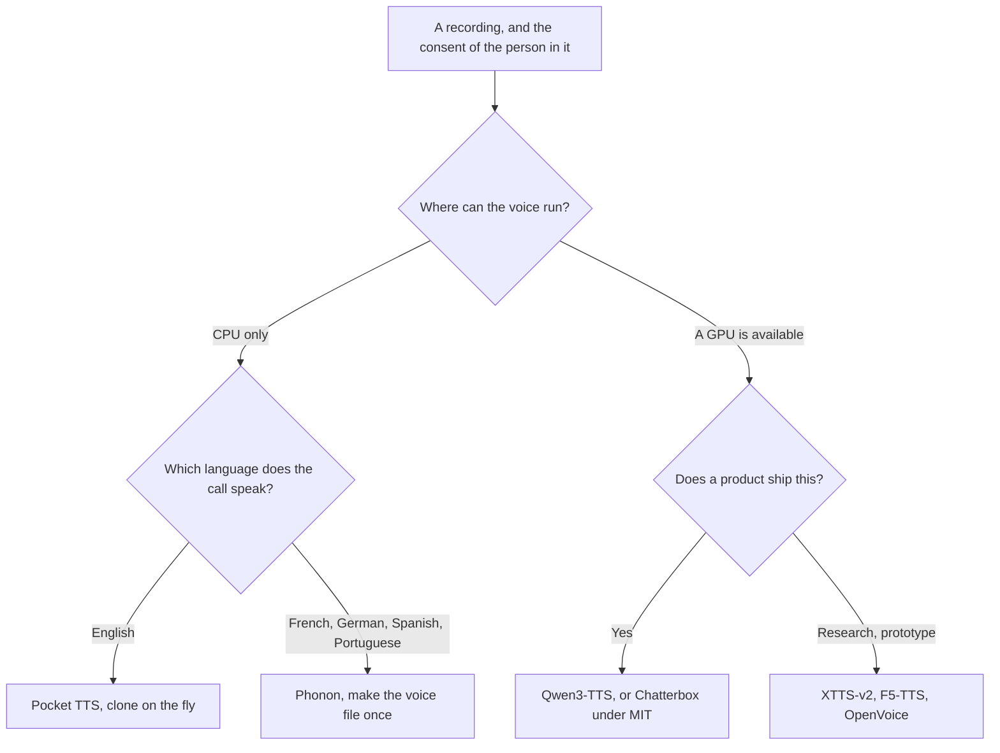
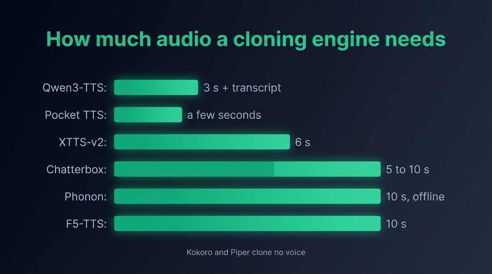
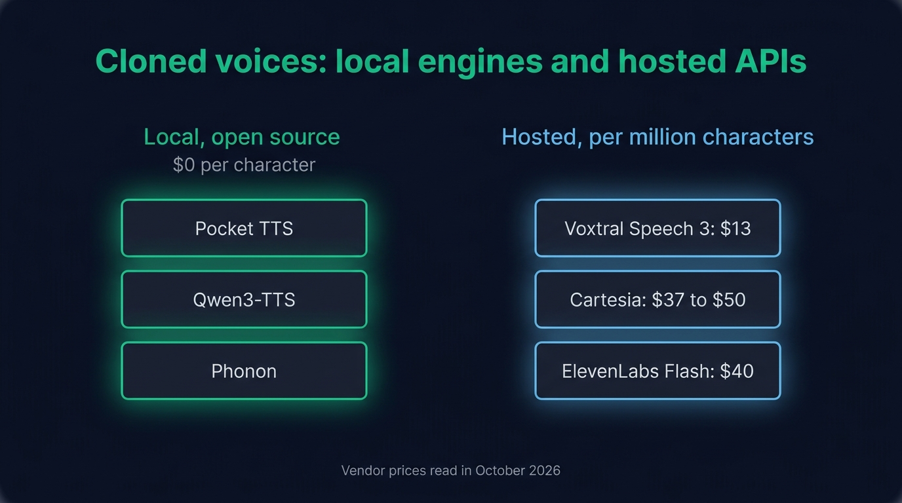

Cloning a voice with an open source model runs on the machine next to your app. Pocket TTS does it on a CPU from a few seconds of audio, Qwen3-TTS does it on a GPU from three seconds and reads ten languages, and Phonon turns ten seconds of clear speech into a voice file you reuse on every call. The license settles the choice as often as the hardware: Qwen3-TTS, Chatterbox and OpenVoice publish weights a product can ship, XTTS-v2 and the published F5-TTS checkpoints forbid commercial use, and Kyutai attaches the consent of the person you clone to its weights.

If you are wiring a cloned voice into a real-time agent in Node, this article covers the whole choice: how much audio each model needs, what its license allows, and how fast it starts speaking. The latency figures were measured on a MacBook Pro M2, and the code runs with [Micdrop](/), an open source TypeScript library for voice conversations whose server takes any engine in this article as its voice. Every engine also works on its own, through its package or repository.

## The short answer, by hardware and license

| Engine                                            | Voice comes from                              | Runs on     | Languages | A product can ship it                          |
| ------------------------------------------------- | --------------------------------------------- | ----------- | --------- | ---------------------------------------------- |
| [Pocket TTS](/docs/ai-integration/provided-integrations/pocket-tts) | A few seconds of audio, no transcript | CPU         | English   | Yes, with the recorded person's consent        |
| [Qwen3-TTS](/docs/ai-integration/provided-integrations/qwen-tts) | 3 seconds of audio plus its transcript | GPU         | 10        | Yes, Apache 2.0                                |
| [Phonon](/docs/ai-integration/provided-integrations/phonon) | A voice file made once from 10 seconds | CPU         | 5         | English model yes, the other models no         |
| [Chatterbox](https://github.com/resemble-ai/chatterbox) | 5 to 10 seconds of audio                 | GPU         | 23+       | Yes, MIT                                       |
| XTTS-v2                                           | 6 seconds of audio                            | GPU         | 17        | No, Coqui Public Model License                 |
| [F5-TTS](https://github.com/SWivid/F5-TTS)        | About 10 seconds of audio                     | GPU         | English   | No, checkpoints CC BY-NC 4.0                   |
| [OpenVoice](https://github.com/myshell-ai/OpenVoice) | A short clip                              | CPU or GPU  | 6         | Yes, MIT                                       |

Take Pocket TTS for an English call on a machine with no GPU. Take Qwen3-TTS when a GPU is available, for the closest thing to a hosted voice and ten languages from one checkpoint. Take Phonon when the voice is decided once, recorded once, and then reused: the cloning happens offline and the first word arrives faster than with any engine here. Chatterbox, XTTS-v2, F5-TTS and OpenVoice run in Python with PyTorch, in a process next to your app. XTTS-v2, F5-TTS and OpenVoice fit a research project or an internal tool better than a product.



## Get consent before you clone

The labs behind these models all attach the same condition to cloning. Kyutai gates the Pocket TTS weights behind terms that require the recorded person's consent, and the Phonon runtime tells you to clone only with the speaker's consent. The hosted providers ask for the same thing: ElevenLabs requires you to hold the rights to every voice you clone on its platform.

All of this guards against impersonation. A cloned voice reads whatever text it receives, so once the model holds the timbre, the voice says anything. Record the consent in writing, keep it with the reference file, and clone people who know what the agent will do with their voice.

## Which models clone a voice, and from how much audio

**Pocket TTS**, a 100 million parameter model from Kyutai, a nonprofit AI lab in Paris, clones with no training step and no transcript. Hand it a wav and it answers in that voice. It reads the first 12 seconds of the reference by default, and even the bundled one second clip clones, which is about the shortest sample the model accepts. A clean recording counts for more than a long one, because the model reproduces the quality of the sample along with the timbre.

**Qwen3-TTS**, from Alibaba's Qwen team, generates audio with a language model. Its Base checkpoints clone from about three seconds of audio plus the transcript of those three seconds. The cloned timbre carries across the ten languages the model reads, so a French sample can voice an English call. That is the feature the technical report benchmarks against CosyVoice. It needs a GPU and a server next to your app.

**Phonon**, the model Gradium built on Pocket TTS, clones offline rather than on the fly. The runtime repository ships a `clone-voice.py` script that takes about ten seconds of clear speech, calls Gradium's service with an API key, and writes a `voice.safetensors` file. That file works with every Phonon checkpoint and loads through the `voice` option of the package. The recording leaves the machine only for that step. The voice then runs locally, with no key.

**XTTS-v2**, the model Coqui released before closing in January 2024, still clones convincingly from six seconds of audio in seventeen languages, which is why it comes up in every discussion of local cloning. Its weights are licensed for non-commercial use, and nobody sells the commercial license anymore.

**F5-TTS**, from the SWivid team, clones from about ten seconds of audio. Its code is MIT and its published checkpoints are CC BY-NC 4.0, because they were trained on the Emilia dataset. A product can only run a model retrained from scratch on licensed data, and fine-tuning the published checkpoints keeps the restriction.

**Chatterbox**, from Resemble AI, is the rare cloning family that puts code and weights under MIT. It clones from 5 to 10 seconds of audio, takes an emotion setting, and the Multilingual V3 checkpoint released in June 2026 reads at least 23 languages.

**OpenVoice**, from MyShell and researchers at MIT, splits cloning in two: a base speaker that reads in the style you set, and a tone converter that paints the reference voice on top. Both versions have been MIT since April 2024, free for commercial use, and V2 reads six languages. The model is two years older than the others here, and the newer engines sound more natural.

**Kokoro and Piper clone nothing.** They are the two engines people reach for first on a CPU. Neither accepts a recording. [Kokoro](/docs/ai-integration/provided-integrations/kokoro) takes no reference audio and ships 54 recorded voices. Its JavaScript port lists only the 28 English ones. [Piper](/docs/ai-integration/provided-integrations/piper) voices are small models trained one speaker at a time, so a new Piper voice means a dataset and a training run. The nearest clone on a CPU is Pocket TTS, and the nearest in another language is Qwen3-TTS on a GPU or a Phonon voice file.

{/* IMAGE regen: api.py image, infographic, 1600x900. Scene: "A horizontal bar chart infographic on a dark slate background, titled \"How much audio a cloning engine needs\" in a modern clean bold sans-serif in emerald. Six horizontal emerald bars, each with its label on the left and the value at the end of the bar, lengths proportional to the seconds: \"Qwen3-TTS: 3 s + transcript\", \"Pocket TTS: a few seconds\", \"XTTS-v2: 6 s\", \"Chatterbox: 5 to 10 s\", \"Phonon: 10 s, offline\", \"F5-TTS: 10 s\". Labels in a legible sans-serif in light slate grey. Below the chart, one small footer line in light slate grey: \"Kokoro and Piper clone no voice\". Generous spacing, flat vector style, no other text."
    Infographic only: regenerate if a model's reference length changes. Last data sync: 2026-10-28. */}


## The license splits the code from the weights

Each model here publishes its code and its weights separately, and the two carry different licenses. The code license matters when you fork the repository. The weights license decides whether a product can run the model. Read the model card on Hugging Face rather than the license file of the repository, since that is where a lab attaches conditions such as consent.

| Model      | Code               | Weights                                        | A product can run it                  |
| ---------- | ------------------ | ---------------------------------------------- | ------------------------------------- |
| Pocket TTS | MIT                | CC BY 4.0, gated terms require consent         | Yes, with consent and attribution     |
| Qwen3-TTS  | Apache 2.0         | Apache 2.0                                     | Yes                                   |
| Phonon     | MIT or Apache 2.0  | English 31M and the voice catalog Apache 2.0, the other models CC BY-NC 4.0 | English yes, the other languages no |
| Chatterbox | MIT                | MIT                                            | Yes                                   |
| OpenVoice  | MIT                | MIT                                            | Yes                                   |
| XTTS-v2    | MPL 2.0            | Coqui Public Model License                     | No                                    |
| F5-TTS     | MIT                | CC BY-NC 4.0                                   | Only a model retrained from scratch   |

Consent is a condition of use for the Pocket TTS weights and the right thing to do with every other engine, and no license replaces it.

## Clone a voice with Pocket TTS, on the CPU

Install the package and fetch the 98 MB archive with the model, then point the engine at a wav of a few seconds of someone speaking:

```typescript
import { MicdropServer } from '@micdrop/server'
import { PocketTTS } from '@micdrop/pocket-tts'

const tts = new PocketTTS({
  modelDir: './sherpa-onnx-pocket-tts-int8-2026-01-26',
  voice: './voices/my-voice.wav',
})

new MicdropServer(socket, {
  tts,
  // stt and agent complete the pipeline
})
```

The archive ships three reference recordings to try before you record anything: `bria` reads calmly for forty seconds, `loona` is a one second clip, and `frenchAccent` shows that the sample gives the timbre while the words keep coming from the text. The engine reads English in this setup, holds about 600 MB of memory while it generates, and starts speaking 250 to 430 ms after it receives a sentence. Every constructor option, from `referenceLength` to `numThreads`, is documented alongside [the latency of Pocket TTS measured on the CPU](/docs/ai-integration/provided-integrations/pocket-tts).

## Clone with Qwen3-TTS, on a GPU

Qwen3-TTS clones through a Base checkpoint, which has no preset speakers of its own. Start the mlx-audio server that holds the weights, then give the engine the reference audio and what it says:

```typescript
import { MicdropServer } from '@micdrop/server'
import { Qwen3TTS } from '@micdrop/qwen-tts'

const tts = new Qwen3TTS({
  model: 'mlx-community/Qwen3-TTS-12Hz-1.7B-Base-6bit',
  refAudio: '/srv/voices/marie.wav',
  refText: 'Bonjour, je suis Marie et je vous accompagne aujourd’hui.',
  language: 'fr-FR',
})

new MicdropServer(socket, {
  tts,
  // stt and agent complete the pipeline
})
```

The path in `refAudio` lives on the machine that runs the server, since the server opens the file. The mlx-audio server uses the Apple Silicon GPU through MLX, so it runs on a Mac. Any server that implements the same `/v1/audio/speech` route can replace it on a Linux box with an NVIDIA card. The checkpoint weighs 2.6 GB and the server holds about 2.5 GB of memory with it loaded, against 600 MB for Pocket TTS in the Node process itself. The first audio of a sentence arrives after about 400 ms, and the rest of the sentence takes about 0.75 seconds of computation per second of speech, so playback never waits.

## Make a Phonon voice once, then run it locally

Run the cloning script of the [Phonon runtime](https://github.com/gradium-ai/xn-ptts) once, on a recording of about ten seconds of clear speech:

```bash
export GRADIUM_API_KEY=...
uv run scripts/clone-voice.py speaker.wav --lang en -o marie.safetensors
```

The script prints the id of the voice in your Gradium account. The file it writes is yours to ship. Point the engine at it:

```typescript
import { PhononTTS } from '@micdrop/phonon'

const tts = new PhononTTS({
  voice: './voices/marie.safetensors',
})
```

The voice file works with every Phonon model, so the same recording gives you English on the 31M model, free for commercial use under Apache 2.0, and French, German, Spanish or Portuguese on the 40M models, which are gated on Hugging Face and licensed for non-commercial use. A Hugging Face token unlocks the 40M models through the `hfToken` option.

With the voice already built, Phonon is the fastest engine in this article. Its first sound arrives 30 to 100 ms after it receives a sentence, on a single CPU core, in any of its five languages. In Gradium's own benchmark, a cloned Phonon voice makes 1.00% word errors on the English Seed-TTS set, transcribed with Whisper large v3, against 1.27% for Pocket TTS and 1.71% for NeuTTS Nano.

## Latency, measured on a MacBook Pro M2

| Engine    | Reference audio         | First audio    | Memory                  | Computation per second of speech |
| --------- | ----------------------- | -------------- | ----------------------- | -------------------------------- |
| Pocket TTS | Cloned on the fly       | 250 to 430 ms  | ~600 MB while generating | ~0.2 s                           |
| Qwen3-TTS  | Cloned on the fly       | ~400 ms, GPU   | 2.5 GB in the server    | ~0.75 s                          |
| Phonon     | Voice file made offline | 30 to 100 ms   | ~450 MB                  | ~0.2 s                           |

All three generate faster than real time, so the delay that matters is the one before the first word, which the person on the call hears. Phonon is the fastest because its cloning already happened, and the trade-off is a step through Gradium's service before the call ever starts. Pocket TTS and Qwen3-TTS clone when they load, and Qwen3-TTS adds the round trip to its server on top. Pocket TTS, Qwen3-TTS, Phonon, Kokoro and Piper are [compared by language, setup and first audio](/docs/ai-integration/local-models/text-to-speech) in the local TTS documentation.

## Hosted cloning, for comparison

The hosted services clone from about the same audio and remove the GPU question. ElevenLabs recommends one to two minutes of sample for its instant voice cloning and bills $40 per million characters on Flash v2.5, about $0.04 for each minute your agent speaks. Cartesia clones a voice from 10 seconds of audio and charges $37 to $50 per million characters depending on the plan. Mistral's Voxtral Speech 3 clones from a few seconds at $13 per million characters, on an endpoint that keeps the inference in Europe. Every price was read on the vendor pages in October 2026.

{/* IMAGE regen: api.py image, infographic, 1600x900. Scene: "A comparison infographic on a dark slate background with two groups of price cards side by side, titled \"Cloned voices: local engines and hosted APIs\" in a modern clean bold sans-serif in emerald. Left group of three compact emerald-outlined cards, headed \"Local, open source\": \"Pocket TTS\", \"Qwen3-TTS\", \"Phonon\", with the value \"$0 per character\" once under the group heading. Right group of three compact cards outlined in discreet sky blue, headed \"Hosted, per million characters\": \"Voxtral Speech 3: $13\", \"Cartesia: $37 to $50\", \"ElevenLabs Flash: $40\". All labels in a legible sans-serif in light slate grey. One small footer line at the bottom in light slate grey: \"Vendor prices read in October 2026\". Flat vector style, generous spacing, no other text."
    Infographic only: regenerate if a vendor price changes. Last data sync: 2026-10-28. */}


Local cloning is the better choice when the voice belongs to someone whose audio should stay in-house, an employee, a founder, a voice under contract, and when the volume of speech makes the per-character bill add up. Hosted cloning fits better when there is no machine to run a model on, when the call needs more languages than the local engines read, and when you want a professional clone refined on hours of recordings. The [alternatives to ElevenLabs for a TypeScript voice agent](/blog/elevenlabs-alternatives-typescript) cover the hosted field, and [Cartesia and ElevenLabs compared for a voice agent](/blog/cartesia-vs-elevenlabs) detail the two largest.

## From a cloned voice to a working call

A cloned voice changes one line of the constructor. Around it, a voice agent still needs the microphone in the browser, the WebSocket, the transcription, the agent and the interruptions, and that is what [Micdrop](/) assembles. Every engine in this article plugs into the same pipeline as the hosted providers, so a call can start on a hosted voice and move behind your own firewall later, by replacing the line that creates the engine. You can [run a first voice call in about five minutes](/docs/getting-started), then swap in the cloned voice once the recording exists.

## Frequently asked questions

<FaqList>
  <FaqItem question="Which open source model clones a voice best?">
    For a call that runs on a CPU, Pocket TTS clones from a few seconds of audio and starts speaking 250 to 430 ms after it receives a sentence. With a GPU, Qwen3-TTS reads ten languages from one cloned voice and sounds the closest to a hosted model. Chatterbox is the MIT option for a commercial product. Phonon turns a recording into a voice file once and then answers in 30 to 100 ms. Pick by hardware and license before quality, since XTTS-v2 and F5-TTS, both strong cloners, forbid commercial use as published.
  </FaqItem>
  <FaqItem question="Can XTTS-v2 be used commercially?">
    No. The XTTS-v2 weights are under the Coqui Public Model License, which allows non-commercial use only. Coqui closed in January 2024, so no commercial license can be bought anymore. The Coqui TTS code itself is MPL 2.0, which leaves the code usable while the weights stay restricted. Qwen3-TTS under Apache 2.0 and Chatterbox under MIT are the closest replacements for a product.
  </FaqItem>
  <FaqItem question="Can Kokoro or Piper clone a voice?">
    Neither one clones. Kokoro ships a fixed catalog of 54 recorded voices and takes no reference audio. Piper voices are small models trained one speaker at a time, and a new one means a dataset and a training run rather than a sample. The closest local clone on a CPU is Pocket TTS, and in another language it is Qwen3-TTS on a GPU or a Phonon voice file.
  </FaqItem>
  <FaqItem question="How many seconds of audio does voice cloning need?">
    Qwen3-TTS clones from about three seconds, the shortest requirement here, and asks for the transcript of those seconds. Pocket TTS clones from a few seconds and reads the first 12 by default, with a one second clip as the floor. XTTS-v2 asks for six seconds, Chatterbox five to ten, and F5-TTS and the Phonon voice tool about ten. A clean recording matters more than a long one for every engine here, because the model reproduces the noise of the sample along with the voice.
  </FaqItem>
  <FaqItem question="Does open source voice cloning need a GPU?">
    Pocket TTS clones on the CPU, inside the Node process, and Phonon runs its cloned voice files on a single CPU core. OpenVoice runs on either. Qwen3-TTS, Chatterbox, XTTS-v2 and F5-TTS generate with a language model or a diffusion decoder and need a GPU to answer in real time.
  </FaqItem>
  <FaqItem question="Is voice cloning legal?">
    With the consent of the person recorded, cloning a voice for an agent is the use these models are built for, and Kyutai makes that consent a written condition of using its weights. Impersonating someone who never agreed is where the laws on identity and publicity rights come in. Record the consent in writing before you clone, and check the rules of the country the agent operates in.
  </FaqItem>
</FaqList>
