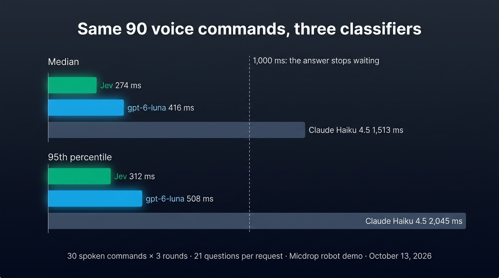
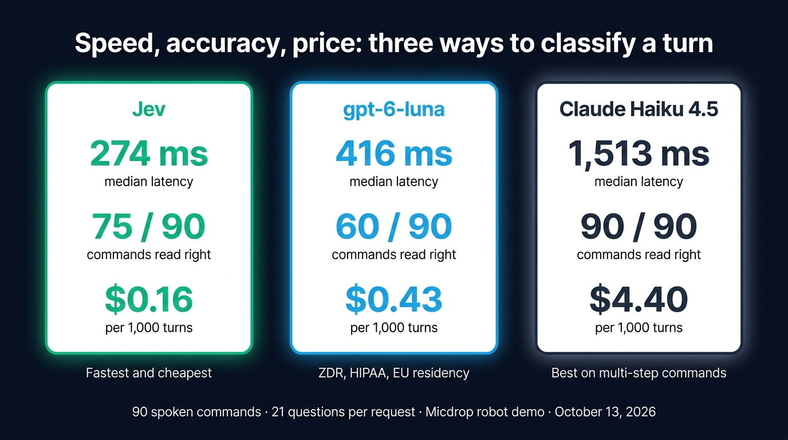
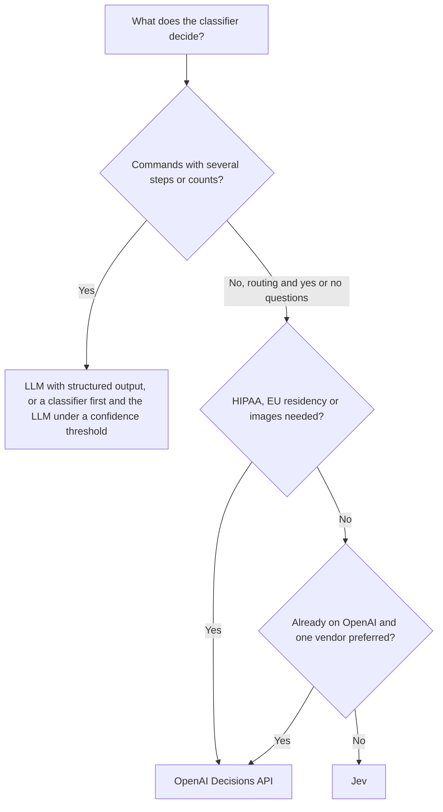

Jev, the System One model of [TypeSafe](https://typesafe.ai), and `gpt-6-luna`, the model behind the [OpenAI Decisions API](https://developers.openai.com/api/docs/guides/decisions), do the same job: they answer typed questions about a text with probabilities, in a few hundred milliseconds, and write no text. We sent the same 90 spoken commands to both on October 13, 2026, and to Claude Haiku 4.5 with structured output as the LLM baseline. Jev answered in 274 ms at the median and read 75 commands right, for $0.16 per 1,000 turns. `gpt-6-luna` took 416 ms, read 60 right and cost $0.43. Claude Haiku 4.5 read all 90 right, in 1,513 ms and for $4.40.

Jev is the fastest and the cheapest of the three, the Decisions API comes with the compliance options of OpenAI, and the LLM is the one to trust with a command of several steps. We detail the method, the commands each model misread, the prices and the data terms, so you can pick the classifier for your own voice agent. The benchmark runs on [Micdrop](/), an open source TypeScript library for real-time voice conversations, where the three models are called through the same classifier interface.

## Jev and the Decisions API answer the same three kinds of questions

Both APIs take an input and a list of questions, and return one typed answer per question in a single response. The three question types match one to one:

| | Jev (TypeSafe) | Decisions API (OpenAI) |
| --- | --- | --- |
| Yes or no | `noul`, the probability of a yes | `predicate`, the probability that a condition is true |
| One value out of a list | `choice`, with a confidence and the probability of each option | `choice`, with a confidence and the probability of each value |
| Position on ordered levels | `score`, the expected level | `score`, the average of the level indices weighted by their probabilities, with a confidence |
| Refusal | None | Any question can come back as a `refusal` |
| Input | A text or a JSON object | A text, or user messages with text and inline images |
| Model | `jev-latest` | `gpt-6-luna`, the only model accepted |
| Probabilities | Trained to be calibrated, according to TypeSafe | "The model's estimate", in OpenAI's words |
| Status in October 2026 | Early access | Public beta |

The Decisions API can refuse a question, so every read of an answer has to handle a missing value. Jev always answers. The Decisions API also reads images, sent inline as base64, where Jev reads text only.

TypeSafe says it trains Jev for calibrated decisions, which means that an answer given with a probability of 0.8 should be right about eight times out of ten. OpenAI's guide makes no such claim for `gpt-6-luna`. Whichever you pick, check the probabilities against turns you have labelled yourself before you set a threshold. You can read more about [how a System One model like Jev works](/blog/what-is-jev), or [route a voice call with the Decisions API](/blog/openai-decisions-api-voice-agent) step by step.

## The benchmark sends 30 voice commands three times, with 21 questions per request

The inputs come from the [robot demo of Micdrop](https://github.com/Godefroy/micdrop/tree/main/examples/demo-robot), where you talk to a small robot in a garden and a classifier turns each sentence into a command. The benchmark sends 30 sentences such as "Take the bucket and water the flower", "Go right four times" or "Bip, you are useless", three times each, which makes 90 requests per model.

Every request carries the same 21 questions. One asks how many actions the sentence holds, from zero to three. Five yes or no questions ask whether the sentence greets the robot, says please or thanks, praises it, insults it or tells it to stop. Then five questions describe each of three possible actions: the action out of 16, its target, who receives the object, the direction and a number of steps. The code reads as many actions as the count says.

Each sentence goes to the three models at the same moment:

- Jev, through `TypesafeClassifier` of `@micdrop/typesafe`.
- `gpt-6-luna`, through `OpenaiClassifier` of `@micdrop/openai`. It gets the questions of Jev unchanged, each `noul` sent as a `predicate`.
- Claude Haiku 4.5, through the Messages API of Anthropic with structured outputs, so the answer follows a JSON schema with one property per question.

We measure the time your server would wait, from the request to the parsed answer, over the public APIs, from one machine and its network. The first request of the process is kept apart as the cold start. Speech to text is left out, so the three models read the same text.

To count the commands a model got right, we labelled the 30 sentences by hand with the commands a person would accept. For "Go switch on the lamp", we accept the switch alone, or a walk to the lamp then the switch. The robot starts each sentence with empty hands, so "Bring the ball to the dog" needs two steps, pick up the ball then give it to the dog. The labels, the script and [the raw file of this run](https://github.com/Godefroy/micdrop/tree/main/examples/demo-robot/measurements) are in the repository. Run `pnpm measure:classifiers` to repeat the benchmark on your network with your keys.

The questions were written for Jev in September 2026, so `gpt-6-luna` answers questions tuned for another model. Instructions rewritten for it may score higher. Thirty sentences in one domain are also a small sample. Treat the numbers as one measurement, and run your own turns before you decide.

## Median latency is 274 ms for Jev, 416 ms for gpt-6-luna and 1,513 ms for the LLM

| | Jev | `gpt-6-luna` | Claude Haiku 4.5 |
| --- | --- | --- | --- |
| Median | 274 ms | 416 ms | 1,513 ms |
| 95th percentile | 312 ms | 508 ms | 2,045 ms |
| Fastest request | 245 ms | 176 ms | 1,360 ms |
| Slowest request | 467 ms | 776 ms | 4,113 ms |
| First request of the process | 373 ms | 281 ms | 2,157 ms |
| Failed requests, out of 90 | 0 | 0 | 0 |

Jev took the least time at the median and varied the least: 95% of its requests came back within 70 ms of its fastest one. `gpt-6-luna` took about 1.5 times as long at the median and varied more. Its fastest request, 176 ms, was quicker than any request of Jev, while its slowest took 776 ms. Claude Haiku 4.5 took 5.5 times as long as Jev at the median, because an LLM writes its JSON one token at a time.

Both classifiers fit in the second a voice agent can wait before it answers. The Micdrop server waits for the classification of a turn before it answers, up to `maxWait`, 1,000 ms by default. Every request of Jev and `gpt-6-luna` in this run came back within that time. Claude Haiku 4.5 took more than a second on all 90 requests, so a server that routes with it has to raise the wait and add over a second of silence to each turn.

The time of the first request of a process depends on the connection it opens. For `gpt-6-luna` it took 281 ms in this run, 548 ms and 1.8 s on two other starts of the script the same day, and about 2.4 s in a test on October 7, 2026. Jev stayed between 373 and 391 ms over the three starts. A server that stays up opens the connection only once. Send one small request at startup, so the connection is open before the first caller arrives.

{/* IMAGE regen: api.py image, infographic, 1600x900. Scene: "A bar chart on a dark background, read from top to bottom. Title at the top in modern clean bold sans-serif: "Same 90 voice commands, three classifiers". Two groups of three horizontal bars, all starting from the same left edge, their lengths strictly proportional to their values, the longest bar (2,045 ms) spanning about 80% of the width. Group label "Median" above the first three bars: an emerald bar labelled "Jev 274 ms", a sky blue bar labelled "gpt-6-luna 416 ms", a slate grey bar labelled "Claude Haiku 4.5 1,513 ms". Group label "95th percentile" above the next three bars: an emerald bar labelled "Jev 312 ms", a sky blue bar labelled "gpt-6-luna 508 ms", a slate grey bar labelled "Claude Haiku 4.5 2,045 ms". Each label sits just right of the end of its bar. A thin vertical dashed line at the position of 1,000 ms crossing all bars, labelled at its top "1,000 ms: the answer stops waiting". No axis, no gridlines, no tick numbers. Footer line centered: "30 spoken commands × 3 rounds · 21 questions per request · Micdrop robot demo · October 13, 2026"."
    Infographic: regenerate if examples/demo-robot/measurements gets a newer three-way file. Last data sync: 2026-10-13. */}


## The LLM read all 90 commands right, Jev 75 and gpt-6-luna 60

| | Jev | `gpt-6-luna` | Claude Haiku 4.5 |
| --- | --- | --- | --- |
| Commands read right, out of 90 | 75 | 60 | 90 |
| Sentences misread, out of 30 | 5 | 10 | 0 |
| Questions refused, out of 1,890 | 0 | 3 | 0 |

Every misread sentence was misread the same way on the three rounds, so it counts three times. Jev and `gpt-6-luna` gave the same command, tone included, on 60 of the 90 requests.

Jev misread five sentences:

- "Go switch on the lamp, please" became a walk to the lamp, without the switch.
- "Bring the ball to the dog" became a gift to the dog, without picking up the ball.
- "Could you please take the wood to the house?" stopped after picking up the wood.
- "Move three steps to the left" became two moves of three steps to the left.
- "Go right four times" became three walks to a place, with no place named.

`gpt-6-luna` misread ten. It made the same mistake as Jev on "Go switch on the lamp, please" and on "Bring the ball to the dog", and it turned "Go right four times" into three moves of four steps. It misread seven more in its own way:

- "Take the bucket and water the flower" made the robot pick up the flower instead of the bucket.
- "Go up two steps, then dance" became two steps with no direction, then the dance.
- "Stupid robot, go water the flower" became a walk to the flower, without the watering.
- "Could you please take the wood to the house?" became a delivery to the house, without picking up the wood.
- "Drop it", "Wave at me" and "Turn off the lamp" produced no command at all.

For "Drop it", "Wave at me" and "Turn off the lamp", `gpt-6-luna` answered that the sentence held zero actions, with a confidence of 0.36 to 0.45. When we asked again in a separate request, it named the right action each time with a confidence above 0.95. The model knew what to do and miscounted the steps. Jev fails on counts as well, as TypeSafe's documentation admits: the current version "does not count reliably", and instructions with "additional levels of indirection" cost accuracy. A verb like "bring", which means a pickup and a delivery in one word, is that kind of instruction.

The confidence helps you catch a part of these mistakes. With a threshold of 0.6 on the count question, `gpt-6-luna` was under it on 12 of its 30 wrong commands and on 9 of its 60 right ones. Jev was under it on 6 of its 15 wrong commands and on none of its 75 right ones. Send those turns to an LLM to remove four mistakes out of ten for both. The answer is then slower on about one turn in four for `gpt-6-luna` and one in fifteen for Jev.

Claude Haiku 4.5 matched our reading of the tone on every request. Jev and `gpt-6-luna` both found a request to stop in "Drop it", where Jev found an insult as well. `gpt-6-luna` also found a greeting in "You're the best robot ever" and in "Wave at me". The three refusals of the run came from `gpt-6-luna`, which declined the same question on each of the three rounds: the number of steps of a third action for "Thanks Bip, that was great".

A robot command is harder than what most voice agents ask of a classifier. Routing a support call takes one intent out of a short list and a few yes or no questions, with no count and no chain of actions. Expect both models to do better there than on these 30 sentences, and keep an LLM for the turns that hold several steps.

## 1,000 turns cost $0.16 with Jev, $0.43 with gpt-6-luna and $4.40 with the LLM

Both classifiers bill input tokens only. Jev costs $0.042 per million and `gpt-6-luna` $0.10 per million, 2.4 times as much. Claude Haiku 4.5 costs $1 per million input tokens and $5 per million output tokens.

| | Jev | `gpt-6-luna` | Claude Haiku 4.5 |
| --- | --- | --- | --- |
| Input tokens per request | 3,732 | 4,306 | 3,872 |
| Output tokens billed per request | 0 | 0 | 105 |
| Price of 1,000 turns | $0.16 | $0.43 | $4.40 |

The same 21 questions count as more tokens at OpenAI than at TypeSafe, so `gpt-6-luna` ends up 2.7 times the price of Jev. The LLM costs 28 times the price of Jev. These requests are large, since the 21 questions hold far more tokens than the sentence. A support agent that asks three or four questions sends about a tenth of these tokens: we counted about 470 input tokens for a turn, its history and three questions on the Decisions API, which comes to $0.05 per 1,000 turns.

The cost is rarely a reason to pick one classifier over the other at these prices. A thousand calls of twenty turns each cost $3 to classify with Jev and $9 with `gpt-6-luna` at the size of the robot requests, and a tenth of that with a few questions. OpenAI adds a premium for regional processing, which its guide mentions without a figure.

{/* IMAGE regen: api.py image, infographic, 1600x900. Scene: "Three side-by-side cards on a dark background, each with a title and three large figures stacked vertically, each figure with a small caption under it. Title at the top in modern clean bold sans-serif: "Speed, accuracy, price: three ways to classify a turn". Card 1, emerald outline, titled "Jev": "274 ms" caption "median latency", "75 / 90" caption "commands read right", "$0.16" caption "per 1,000 turns". Card 2, sky blue outline, titled "gpt-6-luna": "416 ms" caption "median latency", "60 / 90" caption "commands read right", "$0.43" caption "per 1,000 turns". Card 3, slate grey outline, titled "Claude Haiku 4.5": "1,513 ms" caption "median latency", "90 / 90" caption "commands read right", "$4.40" caption "per 1,000 turns". Under each card a one-line tag: under card 1 "Fastest and cheapest", under card 2 "ZDR, HIPAA, EU residency", under card 3 "Best on multi-step commands". Footer line centered: "90 spoken commands · 21 questions per request · Micdrop robot demo · October 13, 2026"."
    Infographic: regenerate if examples/demo-robot/measurements gets a newer three-way file or if a price changes. Last data sync: 2026-10-13. */}


## OpenAI documents more data protection and compliance options than TypeSafe

A classifier reads every turn of every call, so its data terms matter as much as those of your LLM.

| | Jev (TypeSafe) | Decisions API (OpenAI) |
| --- | --- | --- |
| Zero data retention | For enterprise customers, on request | For eligible customers |
| Training on your data | TypeSafe commits to train no model on user data | Covered by the data controls of the OpenAI API |
| HIPAA | Absent from the documentation | For eligible customers |
| Data residency | No region named in the documentation | United States, and Europe (EEA and Switzerland) |
| Contract | Data processing agreement published | Data processing agreement of the OpenAI API |

OpenAI's guide states that the Decisions API "supports Zero Data Retention (ZDR) and HIPAA use for eligible customers", with data residency and regional processing in the United States and in Europe. TypeSafe publishes a data processing agreement and a privacy policy that commits to train no model on user data, and its documentation offers zero data retention to enterprise customers who contact its sales team. That documentation names no hosting region and says nothing about HIPAA, so ask TypeSafe both questions before you send it health data or calls from European customers.

Micdrop is a library that runs in your own server with your own keys. So the compliance of a call depends on your deployment and on the providers you choose, the classifier included.

## Which classifier to pick for a voice agent



- Pick Jev when latency comes first and your calls are in English. It was the fastest, the most regular and the cheapest in this run, and it always answers. English is its main training language, so test other languages on your own turns.
- Pick the Decisions API when you need documented data residency in Europe, HIPAA eligibility or image inputs, or when your agent already runs on OpenAI and one vendor is enough. Plan for refusals in your code, and remember that the API is in public beta.
- Keep an LLM for commands with several steps or a count, when a wrong action is worse for you than an extra second of waiting. You can also classify first and call the LLM only when the confidence is low.

Whichever classifier you start with, a second one is a good fallback. When your LLM and your classifier both run on OpenAI, an OpenAI outage takes the routing down with the answers.

## Switching between Jev and the Decisions API in Micdrop

Both classes extend the same `Classifier` of `@micdrop/server`, so the server options and the routing hook stay the same. Here are two questions asked to Jev:

```typescript
import { choice, noul, TypesafeClassifier } from '@micdrop/typesafe'

const classifier = new TypesafeClassifier({
  apiKey: process.env.TYPESAFE_API_KEY,
  questions: {
    intent: choice('What does the caller in `turn` want?', {
      billing: 'A charge, an invoice, a refund',
      outage: 'The service is down or slow',
      other: 'Anything else',
    }),
    wantsHuman: noul('Does the caller in `turn` ask to speak to a human?'),
  },
})

// In onBeforeAnswer
answers.wantsHuman.noul > 0.7
```

The same questions go to `gpt-6-luna` with another import, `predicate` in place of `noul`, and a read that handles a refusal:

```typescript
import { choice, OpenaiClassifier, predicate } from '@micdrop/openai'

const classifier = new OpenaiClassifier({
  apiKey: process.env.OPENAI_API_KEY || '',
  questions: {
    intent: choice('What does the caller in `turn` want?', {
      billing: 'A charge, an invoice, a refund',
      outage: 'The service is down or slow',
      other: 'Anything else',
    }),
    wantsHuman: predicate('Does the caller in `turn` ask to speak to a human?'),
  },
})

// In onBeforeAnswer, a refused question is missing from the answers
(answers.wantsHuman?.probability ?? 0) > 0.7
```

The call to `MicdropServer` is the same for both:

```typescript
new MicdropServer(socket, {
  stt,
  agent,
  tts,
  classifier,
  classifierOptions: { waitBeforeAnswer: true },
})
```

Swapping takes a few lines, so you can run both on a day of real calls and compare their answers before you choose. Each class has its own options, listed for [the Jev classifier](/docs/ai-integration/provided-integrations/typesafe) and for [the OpenAI classifier](/docs/ai-integration/provided-integrations/openai#openai-classifier). Keywords and embeddings are two other [ways to detect the intent of a turn](/blog/intent-classification-voice-agent), each with its own latency.

## Frequently asked questions

<FaqList>
  <FaqItem question="Is Jev faster than gpt-6-luna?">
    Yes, Jev was faster in our run of October 13, 2026. On 90 requests of 21 questions each, Jev answered in 274 ms at the median and 312 ms at the 95th percentile, against 416 ms and 508 ms for `gpt-6-luna`. `gpt-6-luna` had the fastest single request, at 176 ms, but its times varied more.
  </FaqItem>
  <FaqItem question="Which is more accurate, Jev or the OpenAI Decisions API?">
    On 90 spoken commands for a robot, Jev read 75 right and `gpt-6-luna` 60, while Claude Haiku 4.5 read all 90 right. The questions were first written for Jev, which may favour it. Both models misread commands that hold several steps or a count.
  </FaqItem>
  <FaqItem question="Which is cheaper, Jev or gpt-6-luna?">
    Jev costs $0.042 per million input tokens and `gpt-6-luna` $0.10, and output is free on both. For the same 21 questions, 1,000 requests cost $0.16 with Jev and $0.43 with `gpt-6-luna`, because OpenAI also counted more tokens.
  </FaqItem>
  <FaqItem question="Can gpt-6-luna or Jev replace an LLM in a voice agent?">
    They replace the LLM for decisions, such as routing a turn, detecting a request for a human or reading a simple voice command. Neither writes text, so the LLM keeps the answers that need writing. The LLM also read commands of several steps better in our benchmark.
  </FaqItem>
  <FaqItem question="Is the OpenAI Decisions API an alternative to Jev?">
    Yes, both answer choice, score and yes or no questions with probabilities in a single request. The Decisions API adds image inputs, refusals and documented data residency in the United States and Europe. Jev was faster and cheaper in our run and always answers.
  </FaqItem>
  <FaqItem question="Does the benchmark include speech to text?">
    No, the benchmark leaves speech to text out. The three models receive the same text at the same moment, and the time runs from the request to the parsed answer. In a call, your speech to text adds its transcription time before the classifier starts.
  </FaqItem>
</FaqList>

## Run both classifiers on your own turns

This benchmark covers thirty robot commands, so test the models on your own calls before you pick one. Write the questions your routing needs, log the answers of Jev and of `gpt-6-luna` on the same calls for a few days, label a few dozen turns yourself, then compare. The setup takes one option of the server: [add a classifier to a Micdrop server](/docs/server/classifier), or [start with a first voice call in five minutes](/docs/getting-started) if Micdrop is new to you.
