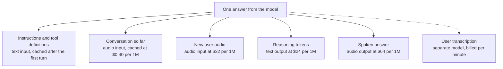
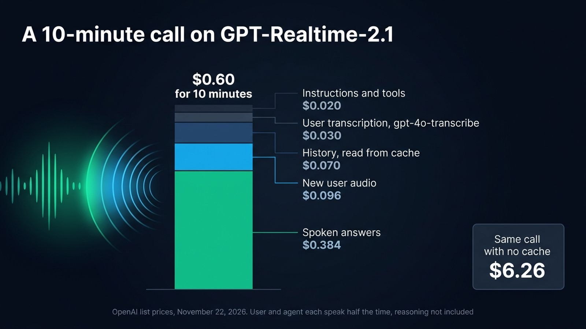
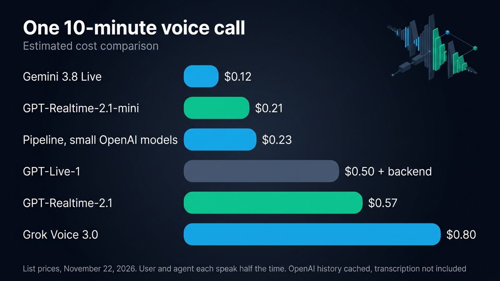

The OpenAI Realtime API costs about $0.05 for one minute of voice conversation on GPT-Realtime-2.1, when the user and the agent each speak for thirty seconds, and about $0.015 on GPT-Realtime-2.1-mini. Those figures cover the audio alone. In a real call, you pay again for the instructions and the conversation history on every answer. Reasoning tokens can add to that. Most teams also pay for a transcription of the user, on a separate meter. With all of that counted and the prompt cache working, a 10-minute call on GPT-Realtime-2.1 comes to about $0.57 before transcription. This post converts OpenAI's token prices into minutes, prices calls of 1 to 30 minutes, breaks a 10-minute call down line by line, and compares the result with GPT-Live-1, Gemini Live, Grok Voice and a pipeline of separate providers.

Every price below comes from [OpenAI's API pricing page](https://developers.openai.com/api/docs/pricing) and its [Realtime API cost guide](https://developers.openai.com/api/docs/guides/voice-latency-cost), read on 22 November 2026, unless the sentence names another source.

## OpenAI Realtime API prices per million tokens

OpenAI bills the Realtime API per token, with audio, text and images on separate rates. The audio rates set most of the bill.

| Model | Audio in | Cached audio in | Audio out | Text in | Cached text in | Text out |
|---|---|---|---|---|---|---|
| `gpt-realtime-2.1` | $32 | $0.40 | $64 | $4 | $0.40 | $24 |
| `gpt-realtime-2.1-mini` | $10 | $0.30 | $20 | $0.60 | $0.06 | $2.40 |
| `gpt-realtime-2` | $32 | $0.40 | $64 | $4 | $0.40 | $24 |
| `gpt-realtime` | $32 | $0.40 | $64 | $4 | $0.40 | $16 |
| `gpt-realtime-mini` | $10 | $0.30 | $20 | $0.60 | $0.06 | $2.40 |

Prices are in US dollars per million tokens. Image input costs $5 per million tokens on the full-size models and $0.80 on the mini ones.

GPT-Realtime-2.1 and GPT-Realtime-2 share every rate. The first generation, `gpt-realtime`, has the same audio rates and a cheaper text output at $16 per million. It does not reason. The older `gpt-realtime-mini` still points to a December 2025 snapshot with a 32K context and no reasoning, at the same price as the 2.1 mini. GPT-Realtime-2.1 [handles letters, numbers, silence and interruptions better](/blog/gpt-live-vs-gpt-realtime-vs-gemini-live) than GPT-Realtime-2, so a new project should start on GPT-Realtime-2.1 or its mini.

## How audio tokens turn into minutes

OpenAI counts one token for every 100 ms of audio the model hears and one token for every 50 ms it speaks. A second of user speech is 10 tokens, and a second of model speech is 20 tokens.

| On `gpt-realtime-2.1` | Tokens | Cost |
|---|---|---|
| One minute of user speech | 600 | $0.0192 |
| One minute of model speech | 1,200 | $0.0768 |
| A minute of conversation, split evenly | 300 in, 600 out | $0.048 |

The same evenly split minute costs $0.015 on GPT-Realtime-2.1-mini, from 300 tokens at $10 and 600 at $20 per million.

A second of the agent speaking costs four times as much as a second of the user speaking, since it counts twice as many tokens at twice the rate. A talkative agent therefore costs more than a brief one. An agent that answers in two sentences rather than five cuts the cost of its spoken answers by more than half. Ask for short answers in the system prompt.

Silence is free when OpenAI's voice detection runs, since it filters empty audio before the model sees it. An application that streams its own silence into the session pays for it as audio input.

## What else you pay for on each turn

The $0.048 a minute assumes each turn stands alone. OpenAI's cost guide states, though, that the entire conversation is sent to the model for each response, so on each answer you pay again for everything said before it.



The instructions and tool definitions are text tokens, resent on every turn. A prompt of 1,000 tokens costs $0.004 on the first turn and $0.0004 on each later turn once cached.

The conversation history is mostly audio, since every user turn and every spoken answer stays in it as audio tokens. Cached audio costs $0.40 per million on GPT-Realtime-2.1, eighty times less than fresh audio input. That discount makes long calls affordable. It depends, though, on a cache OpenAI describes as automatic and best effort. Changing the instructions or the tools in the middle of a session lowers the cache hit rate for the turns that follow. Editing an earlier item clears the cache from that item onward.

OpenAI bills reasoning tokens as text output, at $24 per million on GPT-Realtime-2.1 and $2.40 on the mini. OpenAI publishes no typical count, which depends on the effort level and the question. Each 100 reasoning tokens per answer adds $0.0024 on the full-size model. At four answers a minute, that adds about $0.01 a minute, or a fifth on top of the $0.048 of audio.

Transcribing what the user says is optional and runs on a separate model, billed at that model's rate. The Realtime API only returns a text version of the user's speech when you ask for one in the session settings. Most teams turn it on in production, to store the conversation and to show it in the interface.

| Transcription model | Per minute of user audio | For a 10-minute call, user speaking half the time |
|---|---|---|
| `gpt-transcribe` | $0.0045 | $0.023 |
| `gpt-4o-transcribe` | $0.006 | $0.030 |
| `gpt-live-transcribe` | $0.017 | $0.085 |

## What a 5 or 10 minute call costs

The worked example assumes a support agent with 1,000 tokens of instructions and tools. The user and the agent each speak for 7.5 seconds per exchange, four exchanges a minute, so every minute still splits evenly. Everything said earlier in the call is read from the cache. Reasoning stays out of these figures, since its volume depends on your effort setting.

| Call length | `gpt-realtime-2.1` | `gpt-realtime-2.1-mini` | `gpt-realtime-2.1` with no cache |
|---|---|---|---|
| 1 minute | $0.054 | $0.016 | $0.11 |
| 5 minutes | $0.27 | $0.09 | $1.69 |
| 10 minutes | $0.57 | $0.21 | $6.26 |
| 30 minutes | $2.13 | $0.94 | $53.33 |

On GPT-Realtime-2.1, the 10-minute call splits into four parts:

- 3,000 tokens of new user audio, $0.096
- 6,000 tokens of spoken answers, $0.384
- the instructions on 40 turns, $0.020
- 175,500 tokens of history read from the cache, $0.070

The spoken answers make up two thirds of the bill. Add $0.03 for `gpt-4o-transcribe` and the call costs $0.60, or $0.06 a minute.

The cost per minute grows with the length of the call, from $0.054 for the first minute to $0.071 averaged over thirty minutes, because the history grows on every turn. Without the cache, history is billed at the full audio rate and the 10-minute call costs eleven times more. An uncached 30-minute call costs $53, against $2.13 with the cache. A Realtime session lasts sixty minutes at most. Its 128K context holds a full hour of this conversation, so the whole history stays in the context until the session ends.

{/* IMAGE regen: api.py image, infographic, 1600x900. Scene: "Infographic showing how a 10-minute call on GPT-Realtime-2.1 adds up. A single vertical stacked bar in the center left, built from five segments, bottom to top, each with its label and price to its right, connected by thin lines: 'Spoken answers' '$0.384', 'New user audio' '$0.096', 'History, read from cache' '$0.070', 'User transcription, gpt-4o-transcribe' '$0.030', 'Instructions and tools' '$0.020'. The spoken answers segment is the largest, about two thirds of the bar, in bright emerald. The other segments are sky blue and slate, their heights strictly proportional to their prices. At the top of the bar, a bold total: '$0.60 for 10 minutes'. On the right side, a separate small callout box with a slate outline reading 'Same call with no cache' and below it, large: '$6.26'. Title at top left, in a modern clean bold sans-serif: 'A 10-minute call on GPT-Realtime-2.1'. Footer small text: 'OpenAI list prices, November 22, 2026. User and agent each speak half the time, reasoning not included'. Wide 16:9 layout, lots of breathing room, labels in white and light slate."
    Infographic only: regenerate if OpenAI changes the audio, cached audio, text or transcription rates of gpt-realtime-2.1. Last data sync: 2026-11-22. */}


## Is the OpenAI Realtime API expensive?

The OpenAI Realtime API costs more than most alternatives for the same minute of conversation. On a minute split evenly, Gemini 3.8 Live costs about a quarter as much as GPT-Realtime-2.1, and a pipeline built on small OpenAI models about half. Next to a human agent the API is still cheap, cheap enough that a minute at $0.06 rarely decides whether a product makes money. The difference starts to count at volume. A thousand 10-minute calls a month cost about $600 on GPT-Realtime-2.1 with transcription, against $240 on the mini.

For that price you get a model that hears the audio itself, tone and hesitation included, and answers fast without handing text between three services. Whether that is worth twice the price of a pipeline depends on the product. Price is also only one part of the [trade-off between one Realtime connection and a pipeline of separate providers](/blog/openai-realtime-api-vs-pipeline).

## GPT-Live-1 pricing

OpenAI bills GPT-Live-1, its full-duplex voice model, per minute of session instead of per token. An active minute costs $0.05 and a standby minute $0.02, billed by the second. GPT-Live-1.1 has the same rates. A session is active while someone speaks, during silence before the idle timeout, and while the voice waits for the backend. Muting the microphone keeps the session active, so close the session when the call ends.

The voice model is only part of the bill. GPT-Live-1 hands reasoning and tools to a backend model, billed separately at that model's token rates. OpenAI's own example is a 90-second session at $0.075 plus $0.02 of backend usage, $0.095 in total. A 10-minute active call costs $0.50 before the backend.

GPT-Live-1 has the simpler voice bill. OpenAI bills the session by time rather than by tokens, so a minute of voice costs the same in a long call as in a short one. The backend's token bill still grows with the conversation it receives. GPT-Live-1 is also a [different model, with its own endpoint and events](/blog/gpt-live-vs-gpt-realtime-vs-gemini-live), so moving to it from the Realtime API means rewriting the session code.

## OpenAI Realtime pricing against Gemini Live, Grok Voice and a pipeline

| A 10-minute call, split evenly | Cost | How it bills |
|---|---|---|
| Gemini 3.8 Live | About $0.12 | Audio per token, $3 in and $12 out per million |
| `gpt-realtime-2.1-mini` | $0.21 | Audio per token, history cached |
| Pipeline on small OpenAI models | About $0.23 | Transcription, model and voice billed separately |
| GPT-Live-1 | $0.50 plus the backend model | Per minute of session |
| `gpt-realtime-2.1` | $0.57 | Audio per token, history cached |
| Grok Voice 3.0 | $0.80 | Flat $0.08 per minute |

The figures for `gpt-realtime-2.1` and its mini leave out user transcription, since it is optional and depends on the transcription model you pick.

[Gemini 3.8 Live](https://aistudio.google.com/docs/pricing) costs $3 per million audio tokens heard and $12 per million spoken, which Google estimates at $0.005 and $0.018 per minute of audio. Its Extended Thinking variant has the same rates. Google bills thinking tokens as output. On Vertex AI, it also bills every turn for all the tokens of the session context. Gemini 3.8 Live is the cheapest of the large speech-to-speech models.

Grok Voice 3.0 costs a flat $0.08 per minute of session, plus $0.004 per text input, whatever the length of the history, according to xAI's documentation read on 21 November 2026. On a 10-minute call it costs more than GPT-Realtime-2.1 with a working cache, $0.80 against $0.57, and far less than the $6.26 of an uncached call. Its flat rate also makes the bill easy to predict. Grok Voice accepts the Realtime API's events, so a client written for OpenAI [works with it after a few changes](/blog/grok-voice-api-typescript).

A pipeline transcribes the user with `gpt-live-transcribe`, answers with `gpt-5.6-luna` and speaks with `gpt-realtime-2.1-mini` reading each sentence. On those three OpenAI models, [a minute of pipeline costs about $0.023](/blog/openai-realtime-api-vs-pipeline). The pipeline resends the history as text, which stays cheap as the call grows. Because the history grows, `gpt-5.6-luna` costs about $0.023 over a 10-minute call, against $0.015 at the first minute's rate, so the whole call comes to about $0.23. Amazon Nova Sonic, Qwen Audio Realtime and the other [speech-to-speech APIs for voice agents](/blog/top-speech-to-speech-apis-voice-agents) differ in price, protocol and where the audio is processed.

{/* IMAGE regen: api.py image, infographic, 1600x900. Scene: "Infographic comparing the cost of one 10-minute voice call across six options, as horizontal bars sorted from cheapest at the top to most expensive at the bottom. Each row has a label on the left, a bar, and the price at the end of the bar. Row 'Gemini 3.8 Live' '$0.12'. Row 'GPT-Realtime-2.1-mini' '$0.21'. Row 'Pipeline, small OpenAI models' '$0.23'. Row 'GPT-Live-1' '$0.50 + backend'. Row 'GPT-Realtime-2.1' '$0.57'. Row 'Grok Voice 3.0' '$0.80'. Bar lengths strictly proportional to the prices. The GPT-Realtime-2.1 and GPT-Realtime-2.1-mini bars are bright emerald, the others sky blue and slate. Title at top left, in a modern clean bold sans-serif: 'One 10-minute voice call'. Footer small text: 'List prices, November 22, 2026. User and agent each speak half the time. OpenAI history cached, transcription not included'. Wide 16:9 layout, generous spacing, labels in white and light slate."
    Infographic only: regenerate if OpenAI, Google or xAI change the prices of these models, or if the pipeline figure changes. Last data sync: 2026-11-22. */}


## How to lower your Realtime API bill

- Ask for short answers in the system prompt. The spoken answers are two thirds of the bill, at four times the per-second cost of the user's speech.
- Try GPT-Realtime-2.1-mini on your own conversations. OpenAI warns that mini models can be weaker at following instructions and calling tools, so test it on your hardest calls before you switch.
- Set the reasoning effort to `minimal` or `low` for small talk, and raise it only for the turns that need it.
- Keep the instructions and the tool list identical for the whole session, so the cache keeps working.
- Trim the history on long calls. OpenAI's `retention_ratio` and `token_limits.post_instructions` settings drop old turns automatically. You can also remove the items you no longer need with `conversation.item.delete`, or replace them with a summary.
- Pick the transcription model on purpose. `gpt-transcribe` costs about a quarter of `gpt-live-transcribe`.
- Close sessions when the call ends. OpenAI keeps billing a forgotten GPT-Live session at the standby rate.

OpenAI also recommends measuring a sample session in the Logs tab of the Realtime Playground, which shows the token usage of each turn.

## Setting the cost of each call with Micdrop

[Micdrop](/) is an open source TypeScript library for real-time voice conversations. It handles the microphone, the playback, the socket and the turns between a browser and your Node server. Its `OpenaiRealtime` class runs a Realtime session behind that client, with the model, the reasoning effort and the transcription model among its options:

```typescript
import { MicdropServer } from '@micdrop/server'
import { OpenaiRealtime } from '@micdrop/openai'

new MicdropServer(socket, {
  realtime: new OpenaiRealtime({
    apiKey: process.env.OPENAI_API_KEY || '',
    systemPrompt: 'You are a support agent. Answer in two sentences at most.',
    model: 'gpt-realtime-2.1-mini',
    reasoningEffort: 'minimal',
    transcriptionModel: 'gpt-transcribe',
  }),
})
```

`OpenaiRealtime` runs `gpt-realtime-2.1` by default and leaves the reasoning effort to OpenAI's default, `low`. It transcribes the user with `gpt-4o-transcribe` unless you set another model, which is worth doing since OpenAI shuts `gpt-4o-transcribe` down on 26 February 2027. When the user speaks over the answer, `OpenaiRealtime` truncates the answer in the session history at the point the user stopped hearing it, so on later turns you stop paying for audio nobody heard. The class takes [other settings](/docs/realtime/openai-realtime) as well.

Without a library, you would write a WebSocket session with OpenAI, audio capture and playback in the browser, interruptions and truncation, and a reconnection when the session reaches sixty minutes. Micdrop ships those parts. A hosted platform such as Vapi does the same for [$0.05 a minute on top of OpenAI's bill](/blog/vapi-pricing), which would nearly double the cost of a GPT-Realtime-2.1 call. Micdrop runs on your own server with your own OpenAI key and adds nothing to the bill. You build the hosting, the call history and any dashboard yourself, though.

The same server takes `GeminiLive` in place of `OpenaiRealtime`, or a pipeline of separate providers, without any change to the browser code. You can price GPT-Realtime-2.1, its mini and Gemini Live on your own calls by changing one class. You can [get a first voice call running in five minutes](/docs/getting-started), then read the token usage your own conversations produce.

## Frequently asked questions

<FaqList>
  <FaqItem question="How much does the OpenAI Realtime API cost per minute?">
    A minute where the user and the agent each speak for thirty seconds costs $0.048 in audio on GPT-Realtime-2.1 and $0.015 on GPT-Realtime-2.1-mini. Once the instructions and the history resent on every turn are counted, with the prompt cache working, a 10-minute call averages about $0.057 a minute on the full model and $0.021 on the mini. Transcribing the user adds $0.002 to $0.009 a minute depending on the transcription model.
  </FaqItem>
  <FaqItem question="Is the OpenAI Realtime API expensive?">
    It costs more than most alternatives. For a minute split evenly, Gemini 3.8 Live costs about a quarter as much as GPT-Realtime-2.1, and a pipeline on small OpenAI models about half. A thousand 10-minute calls cost about $600 a month on GPT-Realtime-2.1, transcription included, and about $240 on the mini.
  </FaqItem>
  <FaqItem question="How much does GPT-Live cost?">
    GPT-Live-1 costs $0.05 per active minute and $0.02 per standby minute, billed by the second, plus the token cost of the backend model that does the reasoning and runs the tools. OpenAI gives the example of a 90-second session at $0.075 plus $0.02 of backend usage.
  </FaqItem>
  <FaqItem question="How much does GPT-Realtime-2 cost?">
    GPT-Realtime-2 and GPT-Realtime-2.1 cost $32 per million audio tokens heard, $64 per million spoken, $0.40 per million cached audio tokens, $4 per million text tokens in and $24 per million text tokens out. OpenAI bills reasoning tokens as text output.
  </FaqItem>
  <FaqItem question="How much does GPT-Realtime-mini cost?">
    GPT-Realtime-2.1-mini and the older GPT-Realtime-mini cost $10 per million audio tokens heard, $20 per million spoken and $0.30 per million cached audio tokens. Text costs $0.60 per million in and $2.40 per million out.
  </FaqItem>
  <FaqItem question="How much is 1 million Realtime API tokens?">
    A million audio input tokens is about 28 hours of user speech, and costs $32 on GPT-Realtime-2.1. A million audio output tokens is about 14 hours of model speech, and costs $64. OpenAI counts one token per 100 ms heard and one per 50 ms spoken.
  </FaqItem>
  <FaqItem question="Which realtime API is best for voice AI?">
    Gemini 3.8 Live costs the least per minute. GPT-Realtime-2.1 keeps reasoning, tools and remote MCP servers in one session. Grok Voice 3.0 led the Artificial Analysis speech to speech index in October 2026. The [speech to speech APIs for voice agents](/blog/top-speech-to-speech-apis-voice-agents) also differ on benchmark scores and protocol.
  </FaqItem>
  <FaqItem question="Does the Realtime API bill silence?">
    Silence is free while OpenAI's voice detection runs, since it removes empty audio before the model hears it. Audio your application sends while nobody speaks is billed as input. On GPT-Live-1, silence before the idle timeout counts as active time.
  </FaqItem>
</FaqList>
