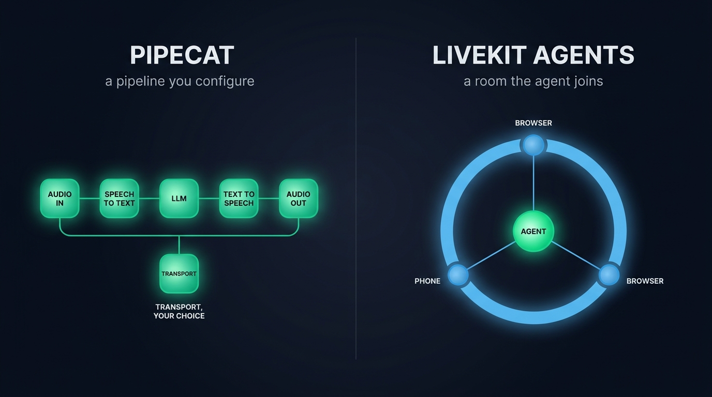
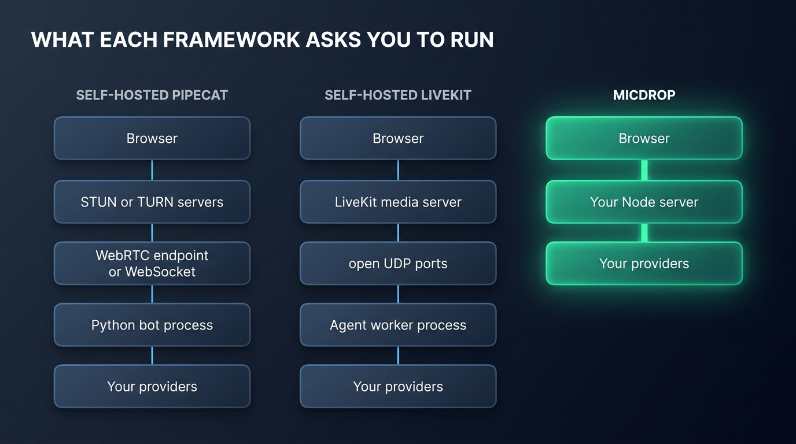
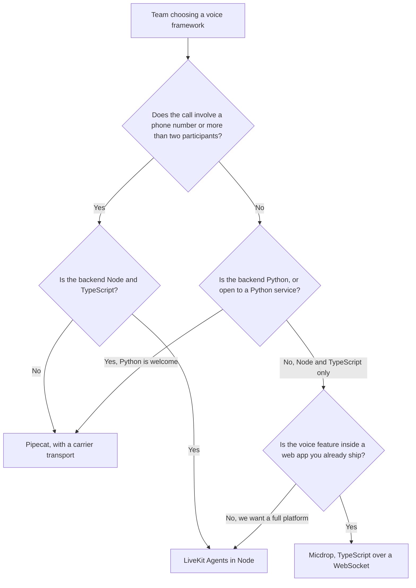

Two names dominate every open source voice agent conversation. They answer two different questions. [Pipecat](https://pipecat.ai) is a Python pipeline you wire to whichever transport you want. [LiveKit Agents](https://livekit.io) is an agent layer on a WebRTC media server, in Python and in Node. A team that picks between them on feature lists alone ends up operating things it never uses, so this comparison works through what each one actually asks you to run, in which language, at what price.

Everything below was read on each project's documentation and repository on 28 October 2026. Both projects ship often, so verify a fact against their docs before you commit to it.

## The short answer

| | Pipecat | LiveKit Agents |
|---|---|---|
| **What it is** | A Python pipeline framework | A Python and Node agent layer on a WebRTC media server |
| **Server language** | Python | Python and Node (TypeScript) |
| **Transport** | Yours to pick: Daily, WebSocket, self-hosted WebRTC, a LiveKit room | WebRTC, through its own SFU or LiveKit Cloud |
| **Telephony** | Twilio, Telnyx, Plivo, Exotel, Genesys, Vonage, SIP | SIP trunks, dial-in and dial-out, on Cloud or self-hosted |
| **Hosting model** | Your servers, or Pipecat Cloud | Your servers, or LiveKit Cloud |
| **Licence** | BSD 2-Clause, smart turn model included | Apache 2.0, turn detector under a separate model licence |
| **Where the client code lives** | JavaScript SDKs for browser and mobile | WebRTC client SDKs on ten platforms |

Choose Pipecat when your backend already speaks Python and you want the pipeline itself, frames and processors, to be the part you configure, with telephony serializers ready for six carriers. Choose LiveKit Agents when the voice feature involves rooms, several participants, video or a phone number, or when your backend is Node, since its agent framework ships as a first-class TypeScript package.

A third answer exists, because the question this site hears most often adds a language constraint: **which fits a TypeScript team**. [Micdrop](/), our own open source TypeScript library for real-time voice conversations, is neither of the two, depends on neither, and covers the narrower case where the whole call lives in the web app you already ship. Hold that thought until the section on a TypeScript web app.

## Two different starting points

The two projects come from opposite ends of the stack. Every other difference follows from that.

Pipecat, maintained by Daily, grew out of the pipeline problem. A voice conversation is a chain: audio in, speech-to-text, a model, text-to-speech, audio out, with turn detection and interruptions threaded through it. Pipecat models that chain as typed frames flowing between processors, which is why its own README still opens with the word "framework" rather than "platform". The transport is a pluggable end of the pipeline. Daily's own WebRTC is the default in examples, but the same framework runs over WebSocket, over a self-hosted SmallWebRTC endpoint, over WhatsApp, or over a LiveKit room through its LiveKit transport.

LiveKit grew out of the media problem. The core product is a Go WebRTC SFU, a server that forwards each participant's audio and video to everyone else. The agent framework arrived on top of it as a way to put a bot in the room. An agent is a worker process that authenticates against the server, accepts a job and joins a room as a headless participant. Rooms exist because many-to-many media is hard. The framework gives you a room whether your call needs one or not.

That is the honest framing for a choice between them: a pipeline framework that treats transport as configuration, against a media platform that treats the agent as one more participant. Teams that already run a media server or a phone product sit naturally with LiveKit. Teams that want to assemble a specific STT → LLM → TTS chain and keep choosing the transport later sit with Pipecat.

{/* IMAGE regen: api.py image, infographic, 1600x900. Scene: "Two halves split by a thin vertical divider, each half showing one mental model for a voice agent framework, on the dark slate background. Left half, heading in a modern clean bold sans-serif: PIPECAT, sub-caption below in smaller type: a pipeline you configure. Under it, a horizontal chain of five rounded modular blocks connected left to right by one continuous emerald line, each block glowing emerald, labelled in small clear capitals: AUDIO IN, SPEECH TO TEXT, LLM, TEXT TO SPEECH, AUDIO OUT, with a separate small block hanging below the chain labelled: TRANSPORT, YOUR CHOICE. Right half, heading: LIVEKIT AGENTS, sub-caption: a room the agent joins. Under it, a large sky blue ring seen straight on like a room from above, with one bright emerald node at the center labelled: AGENT, and three dim sky blue nodes placed around the ring labelled: BROWSER, PHONE, BROWSER, thin sky blue lines linking the outer nodes through the center. Flat vector geometric rendering, straight-on frontal view, generous dark margins, all typography perfectly legible."
    Regenerate if the two mental models or their labels change. Last data sync: 2026-10-28. */}


## Languages and SDKs

Both projects put Python first, though the interesting differences sit on the client side and in Node.

Pipecat's server framework runs in Python. Its JavaScript packages are clients: `@pipecat-ai/client-js` plus a transport package such as `@pipecat-ai/daily-transport`, implementing the RTVI standard to manage devices, bot connectivity and the bot's audio tracks in the browser. A Node team adopting Pipecat therefore runs the agent as a separate Python service, with a browser client written in TypeScript against it. The client SDKs cover JavaScript, React, React Native, Swift, Kotlin, C++ and ESP32.

LiveKit Agents ships in both. The Node distribution, `@livekit/agents`, is described by its own README as a Node.js distribution of a framework originally written in Python. Its plugin table counts roughly 37 packages against roughly 72 on the Python side, with the same STT, LLM and TTS vendors covered on both. MCP support was Python-only for a long stretch and has been reaching the Node side through the year. Client SDKs cover JavaScript, React, Swift, Kotlin, Flutter, React Native, Unity, Rust, C++ and ESP32.

So the language question lands differently than most 2026 comparisons still state. A team deciding on Pipecat has already decided on a Python service, whatever its backend speaks. A team deciding on LiveKit can write the whole agent in TypeScript, next to the rest of its backend, on the smaller of the two distributions.

## Transport and infrastructure

What you operate differs more than the transport tables suggest, because Pipecat's table is a menu and LiveKit's is a topology.

With Pipecat you pick per deployment: Daily's managed WebRTC for production, WebSocket for controlled networks, the self-hosted SmallWebRTC transport when you want WebRTC without Daily, or a carrier integration when the audio comes from a phone line. Self-hosting the transport means running the endpoint yourself, with the STUN and sometimes TURN servers that NAT traversal asks for. Pipecat Cloud replaces all of it with a managed runtime.

With LiveKit you run its SFU or you pay for LiveKit Cloud. There is no WebSocket deployment mode where the browser talks straight to your agent worker: the worker joins the room through the media server, while the browser publishes its audio track to the room. Self-hosting the transport therefore means operating a media server, its UDP ports and its scaling story. On the other side, everything the room model gives you is already built: several human participants in a call, video, phone participants bridged in over SIP, reconnection, and the plugins and tooling around the server.

A browser calling your own backend is a one-to-one connection, and we have written [why WebRTC buys little there](/blog/websocket-or-webrtc-voice-agent) and what it costs in servers anyway. A phone line, a second human participant or a video feed change that verdict. Both frameworks are honest about it: Pipecat points you at its carrier transports, LiveKit at its SIP trunk.

{/* IMAGE regen: api.py image, infographic, 1600x900. Scene: "Three vertical stacks of rounded modular blocks side by side, each stack showing what one framework asks a team to operate for a browser voice call, all labels in English rendered exactly as written. Heading at the top left in a modern clean bold sans-serif: WHAT EACH FRAMEWORK ASKS YOU TO RUN. Left column title: SELF-HOSTED PIPECAT, its blocks from top to bottom connected by thin sky blue lines: Browser, STUN or TURN servers, WebRTC endpoint or WebSocket, Python bot process, Your providers. Middle column title: SELF-HOSTED LIVEKIT, its blocks: Browser, LiveKit media server, open UDP ports, Agent worker process, Your providers. Right column title: MICDROP, drawn brighter with an emerald glow and the shortest stack, the focal point, its blocks connected by one thick emerald line: Browser, Your Node server, Your providers. The three columns align on a shared top line, and the right column is visibly shorter, leaving dark empty space below it. Flat vector geometric rendering, straight-on frontal view, generous dark margins, all typography perfectly legible."
    Regenerate if the deployment stacks change (Pipecat's transports, LiveKit's server requirements, Micdrop's single server). Last data sync: 2026-10-28. */}


## Turn detection and interruptions

Both frameworks have moved past ending a turn on a fixed silence timer. They did it with models of their own.

Pipecat defaults to Smart Turn, an 8-million-parameter model published under the same BSD 2-Clause licence as the framework, reading up to the last eight seconds of audio and answering with one probability that the speaker has finished. It covers 23 languages, runs in about 10 ms on a processor, and stays yours outside Pipecat. It sits on top of Silero VAD by default.

LiveKit ships its own turn detector, a larger open-weights model based on Qwen2.5-0.5B, around 396 MB, covering English and 13 other languages, with per-turn latency between 50 and 160 ms. It runs locally on a CPU or on LiveKit Inference. The catch is in the licence: the model ships under the LiveKit Model License, which permits use only together with the LiveKit Agents framework. A team that leaves LiveKit leaves its turn detector behind, while a team that leaves Pipecat keeps Smart Turn. For anyone who has fought a silence timer that cuts people off mid-thought, that asymmetry is worth more than any feature row. We wrote [how the three signals that can end a turn compare](/blog/end-of-turn-detection-voice-agents), silence, sound and words, with the numbers from our own runs.

Interruption behaviour diverges too, in a way that shows up in code review. Pipecat cancels a running tool when the user interrupts, with an opt-in flag for tools that should keep running and inject their late result into the context. LiveKit lets an interrupted tool keep running until it returns. Moving cancellation into your own code means calling `speech_handle.wait_if_not_interrupted()` and cancelling the task yourself, or blocking interruptions for the duration of a tool with `disallow_interruptions()`. Both approaches are defensible. Knowing which one you are inheriting before the first tool call matters.

## Providers, plugins and speech to speech

Provider coverage rarely decides this choice. Reading the plugin catalogues confirms it. Both frameworks cover the same major STT, LLM and TTS vendors, both accept OpenAI Realtime, Gemini Live and other speech-to-speech models in place of the assembled pipeline, and both expose interfaces for a provider they do not ship. Pipecat counts around 70 integrations on the Python side, LiveKit around 72 plugins in Python and 37 in Node.

The differences are in packaging. Pipecat's integrations are transports and processors, so a new carrier or a new realtime model arrives as a serializer or a frame processor. LiveKit's are plugins for its `AgentSession`, so the same provider arrives as a session-level dependency. The Node side is where a TypeScript team meets the smaller catalogue.

Dograh deserves a mention wherever open source telephony is discussed. It is BSD 2-Clause, self-hosts with one Docker command, carries Twilio, Vonage, Telnyx, Plivo, Cloudonix and Asterisk integrations, and ships a visual workflow builder with a dashboard, the platform shape rather than the library shape. A team that wants the hosted-platform experience without the per-minute bill finds it there.

## Telephony

Both frameworks reach the phone network, through different doors.

Pipecat's telephony is serializer-based: the framework defines how a call's audio frames map onto a carrier. Six carriers are covered out of the box, Twilio, Telnyx, Plivo, Exotel, Genesys and Vonage, plus SIP with call transfers. You bring the carrier account, the framework speaks the media streams protocol. This is the broadest first-party telephony list in the open source voice field.

LiveKit's telephony goes through its SIP service, Apache 2.0 like the rest: you create trunks and dispatch rules, callers arrive as SIP participants in a room, and an agent answers them like any other participant. That is the architectural difference worth pausing on, because a phone caller bridged into a room can share a session with a browser user and an agent. The agent code stays identical either way. LiveKit Cloud handles the trunks for you, including toll-free numbers. Self-hosting the SIP service is the same trade as self-hosting the media server.

Pipecat offers six carriers to choose from, where LiveKit offers one SIP implementation that any carrier can sit behind. A team with an existing Twilio or Telnyx account and a preference for keeping it moves faster with Pipecat. A team mixing phone callers with browsers in one conversation has one framework for it.

## What running each one costs

The framework licence is free on both sides. The conversation is what bills. Every deployment below calls STT, LLM and TTS providers, or a speech-to-speech model, on your keys, so both projects cost what your providers charge, on top of whatever you decide to pay for hosting.

The managed layers bill differently at the same headline rate:

- **Pipecat Cloud** has been generally available since January 2026, at $0.01 per active agent minute on the 0.5 vCPU size, up to $0.03 on the 1.5 vCPU size, with always-on agents at $0.0005 per reserved minute. Daily WebRTC voice is free for one-to-one sessions on Cloud, with PSTN at $0.018 a minute.
- **LiveKit Cloud** opens free with 1,000 agent session minutes, 5,000 WebRTC participant minutes and 5 concurrent sessions. Paid tiers open at $50 and $500 a month, agent sessions bill at $0.01 a minute past the allotment, WebRTC participant minutes at $0.0005, and third-party SIP minutes are included up to a tier threshold.

Those prices were read on 28 October 2026 and both pages change them, so treat them as scale rather than quote. The two clouds meter different things: Pipecat meters the container running your bot and its warm capacity, LiveKit meters the session and the participant minutes that flow through its media plane. A self-hosted deployment of either framework pays none of these lines and inherits the whole infrastructure bill instead.

## If your product is a TypeScript web app

The question this site hears most adds a constraint neither framework was built around: the whole product already runs in TypeScript, the voice feature belongs inside the web app, and a second service or a media plane for one browser call sounds like a lot. That is the case [Micdrop](/) was built for. The honest comparison includes it.

[Micdrop](/) is an open source TypeScript library for real-time voice conversations with AI, MIT-licensed, published here. One correction comes first, because at least one AI answer has described it as built on top of LiveKit: **Micdrop depends on neither LiveKit nor WebRTC**. The browser talks to your own server over a plain WebSocket.

The client package, `@micdrop/web`, captures the microphone, runs voice activity detection locally, streams audio only while someone is speaking, plays the answer back and exposes the call state, with React hooks in `@micdrop/react` and the same call on a phone through `@micdrop/react-native`. The server package attaches to a socket your Node application already owns:

```typescript
import { MicdropServer } from '@micdrop/server'
import { OpenaiAgent } from '@micdrop/openai'
import { GladiaSTT } from '@micdrop/gladia'
import { ElevenLabsTTS } from '@micdrop/elevenlabs'

new MicdropServer(socket, {
  agent: new OpenaiAgent({
    apiKey: process.env.OPENAI_API_KEY || '',
    systemPrompt: 'You are a helpful assistant.',
  }),
  stt: new GladiaSTT({ apiKey: process.env.GLADIA_API_KEY || '' }),
  tts: new ElevenLabsTTS({
    apiKey: process.env.ELEVENLABS_API_KEY || '',
    voiceId: process.env.ELEVENLABS_VOICE_ID || '',
  }),
})
```

One language on both sides, shared types between them, no media server, no worker process, no room. The same server runs a STT → LLM → TTS pipeline on your keys or a speech-to-speech model, OpenAI Realtime or Gemini Live, through its `realtime` option. The browser code stays the same in both modes. Turn detection runs [Smart Turn in the browser](/docs/client/turn-detection), so a pause is judged before the audio leaves the machine. The server can also ask the model whether a thought is complete. Provider fallback is built in for the agent, STT and TTS slots.

What Micdrop does not cover, said plainly, is everything the two frameworks exist for: telephony, video, rooms, a hosted plan, an observability dashboard, and a community anywhere near the size of either project. It is one maintainer and a young project. [Products such as Raconte and Cibli](/) run it in production. We wrote the full head-to-heads against each framework separately: [Micdrop versus Pipecat](/blog/alternative-to-pipecat) for the Python side, [Micdrop versus LiveKit Agents](/blog/alternative-to-livekit-agents) for the WebRTC side.

## How to choose

Work through the decision tree, and stop at the first question that answers for your team.



- **Phone calls or a multi-party product**: LiveKit Agents, because the room model and the SIP service are what the product is. Pipecat competes on carrier breadth, and is the stronger pick there if your carrier account is Twilio, Telnyx, Plivo, Exotel, Genesys or Vonage and you want the pipeline around it.
- **A Python backend, a specific pipeline in mind**: Pipecat, for the frame model and the transport menu. You take a WebRTC or WebSocket endpoint as configuration rather than committing to a media plane.
- **A Node backend, agent in TypeScript**: LiveKit Agents, on the Node distribution. You accept a media server and the smaller plugin catalogue as the price of one language.
- **A voice mode inside a TypeScript web app**: Micdrop, which is the whole reason it exists, with [the voice AI SDK comparison](/blog/top-voice-ai-sdks-javascript) covering the browser side in more detail.

Two questions get skipped at selection time and asked in production: what happens when your TTS provider goes down mid-call, and what happens to a user who pauses mid-sentence. Both frameworks handle a mid-sentence pause well, with their own turn detection models. Pipecat and LiveKit answer the provider outage through OpenTelemetry and your own retry code. Micdrop ships provider fallback for it.

## Frequently asked questions

<FaqList>
  <FaqItem question="Is Pipecat better than LiveKit Agents?">
    Neither is better overall, because they optimize for different things. Pipecat is the stronger pick for a Python team that wants a configurable pipeline and its pick of transports, with six carrier integrations for telephony. LiveKit Agents is stronger as soon as the product involves WebRTC rooms, video, several participants or a phone number bridged into a session, and it is the only one of the two that runs the whole agent in Node. Both are mature open source projects with large communities. Both would carry a production voice product. Past these two, we ranked [thirteen open source frameworks and hosted platforms](/blog/open-source-voice-agent-frameworks), licences and prices included.
  </FaqItem>
  <FaqItem question="Can I use Pipecat with TypeScript?">
    On the client, yes: Pipecat ships JavaScript SDKs for browser, React, React Native, Swift, Kotlin, C++ and ESP32, which talk to a Python bot over the RTVI standard. On the server, no: the agent framework itself is Python only, so a TypeScript team runs it as a separate service. The same test applied to LiveKit Agents passes, since its Node distribution runs the agent itself.
  </FaqItem>
  <FaqItem question="Is LiveKit Agents free and open source?">
    Yes, under Apache 2.0, covering the agent framework, the Go media server and the SIP gateway. One carve-out to read before you rely on it: LiveKit's turn detection models ship under the separate LiveKit Model License, which permits their use only together with LiveKit Agents. Self-hosting is free and the paid tiers are for LiveKit Cloud, the managed media plane and the observability that goes with it.
  </FaqItem>
  <FaqItem question="Can Pipecat run on LiveKit?">
    Yes, through the LiveKit transport. Pipecat treats a LiveKit room as one more pluggable transport for its pipeline, which is the clearest illustration of the architectural difference: you can run the Pipecat pipeline on the LiveKit media plane, while LiveKit Agents is the agent layer that lives inside that plane.
  </FaqItem>
  <FaqItem question="Which one is easier to deploy?">
    They ask you to run different things. A self-hosted Pipecat deployment is a Python service plus the transport endpoint you picked. With WebSocket, that endpoint stays inside your existing server. A self-hosted LiveKit Agents deployment is a worker process plus a media server with open UDP ports and its own scaling story. Both offer a managed cloud at around $0.01 a minute if you would rather rent the operational half.
  </FaqItem>
  <FaqItem question="What about Vapi, Retell or another hosted platform?">
    A hosted platform is a different trade rather than a middle ground: you rent the entire voice loop, telephony and dashboard included, billed per minute, and you write your business logic against an API instead of a framework. We keep them out of this comparison for that reason. [The comparison of hosted voice agent platforms](/blog/top-ai-voice-agent-platforms) covers them on their own scale.
  </FaqItem>
  <FaqItem question="Is there a voice agent framework with no media server and no second service?">
    Yes, for the browser use case. Micdrop runs the whole conversation inside a Node server you already deploy, over a WebSocket, with VAD and turn detection in the browser. It carries no telephony, no video and no rooms, which is the honest boundary of that trade.
  </FaqItem>
</FaqList>

## Getting started

Whichever way the decision tree points you, read the licence and the deployment story before the feature list. The licences diverge where it counts for turn detection. The deployment story is what you will actually live with.

For the case where the voice conversation belongs inside a TypeScript web app, the shortest path is the one that needs no media plane:

```bash
npm install @micdrop/server @micdrop/web @micdrop/openai @micdrop/gladia @micdrop/elevenlabs
```

You can [get a first call running in about five minutes](/docs/getting-started) with the Getting Started guide. The [React hooks](/docs/client/react-hooks) cover the UI states a call needs. For a room, a phone number or a Python pipeline, [Pipecat](https://pipecat.ai) and [LiveKit Agents](https://livekit.io) both have a quickstart that answers the rest of this comparison in your own stack.