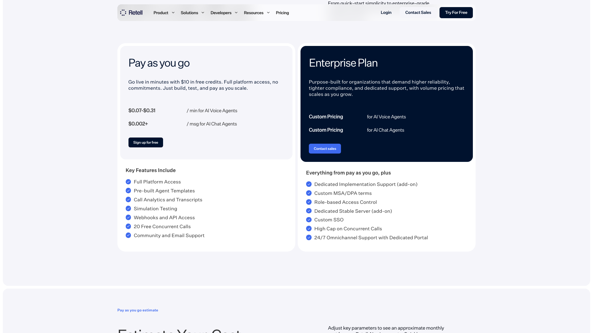
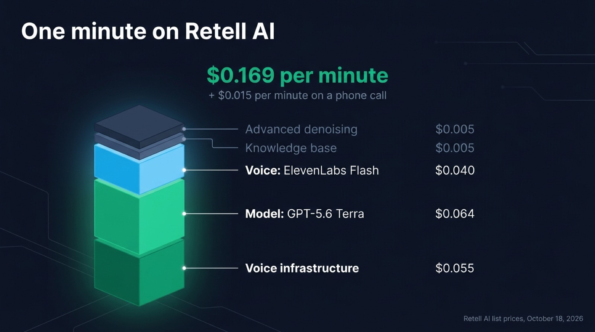
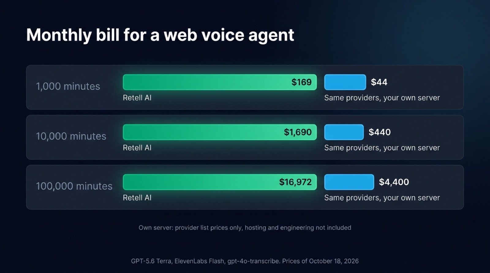

[Retell AI](https://www.retellai.com) costs $0.07 to $0.31 a minute on its pay as you go plan, with no monthly fee, $10 of free credits and 20 concurrent calls included, according to its [pricing page](https://www.retellai.com/pricing) on October 18, 2026. That range is the sum of four lines: $0.055 a minute of voice infrastructure, a voice from $0.015 to $0.10, a model billed per minute from $0.0016 to $0.64, and $0.015 a minute of telephony when the call goes through a Retell number. A typical web agent on a recommended model and an ElevenLabs voice comes to about $0.17 a minute once two common add-ons are counted.

This page rebuilds the bill line by line, works out one minute of conversation, then the monthly cost at 1,000, 10,000 and 100,000 minutes. It ends by pricing the same conversation in your own back end, where the provider fees usually come to a fraction of the Retell bill, and by naming the cases where Retell is still the better deal.

## Retell AI pricing in short

- Retell AI charges per minute of call, counted to the second, with no subscription on the pay as you go plan.
- The model is a per-minute line like the others, so a minute of silence costs the same as a minute of fast talk.
- Concurrent calls past 20, phone numbers and knowledge bases past the tenth are monthly fees on top.

| Line | Price in October 2026 | Billed |
| --- | --- | --- |
| Voice infrastructure | $0.055 | per minute |
| Voice (text to speech) | $0.015 to $0.10 | per minute |
| Model (LLM) | $0.0016 to $0.32, up to $0.64 on the fast tier | per minute |
| Speech to speech model, in place of the model and the voice | $0.07 to $0.38 | per minute |
| Telephony on a Retell number | $0.015, free on your own SIP trunk | per minute |
| Add-ons | $0.005 to $0.10 each | per minute |
| Extra concurrent call, past 20 | $8 | per month |
| Phone number | $2 | per month |
| Enterprise | custom | contract |



## How the per-minute rate is built

Retell bills each component of a call as its own line, then adds them. Every price below comes from [retellai.com/pricing](https://www.retellai.com/pricing) as read on October 18, 2026.

### Voice infrastructure, $0.055 a minute

Retell charges $0.055 a minute on every call for what it calls its voice engine: the orchestration, turn-taking and interruptions. The pricing page has no separate line for speech to text, so transcription is part of this rate. The rate stays the same whichever model and voice you pick.

### The voice, $0.015 to $0.10 a minute

Retell's own voices and the voices from Cartesia, OpenAI, Inworld, MiniMax and Fish all cost $0.015 a minute. ElevenLabs voices cost more and depend on the model:

| ElevenLabs model on Retell | Price per minute of call |
| --- | --- |
| Flash | $0.040 |
| Multilingual v2 | $0.06 |
| v3 Conversational, v4 Turbo | $0.08 |
| v3, v4 | $0.10 |

Retell bills the voice for every minute of the call, whoever is speaking. ElevenLabs sells Flash directly at [about $0.04 for each minute the agent speaks](/blog/elevenlabs-api-pricing-voice-agent), and charges nothing while the user speaks or the line is silent.

### The model, $0.0016 to $0.64 a minute

Retell lists more than thirty models from OpenAI, Anthropic and Google, each with a price per minute. Its four recommended models are GPT-5.6 Terra and Claude 5 Sonnet at $0.064, GPT-5.4 at $0.080 and GPT-5.5 at $0.16. The cheapest is GPT-5 nano at $0.0016 and the most expensive standard price is GPT-6 Astra at $0.32. Most OpenAI models also have a fast tier that doubles the price, which takes GPT-6 Astra to $0.64 a minute.

Speech to speech models replace the model and the voice with a single line: GPT Realtime mini and GPT Realtime 2.1 mini at $0.07, GPT Realtime and GPT Realtime 1.5 at $0.345, GPT Realtime 2 and 2.1 at $0.38.

Retell's pricing estimator also offers a "Custom LLM" option, for a model you host behind a WebSocket that Retell connects to. The pricing page gives it no price. Third-party guides such as [eesel's breakdown](https://eesel.ai/blog/retell-ai-pricing) describe the model line as free in that case, so you would pay the infrastructure, the voice and your own model provider. Ask Retell to confirm it before you budget on it.

### Telephony, $0.015 a minute

A call through a number bought from Retell costs $0.015 a minute in every country Retell lists, across North America, Europe and Asia. Telephony is free on your own SIP trunk and on a web call from the browser SDK. Retell bills only the telephony for the part of a call transferred to a human.

### Why the advertised range stops at $0.31

The low end, $0.07, is the infrastructure plus a $0.015 voice, with a nearly free model and no telephony. The high end, $0.31, is $0.055 of infrastructure, an ElevenLabs v3 or v4 voice at $0.10 and GPT-5.5 at $0.16. The price list goes further than that range: GPT-6 Astra on the fast tier with an ElevenLabs v4 voice and a Retell number comes to $0.81 a minute, before any add-on.

## Add-ons and fixed lines

Per-minute add-ons stack on top of the rate:

| Add-on | Price |
| --- | --- |
| Knowledge base | $0.005 a minute |
| Advanced denoising | $0.005 a minute |
| Safety guardrails | $0.005 a minute |
| PII removal | $0.01 a minute |
| AI quality assurance | first 100 minutes free, then $0.10 a minute |
| Batch call | $0.005 a dial |
| Branded caller ID | $0.10 an outbound call |
| SMS | $0.01 a message |

Other lines are billed by the month:

- 20 concurrent calls are included, and each extra one costs $8 a month, added or removed at any time.
- A Retell phone number costs $2 a month, and a verified number $10 (the page calls it monthly in one section and a one-time fee in another).
- SMS on a Retell number costs $20 a month.
- Knowledge bases cost $8 a month each past the first ten.
- Enterprise is a custom contract with concurrency from 50 calls, SSO and 24/7 support. A dedicated server and dedicated implementation support come as paid options.

Retell counts each call to the second and adds the seconds up over the month before billing. Failed connections are free. Retell bills silence and hold time, and bills voicemail only while the agent is on the line.

## A minute of conversation, then the monthly bill

Take a voice agent inside a web app, answering from a product knowledge base. It runs on GPT-5.6 Terra, one of Retell's recommended models, speaks with ElevenLabs Flash, and uses advanced denoising because people talk to it from open-plan offices. The call starts from the browser, so there is no telephony.

| Line | Per minute |
| --- | --- |
| Voice infrastructure | $0.055 |
| GPT-5.6 Terra | $0.064 |
| ElevenLabs Flash | $0.040 |
| Knowledge base | $0.005 |
| Advanced denoising | $0.005 |
| Total, web call | $0.169 |
| Total, phone call on a Retell number | $0.184 |

{/* IMAGE regen: api.py image, infographic, 1600x900. Scene: "Infographic showing how one minute of a Retell AI web call adds up. A single vertical stacked bar on the left, built from five segments, bottom to top, each with its label and price to its right, connected by thin lines: - "Voice infrastructure" "$0.055" - "Model: GPT-5.6 Terra" "$0.064" - "Voice: ElevenLabs Flash" "$0.040" - "Knowledge base" "$0.005" - "Advanced denoising" "$0.005" The infrastructure and model segments are the two largest, emerald; the voice segment sky blue; the two add-ons thin slate segments. At the top of the bar, a bold total: "$0.169 per minute". Below it, a smaller secondary line: "+ $0.015 per minute on a phone call". Title at top left, in a modern clean bold sans-serif: "One minute on Retell AI". Footer small text: "Retell AI list prices, October 18, 2026". Wide 16:9 layout, lots of breathing room, labels in white and light slate."
    Regenerate if Retell changes the price of the infrastructure, GPT-5.6 Terra, ElevenLabs Flash or the two add-ons. Last data sync: 2026-10-18. */}


For the monthly bill, multiply that rate by the minutes, then add the extra concurrency. Concurrency depends on when people call. In this example, calls arrive over 22 working days of 8 hours, with three times the average load in the busiest hour. At 100,000 minutes that means about 29 calls at once, 9 above the free 20, so $72 a month.

| Minutes per month | Usage at $0.169 | Extra concurrency | Retell AI bill |
| --- | --- | --- | --- |
| 1,000 | $169 | $0 | $169 |
| 10,000 | $1,690 | $0 | $1,690 |
| 100,000 | $16,900 | $72 | $16,972 |

The same agent answering phone calls on one Retell number costs $186, $1,842 and $18,474 a month at those volumes. Retell's estimator on its pricing page runs the same multiplication with its own defaults, which come to $0.11 a minute before add-ons.

{/* TODO ANECDOTE: compare this computed example with the provider bill per minute Raconte pays in production, if the owner allows it to be published (question 03d8f118). */}

## Why Retell bills the model per minute, and what that changes

Model providers bill tokens. Retell resells those tokens as a flat price per minute of call, set per model. For GPT-5.6 Terra, that is $0.064 a minute, while OpenAI sells the model at [$2 per million input tokens and $12 per million output tokens](https://developers.openai.com/api/docs/models/gpt-5.6-terra).

The agent sends the system prompt and the whole history to the model again on every turn, so the token cost of a minute depends on how many turns fit in it and how long the prompt and history are. With a 1,500 token prompt and about 50 tokens of conversation per turn, a ten minute call of 40 turns sends [about 100,000 input tokens](/blog/top-llms-voice-agents), so 10,000 a minute. Here is what a minute costs on GPT-5.6 Terra at OpenAI's list price, against Retell's $0.064:

| Conversation | Input tokens per minute | Token cost per minute | Retell's price |
| --- | --- | --- | --- |
| Slow, 2 turns a minute, 1,500 token prompt | about 4,000 | about $0.009 | $0.064 |
| Typical, 4 turns a minute, 1,500 token prompt | about 10,000 | about $0.021 | $0.064 |
| Fast, 6 turns a minute, 5,000 tokens of prompt and tool definitions | about 36,000 | about $0.073 | $0.064 |

On most calls, Retell's flat rate is above the token cost. A user who thinks before answering, reads something on screen or puts the call on hold costs the full minute on Retell, while the same minute costs almost nothing in tokens. A fast back-and-forth with a long prompt and many tools can cost more in tokens than Retell charges. Prompt caching lowers the token cost further, since every request starts with the same prompt.

Retell bills the voice the same way. Its $0.040 for ElevenLabs Flash covers every minute of the call, while ElevenLabs bills only the characters the agent speaks. When the agent talks half the time, buying the voice directly costs about $0.020 per minute of call, half of Retell's price.

## Running the pipeline in your own back end

The alternative to a per-minute platform is to call speech to text, the model and text to speech from your own server, on your own keys. Each provider then bills you for what it processed: audio seconds for transcription, tokens for the model, characters for the voice.

Here is the same minute with the same model and the same voice, plus OpenAI's gpt-4o-transcribe for transcription. The user speaks for 25 seconds, the agent for 30, and the pipeline sends audio to transcription only while the user speaks.

| Line | Basis | Per minute |
| --- | --- | --- |
| gpt-4o-transcribe | 25 s of audio at about $0.006 a minute | $0.0025 |
| GPT-5.6 Terra | 10,000 input and 100 output tokens | $0.021 |
| ElevenLabs Flash | about 500 characters at $40 per million | $0.020 |
| Total in provider fees | | about $0.044 |

At 1,000, 10,000 and 100,000 minutes, the provider fees come to about $44, $440 and $4,400 a month. Those figures leave out the server, the knowledge base and denoising, and the engineering time, which are now yours. A cheaper model or a cheaper voice lowers the provider fees further. Your [choice of providers](/docs/ai-integration) changes the total more than any orchestration decision.

{/* IMAGE regen: api.py image, infographic, 1600x900. Scene: "Infographic comparing a monthly bill at three volumes, as grouped horizontal bars. Title at top left, in a modern clean bold sans-serif: "Monthly bill for a web voice agent". Three rows, each with two bars: an emerald bar labeled "Retell AI" and a sky-blue bar labeled "Same providers, your own server". Row "1,000 minutes": Retell AI "$169", your own server "$44". Row "10,000 minutes": Retell AI "$1,690", your own server "$440". Row "100,000 minutes": Retell AI "$16,972", your own server "$4,400". Bar lengths proportional within each row. A small note under the chart: "Own server: provider list prices only, hosting and engineering not included". Footer small text: "GPT-5.6 Terra, ElevenLabs Flash, gpt-4o-transcribe. Prices of October 18, 2026". Wide 16:9 layout, labels in white and light slate."
    Regenerate if Retell, OpenAI or ElevenLabs change the prices used in the worked example. Last data sync: 2026-10-18. */}


On your own server, you run what Retell ran for you: the hosting, turn-taking and interruptions, call history, transcripts and a dashboard for whoever reviews calls, plus phone numbers if you need them. [Micdrop](/) is an open source TypeScript library for real-time voice conversations. It takes care of turn-taking and interruptions. `@micdrop/client` handles the microphone, voice activity detection and playback in the browser, while `@micdrop/server` runs the conversation in your Node server with the providers you choose. Micdrop is MIT licensed, so the library itself is free. This server runs the same model, voice and transcription as the worked example:

```typescript
import { MicdropServer } from '@micdrop/server'
import { OpenaiAgent, OpenaiSTT } from '@micdrop/openai'
import { ElevenLabsTTS } from '@micdrop/elevenlabs'
import { WebSocketServer } from 'ws'

const wss = new WebSocketServer({ port: 8081 })

wss.on('connection', (socket) => {
  new MicdropServer(socket, {
    firstMessage: 'Hi, what can I help you with?',
    agent: new OpenaiAgent({
      apiKey: process.env.OPENAI_API_KEY,
      model: 'gpt-5.6-terra',
      systemPrompt: 'You answer questions about our product.',
    }),
    stt: new OpenaiSTT({
      apiKey: process.env.OPENAI_API_KEY,
      model: 'gpt-4o-transcribe',
    }),
    tts: new ElevenLabsTTS({
      apiKey: process.env.ELEVENLABS_API_KEY,
      voiceId: process.env.ELEVENLABS_VOICE_ID,
      modelId: 'eleven_flash_v2_5',
    }),
  })
})
```

You can run a first call in about five minutes. Wiring Micdrop into an existing application takes hours rather than days. Transcript storage, the call history, the dashboard, telephony and hosting take longer, since you build them yourself. Micdrop has a single maintainer and no support contract. Products like [Raconte.ai](https://raconte.ai), built by Micdrop's maintainer, and [Cibli](https://cibli.fr) run on it in production. If you want to switch, you can [compare Retell AI and Micdrop on architecture and migration](/blog/alternative-to-retell-ai).

## When Retell AI is worth the price

Retell is the better deal when the product is phone calls. Retell already sells phone numbers across North America, Europe and Asia, with calls at $0.015 a minute, and has built SIP trunking, warm transfer, IVR navigation, batch dialing and branded caller ID. Building the same telephony yourself would cost more than Retell's per-minute margin for a long time.

Retell is also the better deal when you need compliance certifications this quarter. Retell holds SOC 2 Type 1 and Type 2, signs a GDPR data processing addendum and lets you sign a HIPAA business associate agreement online. Its compliance documentation states that Retell runs all its services outside the European Union, which matters if your data has to stay there.

Retell also makes sense at low volume. At 1,000 minutes a month, the gap with your own pipeline is about $125, less than a day of engineering. At 100,000 minutes it is about $12,600 a month, enough to pay for the hosting, the dashboard and the person who maintains them. The 20 included concurrent calls are enough for most products until well past 10,000 minutes a month, so extra concurrency only adds to the bill at high volume.

Bland also bills per minute, at $0.14 with the model included, but runs only its own models. [Moving a web agent off Bland](/blog/alternative-to-bland-ai) brings back the choice of providers. Synthflow has [moved to annual contracts from $30,000](/blog/alternative-to-synthflow). You can also [compare every voice agent platform on price and hosting](/blog/top-ai-voice-agent-platforms).

## Frequently asked questions

<FaqList>
  <FaqItem question="Is Retell AI free?">
    No. Retell AI gives each new account $10 of free credits, granted once per email address, with no monthly fee on the pay as you go plan. At the $0.11 a minute of its estimator defaults, the credits cover about 90 minutes of calls. After that every minute is billed, from $0.07 to $0.31 for the advertised range.
  </FaqItem>
  <FaqItem question="Does Retell AI charge for the LLM?">
    Yes. Retell bills the model per minute of call, at a price set for each model: $0.064 for GPT-5.6 Terra and Claude 5 Sonnet, $0.16 for GPT-5.5, from $0.0016 to $0.32 at standard speed and up to $0.64 on the fast tier, as of October 18, 2026. When you connect your own model through the Custom LLM option, the pricing page lists no price for it. Third-party guides describe that line as free, so confirm it with Retell.
  </FaqItem>
  <FaqItem question="How does Retell AI bill concurrency?">
    Every account includes 20 concurrent calls. Each extra call you add costs $8 a month, and you can add or remove capacity at any time. Enterprise contracts start at 50 concurrent calls with custom pricing. On a credit-based account, concurrency is charged to the card on file rather than taken from credits.
  </FaqItem>
  <FaqItem question="How much does a voice AI agent cost per minute?">
    On a hosted platform, a voice AI agent costs from about $0.07 to $0.31 a minute on Retell AI and $0.14 on Bland. Vapi adds a $0.05 platform fee to your provider bills. On your own server you pay the providers directly: about $0.044 a minute for GPT-5.6 Terra, ElevenLabs Flash and gpt-4o-transcribe in our example, plus hosting and the engineering time.
  </FaqItem>
  <FaqItem question="Is Retell AI cheaper than Vapi?">
    It depends on the stack. Vapi charges a [$0.05 platform fee per minute](/blog/alternative-to-vapi) and passes speech and model costs through, or leaves them to your own provider accounts when you bring your own keys. It includes 10 concurrent lines and charges $10 a month per extra line. Retell charges $0.055 of infrastructure and resells the voice and the model per minute, with 20 lines included at $8 per extra line. Vapi's fixed fee is $0.005 lower, so Vapi tends to cost less when you bring your own provider keys. Retell can come out ahead when you pick one of its voices at $0.015.
  </FaqItem>
  <FaqItem question="Does Retell AI charge for silence?">
    Yes. Retell bills the full duration of a connected call, silence and hold time included, counted to the second. Failed connections are free, voicemail is billed only while the agent is on the line, and the part of a call transferred to a human costs only the telephony.
  </FaqItem>
</FaqList>

---

Retell AI's price is easy to read once you split it into lines: $0.055 of infrastructure, a voice, a model and telephony, then add-ons and concurrency. For a phone operation or a compliance deadline, you pay for telephony and certifications Retell already has in place. For a voice feature inside a web app at volume, the same providers called from your own server cost a fraction of the Retell bill, once you have built the hosting and the dashboard yourself. [Micdrop](/) runs the conversation inside your Node server. You can [start a first call in five minutes](/docs/getting-started).
