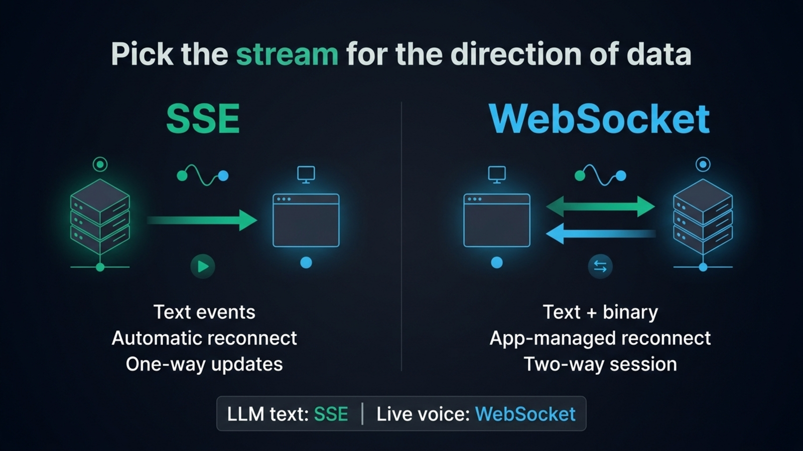
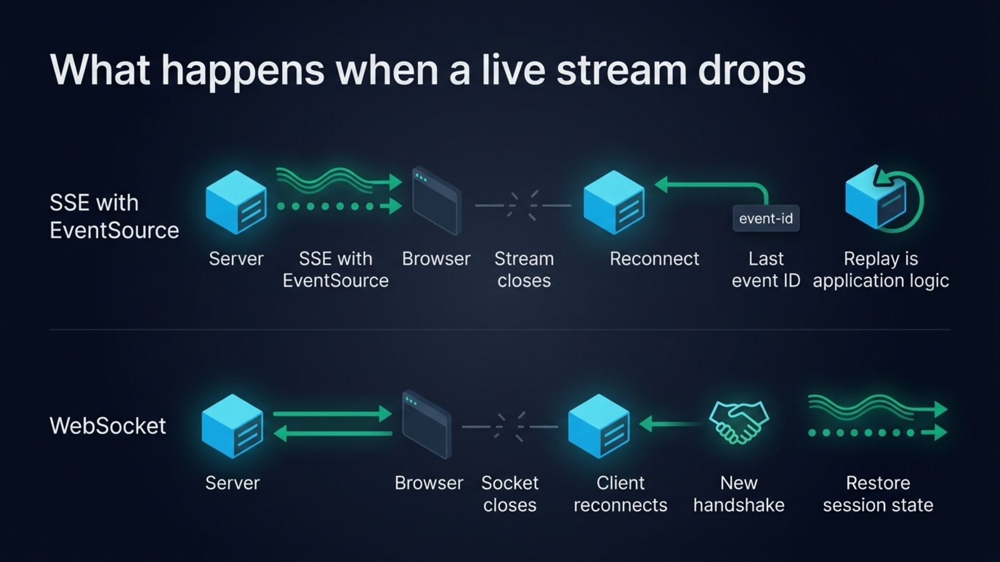
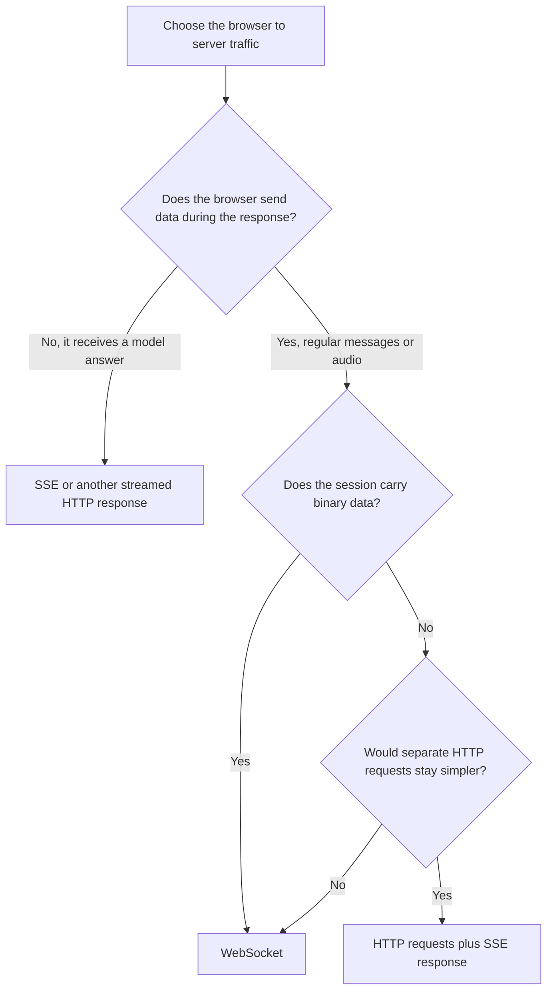

If your chat UI streams an LLM answer token by token, SSE is usually the simpler fit. If the browser must also send frequent messages during the response, especially microphone audio, use a WebSocket. Both stream text over a network connection. Their differences are direction, reconnection, payloads and the work your application handles.

## The short answer

Server-Sent Events (SSE) is a text event format sent over an HTTP response. The browser’s `EventSource` API reads events from the server, handles reconnects and exposes named events to JavaScript. WebSocket begins with an HTTP handshake and then carries messages in both directions over one open connection. The [browser WebSocket API supports text and binary data](https://developer.mozilla.org/en-US/docs/Web/API/WebSocket).

| Question | SSE with `EventSource` | WebSocket |
| --- | --- | --- |
| Message direction | Server to browser | Browser and server |
| Browser API | `EventSource` | `WebSocket` |
| Payload | UTF-8 text, often JSON | Text or binary frames |
| Reconnect | Built into `EventSource`, server controls replay | Application reconnect logic |
| Typical AI chat | Stream model events to the UI | Useful when the user sends live control messages |
| Voice session | Downstream events only | Audio can travel up and down |
| HTTP infrastructure | Ordinary streaming response | Upgrade handling and persistent connections |
| Flow control | Depends on the HTTP stream API | Browser API has no receive back-pressure |

{/* IMAGE regen: api.py image, infographic, 1600x900. Scene: "A clear two-column side-by-side decision graphic, wide 16:9. Title exactly: \"Pick the stream for the direction of data\". Left column heading exactly: \"SSE\". Under it, draw a server node on the left and a browser endpoint on the right, connected by one emerald arrow pointing only toward the browser. Add three short labels exactly: \"Text events\", \"Automatic reconnect\", \"One-way updates\". Right column heading exactly: \"WebSocket\". Draw a browser endpoint and server node connected by two parallel opposing arrows. Add three short labels exactly: \"Text + binary\", \"App-managed reconnect\", \"Two-way session\". At the bottom, one highlighted callout exactly: \"LLM text: SSE   |   Live voice: WebSocket\". Use a modern clean bold sans-serif title, legible clean sans-serif labels, aligned columns, simple geometric icons, generous spacing and strong dark negative space. Ensure every word is spelled exactly as provided." */}


SSE describes one event framing for an HTTP response. A server can also return plain text chunks or another streaming format. The Vercel AI SDK, for example, supports plain text streams and [SSE-framed UI message streams](https://ai-sdk.dev/docs/ai-sdk-ui/stream-protocol) with events for text, tool calls and metadata.

## Why SSE works well for streaming LLM text

A typical chat turn travels mostly one way once the browser has sent its prompt. Your browser sends an HTTP request with the conversation, and your server returns a response as soon as the model starts producing output. Each arriving chunk updates the message on screen. A regular HTTP response can display an answer progressively without a separate full-duplex connection.

SSE gives each event a small, readable envelope. A response uses the `text/event-stream` media type, and events are separated by a blank line. A simple event might look like this:

```text
event: token
data: {"text":"Hello"}

```

SSE supports named events, IDs and a reconnection delay, as [the event format specifies](https://developer.mozilla.org/en-US/docs/Web/API/Server-sent_events/Using_server-sent_events). The server can send a `text` event for a token, a `tool` event for progress and a `done` event at completion, provided the client and server agree on the schema.

Many AI libraries already speak this language. The AI SDK streams plain text for basic token output and uses SSE formatting for its richer UI message stream. That stream can include tool input and output, text deltas, errors and a `[DONE]` marker. When the interface already uses the SDK, its documented transport is often a better starting point than designing a message protocol from scratch.

SSE travels through familiar HTTP infrastructure, so authentication, request logs, response headers and middleware can follow the conventions of the rest of your API. It suits server notifications, progress updates, background job status and model responses that run from server to browser.

## What SSE leaves to the application

`EventSource` reconnects automatically when a connection closes. The browser can reopen the stream, while the application decides how to recover any missed events. The server can attach an `id` to events, and a reconnect can include the last event ID. Your server must retain or reproduce events if the client needs a gap-free history. For an LLM answer that ends when the request ends, restarting may mean generating again or showing an interruption, so decide what a reconnect should do.

The built-in `EventSource` interface is designed around a URL and a GET request. It has limited request configuration compared with `fetch`, including no standard way to supply an arbitrary bearer-token header. Teams can use same-site cookies, a short-lived URL token where appropriate, or consume an SSE-formatted response with `fetch` when they need a POST body and custom headers. That fetch approach gives more control over the request, and the application then reads and parses the response stream itself.

SSE events are text. Encode structured data as JSON in `data`, then decode it in the browser. Audio frames and other binary payloads need encoding or a separate path, which adds overhead and complexity. SSE is also one-way at the event connection: the browser sends its next prompt in another HTTP request rather than writing into the open stream.

One caveat concerns browser connection limits over HTTP/1.1. [MDN documents a low per-browser, per-domain limit](https://developer.mozilla.org/en-US/docs/Web/API/Server-sent_events/Using_server-sent_events) that can affect multiple tabs. HTTP/2 negotiates the number of concurrent streams instead, commonly avoiding that bottleneck. Check the protocol your CDN and server negotiate before treating six connections as a universal limit.

## What WebSocket adds

A WebSocket is a persistent, two-way connection. After the opening handshake, either side can send a message whenever it needs to. That makes it useful when the browser and server exchange events continuously: collaborative editing, multiplayer state, device control, live transcription, or a conversation that sends microphone chunks up while assistant audio comes back down.

WebSocket messages can contain text or binary data. A browser can send audio buffers directly and receive binary audio without first turning the bytes into JSON text. Control messages can share the same connection, so one socket can carry the audio and events that start, stop or cancel a turn.

WebSocket does not provide automatic application-level reconnect and replay. The client must notice `close` or `error`, decide whether to reconnect, authenticate the new connection, and restore any state it needs. A reconnect is a new session unless the application associates it with a durable conversation ID and restores the right state.

The browser API also has no receive back-pressure. MDN notes that messages can accumulate in memory when they arrive faster than the application can process them. `bufferedAmount` reports bytes queued for sending, while application-level limits or flow control can keep incoming work manageable.

{/* IMAGE regen: api.py image, infographic, 1600x900. Scene: "A legible two-row lifecycle comparison infographic, wide 16:9, large clear sans-serif text. Title exactly: \"What happens when a live stream drops\". Top row label exactly: \"SSE with EventSource\". Show a server sending text events to a browser, a brief broken connection, then a reconnect arrow back to the server with a small event-id card. Label the stages exactly: \"Stream closes\", \"Reconnect\", \"Last event ID\", \"Replay is application logic\". Bottom row label exactly: \"WebSocket\". Show a browser and server with a two-way connection, a break, then a new handshake and restored connection. Label the stages exactly: \"Socket closes\", \"Client reconnects\", \"New handshake\", \"Restore session state\". Use emerald for the active streams and reconnect arrows, cyan for server/browser nodes. Keep both rows distinct, balanced and uncluttered. No extra text." */}


## What it costs to run

SSE keeps the request in HTTP, but a streaming response still occupies server and proxy resources until it ends. Configure the application, reverse proxy and CDN to flush chunks rather than buffer them, and send keep-alive comments if an idle connection would otherwise time out. A serverless HTTP function also has a maximum request duration, so confirm that its streaming and execution limits fit the model’s longest response.

WebSocket connections are stateful and long-lived. The server has to handle connection upgrades, keep track of clients, clean up disconnected sessions and route messages to the process holding each connection. A deployment that scales across instances may need a shared pub/sub layer or connection-aware routing. Authentication usually happens when the connection is established, so expiring credentials and reconnects need a plan.

Managed services can make that operational work smaller, though they have their own limits. For example, AWS API Gateway documents a two-hour maximum connection duration and a ten-minute idle timeout for WebSocket APIs, alongside message size limits in its [WebSocket quotas](https://docs.aws.amazon.com/apigateway/latest/developerguide/apigateway-execution-service-websocket-limits-table.html). Those figures describe AWS API Gateway rather than WebSocket in general. Read the quotas of the platform you choose, especially when the socket must remain open through long pauses.

Neither choice removes the need to handle cancellation. If a user closes the chat or starts another prompt, abort the model generation and stop writing to a dead response or connection. For either protocol, connect request cancellation to the provider’s abort mechanism and release stream readers and server resources.

## When voice changes the answer

A text chat usually sends one user request, then receives one model response. A voice call keeps both directions active. The browser streams microphone audio to a server while the server returns transcripts, assistant messages, control events and often audio chunks. The user may interrupt the assistant, so upstream messages still matter while audio is playing.

SSE sends events from server to browser, so a voice session needs another channel for microphone audio going upstream. Separate HTTP uploads can handle some designs, though frequent audio chunks, cancellation and turn control make the system more complex. WebSocket carries binary microphone frames and server events over one full-duplex connection.



Teams choosing a voice transport should also decide whether they need WebRTC. WebSocket is a practical browser-to-server channel when your own backend runs the conversation. WebRTC brings media handling suited to group calls, video and lossy mobile networks. Compare [WebSocket and WebRTC for browser voice agents](/blog/websocket-or-webrtc-voice-agent) when making that transport choice.

## A WebSocket voice server in TypeScript

[Micdrop](/) is an open source TypeScript library for real-time voice conversations with AI. Its server attaches to an accepted WebSocket and coordinates the speech recognizer, language model and speech synthesizer. A minimal server can look like this:

```typescript
import { MicdropServer } from '@micdrop/server'
import { OpenaiAgent } from '@micdrop/openai'
import { GladiaSTT } from '@micdrop/gladia'
import { ElevenLabsTTS } from '@micdrop/elevenlabs'
import { WebSocketServer } from 'ws'

const wss = new WebSocketServer({ port: 8081 })

wss.on('connection', (socket) => {
  new MicdropServer(socket, {
    agent: new OpenaiAgent({
      apiKey: process.env.OPENAI_API_KEY,
      systemPrompt: 'You are a helpful assistant',
    }),
    stt: new GladiaSTT({ apiKey: process.env.GLADIA_API_KEY }),
    tts: new ElevenLabsTTS({
      apiKey: process.env.ELEVENLABS_API_KEY,
      voiceId: process.env.ELEVENLABS_VOICE_ID,
    }),
  })
})
```

The server protocol uses the same socket for audio chunks and conversation events. The browser detects speech and sends audio while the user speaks. The server returns messages and audio as the providers produce them. The [Micdrop protocol documentation](/docs/server/protocol) lists the events in each direction, and the broader [Node server guide](/docs/server) covers the integrations and server frameworks, including [Fastify](/docs/server/with-fastify) and [NestJS](/docs/server/with-nestjs). Micdrop can also use Vercel AI SDK models through its [AI SDK agent integration](/docs/ai-integration/provided-integrations/ai-sdk).

A WebSocket’s connection management makes sense here because the application needs upstream microphone audio and a downstream voice response at once. An HTTP stream usually needs less management for a text-only answer. For live transcription over WebSocket in TypeScript, including the message sequence and the points that fail in production, see [real-time transcription in TypeScript](/blog/real-time-transcription-websocket-typescript).

## Which one should you choose?

Choose SSE when each turn begins with a normal HTTP request and the response flows from server to browser. It suits token streaming, notifications and progress updates. `EventSource` fits a GET request with the browser’s cookie model. `fetch` streaming gives you a POST body, custom headers and direct control of response parsing.

Choose WebSocket when the browser also needs to send messages over the live connection, or when binary input and output belong to the same session. Factor in reconnects, authentication, back-pressure and stateful server capacity. Those details are part of the application design, rather than a feature the protocol takes care of for you.

A chat interface can start with SSE and move to WebSocket when its interaction becomes two-way. Voice is that point: browser audio goes up as the assistant’s response comes back. For a Node implementation, [start a Micdrop integration](/docs/getting-started) and choose the server protocol that fits the call.

## Frequently asked questions

<FaqList>
  <FaqItem question="What is replacing WebSockets?">
    Different tools serve different WebSocket use cases. SSE works well for one-way server updates, while [WebTransport](https://developer.mozilla.org/en-US/docs/Web/API/WebTransport_API) offers HTTP/3 streams and datagrams for applications that need more control over delivery. Ordinary HTTP streaming also works for one-way responses. Choose by message direction, browser support and what your hosting stack can operate.
  </FaqItem>
  <FaqItem question="What are the downsides of using WebSockets?">
    WebSockets keep stateful connections open, so deployments must manage disconnects, authentication on reconnect, connection ownership across instances and idle timeouts. The browser API also has no receive back-pressure. Those costs make WebSocket unnecessary for a response that only streams from a server to a browser.
  </FaqItem>
  <FaqItem question="What is the SSE protocol?">
    Server-Sent Events is a UTF-8 text event format carried in an HTTP response with the `text/event-stream` content type. Each event uses fields such as `data`, `event`, `id` and `retry`, and a blank line ends the event. Browsers read it with `EventSource`, which reconnects when the stream closes.
  </FaqItem>
  <FaqItem question="Is WebSocket different from HTTP?">
    Yes. A WebSocket connection starts with an HTTP handshake, then switches to the WebSocket protocol for messages in both directions. SSE stays an HTTP response and streams text events from the server to the browser. The two can pass through overlapping infrastructure, but they have different message models and connection behavior.
  </FaqItem>
  <FaqItem question="Is a webhook the same as a WebSocket?">
    A webhook sends an HTTP request from one service to another when an event happens. A WebSocket keeps a connection open so a browser and server can exchange messages in both directions.
  </FaqItem>
</FaqList>
