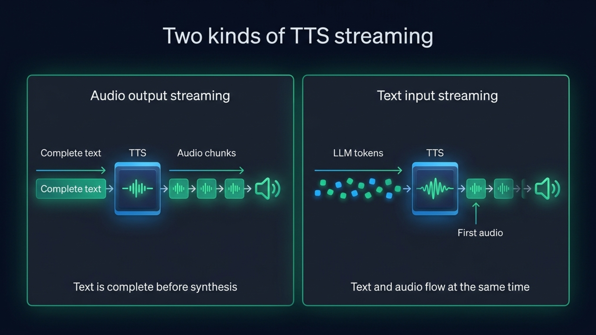
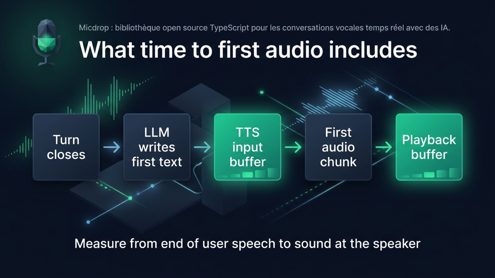
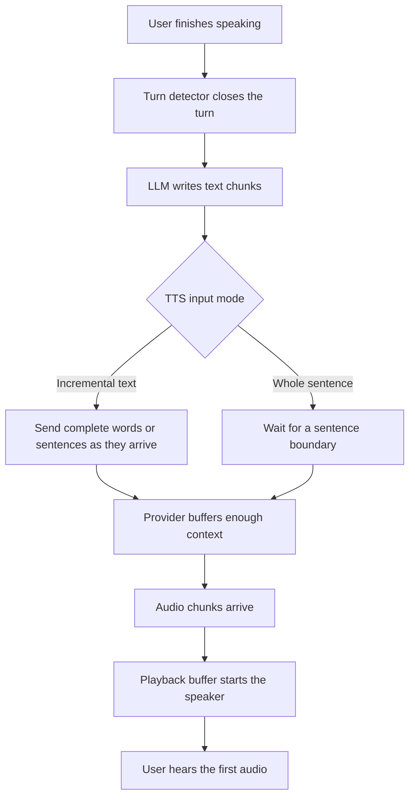

When a voice agent waits for the LLM’s full answer before asking a text to speech service to speak, generation and synthesis run one after the other. Streaming text to speech overlaps them. The agent sends text to the voice as the LLM writes it, and TTS returns audio chunks before the answer is complete. Buffering, sentence boundaries and playback still decide when the first sound reaches the listener.

## What does streaming text to speech mean?

Streaming text to speech can describe two different things. **Audio output streaming** sends a complete text input and returns audio in chunks before the whole recording is ready. **Text input streaming** sends partial text to the TTS service while an LLM is still writing. A voice agent can use both at once. Input streaming sends partial text, while a sentence queue sends complete sentences as soon as they are ready.

{/* IMAGE regen: api.py image, infographic, 1600x900. Scene: "Create a two-lane comparison infographic titled ‘Two kinds of TTS streaming’. Left lane label ‘Audio output streaming’. Show one complete text block entering a TTS block, then audio chunks leaving progressively toward a speaker. Caption exactly: ‘Text is complete before synthesis’. Right lane label ‘Text input streaming’. Show a live LLM token stream flowing into TTS, with audio chunks flowing out before the final text token exists. Caption exactly: ‘Text and audio flow at the same time’. Add small directional labels ‘Complete text’, ‘Audio chunks’, ‘LLM tokens’, ‘First audio’. Make the difference obvious at a glance, clean geometric arrows and waveforms, no other text." */}


The distinction matters because an endpoint that streams its audio response may still require the full text in the request. OpenAI’s Speech API can return audio progressively, but the application supplies the input text up front. Mistral’s ordinary streamed speech endpoint works the same way, while its [realtime TTS WebSocket accepts text fragments as they arrive](https://docs.mistral.ai/studio/audio/text-to-speech/speak-in-realtime). The [OpenAI API streams audio for a complete text input](https://developers.openai.com/api/docs/guides/text-to-speech), and [Mistral’s speech endpoint does the same](https://docs.mistral.ai/studio/audio/text-to-speech/stream-speech).

A TTS service can also accept streamed text but wait to send audio until it has enough context. That buffer helps the voice sound like one continuous utterance instead of a string of disconnected words. The app controls how much of that wait it accepts, through provider settings such as a flush, a maximum buffer delay or an explicit end-of-input message.

## Why does waiting for the full LLM answer add delay?

A voice agent’s first sound follows several stages. The user finishes speaking, turn detection decides the turn is over, the LLM produces enough text to speak, the TTS service buffers and synthesizes it, and the player gathers enough audio to begin playback. If the app waits for the whole answer, it adds the generation time of the remaining answer before TTS even starts.

Streaming overlaps the last two model tasks. TTS can synthesize the first complete sentence while the LLM writes the next one. The listener still waits for useful text, provider buffering and enough audio for playback. Turn detection and playback remain part of the wait.

For a voice agent, measure time to first audio from the end of the user’s speech to the first sound at the speaker. Starting at the first LLM token excludes turn detection. Stopping at the first server byte excludes playback buffering and the network path.

{/* IMAGE regen: api.py image, infographic, 1600x900. Scene: "A clean horizontal equation infographic titled ‘What time to first audio includes’. Draw five connected blocks left to right with these exact labels: ‘Turn closes’, ‘LLM writes first text’, ‘TTS input buffer’, ‘First audio chunk’, ‘Playback buffer’. Under the full chain put the exact caption ‘Measure from end of user speech to sound at the speaker’. Highlight the TTS input buffer and playback buffer in emerald to show these two buffering choices can add waiting time. Add no numbers and no claims that any single block always dominates. Flat vector layout, roomy spacing, all text large and crisp." */}


Our [Eleven v4 Turbo flush measurements](/blog/eleven-v4-turbo-voice-agent) show why the TTS input buffer matters. We sent one word every 30 ms to Eleven v4 Turbo. Without a flush, its Text to Dialogue WebSocket waited for roughly 40 characters and eight words before generating. The first audio arrived 355 ms after the first word. Flushing at the end of each sentence brought that measurement to 138 ms. Those are measurements from one setup on September 28, 2026. Latency varies by server, region and provider.

## Which streaming mode should you use?

Choose a mode based on when the text becomes available. A complete text can use an HTTP endpoint that streams audio. For an LLM response still being written, use an input streaming API or send complete sentences as soon as they are ready. A persistent WebSocket can also keep a continuous conversation on one connection.

| Mode | Text available when request starts | Audio returned | Typical transport | Use it when |
| --- | --- | --- | --- | --- |
| Complete request, complete response | All text | After synthesis finishes | HTTP | Batch jobs or saved audio |
| Complete request, streamed audio | All text | In audio chunks | HTTP response or server sent events | The text is ready, and the listener should hear it before the file is complete |
| Incremental text, streamed audio | Partial text | In audio chunks as synthesis progresses | WebSocket or realtime session | An LLM is generating the answer during a call |
| Sentence queue | One sentence at a time | Each sentence streams or returns as a unit | HTTP requests, often overlapping | A provider accepts a full sentence but not a live text stream |

These modes can use different model endpoints from the same vendor. ElevenLabs’ HTTP streaming endpoints return audio for text supplied up front, while its WebSocket endpoints accept partial text. ElevenLabs v3 and v4 use the Text to Dialogue WebSocket, which buffers input until it has enough context or the client flushes it. The standard Text to Speech WebSocket serves other model families. ElevenLabs [documents which models use each WebSocket](https://elevenlabs.io/docs/eleven-api/guides/how-to/websockets/tts-vs-ttd-websockets).

Cartesia’s WebSocket accepts text in pieces under a context ID. Set `continue: true` while more text is coming, then set it to `false` when the utterance is complete. Cartesia joins those chunks as written, so [spaces and punctuation must stay intact](https://docs.cartesia.ai/build-with-cartesia/capability-guides/stream-inputs-using-continuations). Gradium’s WebSocket also accepts text messages during synthesis, then ends the request with an `end_of_stream` message. Gradium [recommends splitting text at whitespace or sentence boundaries](https://docs.gradium.ai/guides/text-to-speech), rather than in the middle of a word.



## How should you split the LLM’s text?

Forward complete words or sensible text segments to the TTS service. An LLM may divide a word across tokens, and a provider can pronounce separate chunks differently from the same text sent together. Keep spaces attached to the text, avoid splitting a number or abbreviation, and keep punctuation with its sentence unless the API explicitly handles it separately.

Chunk boundaries depend on the provider. Cartesia joins successive inputs verbatim, so include spaces. Gradium inserts a space between text messages, so `hello` followed by `world` becomes `hello world`. Its wire protocol advises against sending punctuation on its own. Test these details with the SDK or API you deploy.

Sentence boundaries are a useful compromise when the provider needs more context than a token can give it. The LLM can stream an answer into a splitter. Once the splitter sees a complete sentence, the app sends it to TTS and keeps generating the rest. The sentence should be long enough for natural prosody, but short enough that the speaker does not wait for a paragraph.

Abbreviations and decimals complicate sentence splitting. A splitter that treats the period in `Dr.` or `3.5` as a sentence boundary can send an incomplete thought to the voice. Test names, numbers and abbreviations your agent says.

## What do the main TTS APIs accept?

The table separates input streaming from audio output streaming. Vendor APIs change, so confirm the endpoint and model combination in the linked documentation before you implement it.

| Provider or engine | Can text arrive while it is generated? | Can audio arrive in chunks? | Transport and useful detail |
| --- | --- | --- | --- |
| ElevenLabs | Yes, over its input streaming WebSockets | Yes | WebSocket. Text to Dialogue handles v3 and v4, while the Text to Speech WebSocket serves other supported models. |
| Cartesia | Yes | Yes | WebSocket contexts accept continuations and return audio chunks. |
| OpenAI Speech API | No, the request takes the text input | Yes | HTTP streamed response. It streams audio generation, not LLM text into TTS. |
| Gemini TTS | The documented TTS request takes text input | Yes on supported models | Streaming response. Gemini Live is a separate speech to speech conversation API. |
| Mistral Voxtral Speech 3 | Yes, with the realtime TTS WebSocket | Yes | The regular speech endpoint can stream audio for complete text. The realtime endpoint accepts text deltas. |
| Gradium | Yes | Yes | WebSocket text messages and audio chunks. |
| Kokoro and Piper in Micdrop | Micdrop splits the LLM stream into sentences | Yes, after each sentence reaches synthesis | Local models do not share one universal protocol. Micdrop emits audio as each model generates it. |

Google [supports streaming audio output from Gemini TTS requests](https://ai.google.dev/gemini-api/docs/speech-generation). Gemini Live is a separate API for live audio conversations. For Mistral, use its [realtime TTS WebSocket](https://docs.mistral.ai/studio/audio/text-to-speech/speak-in-realtime) when the text itself arrives incrementally. Its regular [streamed speech endpoint](https://docs.mistral.ai/studio/audio/text-to-speech/stream-speech) streams audio for a complete text input.

Micdrop’s [custom TTS interface](/docs/ai-integration/custom-integrations/custom-tts) takes a text stream, while its `SentenceTTS` base class buffers sentences for models that need complete text. Measurements of [local TTS engines in Node](/blog/local-tts-node-kokoro-vs-piper) compare Phonon, Pocket TTS, Piper, Kokoro and Qwen3-TTS on a MacBook Pro M2, and explain which engines return audio in frames.

## How do you play streamed audio without gaps?

Audio chunks need decoding, scheduling and a playback buffer. A small buffer starts sooner but can run dry. A larger one hides short network or synthesis pauses, at the cost of a later first sound.

Keep audio encoding consistent across chunks. Raw PCM can be concatenated directly when its sample rate and channel layout stay the same. Container formats such as WAV carry headers, so individual chunks may need parsing rather than simple concatenation. If the provider sends base64 audio inside JSON or server sent events, decode each chunk before passing it to the audio queue.

Interruption handling needs the same care. When the user starts talking, stop queued playback and cancel synthesis where the provider supports it. Otherwise, the current audio can continue after the user has taken the floor. Check what `cancel` means for the chosen API. Some providers cancel one generation on a live connection. Others require closing or replacing a session.

## How do you measure time to first audio?

Use a monotonic clock and record the end of user speech, turn closure, first LLM text, first TTS input, first provider audio byte and first audio played by the client. These timestamps locate delay in turn detection, the LLM, buffering, synthesis, transport or playback.

Use a sentence your agent actually says, not only a short “Hello”. A short greeting may fit inside one model buffer, while a longer sentence may cross it. Repeat the same test several times from the region where your server runs. Keep the provider, model, voice, output format, connection state, flush settings and playback buffer fixed when comparing runs.

The reported number should identify what the timer measured. “First byte after the LLM’s first token” and “first sound after the user stops speaking” answer different questions. Report a median and a high percentile when you have enough samples, and include the date and setup. Compare a provider’s inference-only figure with another inference-only figure, or compare application measurements that both include the network trip and playback.

For a live agent, log turn close to first sound as the user-facing result, then retain the intermediate timestamps for diagnosis. If the agent’s first text arrives late, changing the TTS buffer will not make the LLM answer sooner. If the first TTS chunk arrives promptly but playback starts late, inspect decoding and the client buffer instead.

## How does Micdrop stream text into TTS?

[Micdrop](/), an open source TypeScript library for real-time voice conversations with AI, connects a streaming agent to a TTS implementation through `MicdropServer`. Its WebSocket and audio pipeline carry the assistant’s text to the TTS engine and audio back to the browser. The [integrated speech and language model providers](/docs/ai-integration) run behind this pipeline.

The provider determines how Micdrop sends text. ElevenLabs, Cartesia and Gradium accept incremental text over WebSockets. For a provider that needs complete text, Micdrop sends a sentence when it is complete, then emits the returned audio chunks. Its Mistral integration streams audio per sentence, while OpenAI’s integration buffers sentences and streams the audio response. The client can speak before the LLM finishes, even when the provider cannot accept token-by-token input.

In a Micdrop pipeline, the `agent` produces a text stream, and `tts` receives it through the server. Provider-specific configuration determines whether input travels as WebSocket text chunks or complete sentences.

```typescript
import { MicdropServer } from '@micdrop/server'
import { CartesiaTTS } from '@micdrop/cartesia'
import { OpenaiAgent, OpenaiSTT } from '@micdrop/openai'

new MicdropServer(socket, {
  agent: new OpenaiAgent({
    apiKey: process.env.OPENAI_API_KEY || '',
    systemPrompt: 'You are a helpful assistant. Speak in complete sentences.',
  }),
  stt: new OpenaiSTT({ apiKey: process.env.OPENAI_API_KEY || '' }),
  tts: new CartesiaTTS({
    apiKey: process.env.CARTESIA_API_KEY || '',
    modelId: 'sonic-3.6',
    voiceId: process.env.CARTESIA_VOICE_ID || '',
    language: 'en',
  }),
})
```

Micdrop handles the browser audio path and server pipeline, including the microphone, server WebSocket and playback. You run the server on your infrastructure and add any dashboard or transcript database your application needs. Start with the [getting started guide](/docs/getting-started), then compare [voice agent latency stages](/docs/client/latency) in your own call.

## Frequently asked questions

<FaqList>
  <FaqItem question="What is the difference between streaming TTS and real-time TTS?">
    Streaming TTS can mean audio chunks arrive before the full audio file is
    ready. Real-time input streaming also sends text to the TTS service while
    an LLM is still writing. Check whether the API streams its input, its audio
    output, or both.
  </FaqItem>
  <FaqItem question="Does streaming audio mean the TTS accepts LLM tokens?">
    An endpoint can return audio in chunks while requiring the complete
    text in the request. For text that is still being generated, use an input
    streaming WebSocket or send complete sentences to a sentence-based TTS
    adapter.
  </FaqItem>
  <FaqItem question="Should I send every LLM token to TTS?">
    Usually, no. A token may be part of an unfinished word, and a provider may
    need context for natural prosody. Send complete words with the right spaces,
    or wait for a complete sentence when the provider expects a larger input.
  </FaqItem>
  <FaqItem question="How do I measure time to first audio in a voice agent?">
    Start the timer when the user finishes speaking and stop it when the client
    plays the first sound. Record turn closure, the first LLM text, the first
    TTS input, the provider’s first audio chunk and playback start as separate
    timestamps so you can locate the delay.
  </FaqItem>
</FaqList>

A voice agent speaks sooner when the LLM and the TTS service work at the same time. The useful implementation depends on whether the provider accepts streamed text, how much context it buffers and how the client queues audio. Measure the whole path from the end of the user’s turn to the sound they hear, then tune the stage that actually holds it up.

[Micdrop](/) connects streaming agents and TTS providers in a TypeScript voice pipeline, including providers that need a sentence before they synthesize. Compare the [integrated TTS providers](/docs/ai-integration), [start building a voice agent](/docs/getting-started) and measure its [turn and speech latency](/docs/client/latency) in your own setup.
