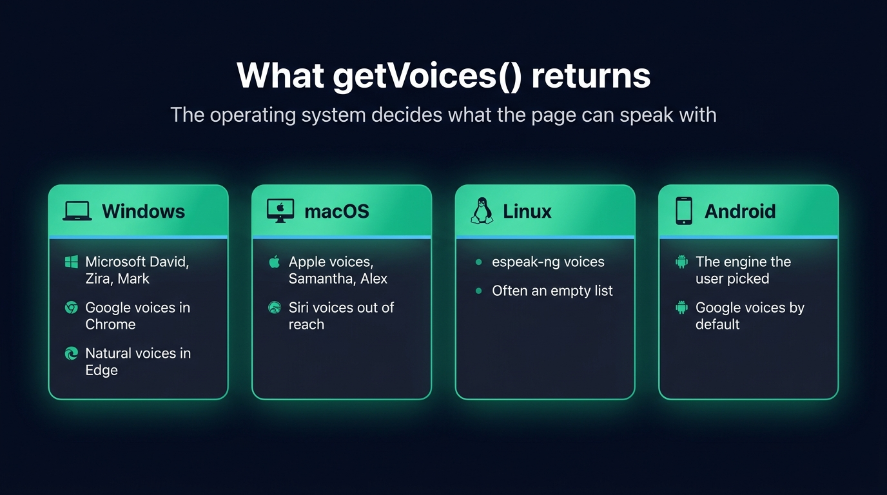
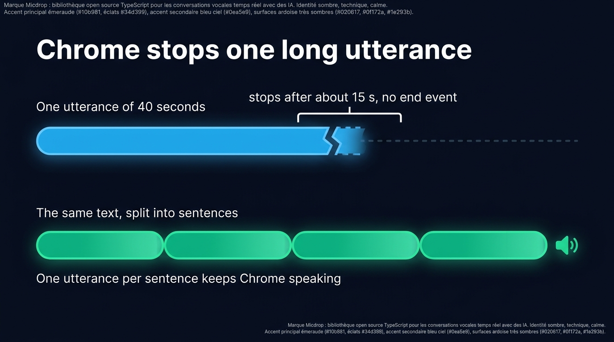
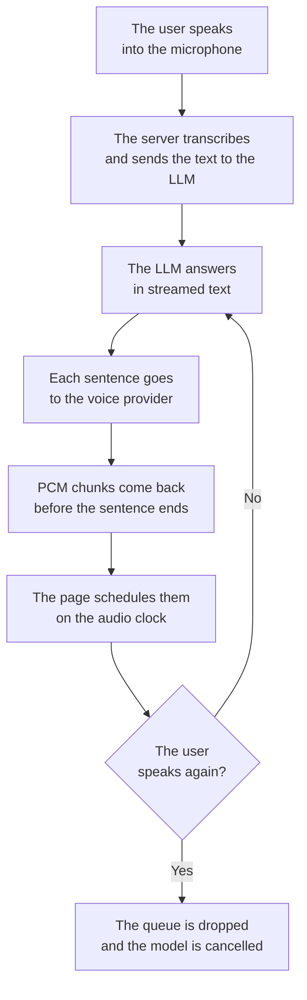

Making a page speak takes twenty lines of JavaScript, no library and no API key. `speechSynthesis` is built into every browser people use today, it works offline with the voices already installed, and it costs nothing. That is the right tool for a notification, a form error or an accessibility feature. Then you open the site on Windows, on a Mac and on an Android phone, and hear three different voices reading the same sentence, because the voices belong to the operating system and the browser, not to your page. When the voice is part of the product, you synthesise the audio yourself, either with a voice streamed from your server or with a model running in the tab as WebAssembly. This post covers all three routes, and where each one stops.

The recognition half of the same browser interface has its own page, on [speech to text in JavaScript with the Web Speech API](/blog/web-speech-api).

## speechSynthesis in twenty lines

The whole interface is one global object and one utterance:

```js
const utterance = new SpeechSynthesisUtterance('Your order has shipped.')
utterance.lang = 'en-US'
utterance.rate = 1
utterance.pitch = 1

speechSynthesis.speak(utterance)
```

The device speaks with its default voice for the language. `rate` goes from 0.1 to 10, `pitch` from 0 to 2, `volume` from 0 to 1. The `start`, `end` and `error` events tell you what happened, and `boundary` fires at word boundaries, which is what subtitle highlighting is built on.

To pick a voice instead of taking the default, list them:

```js
let voices = []

const loadVoices = () => {
  voices = speechSynthesis
    .getVoices()
    .filter((voice) => voice.lang.startsWith('en'))
}

loadVoices()
speechSynthesis.onvoiceschanged = loadVoices
```

In Chrome, `getVoices()` returns an empty array on the first call, because the browser collects the voices from the system after the page has loaded. The `voiceschanged` event fires once the list is ready, which is why `loadVoices()` runs twice. Then pass one of them to the utterance:

```js
const utterance = new SpeechSynthesisUtterance('Your order has shipped.')
utterance.voice = voices[0]
speechSynthesis.speak(utterance)
```

`speechSynthesis` also exposes `pause()`, `resume()` and `cancel()`. `cancel()` stops everything on the spot, mid-word, with no way to resume where it stopped.

## Which browsers support it, and which voices you actually get

Support is broad, wider than for the recognition half of the interface. Checked on MDN and caniuse on 29 October 2026:

| Browser | Speech synthesis |
| --- | --- |
| Chrome, desktop and Android | Since Chrome 33 |
| Edge | Since 14 |
| Firefox | Since 49 |
| Safari, macOS and iOS | Since 7 |
| The `voiceschanged` event | Chrome 33, Edge 14, Firefox 49, Safari 16 |

Caniuse puts global coverage at about 96%. The support question is settled. The voice question is where it gets complicated, because `getVoices()` lists the voices installed on the operating system, plus whatever the browser adds on top:

- Windows ships Microsoft's David, Zira and Mark, roughly one per language. Chrome adds Google's online voices to the list, and Edge adds Microsoft's online natural voices, which reach the page through Edge only.
- macOS ships Apple's voices, such as Samantha and Alex, in many languages. The Siri voices stay out of reach of the API.
- Linux lists whatever espeak-ng provides, and often nothing at all. A visitor on a server-like setup or a stripped desktop gets an empty list.
- Android speaks with the engine the user picked in the system settings, Google's by default, each engine with its own voices.

A single laptop exposes a different list in every browser, since Chrome mixes local and online voices, Firefox shows the local ones only, and Edge has its own online set. Pick a voice at runtime by language, as `loadVoices()` does, and keep a fallback. A voice name that works on your machine is missing on the next one.

On iPhone, one more rule from WebKit: the page cannot speak before the user has interacted with it once. A `speak()` call on page load is dropped silently, with no error and no event. A tap on a button unlocks speech for the rest of the session, which is why voice features on iOS start with a button rather than an autoplay.

{/* IMAGE regen: api.py image, infographic, 1600x900. Scene: "Title at the top in a modern clean bold sans-serif: \"What getVoices() returns\" Four cards in a row, one per system. Card 1 header \"Windows\" with a laptop icon: rows \"Microsoft David, Zira, Mark\", \"Google voices in Chrome\", \"Natural voices in Edge\". Card 2 header \"macOS\": rows \"Apple voices, Samantha, Alex\", \"Siri voices out of reach\". Card 3 header \"Linux\": rows \"espeak-ng voices\", \"Often an empty list\". Card 4 header \"Android\": rows \"The engine the user picked\", \"Google voices by default\". A caption line under the title: \"The operating system decides what the page can speak with\". Wide 16:9 layout, flat vector style, generous spacing."
    Infographic only: regenerate if the voice sets named change. Last data sync: 2026-10-29. */}


## Four limits you will hit

### The voice belongs to the device

You control `rate`, `pitch` and `volume`, and the machine decides everything else. The voice quality varies from one visitor to the next, a brand voice has no way into the API, and the browser swaps the underlying engine on its own schedule. Your page sounds like whatever the visitor last installed.

### The page never sees the audio

The engine plays straight to the speakers. The page receives events, and no samples, so there is nothing to draw a level meter from, nothing to record, and nothing to send through an analyser. You also never hear what the visitor hears, so a broken voice on one platform is a bug report, not a log line.

### Long texts stop in Chrome

Desktop Chrome stops an utterance after about 15 seconds of speech on some voices, with no error and no `end` event, while `speechSynthesis.speaking` keeps reporting `true`. A [Chromium bug](https://issues.chromium.org/issues/41346274) has carried it for more than a decade, and it hits hardest with Google's online voices. Two workarounds exist: split the text at sentence boundaries and queue one utterance per sentence, or call `pause()` then `resume()` on a timer every ten seconds or so while speech is running. Sentence splitting is the more robust one, and it gives you per-sentence events for free.

{/* IMAGE regen: api.py image, infographic, 1600x900. Scene: "Title at the top in a modern clean bold sans-serif: \"Chrome stops one long utterance\" Two horizontal timelines stacked. Top timeline labelled \"One utterance of 40 seconds\": a single long rounded bar in sky blue that ends abruptly at about 40% of its length with a jagged cut edge, then a thin dashed line to the end. A bracket over the cut point labelled \"stops after about 15 s, no end event\". Bottom timeline labelled \"The same text, split into sentences\": four short bars in emerald, edge to edge, each with a small gap, filling the full width, with a small speaker icon at the end. Caption under the bottom timeline: \"One utterance per sentence keeps Chrome speaking\". Wide 16:9 layout, flat vector style, generous spacing."
    Infographic only: regenerate if the Chrome cutoff behaviour or the workarounds change. Last data sync: 2026-10-29. */}


### The API takes a finished sentence

`speak()` waits for a complete string. To read a language model's answer out loud, you would cut its stream into sentences yourself, guess where a sentence ends while the model is still writing, queue the utterances, and call `cancel()` when the user starts talking again, which cuts mid-word. Everything that makes a spoken conversation feel natural is left for you to build around a queue of strings: start before the answer is finished, stop the moment the user speaks.

## Stream a voice from your own server instead

The second route moves the synthesis behind your back end. The server sends text to a text to speech API as the language model writes it, gets audio back in chunks before the sentence is finished, and forwards the chunks to the page over a WebSocket. The page schedules each chunk to start exactly when the previous one ends, on the audio clock of the Web Audio API rather than on a JavaScript timer.

Every browser then plays the same voice, because one model synthesises for all of them. The page holds the samples, so it can analyse them, record them and draw whatever it wants from them. Interruption is dropping the queue, mid-word, the moment the voice activity detector hears the user.

The main APIs are ElevenLabs, Cartesia, Gradium, Gemini TTS and Amazon Polly. ElevenLabs and Gradium both ask you to keep the key on a server, never in a page, so the back end stops being optional. The raw format to ask for is PCM: at 16 kHz, 16 bits and one channel, one second of speech weighs 32 kB, and the page needs no decoder to play it. You pay per character, and the voice needs the network.

Choosing between the providers is its own question, one of latency, price and where the audio is allowed to be processed. The [ElevenLabs alternatives for TypeScript](/blog/elevenlabs-alternatives-typescript) walk through it. The chunk scheduling is the same problem a native app solves, and [the pipeline described for React Native](/blog/text-to-speech-react-native) applies to the browser player too.

## Run a voice model in the browser with WebAssembly

Between the device's voices and a provider's voice sits a third option: the model runs in the tab. Gradium publishes Phonon, a text to speech runtime written in Rust and compiled to WebAssembly, as [`phonon-tts`](https://www.npmjs.com/package/phonon-tts) on npm. Its English model weighs 65 MB, is Apache 2.0 licensed, and offers 102 voices. [`kokoro-js`](https://www.npmjs.com/package/kokoro-js) runs Kokoro through Transformers.js, on WebGPU where the browser has it and on WebAssembly otherwise, with about 92 MB to download. Piper voice files run in the tab through community builds such as `piper-tts-web`, on top of onnxruntime-web.

What they share is the trade-off. The visitor downloads tens of megabytes on the first visit, which the runtime reports through a progress callback, and the browser caches the model when the page is served over HTTPS. After that, the voice never leaves the device, and it works offline. The device sets the speed: a recent laptop synthesises faster than a phone on an old chip, and you have no way to know which one the visitor brought.

The same Phonon runtime also runs in Node through `@micdrop/phonon`, where its first audio arrives 30 to 100 ms after it receives a sentence, measured on one CPU core of a MacBook Pro M2. Micdrop ships no text to speech inside the browser: the model's download comes out of the visitor's connection. The detail of [where each part of a voice agent runs](/blog/on-device-ai-voice-agent) is covered in its own post.

| | speechSynthesis | A model in the tab | A voice from your server |
| --- | --- | --- | --- |
| Same voice everywhere | No, the device's own | Yes, once downloaded | Yes |
| Added to the page | Nothing | 65 MB and up of weights | A player and a WebSocket |
| Works offline | With installed voices | After the first download | No |
| Audio the page can use | None | The synthesised samples | The streamed samples |
| Cost | Free | Free | Per character |
| First sentence | Immediate | After the model loads | A network round trip |

## Speak an LLM answer in a React component

[Micdrop](/) is an open source TypeScript library for real-time voice conversations. Its Node server runs the language model and the voice, its browser client runs the microphone, the playback and the interruption, and the same server also answers a React Native app.

On the server, the voice is one constructor, passed as `tts` next to the agent:

```ts
import { ElevenLabsTTS } from '@micdrop/elevenlabs'
import { OpenaiAgent, OpenaiSTT } from '@micdrop/openai'
import { MicdropServer } from '@micdrop/server'
import { WebSocketServer } from 'ws'

const server = new WebSocketServer({ port: 8088 })
const openaiKey = process.env.OPENAI_API_KEY || ''

server.on('connection', (socket) => {
  new MicdropServer(socket, {
    agent: new OpenaiAgent({
      apiKey: openaiKey,
      systemPrompt: 'You are a helpful assistant',
    }),
    stt: new OpenaiSTT({ apiKey: openaiKey, language: 'en' }),
    tts: new ElevenLabsTTS({
      apiKey: process.env.ELEVENLABS_API_KEY || '',
      voiceId: '21m00Tcm4TlvDq8ikWAM',
    }),
  })
})
```

Every voice implements the same interface and returns 16 kHz PCM, so changing provider means changing that one constructor. The providers and their options are covered in the [AI integration guide](/docs/ai-integration).

In the page, the component needs one hook:

```tsx
import { useMicdropState } from '@micdrop/react'
import { Micdrop } from '@micdrop/web'

export function VoiceAssistant() {
  const state = useMicdropState()

  const handleClick = () =>
    state.isStarted
      ? Micdrop.stop()
      : Micdrop.start({ url: 'ws://localhost:8088' })

  return (
    <div>
      <button onClick={handleClick}>
        {state.isStarted ? 'Hang up' : 'Start the call'}
      </button>
      <p>{state.isAssistantSpeaking ? 'Speaking' : 'Listening'}</p>
    </div>
  )
}
```

The client asks for the microphone, runs voice activity detection in the tab, resamples the audio, schedules the incoming chunks on the audio clock, and reconnects when the network drops. When the user starts talking over the answer, the queued chunks are dropped and the server cancels the voice and the model:



The hook and the state it exposes, from `isListening` to `isAssistantSpeaking`, are covered in the [React hooks documentation](/docs/client/react-hooks), and the rest of the call state, the devices and the errors in the [client documentation](/docs/client).

## Run the voice in Node instead

A model in the tab and a provider voice each have a weakness: the download for the first, the bill for the second. A model running in your Node process, next to the server that already runs the language model, keeps both out. Phonon, Kokoro, Piper, Pocket TTS and Qwen3-TTS all speak from Node, with no API key and no per-character bill, and the audio reaches the browser over the same WebSocket. How fast each one starts speaking and what it weighs in memory are covered in [the comparison of local text to speech engines in Node](/blog/local-tts-node-kokoro-vs-piper).

## Frequently asked questions

<FaqList>
  <FaqItem question="Is speechSynthesis free?">
    Yes. It runs on voices the operating system and the browser vendor provide, so there is no key to create and no bill at the end of the month. In exchange, the device decides which voice speaks, how good it sounds and whether it exists at all.
  </FaqItem>
  <FaqItem question="How do I make a web page read text aloud?">
    Create a `SpeechSynthesisUtterance` with the text, set `lang` so the right voice is picked, and call `speechSynthesis.speak()`. On iPhone, first wait for a user interaction, since WebKit drops any `speak()` call made before one. For a long text, split it into sentences and queue one utterance per sentence, or Chrome stops the utterance after about 15 seconds.
  </FaqItem>
  <FaqItem question="Does speechSynthesis work offline?">
    With the voices installed on the machine, yes. Each voice carries a `localService` flag telling you whether it runs locally, and Google's online voices in Chrome return `false` for it. A page that filters on that flag keeps speaking with the network off.
  </FaqItem>
  <FaqItem question="Can I record or download the audio speechSynthesis produces?">
    No. The engine plays straight to the output device and the page receives events only, never samples. To get audio you can record, you have to synthesise it yourself, either with a model in the tab or with a text to speech API on your server. The audio is then yours to save.
  </FaqItem>
  <FaqItem question="How do I change the voice in speechSynthesis?">
    Call `speechSynthesis.getVoices()` after the `voiceschanged` event has fired, since Chrome returns an empty list on the first call, then assign one of the voices to the `voice` property of the utterance. Choose by `lang` at runtime rather than by name, because a name that exists on your machine is missing on the next one.
  </FaqItem>
  <FaqItem question="Why does Chrome cut off speechSynthesis?">
    A Chromium bug, open for more than a decade, makes desktop Chrome stop an utterance after about 15 seconds with some voices, without an error or an `end` event. Split the text into one utterance per sentence, or call `pause()` followed by `resume()` on a timer while speech is running.
  </FaqItem>
</FaqList>

## The device's voices or your own

Keep `speechSynthesis` for reading a label, a notification or an article aloud, where a free offline voice in twenty lines is the right trade-off. Move to your own synthesis as soon as the voice is part of the product, and pick the route by constraint: a model in the tab when the audio must never leave the device, a streamed voice when every browser must hear the same one.

A spoken conversation needs more than a voice, and that is what Micdrop assembles end to end. You can [run a first voice call in five minutes](/docs/getting-started), and the same server then serves a web page or a React Native app.
