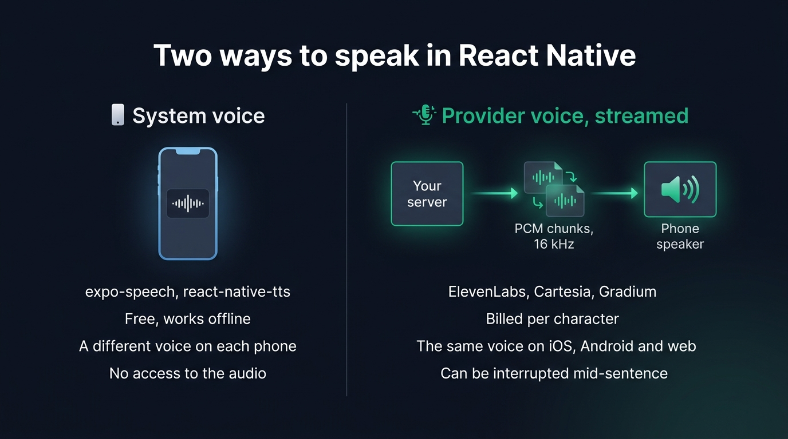
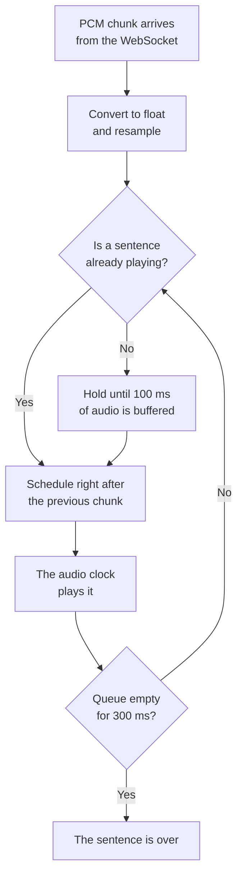
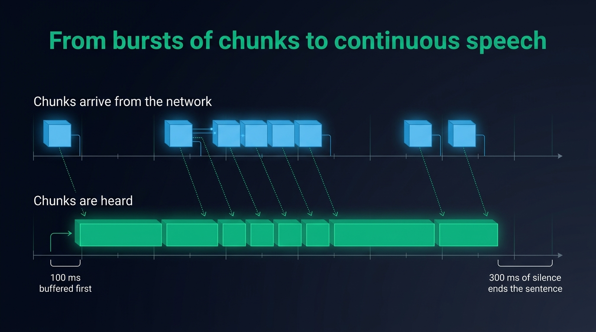
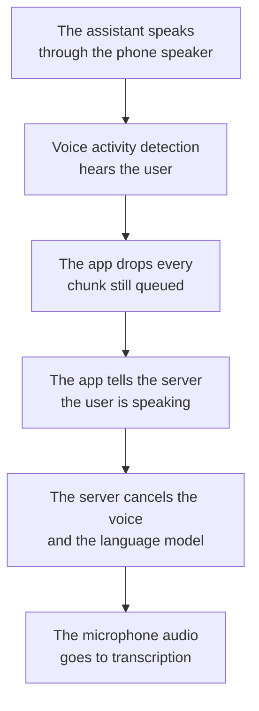

A React Native app can speak in two ways. The system voice, called through `expo-speech` or `react-native-tts`, is free and takes a few lines of code, but it sounds different on every phone. A provider voice from ElevenLabs, Cartesia or Gradium is synthesised by the provider and streamed to the app through your server. It sounds the same on iOS, on Android and on the web, at the cost of a bill per character and a playback pipeline to write. Use the system voice to read a label, a notification or an article aloud. Stream a provider voice when the voice is part of your product, or when the app holds a conversation.

## The system voice is free and changes from one phone to the next

`expo-speech` is the official Expo module. It runs on iOS, Android and the web, it is included in Expo Go, and npm counted 558,000 downloads of it in the first week of October 2026.

```tsx
import * as Speech from 'expo-speech'

const handleSpeak = () => {
  Speech.speak('Your order has shipped.', {
    language: 'en-US',
    rate: 1.0,
    onDone: () => setSpeaking(false),
  })
}

const handleStop = () => Speech.stop()
```

`react-native-tts` is the older choice for bare React Native. Its last release dates from June 2024 and its repository has 111 open issues, yet it still gets about 38,000 downloads a week. `@mhpdev/react-native-speech` is a newer package, for the new architecture only, which adds the pause that Android itself lacks.

All three call the synthesiser the phone already has, `AVSpeechSynthesizer` on iOS and `TextToSpeech` on Android. No model ships with the app and nothing is billed. You borrow the voice, so you get whatever each phone has:

- On iOS, the default voices are on the device. Apple's enhanced and premium voices sound better, but the user has to download each one in the settings. `expo-speech` has two quality levels, `Default` and `Enhanced`, and reports a premium voice as `Default`.
- On Android, the engine is the one the user chose. A Samsung phone offers Samsung's engine and Google's, each with its own voices and languages. A voice can also need a network connection, or extra data that has yet to be downloaded.
- Android takes 4,000 characters per call, while iOS has no limit. Read `Speech.maxSpeechInputLength` and cut a long text into sentences.
- `Speech.pause()` and `Speech.resume()` exist on iOS and on the web only.
- On a physical iPhone in silent mode, `expo-speech` produces no sound. `react-native-tts` has `Tts.setIgnoreSilentSwitch('ignore')` for that case.

List the voices with `Speech.getAvailableVoicesAsync()` and pass an `identifier` as the `voice` option. The list comes from the phone in your hand, so an identifier you hardcode may be missing on the next one.

`Speech.speak()` returns nothing. The app gets events when speech starts, reaches a word and ends, but it never gets the audio, so it has no samples to draw a level meter from. Your iOS and Android users also hear different voices.

Plenty of apps are fine with these limits. The system voice is made for reading a recipe step, a navigation hint or a flashcard aloud. It also works with the network off as long as the voice is installed.

## A provider voice streamed from the server sounds the same on web and mobile

A text to speech provider keeps one model on its side, so every device plays the same voice. You choose that voice, you can clone one, and it speaks the languages the provider covers rather than the ones a phone has installed.

The app should reach the provider through your server. ElevenLabs asks you to keep the key out of [any client-side code, browsers and apps](https://elevenlabs.io/docs/api-reference/authentication), and Gradium says the same about [browser or mobile code](https://docs.gradium.ai/guides/browser-websockets). In October 2026, the React Native pages of the ElevenLabs documentation cover its agents product only. Its `@elevenlabs/react-native` package connects to its hosted agents platform over WebRTC through LiveKit, needs a development build, and takes an agent id rather than a text to speak. [ElevenLabs Agents](https://elevenlabs.io/pricing/agents) charged $0.08 a minute on October 11, 2026, with the LLM billed on top.

So your server sits in the middle. It sends text to the provider over a WebSocket, as the language model writes it, and gets the audio back in chunks before the sentence is finished. Ask for raw PCM, which needs no decoder on the phone. ElevenLabs offers it from 8 to 48 kHz, Cartesia sends `pcm_s16le` from 8 to 48 kHz, and Gradium sends 48 kHz by default with 16 kHz as an option. At 16 kHz, 16 bits and one channel, a second of speech weighs 32 kB.

Each provider publishes how fast its first audio arrives: about [75 ms for ElevenLabs Flash v2.5](https://elevenlabs.io/docs/overview/models), network excluded, [under 90 ms for Cartesia Sonic](https://cartesia.ai/sonic), and [below 300 ms for Gradium](https://docs.gradium.ai/guides/introduction). The network between the provider, your server and the phone adds to each of these figures. To pick one, compare [Cartesia and ElevenLabs for a voice agent](/blog/cartesia-vs-elevenlabs) on latency, price and concurrency.

### A model on the phone works offline

`react-native-executorch` runs two speech models on the device behind its `useTextToSpeech` hook: Kokoro, at 332 MB per language, and Supertonic, at 398 MB. Software Mansion's benchmarks from September 2026 time a paragraph of two sentences. With Supertonic, synthesising it takes 610 ms on an iPhone 17 and 1.2 seconds on a third generation iPhone SE. With Kokoro on the XNNPACK backend, the same two phones take 2.8 and 7.3 seconds. Audio comes out one sentence at a time. This route gives you one voice on iOS and Android with no server. In return, the user downloads the weights and waits longer on an old phone.

### Comparing the system voice, a model on the phone and a provider voice

| | System voice | Model on the phone | Provider voice from a server |
| --- | --- | --- | --- |
| Packages | `expo-speech`, `react-native-tts` | `react-native-executorch` | A native audio player and your server |
| Same voice on every device | No | On iOS and Android | On iOS, Android and the web |
| Works offline | Yes, with an installed voice | Yes | No |
| Added to the app | Nothing | 332 MB and up of weights | A native audio module |
| Runs in Expo Go | Yes with `expo-speech` | No | No |
| Access to the audio samples | No | Yes | Yes |
| Running cost | Free | Free | Billed per character by the provider |

{/* IMAGE regen: api.py image, infographic, 1600x900. Scene: "Title at the top in a modern clean bold sans-serif: \"Two ways to speak in React Native\" Two wide columns side by side with a thin vertical divider. Left column header: \"System voice\" with a small phone icon. Under it a single phone outline containing a small waveform, and four short rows of text: \"expo-speech, react-native-tts\" \"Free, works offline\" \"A different voice on each phone\" \"No access to the audio\". Right column header in emerald: \"Provider voice, streamed\". Under it a horizontal flow of three connected blocks with arrows: \"Your server\" then \"PCM chunks, 16 kHz\" then \"Phone speaker\", and four short rows of text: \"ElevenLabs, Cartesia, Gradium\" \"Billed per character\" \"The same voice on iOS, Android and web\" \"Can be interrupted mid-sentence\". Wide 16:9 layout, flat vector style, generous spacing."
    Infographic only: regenerate if the packages or providers named change. Last data sync: 2026-10-11. */}


## Playing streamed PCM on iOS and Android without gaps between chunks

React Native has no built-in way to play raw samples. `expo-audio` plays a file or a URL, and streams PCM from the microphone only. `react-native-audio-api`, from Software Mansion, implements the Web Audio API on both platforms: you create a buffer from samples and start it at a precise time on the audio clock. It needs a development build.

If you play each chunk when it arrives, the voice sounds broken, because the network delivers audio in bursts. A provider often sends a short first burst, pauses while it generates, then sends faster than real time. You need four pieces of logic between the socket and the speaker:

- Convert each chunk from 16 bit integers to floats, and resample it from 16 kHz to the rate of the phone's audio output
- Hold the first chunks until about 100 ms of audio is ready, so the speaker still has audio to play while the provider pauses
- Schedule every chunk to start exactly when the previous one ends, on the audio clock rather than on a JavaScript timer
- Treat an empty queue as a late chunk first, and as the end of the sentence only once it has stayed empty for 300 ms



{/* IMAGE regen: api.py image, infographic, 1600x900. Scene: "Title at the top in a modern clean bold sans-serif: \"From bursts of chunks to continuous speech\" Two horizontal timelines stacked, sharing the same time axis from left to right. Top timeline labelled \"Chunks arrive from the network\": a first small block, then an empty gap, then five blocks packed tightly together, then a gap, then two blocks, all in sky blue, irregular spacing. Bottom timeline labelled \"Chunks are heard\": the same number of blocks in emerald, placed edge to edge with no gap, starting slightly later than the top row. A small bracket at the start of the bottom timeline labelled \"100 ms buffered first\". A small bracket at the end of the bottom timeline labelled \"300 ms of silence ends the sentence\". Thin dotted arrows link each top block to its bottom block. Wide 16:9 layout, flat vector style, generous spacing."
    Infographic only: regenerate if the buffering or end of sentence delays change. Last data sync: 2026-10-11. */}


You also have to configure the audio session. On a phone you decide whether the voice plays on the loudspeaker or on the earpiece, while the operating system moves it to headphones or Bluetooth when they connect. Each of these outputs depends on the session options for [audio output on iOS and Android](/docs/react-native/audio-output).

## Interrupting the assistant when the user speaks again

Stopping the system voice takes one call. `Speech.stop()` cuts the current sentence and empties the queue on both platforms. In a conversation, you still have three problems to solve around that call:

- To know that the user started talking, you need an open microphone while the phone speaks, plus a voice activity detector. `expo-speech` has neither, so a second module has to provide them.
- The microphone hears the loudspeaker. Echo cancellation is on when the audio session is configured as a voice call, but `expo-speech` leaves that session to you. Test on real phones whether the system voice ends up in what the microphone records.
- `Speech.speak()` takes a finished string. To start speaking before the language model has finished, you cut its output into sentences and queue them, then cancel the model yourself when the user interrupts.

With streamed audio, the same client owns the microphone and the speaker, so an interruption is one event handled in four steps.



The detector runs on the phone, so the voice stops without waiting for a round trip to the server. A volume threshold is enough in a quiet room, while a speech model such as Silero tells a voice from a noise in a car. You can use either for [voice activity detection on a phone](/docs/react-native/vad).

## Streaming a provider voice with @micdrop/react-native and ElevenLabs, Cartesia or Gradium

[Micdrop](/) is an open source TypeScript library for real-time voice conversations. Its Node server runs the transcription, the language model and the voice, while its React Native client handles the microphone, the scheduling of chunks and the interruption.

On the server, the voice is one constructor passed as `tts`:

```ts
import { ElevenLabsTTS } from '@micdrop/elevenlabs'
import { OpenaiAgent, OpenaiSTT } from '@micdrop/openai'
import { MicdropServer } from '@micdrop/server'
import { WebSocketServer } from 'ws'

const openaiKey = process.env.OPENAI_API_KEY || ''
const server = new WebSocketServer({ port: 8087, host: '0.0.0.0' })

server.on('connection', (socket) => {
  new MicdropServer(socket, {
    firstMessage: 'Hi! What can I do for you?',
    agent: new OpenaiAgent({
      apiKey: openaiKey,
      systemPrompt: 'You are a helpful assistant',
    }),
    stt: new OpenaiSTT({ apiKey: openaiKey, language: 'en' }),
    tts: new ElevenLabsTTS({
      apiKey: process.env.ELEVENLABS_API_KEY || '',
      voiceId: '21m00Tcm4TlvDq8ikWAM',
    }),
  })
})
```

Every voice implements the same interface and returns 16 kHz PCM, so changing provider means changing that constructor. The phone code stays as it is.

```ts
import { CartesiaTTS } from '@micdrop/cartesia'
import { GradiumTTS } from '@micdrop/gradium'

const cartesia = new CartesiaTTS({
  apiKey: process.env.CARTESIA_API_KEY || '',
  modelId: 'sonic-3.6',
  voiceId: 'a0e99841-438c-4a64-b679-ae501e7d6091',
})

const gradium = new GradiumTTS({
  apiKey: process.env.GRADIUM_API_KEY || '',
  voiceId: 'Bla6SbVMczYnOhfK',
  region: 'eu',
})
```

The constructor options differ for [ElevenLabs](/docs/ai-integration/provided-integrations/elevenlabs), [Cartesia](/docs/ai-integration/provided-integrations/cartesia) and [Gradium](/docs/ai-integration/provided-integrations/gradium). Gradium synthesises in Europe by default, which matters when the audio has to stay there.

On the phone, install the client and the audio library it plays with:

```bash
npm install @micdrop/react-native @micdrop/react react-native-audio-api
```

```tsx
import { useMicdropState } from '@micdrop/react'
import { Micdrop } from '@micdrop/react-native'
import { Button, Text, View } from 'react-native'

export default function Call() {
  const state = useMicdropState()

  const handlePress = () =>
    state.isStarted
      ? Micdrop.stop()
      : Micdrop.start({ url: 'ws://192.168.1.10:8087' })

  return (
    <View>
      <Text>{state.isAssistantSpeaking ? 'Speaking' : 'Listening'}</Text>
      <Button
        title={state.isStarted ? 'Hang up' : 'Start the call'}
        onPress={handlePress}
      />
    </View>
  )
}
```

`Micdrop.start()` asks for the microphone permission, configures the audio session as a voice call so echo cancellation is on, opens the socket and starts listening. The assistant's voice plays as it streams in and stops when the user talks. The same server answers a browser through `@micdrop/web`, with the same voice.

The package saves you from writing the client. It handles the resampling, the buffering and the scheduling of chunks, voice activity detection, interruption, the choice between loudspeaker and earpiece, and reconnection when the network drops. Where a hosted platform bills per minute, you pay the provider's price per character with your own key. You also run the Node server and store the conversations yourself, since Micdrop comes without hosting, dashboard or call history.

Micdrop is built for conversations, which is why its server needs a transcription component. If you only want to read a static text aloud with a provider voice, synthesise a file on your server and play its URL with `expo-audio`.

## Frequently asked questions

<FaqList>
  <FaqItem question="Does expo-speech work in Expo Go?">
    Yes. `expo-speech` is part of the Expo SDK and is included in Expo Go, on iOS, Android and the web. `react-native-tts`, `@mhpdev/react-native-speech` and `react-native-audio-api` contain native code of their own and need a development build.
  </FaqItem>
  <FaqItem question="Why is expo-speech silent on an iPhone?">
    On a physical iPhone in silent mode, `expo-speech` produces no sound, and its documentation asks you to turn silent mode off. `react-native-tts` exposes `Tts.setIgnoreSilentSwitch('ignore')` to speak anyway.
  </FaqItem>
  <FaqItem question="Does text to speech work offline in React Native?">
    The system voice works offline when the voice is installed. The default iOS voices are on the device. On Android each voice reports whether it needs a network connection, which `react-native-tts` exposes as `networkConnectionRequired`. A provider voice always needs the network, while a model run with `react-native-executorch` works offline once its weights are downloaded.
  </FaqItem>
  <FaqItem question="How do you change the voice in expo-speech?">
    Call `Speech.getAvailableVoicesAsync()`, which returns each voice with its `identifier`, `name`, `language` and `quality`, then pass the identifier as the `voice` option of `Speech.speak()`. The list depends on the phone, so choose by language and quality at runtime and keep a fallback.
  </FaqItem>
  <FaqItem question="Is react-native-tts still maintained?">
    Its last release, 4.1.1, was published in June 2024, and the repository had 111 open issues in October 2026. It still gets about 38,000 downloads a week. For an Expo app, `expo-speech` follows every SDK release.
  </FaqItem>
  <FaqItem question="Can a React Native app call ElevenLabs or Cartesia directly?">
    ElevenLabs and Cartesia both ask you to keep the API key on a server, since a key shipped in an app can be extracted. Call the provider from your backend and stream the audio to the app, or have the backend mint a short-lived token when the provider offers one.
  </FaqItem>
</FaqList>

## Getting started

Keep the system voice for an app that reads text aloud. Stream a provider voice as soon as the app converses. An app that converses already has a server for the language model, which can then send the same voice to your web users.

Start by [setting up the Node server and a first call](/docs/getting-started). For the phone, [install the React Native client](/docs/react-native/installation) with its permissions and its Expo config plugin. If the app also needs the user's words as text, compare the three routes to [speech to text in React Native](/blog/speech-to-text-react-native).
