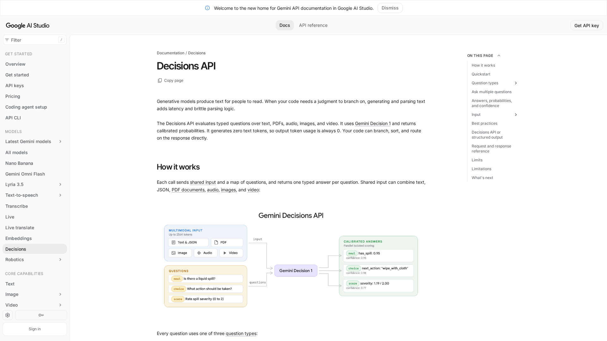
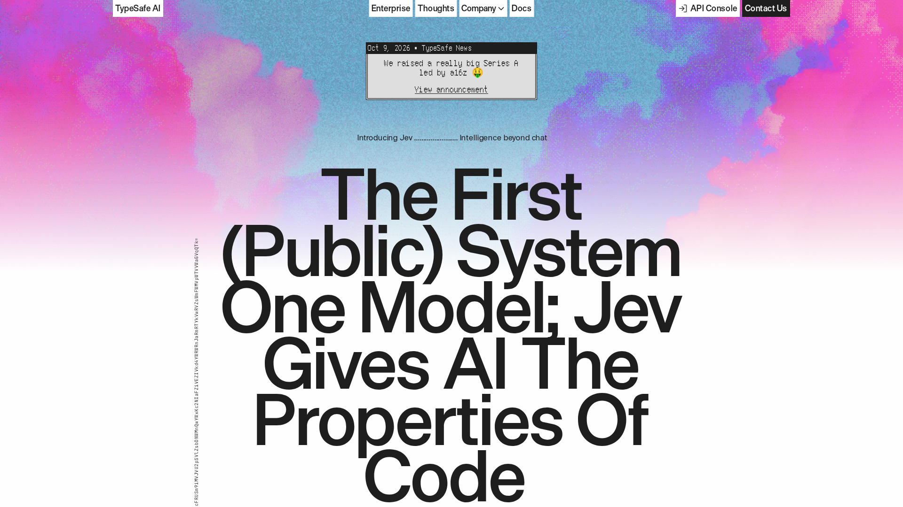
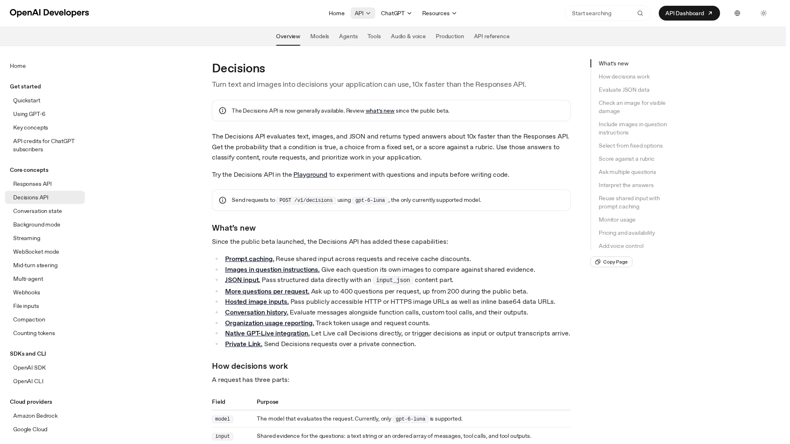
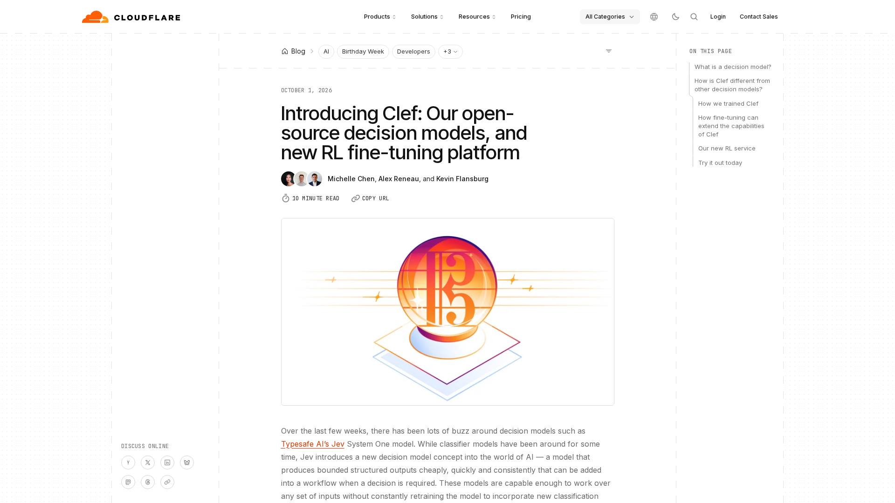
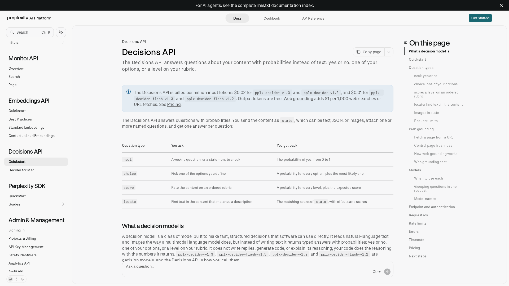
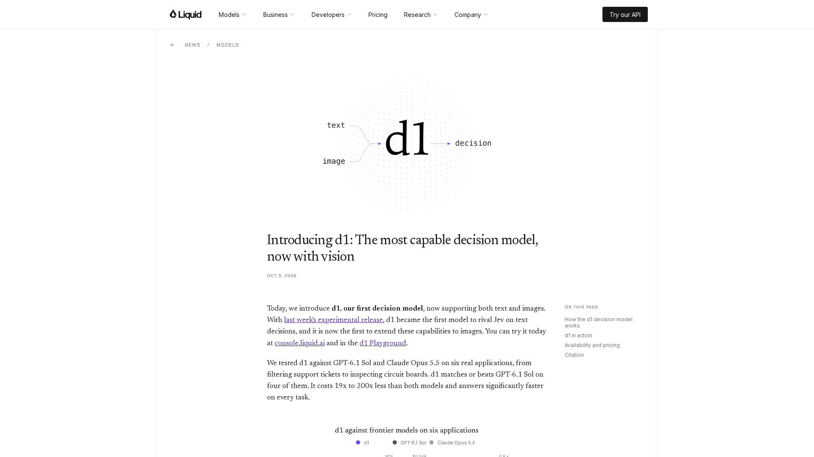
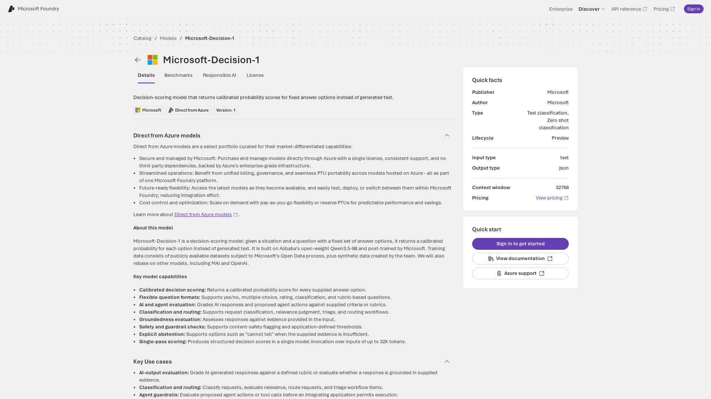
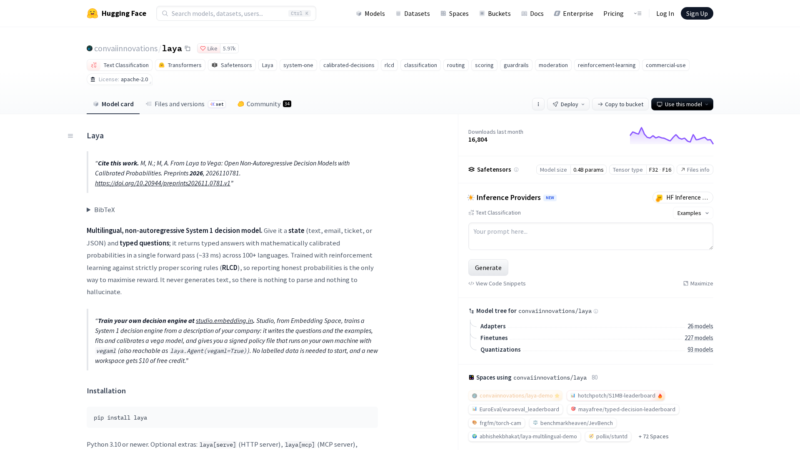

The best decisions API in November 2026 is Google's Gemini Decisions, which read the most voice commands right of the three decision models we measured side by side and is the only one that also reads audio, video and PDF. TypeSafe's Jev comes second, three commands behind Gemini. It answered twice as fast as Gemini, at less than half the price per token. The OpenAI Decisions API read fewer commands right and comes third, yet it is the only one of the three that is generally available, eligible for HIPAA and able to process data in Europe. Cloudflare's Clef, Perplexity's Decider, Liquid AI's d1, Microsoft-Decision-1 and the open source Laya make up the rest of the eight. A decisions API takes a text, a JSON object or an image with a list of typed questions (yes or no, one option out of several, a level on a scale) and returns one probability per answer in a single request, without writing a word. This ranking compares the eight on accuracy, latency, price per token, the inputs they read and where your data goes, then sets them against the alternatives a developer considers: an LLM with structured output, a small fine-tuned classifier, a zero-shot NLI model and keyword rules.

Micdrop publishes this ranking. [Micdrop](/) is an open source TypeScript library for real-time voice conversations with AI, whose server can classify each turn of a call with Jev, OpenAI Decisions or Gemini Decisions before the answer starts. We wrote and measured those three integrations ourselves, which is why they are the three this article tests. Micdrop trains no model and sells no API, so it has no place in the ranking.

The latency and accuracy figures for Jev, OpenAI Decisions and Gemini Decisions come from our own run of 12 November 2026, with its script and raw file in the Micdrop repository. Everything else comes from each vendor's documentation, pricing page and changelog, read on 16 November 2026. Vendors in this category have shipped new versions every few weeks since TypeSafe launched Jev on 15 September 2026, so check the model ID and the price again before you commit.

## How the APIs were ranked

An API qualifies when it has public documentation and a published price per token, and when it answers typed questions with probabilities instead of generating text. We order the APIs on two kinds of evidence:

- The three APIs we measured come first, ordered by the voice commands they read right. One test on the same inputs tells you more than three vendor charts that each pick their own benchmark.
- The five we did not measure come after, ordered by the published evidence for each model used without fine-tuning. Open weights you can test yourself and a benchmark against Jev count most, then figures against LLMs only, then a single anecdote. Within a level, the model ahead of Jev on a larger share of its vendor's own benchmarks comes first. A model whose own card reports scores below a trivial baseline without fine-tuning comes last.

The order leaves out price, latency, inputs and data terms. They go in the table and in each entry, since the right pick for a voice agent that waits on every answer differs from the right pick for a nightly batch of documents.

Our test is the robot demo of the Micdrop repository. It sends 30 spoken commands such as "Take the bucket and water the flower" or "Go right four times" three times each, with the same 21 questions per request, to the three decision models and to Claude Haiku 4.5 with structured output at the same moment. We labelled the commands a person would accept for each sentence. A command counts as right when every action and its target match one of those labels. Thirty sentences in one domain make a small sample. The questions were also first written for Jev in September, which may favour it. Treat the figures as one measurement, then [run the benchmark on your own turns](https://github.com/Godefroy/micdrop/tree/main/examples/demo-robot) with `pnpm measure:classifiers`.

## The comparison at a glance

| API and model | Status in November 2026 | Input price per million tokens | Inputs | Latency | Commands read right, out of 90 | Open weights | Data in Europe |
|---|---|---|---|---|---|---|---|
| **Google** Gemini Decision 1 | Live on the Gemini Developer API (v1beta) | $0.10 | Text, JSON, images, audio, video, PDF | 337 ms median, measured | 81 | No | Google Cloud support announced as coming soon |
| **TypeSafe** Jev | Early access | $0.042 | Text, JSON, images behind an opt-in flag | 164 ms median, measured | 78 | No | No region named |
| **OpenAI** Decisions (gpt-6-luna) | Generally available since 22 October 2026 | $0.10, cache hits discounted | Text, JSON, images | 244 ms median, measured | 60 | No | Processing in the EEA and Switzerland |
| **Cloudflare** Clef, Clef-flash, Clef-omni | Live on Workers AI | $0.038 (flash) to $0.24 (Clef) | Text, JSON, images, audio and video on Clef-omni | 38.8 ms median for Clef-flash, announced | Not measured | Yes, Apache 2.0 | Not documented |
| **Perplexity** Decider | Live | $0.02, or $0.01 for the 4B flash model | Text, JSON, images | Not published | Not measured | Yes for v1 27B, Apache 2.0 | Not documented |
| **Liquid AI** d1 | Live | $0.04, each question billed as its own prompt | Text, images | 200 to 300 ms per text decision, announced | Not measured | No | Not documented |
| **Microsoft** Microsoft-Decision-1 | Preview on Microsoft Foundry | $0.042 | Text | Not published | Not measured | No | EU Data Zone at the same price |
| **Convai Innovations** Laya, hosted by Boundless | Live on Vercel AI Gateway | $0.0105 | Text | 33 to 40 ms per question on a T4 GPU, announced | Not measured | Yes, Apache 2.0 | Anywhere, if you host it yourself |

All of these APIs bill input tokens only. Most of them bill the shared input once per request, so ten questions about the same text cost little more than one. Liquid AI bills each question as its own prompt, input included, so the same text is billed again for every question.

On the same 90 commands, Claude Haiku 4.5 with structured output read 89 right, with a median of 1,876 ms. Classifying 1,000 turns with 21 questions each cost $0.16 with Jev, $0.29 with Gemini Decisions, $0.43 with OpenAI Decisions and $4.40 with Claude Haiku 4.5. Gemini and OpenAI charge the same rate, but each vendor counts tokens its own way: the same request came to 2,887 input tokens at Google, 3,732 at TypeSafe and 4,306 at OpenAI.

## The ranking

### 1. Google Gemini Decisions



Google launched the [Gemini Decisions API](https://aistudio.google.com/docs/decisions-api) on 11 November 2026 with one model, Gemini Decision 1. In the Micdrop test the next day, it read 81 of the 90 commands right, the best score of the three decision models, against 78 for Jev and 60 for OpenAI Decisions. It answered in 337 ms at the median and 485 ms at the 95th percentile, and its first request of the process took 320 ms. Google announces 150 to 250 ms end to end, including 50 to 100 ms of model compute, and says the time stays nearly flat from 1 to 100 questions for inputs up to 16K tokens.

It reads more input types than any other API here: text, JSON, images, audio, video and PDF, in a context of 262,144 tokens shared by the input and the questions. A request takes up to 1,000 questions of three types: `noul` for the probability of a yes, `choice` among 2 to 255 options and `score` on ordered levels. Google says the probabilities are calibrated and that every answer carries a confidence. A yes or no probability always falls between 0.01 and 0.99, so a threshold above 0.99 never matches.

Input costs $0.10 per million tokens for every type of media, and output is free. AI Studio also has a free tier. Google's pricing page says Google uses the data sent on the free tier to improve its products, and keeps paid tier data out of that use. The API runs on the Gemini Developer API in `v1beta` only, and lacks context caching, batch mode and conversation history as input. Google announces Google Cloud support as coming soon, so check where your data is processed before you send calls from European users. The official SDKs are `@google/genai` for TypeScript and `google-genai` for Python.

### 2. TypeSafe Jev



[TypeSafe AI](https://typesafe.ai), a San Francisco company founded in 2024 by Diogo Almeida, Erik Gafni and Sasha Sheng, launched Jev on 15 September 2026 and created the category: every model after it answers the same three question types, and several accept Jev's request format as is. TypeSafe raised an $870M Series A led by Andreessen Horowitz, at a $7.5B valuation, on 9 October 2026, [according to Implicator](https://www.implicator.ai/typesafe-ai-raises-870-million-for-jev-as-openai-amazon-and-cloudflare-ship-rivals/).

Jev was the fastest and the steadiest of the three decision models in the Micdrop test: 164 ms at the median, 207 ms at the 95th percentile, and 263 ms for the first request of the process. It read 78 of the 90 commands right. On the [JevBench leaderboard](https://benchlm.ai/decision-models), an open benchmark of 1,624 decisions run by Florian Standhartinger and contributors, Jev 1.13 ranks third of 106 ranked systems on a composite of quality, calibration, speed and cost. The two ahead of it are open models you host yourself. JevBench is run by volunteers and does not publish how its composite weighs the four criteria. TypeSafe trains Jev with what it calls reinforcement learning for calibrated decisions.

Input costs $0.042 per million tokens and output is free, so Jev was the cheapest of the three tested, at $0.16 per 1,000 turns. Jev reads a text or a JSON state. Jev 1.14, released in October, added a `box` question that returns a bounding box. It also added image input behind an opt-in header, and TypeSafe says Jev reads images less well than text. English is its main training language. TypeSafe's homepage still lists Jev in early access, and its documentation names no hosting region, so ask TypeSafe where your data goes before you send it calls from European customers. The official TypeScript SDK is `@typesafe-ai/sdk`. You can read more about [what Jev answers and where it falls short](/blog/what-is-jev).

### 3. OpenAI Decisions API



OpenAI opened the [Decisions API](https://developers.openai.com/api/docs/guides/decisions) in beta on 6 October 2026 and made it generally available on 22 October, according to its [changelog](https://developers.openai.com/changelog/). The API runs one model, `gpt-6-luna`, and OpenAI announces answers about ten times faster than with the Responses API. In the Micdrop test it answered in 244 ms at the median, but its times varied more than those of the other two, with 686 ms at the 95th percentile and 1,733 ms for the first request of the process. It read 60 of the 90 commands right, the lowest score of the three, and declined to answer three of its 1,890 questions. It misread mostly the commands that hold several steps or a count, which Micdrop listed one by one in an [earlier benchmark of OpenAI Decisions against Jev](/blog/openai-decisions-vs-jev).

Its questions are called `predicate`, `choice` and `score`, up to 400 per request since the general availability. It reads text, JSON and images, as inline data or as public URLs, plus a conversation history with tool calls. Any question can come back as a refusal, so the code reading the answers has to handle a missing value. OpenAI makes no calibration claim and tells you to set thresholds on labelled examples from your own application.

Input costs $0.10 per million tokens, with a discount on prompt cache hits, and output is free. OpenAI adds 10% to the price for regional processing on recent models, according to its pricing page. The Decisions API is the only one of the eight that documents both zero data retention and HIPAA use for eligible customers, with processing in the United States or in Europe (EEA and Switzerland) and Private Link. Microsoft Foundry serves the same `gpt-6-luna` model as Azure OpenAI Decisions. GPT-Live, OpenAI's voice model, can also call the Decisions API on its own while the user speaks.

### 4. Cloudflare Clef



Cloudflare [released Clef and Clef-flash](https://blog.cloudflare.com/clef-decision-models/) on Workers AI on 1 October 2026, then Clef-omni on 9 October. The three follow Jev's request format, so you can switch an existing Jev integration by changing the endpoint and the model name, Cloudflare says. Their weights are on Hugging Face under the Apache 2.0 license. Clef-flash takes up to 256K tokens of context when you host those weights yourself.

Cloudflare compares its models with Jev in more detail than any other vendor here. On ten public benchmarks, Clef scores higher than Jev on eight, for example 94.20 against 79.74 macro-F1 on BANKING77, and lower on When2Call and BRIGHT. Clef answered in 209 ms at the median against 524 ms for Jev in Cloudflare's test, and Clef-flash in 38.8 ms. The Micdrop test measured Jev at 164 ms, so Jev ran slower in Cloudflare's test than in Micdrop's. Cloudflare ran these tests itself, on its own selection of tasks. Since 9 October, Cloudflare has served Clef up to twice as fast.

Clef-flash, a 9B model, costs $0.038 per million input tokens, with a hosted context of 24K tokens. Clef, a 27B model, costs $0.24 and has a 64K context. Clef-omni costs $0.15 and is the only model here besides Gemini Decision 1 that reads audio and video. A request takes up to 64 questions and four images. Cloudflare's Workers AI model page lists zero data retention. You call the models through a Workers binding, the REST endpoint or AI Gateway.

### 5. Perplexity Decider



Perplexity launched its [Decisions API](https://docs.perplexity.ai/docs/decisions/quickstart) in October 2026 with `pplx-decider-v1-27b`, a model fine-tuned from Qwen3.8-27B and published on Hugging Face under Apache 2.0. Perplexity ran a panel of 11 benchmarks through its own API. That model scored 85.71% overall against 84.51% for Jev, ahead on six benchmarks and behind on five, so the two are close on Perplexity's own figures. The current models are `pplx-decider-v1.3` (27B) and `pplx-decider-flash-v1.3` (4B), released in November.

Perplexity charges less than any other large vendor here: $0.02 per million input tokens for the 27B model and $0.01 for the flash model, output free. Decider reads text, JSON and images. Decider v1.3 adds a fourth question type, `locate`, which returns the spans of a text that match a description, with character offsets. In web grounding mode, the API runs a search for each question and adds the results to the input, at $0.001 per search, so the model can check a claim against the web. Perplexity warns that a new version can change the probabilities, so check your thresholds again whenever the `pplx-decider-latest` alias moves.

### 6. Liquid AI d1



[Liquid AI](https://www.liquid.ai/blog/d1-decision-model), an MIT spinout, released d1, its first decision model, on 5 October 2026, with text and image inputs. Liquid tested it against GPT-6.1 Sol and Claude Opus 5.5 on six applications, including filtering support tickets and inspecting circuit boards, and reports that d1 matches or beats GPT-6.1 Sol on four of them, at 19 to 200 times lower cost. Liquid publishes no comparison with another decision model.

Input costs $0.04 per million tokens, output free, and each question is billed as its own prompt with its text and images. A request of 21 questions about the same turn therefore costs about 21 times the price of the turn, where Jev or Gemini Decisions bill the turn once. Each image costs 1.5 tokens per 32 by 32 pixel patch, about 1,536 tokens for a 1024 by 1024 picture. Liquid announces 200 to 300 ms per text decision. The model runs on Liquid's API at `api.liquid.ai/decisions/v1/systemone`, and on Vercel and OpenRouter with text only for now. Liquid also publishes small open decision models, d1-3B and d1-omni-600M, under its own LFM license.

### 7. Microsoft-Decision-1



Microsoft [announced Microsoft-Decision-1](https://techcommunity.microsoft.com/blog/azure-ai-foundry-blog/introducing-microsoft-decision-1-in-microsoft-foundry-for-decision-and-classific/4562742) in public preview on Microsoft Foundry on 9 October 2026. It is built on Alibaba's open Qwen3.5-9B and post-trained by Microsoft, which plans to rebase later versions on its MAI models and on OpenAI's. Its endpoint, `/providers/microsoft/v1/systemone`, takes the same state and questions as Jev.

It costs $0.042 per million input tokens, the price of Jev, in both the US and the EU Data Zones. It reads text only, in a context of 32,768 tokens, and returns yes or no, choice and rubric answers, with an explicit "cannot tell" option when the input does not hold the answer. Microsoft cites a single case, in which Xbox Research sorted more than 10,000 pieces of player feedback with it, at a quality Microsoft describes as competitive with GPT-5 and 80 to 100 times faster. Its catalog page calls the scores calibrated, but Microsoft publishes no calibration figures and asks you to check them on your own data. Microsoft's blog sample calls the REST endpoint from Python. Microsoft ships no dedicated SDK.

### 8. Laya



[Laya](https://huggingface.co/convaiinnovations/laya) is an open source decision model from Convai Innovations, published under Apache 2.0. Where every other model here starts from a large language model, Laya puts a decision head on ModernBERT-large, a 421M parameter encoder, with a 322M multilingual checkpoint that covers over 100 languages. It answers a question in 39.5 ms on a T4 GPU for the English checkpoint and 32.8 ms for the multilingual one, according to its authors. Its server accepts Jev's request format. The `@receptron/laya` package runs it from Node with ONNX Runtime.

Its authors report its weaknesses more openly than any other vendor here. On their test of 2,000 typed decisions, the English checkpoint scored 0.362 and the multilingual one 0.342 without fine-tuning, below the 0.461 of always picking the most common answer. A checkpoint fine-tuned on that task scored 0.766, against 0.727 published for Jev. The authors also warn that the checkpoints ship overconfident, and that you should refit the temperatures on your own labelled data. Boundless hosts the base model on Vercel AI Gateway for $0.0105 per million input tokens, close to the price of Perplexity's flash model, with an 8,192 token context. Pick Laya when you can fine-tune it on your own labels, or when your data must stay on your servers.

## When a decisions API is the wrong tool

A decision model answers questions you defined, about an input you send. Four other tools can do the same job, each with cases where it fits better.

**An LLM with structured output** reads requests of several steps or with a count better than any decision model we measured. Claude Haiku 4.5 read 89 of the 90 commands right, against 81 for the best decision model. It also writes text, extracts free-form values and reasons over several steps, which no decisions API does. In exchange, it took 1,876 ms at the median and cost $4.40 per 1,000 turns at $1 per million input tokens and $5 per million output tokens. When the LLM writes its own confidence, that number tells you little about how often it is right. A common setup sends the turns a decision model answers with low confidence to the LLM, so only those pay its latency.

**A small fine-tuned classifier**, such as ModernBERT or a few-shot SetFit model, answers in tens of milliseconds on a CPU and costs the price of an hourly instance, from $0.03 an hour on CPU or $0.50 an hour for a T4 GPU on Hugging Face Inference Endpoints. It needs labelled examples and a new training run for every new label, where a decision model takes a new question in the next request. Laya comes close to this option, since it is an encoder you can host and its authors recommend fine-tuning it.

**Zero-shot NLI models** (natural language inference) such as `facebook/bart-large-mnli`, released under the MIT license, rate each label against the text with no training. They need one pass per label and do better with short labels than with nuanced intents.

**Keyword rules** cost nothing and answer in under a millisecond. They catch the phrasings you listed and miss the others, so they work for a fixed vocabulary such as "stop" or "operator" and fail on free speech. You can compare keywords, an LLM and a decision model on the same turns for [intent classification in a voice agent](/blog/intent-classification-voice-agent).

## Other options worth knowing

Azure OpenAI Decisions serves OpenAI's `gpt-6-luna` on Microsoft Foundry, for teams that buy their models through Azure. Its billing and data terms follow your Azure contract.

Several authors publish the weights of their decision models without a hosted API. AWS's Strands Labs released [Strands Decider 2B](https://thenewstack.io/aws-strands-decider-model/) on 1 October 2026 under Apache 2.0, as an experiment you run next to an agent, with no managed Bedrock service. The two systems ahead of Jev on JevBench, Blockbrain's Cygnet and Winnow-12B, are open models you host yourself too.

More hosted decisions APIs appear every week, from model labs and from inference platforms that serve the open weights listed above. Check that a new one publishes a price per token and a benchmark against a model you already know before you send it production traffic.

## How to choose a decisions API

Start with what the model has to read. For PDF, only Gemini Decisions qualifies. For audio or video, pick Gemini Decisions or Cloudflare's Clef-omni. With images, you can also pick OpenAI, Perplexity, Liquid AI and the rest of the Clef family. All eight read text.

Then pick on what your application needs most:

- Gemini Decisions for the best accuracy in our test and the largest hosted context, 262,144 tokens, if Google's `v1beta` status and the lack of Google Cloud hosting suit you
- Jev for the lowest and steadiest latency we measured and a low price, when your inputs are in English and you can live with an early access service that names no region
- OpenAI Decisions for HIPAA, zero data retention, processing in Europe at a 10% premium and general availability, if you can test its accuracy on your own inputs first and handle refusals
- Microsoft-Decision-1 when your contracts already run through Azure and you need the EU Data Zone at the price of Jev
- Perplexity's flash model or Laya for the lowest price on high volumes, Clef-flash for the fastest announced answers, and Clef or Perplexity's open weights when you may later want to run the model yourself
- Laya when the data must stay on your own servers and you have labelled examples to fine-tune it

Whatever you pick, set your thresholds on your own labelled inputs. TypeSafe, Google, Cloudflare and Microsoft all call their probabilities calibrated. In our test, the confidence flagged the mistakes of some models far more often than others. With a threshold of 0.6 on the question that counts the actions, Jev was unsure on 3 of its 12 wrong commands and on none of its right ones. Gemini Decisions was unsure on none of its 9 wrong commands, and on 3 of its right ones. OpenAI Decisions was unsure on 12 of its 30 wrong commands and on 9 of its right ones.

Keep the provider swappable, since prices and models moved every few weeks this autumn. Most of these APIs accept Jev's questions with few changes. [Micdrop's classifier](/docs/classifiers) gives Jev, OpenAI Decisions and Gemini Decisions the same interface on a voice server, so switching takes an import and a constructor. Each package exports its own question helpers:

```typescript
import { GeminiClassifier, noul as geminiNoul } from '@micdrop/gemini'
import { MicdropServer } from '@micdrop/server'
import { noul, TypesafeClassifier } from '@micdrop/typesafe'

const wantsHuman = 'Does the user in `turn` ask for a human?'

const classifier =
  process.env.CLASSIFIER === 'gemini'
    ? new GeminiClassifier({
        apiKey: process.env.GEMINI_API_KEY || '',
        questions: { wantsHuman: geminiNoul(wantsHuman) },
      })
    : new TypesafeClassifier({
        apiKey: process.env.TYPESAFE_API_KEY,
        questions: { wantsHuman: noul(wantsHuman) },
      })

new MicdropServer(socket, {
  stt,
  agent,
  tts,
  classifier,
  classifierOptions: { waitBeforeAnswer: true },
})
```

The server classifies each turn when the user stops speaking and holds the answer up to one second, so your agent can transfer the call, play a scripted line or let the LLM answer. To use another API from this ranking, write a class that extends the [`Classifier` base class](/docs/classifiers/custom) and implements one method. Micdrop is a library you host yourself with your own keys, so the data terms of a call are those of the decision model you choose.

## Frequently asked questions

<FaqList>
  <FaqItem question="What is a decisions API?">
    A decisions API runs a decision model: you send an input, such as a text, a JSON object or an image, with a list of typed questions, and it returns one answer per question with probabilities. A question asks for the probability of a yes, one option out of a list, or a level on an ordered scale. The model writes no text, so it answers in a few hundred milliseconds or less and bills only the input tokens. TypeSafe launched the first one, Jev, in September 2026, and OpenAI, Google, Cloudflare, Perplexity, Liquid AI and Microsoft followed within two months.
  </FaqItem>
  <FaqItem question="What is the best decisions API in 2026?">
    Gemini Decisions read the most commands right of the three decision models we measured on 90 voice commands on 12 November 2026, 81 against 78 for Jev and 60 for OpenAI Decisions. Jev was the fastest, at 164 ms median against 244 ms for OpenAI and 337 ms for Gemini, and the cheapest of the three at $0.042 per million input tokens. OpenAI Decisions is the only one of the three that is generally available and documents HIPAA use and processing in Europe.
  </FaqItem>
  <FaqItem question="How much does a decisions API cost?">
    Decisions APIs bill input tokens only. Perplexity's flash model costs $0.01 per million input tokens, Laya on Vercel AI Gateway $0.0105, Perplexity's 27B model $0.02, Cloudflare's Clef-flash $0.038, Liquid AI's d1 $0.04, Jev and Microsoft-Decision-1 $0.042, Gemini Decisions and OpenAI Decisions $0.10, and Cloudflare's Clef $0.24. Liquid AI bills each question as its own prompt, while most others bill the shared input once per request. In our test, 1,000 requests of 21 questions cost $0.16 with Jev, $0.29 with Gemini Decisions and $0.43 with OpenAI Decisions.
  </FaqItem>
  <FaqItem question="What is the difference between a decision model and an LLM with structured output?">
    An LLM with structured output writes its JSON answer one token at a time, and any confidence it gives is a number it wrote itself. A decision model scores the options you defined in one pass, so it answers faster, bills no output and returns a probability for each option. In our test, Claude Haiku 4.5 with structured output took 1,876 ms at the median against 164 to 337 ms for the decision models, but it read 89 of 90 commands right against 81 for the best decision model. Keep the LLM for text, extraction and requests of several steps.
  </FaqItem>
  <FaqItem question="Which decisions APIs read images, audio or video?">
    Gemini Decisions reads text, JSON, images, audio, video and PDF. Cloudflare's Clef-omni reads text, images, audio and video. OpenAI Decisions, Perplexity's Decider, Liquid AI's d1, Clef and Clef-flash read images next to the text. Jev reads images only behind an opt-in header, and TypeSafe says its answers on images are less accurate than on text. Microsoft-Decision-1 and Laya read text only.
  </FaqItem>
  <FaqItem question="Which decisions APIs can keep data in Europe?">
    OpenAI Decisions supports regional processing in Europe (EEA and Switzerland) at a 10% premium, with zero data retention and HIPAA for eligible customers. Microsoft-Decision-1 runs in an EU Data Zone at the same price as in the US. The weights of Laya, Clef and Perplexity's first 27B Decider are public, so you can host them in Europe yourself. TypeSafe names no hosting region for Jev, and Google announces Google Cloud support for Gemini Decisions as coming soon.
  </FaqItem>
  <FaqItem question="Are the probabilities of a decision model calibrated?">
    TypeSafe, Google, Cloudflare and Microsoft say their models return calibrated probabilities, meaning that answers given 0.8 should be right about eight times out of ten. Microsoft publishes no figures to back it, OpenAI makes no such claim, and Laya's authors warn that its checkpoints ship overconfident. In our test, with a threshold of 0.6, Jev's confidence flagged 3 of its 12 wrong commands, OpenAI's flagged 12 of its 30, and Gemini's flagged none of its 9. Set your thresholds on inputs you have labelled yourself.
  </FaqItem>
  <FaqItem question="Can I self-host a decision model?">
    Yes. Cloudflare publishes Clef, Clef-flash and Clef-omni under Apache 2.0, Perplexity publishes its first 27B Decider under Apache 2.0, and Convai Innovations publishes Laya under Apache 2.0, with a Node package that runs it on ONNX Runtime. AWS released Strands Decider 2B and Liquid AI released d1-3B as open models too. Jev, Gemini Decision 1, OpenAI's gpt-6-luna and Microsoft-Decision-1 run only as hosted APIs.
  </FaqItem>
</FaqList>

## Try a decision model on your own inputs

Take Gemini Decisions for accuracy and inputs beyond text if its v1beta status suits you, Jev for the fastest and cheapest answers we measured on English text, and OpenAI Decisions for HIPAA, processing in Europe and a generally available service. Perplexity's models and Clef-flash cost less than those three. Clef-flash and Perplexity's first Decider also have open weights. Microsoft-Decision-1 suits teams on Azure, while Laya suits data that has to stay on your servers.

Whichever API you shortlist, write the questions your application needs, run them on a few dozen inputs you have labelled, and compare before you set a threshold. To route a voice call on the answers, [add a classifier to a Micdrop server](/docs/classifiers) with Jev, OpenAI Decisions or Gemini Decisions, or [start with a first voice call in five minutes](/docs/getting-started).

<RankingJsonLd
  name="Best decisions APIs in 2026"
  description="Hosted decision model APIs ranked in November 2026, on voice commands measured side by side and on the evidence each vendor publishes."
>
  <RankingEntry name="Google Gemini Decisions" url="https://aistudio.google.com/docs/decisions-api" />
  <RankingEntry name="TypeSafe Jev" url="https://typesafe.ai" />
  <RankingEntry name="OpenAI Decisions API" url="https://developers.openai.com/api/docs/guides/decisions" />
  <RankingEntry name="Cloudflare Clef" url="https://blog.cloudflare.com/clef-decision-models/" />
  <RankingEntry name="Perplexity Decider" url="https://docs.perplexity.ai/docs/decisions/quickstart" />
  <RankingEntry name="Liquid AI d1" url="https://www.liquid.ai/blog/d1-decision-model" />
  <RankingEntry name="Microsoft-Decision-1" url="https://ai.azure.com/catalog/models/Microsoft-Decision-1" />
  <RankingEntry name="Laya" url="https://huggingface.co/convaiinnovations/laya" />
</RankingJsonLd>
