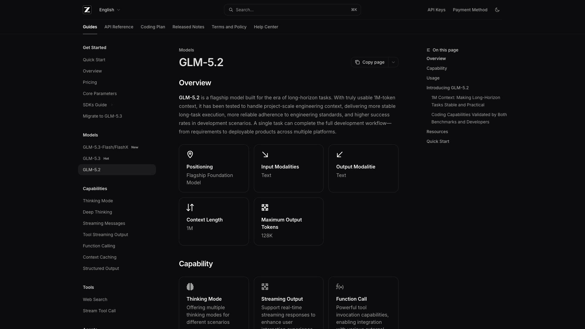
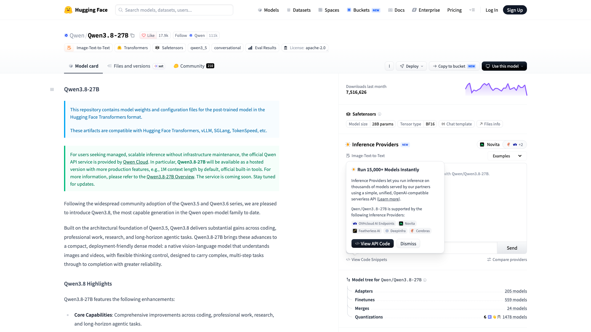
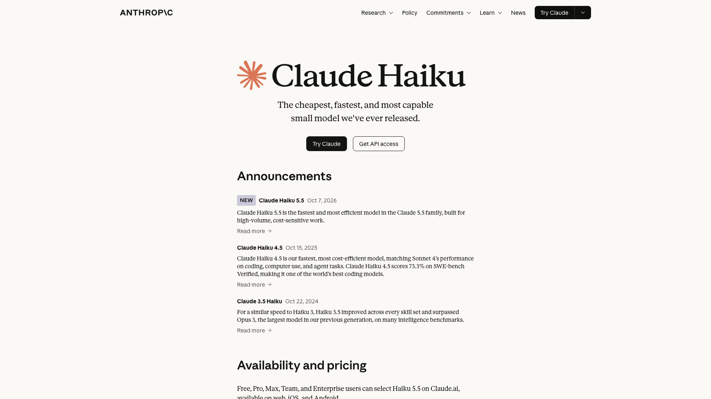
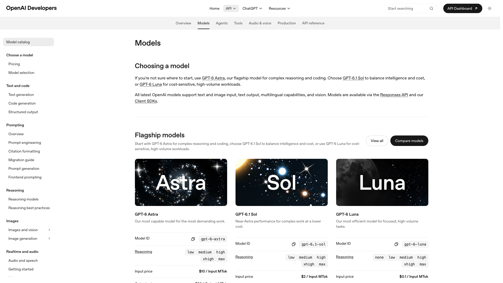
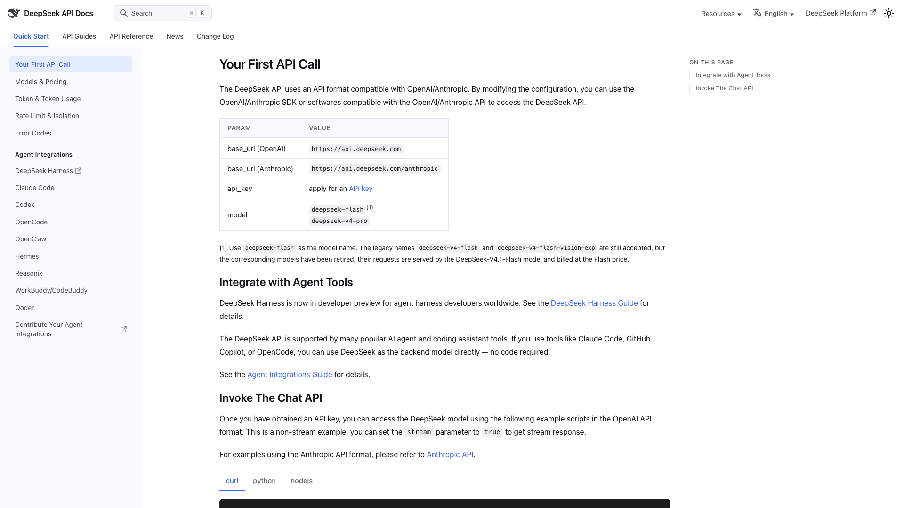
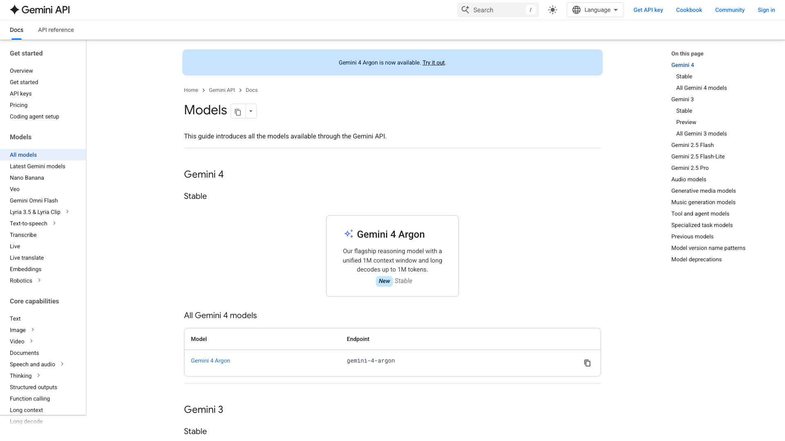
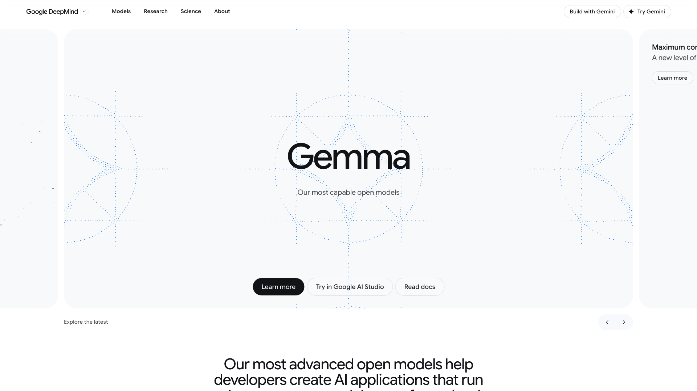
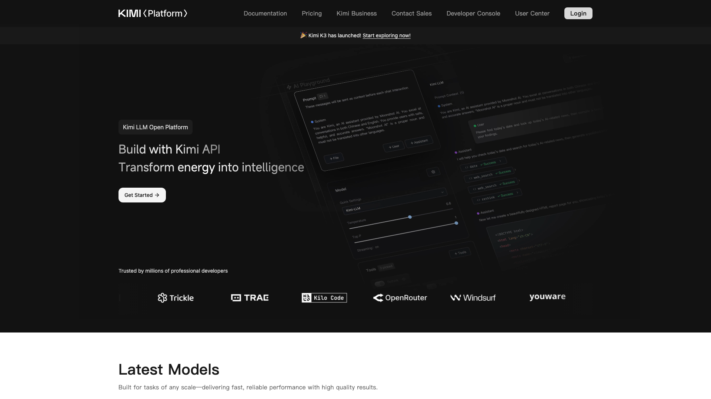
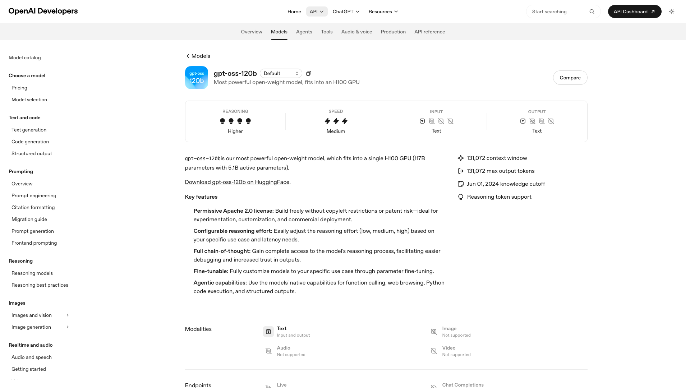
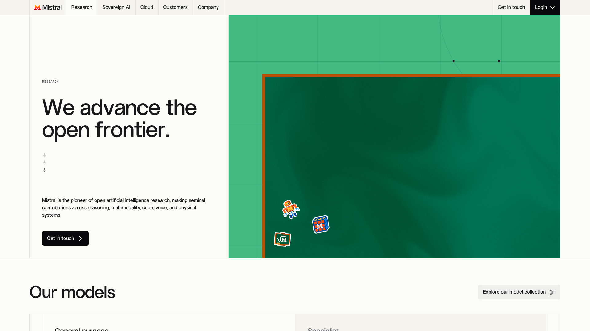

The best language model for a voice agent in October 2026 is GLM-5.2 with reasoning off when tool calls have to be right, and Qwen3.8 27B when every answer has to start fast with a score still above 98%. GLM-5.2 passed 99.7% of the turns of aiewf-eval, the multi-turn voice benchmark run by the team behind Pipecat. Qwen3.8 27B passed 98.2% and started 95% of its answers within 801 ms. Claude Haiku 4.5, OpenAI GPT-5.6 Terra, DeepSeek V4 Pro and Gemini 3.6 Flash complete the top six. This ranking compares nine model families on what the LLM step of a speech to text, LLM and text to speech pipeline needs: correct tool calls and instructions over a long call, the delay before the first word, price, where the data is processed and whether you can host the model yourself.

[Micdrop](/), which publishes this ranking, is an open source TypeScript library for real-time voice conversations with AI. It trains no model, so it stays out of the ranking. Raconte, a voice interview product built by Micdrop's maintainer, runs OpenAI and Mistral models on it in production.

Benchmark scores come from the aiewf-eval results table as published after its August 2026 review of current models. Prices come from each vendor's pricing page, collected on 17 October 2026. Vendors rename and retire fast models every few weeks, so check the model ID before you commit.

This ranking leaves out [speech to speech models](/blog/gpt-live-vs-gpt-realtime-vs-gemini-live) such as GPT-Live, GPT Realtime and Gemini Live, which hear and answer in one connection.

## How the models were ranked

[aiewf-eval](https://github.com/kwindla/aiewf-eval) is maintained by Kwindla Hultman Kramer, cofounder and CEO of Daily, the company behind the Pipecat framework. It plays 30 scripted conversations of 30 turns to each model, 900 turns in all. An LLM judge, Claude, checks three things on every turn: the tool call, the instructions and the answer from the knowledge base. A turn passes when all three are right. A turn the model never answers counts as failed. The benchmark times each answer from the request to the first word or tool call the user would get, so the time a model spends reasoning counts in the delay. Kramer adds about 500 ms for the rest of the pipeline and calls a median above about 700 ms too slow for most voice agents.

A family is one product line, such as Gemini or Gemma, so a vendor can enter twice. A route is one model at one reasoning setting, on the host the benchmark timed. The ranking applies three rules:

- a route qualifies when its median answer starts within one second and 95% of its answers within 2.5 seconds
- it also has to run a model its vendor still offers and has not marked deprecated, on a deployment the benchmark still compares with the others
- each family enters with its highest scoring qualifying route, ranked by the share of turns passed, the faster median first on a tie

One second is looser than Kramer's 700 ms, so the comparison covers the families most teams already use. A 95th percentile of 2.5 seconds means one turn in twenty leaves the caller in silence for three seconds or more once the voice is added. A family the benchmark has not scored stays out of the ranking, Mistral included.

The rules leave out several strong models. Claude Sonnet 4.6 passed every turn, but 5% of its answers took more than 4.1 seconds to start. NVIDIA's Nemotron 3 Ultra passed every turn with a median of 541 ms, on deployments that no longer exist at the inference host Baseten. The benchmark warns that those delays cannot be compared with the other models' delays. GPT-4.1 scored 96.3% with a median of 536 ms and GPT-5.1 scored 98.0%, but OpenAI now marks both [deprecated](https://developers.openai.com/api/docs/models/gpt-4.1). Pipecat's quickstart still uses GPT-4.1, which Daily described in February 2026 as [the model most production voice agents ran](https://www.daily.co/blog/benchmarking-llms-for-voice-agent-use-cases/).

## The comparison at a glance

| Model family and measured route | Turns passed | First word, median and 95th percentile | Price per 1M tokens, input and output | Reasoning can be turned off | EU processing | Open weights |
|---|---|---|---|---|---|---|
| **Z.ai** GLM-5.2, reasoning off, on Baseten | 99.7% | 936 ms, 2,140 ms | $1.40, $4.40 on Z.ai | Yes (GLM-5.3 always reasons) | Self-hosted weights | Yes |
| **Alibaba** Qwen3.8 27B, thinking off, on Baseten | 98.2% | 649 ms, 801 ms | $0.99, $1.49 on Cerebras | Yes | Qwen3.8 Flash in Frankfurt, or self-hosted weights | Apache 2.0 |
| **Anthropic** Claude Haiku 4.5 | 98.0% | 637 ms, 1,615 ms | $1, $5 ($0.10, $0.50 for Haiku 5.5 on prompts up to 100,000 tokens) | Yes | Amazon Bedrock EU | No |
| **OpenAI** GPT-5.6 Terra, medium reasoning | 97.8% | 927 ms, 2,149 ms | $2, $12 ($0.10, $0.50 for GPT-6 Luna) | Yes | EU endpoint, 10% extra | No |
| **DeepSeek** V4 Pro, low reasoning, on Baseten | 97.3% | 752 ms, 1,477 ms | $1.32, $3.96 on DeepSeek | Yes | Self-hosted weights | Yes |
| **Google** Gemini 3.6 Flash, minimal thinking | 97.1% | 798 ms, 984 ms | $0.75, $3.75 until 31 December | No, minimal at lowest | Vertex AI EU | No |
| **Google** Gemma 4 31B, thinking off, on Baseten | 96.6% | 489 ms, 609 ms | Set by the host | Yes | Self-hosted weights | Apache 2.0 |
| **Moonshot** Kimi K2.6, thinking off, on Baseten | 93.9% | 475 ms, 842 ms | $0.95, $4.00 on Moonshot | Yes (Kimi K3 always thinks) | Self-hosted weights | Yes |
| **OpenAI** gpt-oss-120b, on Groq | 86.3% | 98 ms, 217 ms | $0.15, $0.60 on Groq | No, low at lowest | Self-hosted weights | Apache 2.0 |

The benchmark timed the language model alone, from its own client, so your network and your host add to these delays. It ran gpt-oss on Groq and the other open weight models on Baseten. A price cell names its host when that host differs from the one timed.

## The ranking

### 1. Z.ai GLM-5.2



[GLM-5.2](https://docs.z.ai/guides/llm/glm-5.2), released by Z.ai on 16 June 2026, passed 99.7% of the aiewf-eval turns with reasoning off, the highest score in this ranking. It failed 0.2% of tool calls and 0.2% of instructions. Its median answer starts after 936 ms on Baseten, where 5% of its answers take more than 2,140 ms.

The [price](https://docs.z.ai/guides/overview/pricing) is $1.40 per million input tokens, $0.26 when cached, and $4.40 per million output tokens. GLM-5.2 takes a 1M token context and has open weights. The voice AI company ElevenLabs hosts it for its agents and recommends it as a starting point in its advice on [prompting voice agents](https://elevenlabs.io/docs/eleven-agents/best-practices/prompting-guide).

Its successor GLM-5.3, released on 18 August 2026, always reasons. Z.ai rejects any request that turns reasoning off. In the same benchmark, GLM-5.3 at its lowest setting passed 98.7% of turns but started its median answer after 2,376 ms. Pin `glm-5.2` explicitly and plan for the day Z.ai retires it. Z.ai publishes no European region for its API, so a European team can run the open weights on its own servers.

### 2. Alibaba Qwen3.8 27B



[Qwen3.8 27B](https://huggingface.co/Qwen/Qwen3.8-27B), released by Alibaba's Qwen team in August 2026, passed 98.2% of the aiewf-eval turns with thinking off. It has the lowest 95th percentile of the models above 97%, with 95% of answers within 801 ms and a median of 649 ms. Its open weights are under Apache 2.0. As a 27 billion parameter dense model, it fits on a single GPU.

[Cerebras](https://inference-docs.cerebras.ai/models/qwen-3.8-27b) serves `qwen-3.8-27b` at about 1,850 tokens per second for $0.99 per million input tokens and $1.49 per million output tokens. Groq serves it in preview at about 450 tokens per second for $0.80 and $4.00. Both accept `reasoning_effort: "none"`. The benchmark timed neither host. A quantized copy on a single RTX 5090 graphics card passed 97.8% of turns.

Thinking is on by default, so if you forget to turn it off, every turn waits for the reasoning. Alibaba's own API serves Qwen3.8 Flash, a separate model the benchmark has not scored, from Frankfurt at $0.113 and $0.382 per million tokens, which keeps the data in Europe.

### 3. Anthropic Claude Haiku 4.5



[Claude Haiku 4.5](https://www.anthropic.com/claude/haiku) passed 98.0% of the aiewf-eval turns with the fastest median of the top six, 637 ms. It missed an instruction on 2.0% of turns. Its tool errors, on 0.7% of turns, all fell on those same turns. Its slowest 5% of answers took more than 1,615 ms. Its [price](https://platform.claude.com/docs/en/about-claude/pricing) is $1 per million input tokens and $5 per million output tokens.

Anthropic released Claude Haiku 5.5 on 7 October 2026, too late for the August benchmark. It costs a tenth of Haiku 4.5, $0.10 and $0.50 per million tokens for prompts up to 100,000 tokens. Haiku 5.5 thinks by default, so send `thinking: { type: "disabled" }`. It also rejects the `temperature` setting. Measure it on your own calls before you switch.

Anthropic still offers Haiku 4.5 alongside 5.5. Anthropic's own API has no European region. Amazon Bedrock's `eu.` inference profile keeps Haiku in EU regions instead. The voice agent platform Retell already lists Haiku 5.5. Vapi, a similar platform, and ElevenLabs still list Haiku 4.5.

### 4. OpenAI GPT-5.6 Terra



[GPT-5.6 Terra](https://developers.openai.com/api/docs/models/gpt-5.6-terra) passed 97.8% of the aiewf-eval turns at medium reasoning, with a median of 927 ms and 5% of answers above 2,149 ms. OpenAI describes Terra as the tier that replaces the mini models of earlier GPT-5 families. It costs $2 per million input tokens and $12 per million output tokens. Retell uses it as its [default voice agent model](https://docs.retellai.com/api-references/create-retell-llm).

Terra gets faster and less reliable with reasoning off. At `none`, it started its median answer after 621 ms and passed 91.3% of turns. OpenAI requires the Responses API to combine a reasoning effort with function tools. Chat Completions returns an error for that combination.

[GPT-6 Luna](https://developers.openai.com/api/docs/models/gpt-6-luna), released on 22 September 2026, is the cheap tier at $0.10 and $0.50 per million tokens. The benchmarking site Artificial Analysis, which times a single request rather than a conversation, measures its first token at 0.94 s with reasoning off. aiewf-eval has not scored it yet. Its predecessor GPT-5.6 Luna passed 88.3%.

OpenAI processes data in Europe through `eu.api.openai.com`, for 10% extra on recent models. It sells no self-hosted version of these models.

### 5. DeepSeek V4 Pro



[DeepSeek V4 Pro](https://api-docs.deepseek.com/quick_start/pricing) passed 97.3% of the aiewf-eval turns at low reasoning, with a median of 752 ms and 5% of answers above 1,477 ms on Baseten. It costs $1.32 per million input tokens, $0.044 when cached, and $3.96 per million output tokens, at half price during DeepSeek's off-peak hours. The cheaper V4 Flash passed 96.7% at low reasoning, with a median of 677 ms.

DeepSeek retired that Flash version in September. The current `deepseek-flash` serves V4.1 Flash, released on 10 September 2026, at $0.30 per million input tokens, $0.006 when cached, and $1.20 per million output tokens, under the MIT license. The benchmark has not scored V4.1 Flash yet. ElevenLabs offers it among its low latency models, as does Vapi.

DeepSeek's API documentation names no data location. A team that needs the data in Europe or the United States can call the open weights through a Western host such as Together AI or Baseten. V4 Pro and V4.1 Flash think by default, so set the effort to low or request the non-thinking mode.

### 6. Google Gemini 3.6 Flash



[Gemini 3.6 Flash](https://ai.google.dev/gemini-api/docs/models), released on 21 July 2026, passed 97.1% of the aiewf-eval turns at `minimal` thinking. Its delay is the most even of the hosted closed models: a median of 798 ms, 95% of answers within 984 ms and a slowest answer of 1,472 ms, measured on Google AI Studio.

The [price](https://ai.google.dev/gemini-api/docs/pricing) is $0.75 per million input tokens and $3.75 per million output tokens until 31 December 2026, then $1.50 and $7.50. Cached input costs a tenth.

Gemini 3.x keeps some thinking on every request. Gemini 3.6 Flash goes down to `minimal`. The newer Gemini 3.8 Flash stops at `low` and has no aiewf-eval score yet. Gemini 3.5 Flash-Lite starts fast but passed only 68.6% of turns. Vertex AI keeps processing inside its EU multi-region for 3.6 Flash, while the plain Gemini API cannot be pinned to a region.

### 7. Google Gemma 4 31B



[Gemma 4 31B](https://deepmind.google/models/gemma/), Google's open weight model released on 2 April 2026 under Apache 2.0, has the fastest median among the ranked models above 95%, 489 ms, with 95% of its answers starting within 609 ms. It passed 96.6% of the aiewf-eval turns with thinking off, over 150 conversations rather than the usual 30.

The voice agent framework LiveKit names Gemma 4 31B the [recommended default language model](https://docs.livekit.io/agents/models/llm/) of its agents, served through LiveKit Inference. Baseten, Together AI and other hosts serve it at their own prices. The 31 billion parameter model runs on two H100 GPUs, or on one RTX 5090 once quantized.

Baseten's servers stalled at times over the 4,500 turns of those 150 conversations, once holding an answer for 38 seconds. Plan a timeout and a fallback model whatever the host. The smaller Gemma 4 26B A4B passed only 80.7% of turns. It kept asking for details the user had already given instead of calling the tool.

### 8. Moonshot Kimi K2.6



[Kimi K2.6](https://platform.kimi.ai), released by Moonshot AI on 20 April 2026, passed 93.9% of the aiewf-eval turns with thinking off. It has the fastest median of the models above 90%, 475 ms, with 95% of its answers starting within 842 ms. With thinking on, it passed 98.3%, but its median rose to 1,560 ms.

Kimi K2.6 loses part of its score at the end of the call when thinking is off. It called the hang-up tool at the right turn in 9 of 30 conversations, against 30 of 30 with thinking on. K2.6 costs $0.95 per million input tokens and $4.00 per million output tokens on [Moonshot's API](https://platform.kimi.ai/docs/pricing/chat). Moonshot publishes the K2.6 weights.

Moonshot still lists K2.6 on its API next to the newer Kimi K3, released in July 2026. K3 always thinks and has no benchmark score yet. Artificial Analysis measures its first token at 3.75 seconds on Moonshot's API. Groq stopped serving Kimi in April. Moonshot publishes no European region.

### 9. OpenAI gpt-oss-120b on Groq



[gpt-oss-120b](https://developers.openai.com/api/docs/models/gpt-oss-120b) is the fastest model in the benchmark. It started its median answer on Groq after 98 ms, with 95% of its answers starting within 217 ms. It passed 86.3% of turns and made a tool error on 9.3% of them. OpenAI released it in August 2025 under Apache 2.0, with 117 billion parameters of which 5.1 billion are active per token.

[Groq](https://console.groq.com/docs/model/openai/gpt-oss-120b) charges $0.15 per million input tokens and $0.60 per million output tokens, at about 500 tokens per second. [Cerebras](https://inference-docs.cerebras.ai/models/openai-oss) serves it at about 3,000 tokens per second for $0.35 and $0.75. Groq names it as the replacement for the Llama 4 and Kimi models it [stopped serving this year](https://console.groq.com/docs/deprecations).

gpt-oss reasons at low, medium or high effort, with no off setting. It suits a voice agent with a short script and few tools, where an occasional wrong tool call costs little and speed is what callers notice. Neither Groq nor Cerebras documents a European endpoint, so a European team can host the weights itself on a single H100.

## Mistral, the European option without a score



[Mistral Small 4](https://docs.mistral.ai/models/mistral-small-4-0-26-03), released on 16 March 2026 under Apache 2.0, has no aiewf-eval score yet. [Artificial Analysis](https://artificialanalysis.ai/models/mistral-small-4-non-reasoning) measures its first token at 0.91 s on Mistral's API with reasoning off, at about 154 tokens per second. It costs $0.15 per million input tokens and $0.60 per million output tokens. Send `reasoning_effort: "none"` to turn reasoning off.

Mistral, a French company based in Paris, is the only vendor here that processes data in Europe by default, with an opt-in US endpoint. Mistral Medium 3.5 costs [$1.50 and $7.50 per million tokens](https://mistral.ai/pricing). Mistral Large 4, in public preview since 6 October 2026, costs an introductory $0.68 and $2.09 until the preview ends, less than Medium 3.5. Test either model on your own script before production. Vapi offers Mistral Small and Large. LiveKit and Pipecat have Mistral plugins.

## Other models worth knowing

[xAI Grok](https://docs.x.ai/docs/models) 4.20 non-reasoning returns its first token in 0.57 s on Artificial Analysis and costs $1.25 and $2.50 per million tokens. xAI publishes no European region. Artificial Analysis marks the model deprecated, while xAI does not.

[Amazon Nova 2 Lite](https://docs.aws.amazon.com/bedrock/latest/userguide/model-card-amazon-nova-2-lite.html) keeps reasoning off by default, runs in EU regions on Bedrock, and is the default model of LiveKit's AWS plugin. [MiniMax-M3](https://huggingface.co/MiniMaxAI/MiniMax-M3) can turn thinking off and costs $0.30 and $1.20 per million tokens at its current discount. Cohere publishes the weights of Command A+ under Apache 2.0, so a European team can host that model itself. Grok, Nova, MiniMax and Command A+ have no aiewf-eval score yet.

With Ollama, Whisper and Piper, [a voice agent can run entirely on your own machine](/blog/local-voice-agent-ollama-whisper-piper) and answer in about a second, provided you pick a model that does not reason.

## How to choose between them

Start with reasoning. Set reasoning to off, `none` or `minimal` on every request, then measure. On aiewf-eval, Kimi K2.6 went from 475 ms to 1,560 ms with thinking on. Some models do need a little reasoning, though. GPT-5.6 Terra passed 97.8% of turns at medium reasoning against 91.3% with reasoning off.

Then test tool calls on your own script. A voice agent that books, transfers or hangs up does it through tools. In Micdrop, [tools are declared once on the agent](/docs/server/tools), the hang-up tool `autoEndCall` included. Check that your model calls it when the user says goodbye, since Kimi K2.6 with thinking off and [small local models](/blog/local-voice-agent-ollama-whisper-piper) often keep the line open.

Watch the 95th percentile as closely as the median. Gemini 3.6 Flash starts later than Claude Haiku 4.5 at the median, but 95% of its answers start within one second, while Haiku's 95th percentile is 1.6 seconds.

Look at where the data is processed. Z.ai, Moonshot and DeepSeek publish no European region, so a European team runs their open weights on its own servers or through a host it trusts. Some procurement teams also look at who owns the model. Z.ai, Alibaba, DeepSeek and Moonshot are Chinese companies. OpenAI, Anthropic and Google are US companies under US law, even on a European endpoint. Mistral, a French company, falls under EU law instead. You can [keep every step of the pipeline in Europe](/docs/ai-integration/sovereign-voice-ai) with Mistral for the language model, Gladia for the transcription and Gradium for the voice.

Price matters less than delay and tool calls for most agents. Every turn resends the system prompt and the history. A ten minute call of 40 turns, with a 1,500 token prompt and about 50 tokens of conversation per turn, sends the model about 100,000 input tokens before any tool definitions. At $1 per million input tokens, the model input costs about ten cents for the call. Prompt caching cuts most of that, since the start of every request repeats.

Plan for outages. A voice agent stops talking when its model provider goes down. Raconte runs OpenAI GPT-5.4 first, with Mistral Large as its fallback, and Mistral Large alone for organisations that keep their data in Europe. GPT-5.4 passed 97.0% of aiewf-eval turns at low reasoning, with a median of 782 ms. In Micdrop, [`FallbackAgent`](/docs/ai-integration/fallback-strategies/agent-fallback) moves to the next model when one fails, with the same conversation history. This configuration uses two integrations that need no adapter, Gemini 3.6 Flash first and Mistral Small from another provider as the fallback:

```typescript
import { FallbackAgent } from '@micdrop/server'
import { GeminiAgent } from '@micdrop/gemini'
import { MistralAgent } from '@micdrop/mistral'

const systemPrompt =
  'You book appointments. Answer in one or two short spoken sentences.'

const agent = new FallbackAgent({
  factories: [
    () =>
      new GeminiAgent({
        apiKey: process.env.GEMINI_API_KEY || '',
        model: 'gemini-3.6-flash',
        thinkingLevel: 'minimal',
        systemPrompt,
        autoEndCall: true,
      }),
    () =>
      new MistralAgent({
        apiKey: process.env.MISTRAL_API_KEY || '',
        model: 'mistral-small-latest',
        systemPrompt,
        autoEndCall: true,
      }),
  ],
})
```

Micdrop's Gemini integration defaults to Gemini 3.8 Flash, which [takes several seconds to answer even at `low` thinking](/docs/ai-integration/provided-integrations/gemini#gemini-agent), so name `gemini-3.6-flash` explicitly for a call. GLM-5.2, Qwen on Cerebras or Groq, Claude, DeepSeek, Gemma, Kimi and gpt-oss plug in through [the AI SDK integration](/docs/ai-integration/provided-integrations/ai-sdk), which accepts any AI SDK model.

## Frequently asked questions

<FaqList>
  <FaqItem question="What is the best LLM for voice agents in 2026?">
    GLM-5.2 with reasoning off passed 99.7% of the turns of the aiewf-eval voice benchmark published in August 2026, the highest score among current models that start their median answer within a second and 95% of their answers within 2.5 seconds. Qwen3.8 27B passed 98.2% and started 95% of its answers within 801 ms. Claude Haiku 4.5, OpenAI GPT-5.6 Terra, DeepSeek V4 Pro and Gemini 3.6 Flash all passed more than 97%.
  </FaqItem>
  <FaqItem question="What is the fastest LLM for a voice agent?">
    OpenAI's open weight gpt-oss-120b on Groq started its median answer after 98 ms on aiewf-eval, but passed only 86.3% of turns. Among the ranked models above 95%, Gemma 4 31B started after 489 ms, Claude Haiku 4.5 after 637 ms and Qwen3.8 27B after 649 ms. Cerebras serves Qwen3.8 27B at about 1,850 tokens per second.
  </FaqItem>
  <FaqItem question="Should I turn reasoning off for a voice agent?">
    Turn it off or set it to its lowest level, then check tool calls on your own script. On aiewf-eval, Kimi K2.6 started its median answer after 475 ms with thinking off and 1,560 ms with it on. GPT-5.6 Terra is the exception worth testing. At medium reasoning it passed 97.8% of turns against 91.3% with reasoning off, for about 300 ms more.
  </FaqItem>
  <FaqItem question="Is GPT-4.1 still a good choice for a voice agent?">
    GPT-4.1, which Pipecat's quickstart still uses, passed 96.3% of aiewf-eval turns with a median of 536 ms. OpenAI now marks it deprecated, so plan a move. GPT-5.6 Terra is the highest scoring current OpenAI model on this benchmark, at 97.8%, with a slower median of 927 ms.
  </FaqItem>
  <FaqItem question="Which LLMs can process data in the EU for a voice agent?">
    Mistral processes data in Europe by default. OpenAI offers an EU endpoint at 10% extra on recent models, Claude runs in EU regions through Amazon Bedrock, Gemini Flash through Vertex AI's EU multi-region, and Alibaba serves Qwen3.8 Flash from Frankfurt. The open weight models, Qwen3.8 27B, Gemma 4, GLM-5.2, DeepSeek V4, Kimi K2.6, gpt-oss and Mistral Small 4, can run on servers you choose.
  </FaqItem>
  <FaqItem question="What is the cheapest LLM for a voice agent?">
    Claude Haiku 5.5, on prompts up to 100,000 tokens, and GPT-6 Luna cost $0.10 per million input tokens and $0.50 per million output tokens, Qwen3.8 Flash $0.113 and $0.382 in Frankfurt, and Mistral Small 4 and gpt-oss-120b on Groq $0.15 and $0.60. Of these, only gpt-oss-120b has an aiewf-eval score, 86.3% of turns. A ten minute call sends the model about 100,000 input tokens, so at $0.10 per million the model input costs about a cent.
  </FaqItem>
  <FaqItem question="Can I use an open source LLM for a voice agent?">
    Yes. Qwen3.8 27B and Gemma 4 31B, both under Apache 2.0, passed 98.2% and 96.6% of aiewf-eval turns with medians under 650 ms. The weights of GLM-5.2, DeepSeek V4 and Kimi K2.6 are public too. gpt-oss-120b, also under Apache 2.0, passed 86.3%. A quantized Qwen3.8 27B on a single RTX 5090 passed 97.8% of turns.
  </FaqItem>
</FaqList>

## Getting started

Pick GLM-5.2 when tool calls decide whether the call succeeds, Qwen3.8 27B when every turn has to start fast with a score still above 98%, and Gemini 3.6 Flash when you want the most even delay from a hosted closed model. A team that keeps its data in Europe can run Claude Haiku 4.5 on Bedrock, GPT-5.6 Terra on OpenAI's EU endpoint, Gemini on Vertex AI, or Qwen3.8 27B and the other open weight models on its own servers. Mistral Small keeps the data in Europe by default but has no score yet, so test it first.

Whichever you choose, play your own conversations to it, with real tool calls and a real goodbye. Pair it with a [fast speech to text API](/blog/top-speech-to-text-apis-voice-agents). Micdrop then lets you swap the model without touching the browser:

```bash
npm install @micdrop/server @micdrop/web @micdrop/gemini @micdrop/mistral @micdrop/ai-sdk
```

You can [compare the agent, transcription and voice integrations](/docs/ai-integration), then [run a first voice call in about five minutes](/docs/getting-started).

<RankingJsonLd
  name="Best LLMs for voice agents in 2026"
  description="Language model families ranked for cascaded voice agents in October 2026, on the aiewf-eval multi-turn voice benchmark."
>
  <RankingEntry name="Z.ai GLM-5.2" url="https://docs.z.ai/guides/llm/glm-5.2" />
  <RankingEntry name="Alibaba Qwen3.8 27B" url="https://huggingface.co/Qwen/Qwen3.8-27B" />
  <RankingEntry name="Anthropic Claude Haiku 4.5" url="https://www.anthropic.com/claude/haiku" />
  <RankingEntry name="OpenAI GPT-5.6 Terra" url="https://developers.openai.com/api/docs/models/gpt-5.6-terra" />
  <RankingEntry name="DeepSeek V4 Pro" url="https://api-docs.deepseek.com/quick_start/pricing" />
  <RankingEntry name="Google Gemini 3.6 Flash" url="https://ai.google.dev/gemini-api/docs/models" />
  <RankingEntry name="Google Gemma 4 31B" url="https://deepmind.google/models/gemma/" />
  <RankingEntry name="Moonshot Kimi K2.6" url="https://platform.kimi.ai" />
  <RankingEntry name="OpenAI gpt-oss-120b" url="https://developers.openai.com/api/docs/models/gpt-oss-120b" />
</RankingJsonLd>
