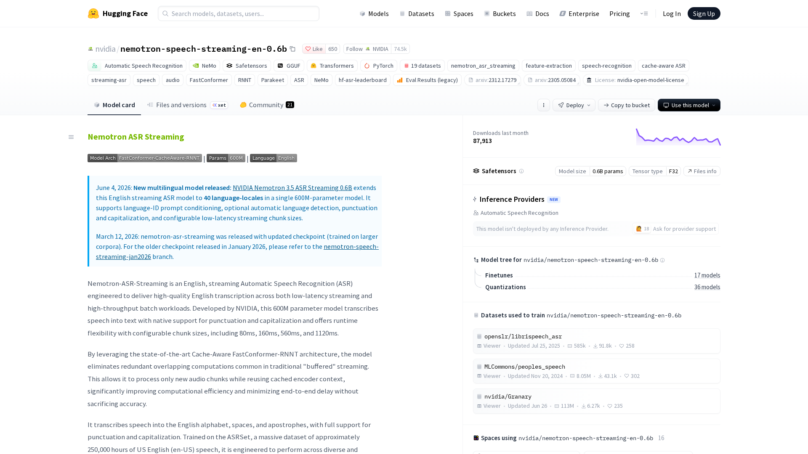
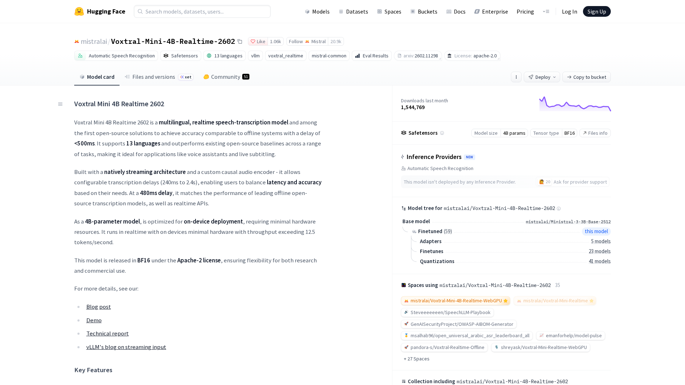
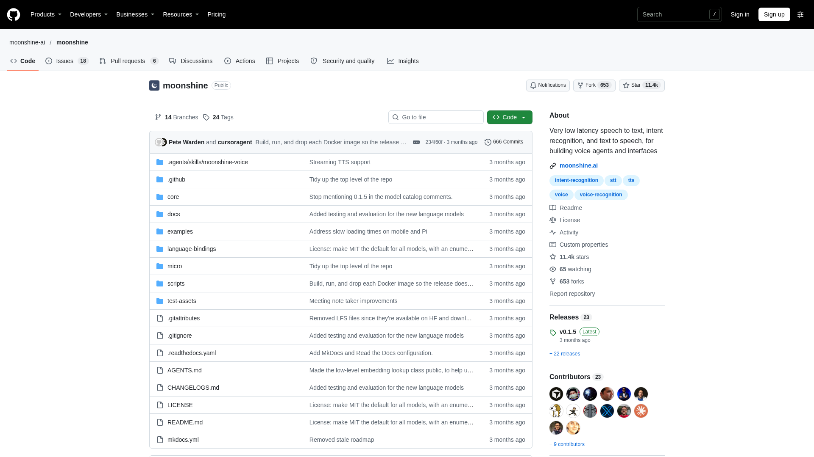
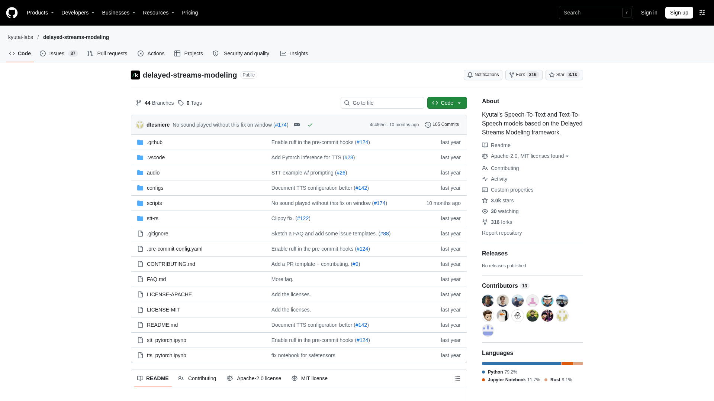
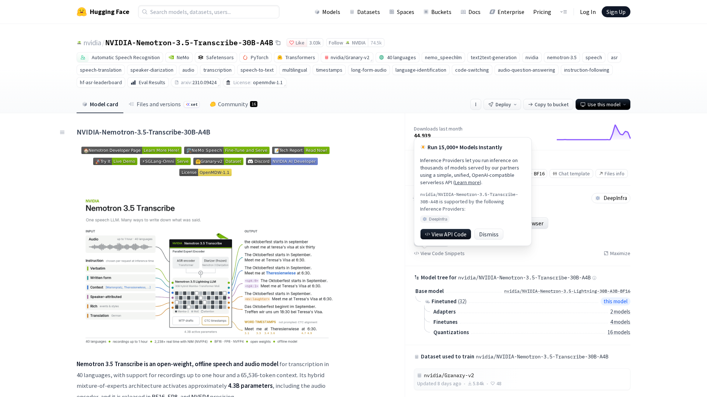
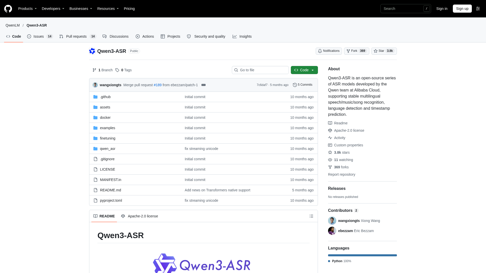
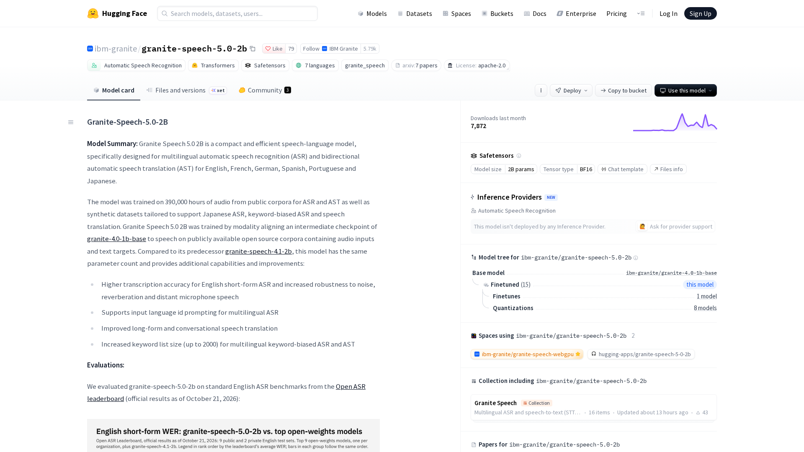
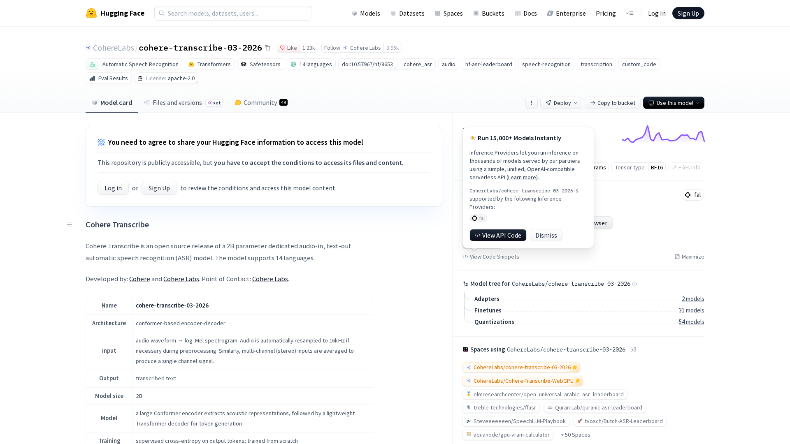
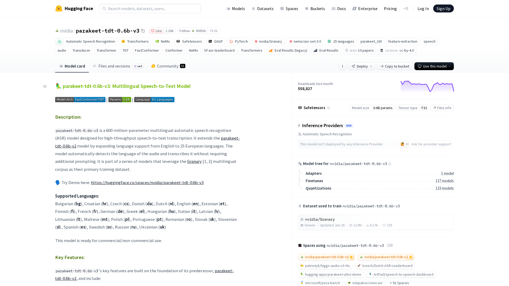
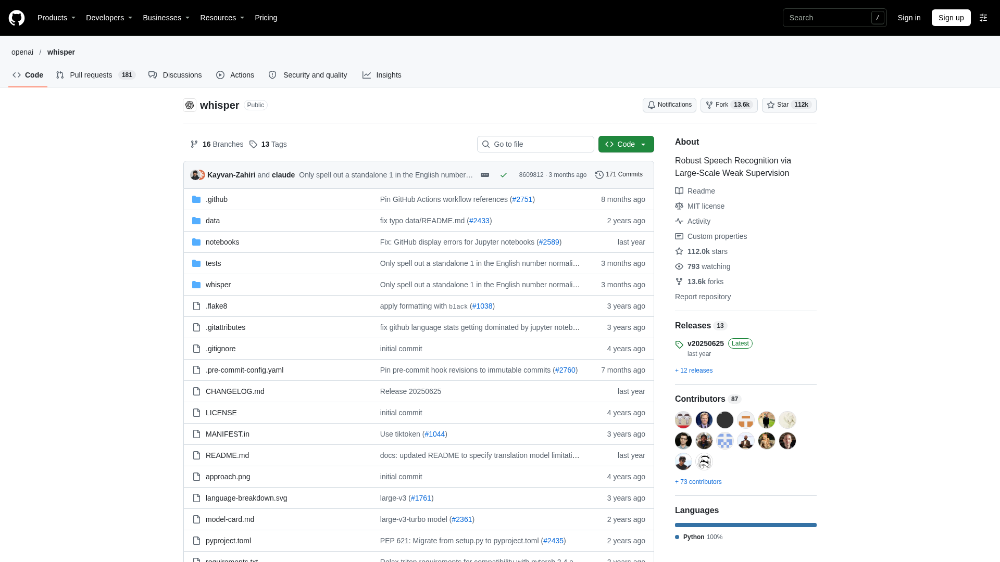

The best open source speech to text model for a real-time voice agent in November 2026 is NVIDIA's Nemotron Speech Streaming when you can run it on a GPU, and Moonshine when the transcription has to run on a CPU. Both transcribe while the user is still speaking, which most open models cannot do. Pipecat, an open source framework for voice agents, timed Nemotron's final English transcript at a median 221 ms after the user stopped speaking, the lowest median of everything it measured, hosted APIs included. Mistral's Voxtral Realtime and Kyutai STT are the two other streaming models in the ranking. For accuracy on a finished sentence, NVIDIA Nemotron 3.5 Transcribe and Alibaba's Qwen3-ASR lead the open models on the Hugging Face Open ASR Leaderboard, ahead of IBM Granite Speech, Cohere Transcribe, NVIDIA Parakeet and OpenAI Whisper. This ranking compares ten models with published weights on what a live agent needs from transcription: whether the model streams, its word error rate, the hardware it needs, its languages, and whether a company can ship the weights as published.

[Micdrop](/), which publishes this ranking, is an open source TypeScript library for real-time voice conversations with AI. It trains no model, so it stays out of the ranking. Micdrop integrates one of the ten models, Whisper, through [@micdrop/whisper](/docs/ai-integration/provided-integrations/whisper). Micdrop measured the Whisper checkpoints itself on a MacBook Pro M2. Voxtral Mini 3B, which Micdrop tested on the same machine, took about 16.6 seconds per sentence on its CPU, too slow for a call. Micdrop's hosted integrations include Mistral, whose API also serves Voxtral Mini Transcribe Realtime 3, a newer model than the open Voxtral weights ranked here.

Word error rates come from the [Open ASR Leaderboard](https://huggingface.co/spaces/hf-audio/open_asr_leaderboard), read on 5 November 2026. Licenses, sizes, dates and downloads come from each model card on the same day. Hosted APIs such as Deepgram and AssemblyAI have their own [ranking of speech to text APIs for voice agents](/blog/top-speech-to-text-apis-voice-agents). The browser's built-in recognition goes through the [Web Speech API](/blog/web-speech-api).

## How the models were ranked

Every model passed one gate first. Its published weights must let a company of any size use them in a commercial voice agent, with no revenue cap and no research-only clause. CC BY 4.0, which asks for attribution, and the NVIDIA Open Model License, which asks for a notice file, pass the gate. Strong models that fail it are listed apart, with [the license that blocks each one](#strong-models-whose-license-blocks-a-commercial-agent).

The models that passed then split into two groups.

- Streaming models transcribe the audio as it arrives, with a delay their publisher states, so the transcript is nearly ready when the user stops speaking. They come first, since a voice agent waits for that transcript before it answers. They are ranked by their average English word error rate on the Open ASR Leaderboard, which scores them offline like every other model. Moonshine and Kyutai STT are missing from the current board, so they come after the two streaming models it scores. Moonshine comes before Kyutai STT because it runs on an ordinary CPU, while Kyutai STT needs a GPU or Apple Silicon.
- Offline models transcribe a finished sentence, once voice activity detection has cut the audio. They are ranked by the same average English word error rate.

Two English-only models stay out of the ten despite low error rates. Distil-Whisper averages 7.55%, but it is a smaller copy of Whisper and each entry is a model family, so it counts as part of the Whisper entry. NVIDIA's Canary-Qwen averages 6.83%, but it needs a GPU and was trained on clips of up to 40 seconds, where Parakeet, from the same publisher, covers the same offline use on a CPU and in 25 languages. Both appear among the [other models worth knowing](#other-models-worth-knowing).

The leaderboard changed its method on 2 November 2026. It dropped LibriSpeech from its average and added harder sets, such as meetings, earnings calls, accented English and private conversational recordings. A word error rate quoted on a model card or in an older comparison is usually lower than the current one, so compare two models within one version of the board only. Normalization changes the score too, since [word error rate](/blog/what-is-automatic-speech-recognition#word-error-rate-and-what-it-hides) counts "8" against "eight" as a mistake unless both texts are normalized first. Proprietary APIs hold the first eight places of the English board, ahead of every open model. The multilingual average covers seven languages: six European ones and Hindi. The leaderboard's speed figure, RTFx, measures how much audio a datacenter GPU gets through in batches, which leaves out the delay on one short sentence.

## The comparison at a glance

| Model and publisher | Size | Weights license | Languages | Streams | English WER, Open ASR | Runs on |
|---|---|---|---|---|---|---|
| **Nemotron Speech Streaming**, NVIDIA | 0.6B | NVIDIA Open Model License (English), OpenMDW-1.1 (multilingual) | English, or 40 locales | Yes, chunks of 80 ms to 1.12 s | 7.37% (English model) | GPU, CPU through NeMo-Speech.cpp, sherpa-onnx |
| **Voxtral Mini 4B Realtime**, Mistral | 4B | Apache 2.0 | 13 | Yes, 80 ms to 2.4 s delay | 9.59% | GPU with 16 GB, vLLM |
| **Moonshine v2 Streaming**, Moonshine AI | 34M to 245M | MIT | English, and 7 others in streaming | Yes | Not on the board | CPU, sherpa-onnx, own C++ library |
| **Kyutai STT**, Kyutai | 1B and 2.6B | CC BY 4.0 | English and French (1B) | Yes, 0.5 s delay (1B) | Not on the board | GPU, Apple Silicon through MLX |
| **Nemotron 3.5 Transcribe**, NVIDIA | 30B, about 4B active | OpenMDW-1.1 | 40 | No | 6.10% | GPU, vLLM, SGLang |
| **Qwen3-ASR**, Alibaba | 0.6B and 1.7B | Apache 2.0 | 30, and 22 Chinese dialects | Through vLLM, no latency published | 6.14% (1.7B) | GPU, CPU for 0.6B through sherpa-onnx |
| **Granite Speech 5.0 2B**, IBM | 2.3B | Apache 2.0 | 6 | No | 6.59% | GPU, vLLM, llama.cpp, mlx-audio |
| **Cohere Transcribe**, Cohere | 2B | Apache 2.0 | 14 | No | 6.72% | GPU, Transformers.js on WebGPU, sherpa-onnx |
| **Parakeet TDT 0.6B**, NVIDIA | 0.6B | CC BY 4.0 | English (v2), 25 European (v3) | No | 6.91% (v2), 7.03% (v3) | GPU, CPU through sherpa-onnx |
| **Whisper**, OpenAI | 39M to 1.55B | MIT, Apache 2.0 for large-v3 | 99 | No, 30 second window | 8.18% (large-v3) | CPU, GPU, every runtime, Node through Transformers.js |

The board scores Whisper large-v3-turbo at 8.68%. Moonshine AI reports 6.65% for its Medium model on the eight datasets of the previous board method, a score that compares only with other scores from that method.

## The ranking

### 1. Nemotron Speech Streaming by NVIDIA



[Nemotron Speech Streaming](https://huggingface.co/nvidia/nemotron-speech-streaming-en-0.6b) is a 0.6B model that NVIDIA built for voice agents. It keeps what it has already heard in a cache and processes each new chunk of audio once, in chunks of 80, 160, 560 or 1120 ms that you pick when you start it. With a shorter chunk, the model answers sooner and makes more errors. NVIDIA gives 6.93% at 1.12 s and 8.43% at 80 ms on the previous board method. The English model is under the NVIDIA Open Model License, which allows commercial use with no revenue cap, asks you to ship a notice and ends if you remove the model's guardrails.

The [Pipecat speech to text benchmark](https://github.com/pipecat-ai/stt-benchmark) times 1,000 English turns from the end of speech to the final transcript. It measured NVIDIA's English Nemotron ASR at a median 221 ms and 238 ms at the 95th percentile, the lowest median in Pipecat's results, ahead of Deepgram Nova-3 at 247 ms and Soniox at 249 ms. Pipecat lists no hardware for the NVIDIA rows, so read the comparison with hosted APIs as a guide rather than a like-for-like test. Pipecat scored the word errors of the NVIDIA rows with an earlier judge and plans to score them again. The English model averages 7.37% on the Open ASR Leaderboard and had 87,913 downloads in the last 30 days.

The multilingual [Nemotron 3.5 ASR Streaming](https://huggingface.co/nvidia/nemotron-3.5-asr-streaming-0.6b), released in June 2026 under the permissive OpenMDW-1.1 license, covers 40 locales with language detection. It had 604,694 downloads in the last 30 days. It makes more errors in English, 10.85% on the board. NVIDIA itself recommends the English model for English calls. Pipecat measured it at a median 236 ms.

Both run in NVIDIA's NeMo toolkit and in sherpa-onnx, which has int8 exports for each chunk size. NVIDIA's NeMo-Speech.cpp runs the English model on a CPU, where NVIDIA states 27 ms of work per 160 ms chunk in `Q8_0`, about six times faster than real time.

### 2. Voxtral Mini 4B Realtime by Mistral



[Voxtral Mini 4B Realtime](https://huggingface.co/mistralai/Voxtral-Mini-4B-Realtime-2602) is Mistral's open weights streaming model, released on 4 February 2026 under Apache 2.0. It has about 4B parameters, a 3.4B language model behind a 970M audio encoder, and transcribes 13 languages. Its delay is a setting from 80 ms to 1.2 s in 80 ms steps, plus 2.4 s, with 480 ms as Mistral's recommended value. Mistral gives an average word error rate of 8.72% on the FLEURS multilingual set at 480 ms, 12.6% at 160 ms and 6.73% at 2.4 s.

It had 1.54 million downloads in the last 30 days, the most among the streaming models that Hugging Face counts. It averages 9.59% in English on the Open ASR Leaderboard and 9.36% across its multilingual set. Mistral serves the same model through its API, where the Pipecat benchmark measured a median 525 ms to the final transcript.

Mistral recommends vLLM, which exposes a `/v1/realtime` WebSocket on one GPU with at least 16 GB of memory. Transformers runs it too, as do Transformers.js through an ONNX export and community ports for Apple Silicon (mlx-audio) and plain C. The plain C port can run on a CPU, though nobody has published a CPU timing for it.

### 3. Moonshine v2 Streaming by Moonshine AI



[Moonshine](https://github.com/moonshine-ai/moonshine) comes from Moonshine AI, formerly Useful Sensors, which released its streaming models in January 2026 and described them in a February paper. Tiny has 34M parameters, Small 123M and Medium 245M. The encoder looks at a sliding window of audio with 80 ms of lookahead, so it works while the user speaks and skips Whisper's thirty second padding. Every streaming model is under MIT, the English ones as well as the Arabic, German, Japanese, Mandarin, Spanish, Tagalog and Vietnamese ones added in August 2026.

Moonshine AI publishes its own comparison with Whisper. It reports a delay of 59 ms for Medium and 38 ms for Small on a MacBook Pro, against 11,286 ms for Whisper large-v3. On a Linux x86 machine it reports 269 ms for Medium and 165 ms for Small, against about 17 seconds for Whisper large-v3. Medium takes 802 ms on a Raspberry Pi 5. Moonshine AI gives Medium a 6.65% word error rate on the previous board's datasets, against 7.44% for Whisper large-v3. These are vendor figures. The current board has no score for Moonshine to set against them.

Moonshine runs on a C++ core over ONNX Runtime, with bindings for Python, Swift, Android and C++. sherpa-onnx added the v2 models in version 1.12.28, its Node addon included. Each English model had about 50,000 downloads in the last 30 days, against about a hundred for each non-English one. Moonshine AI warns on the model card that the full transcript takes longer as the sentence grows, even when the first words come fast.

### 4. Kyutai STT by Kyutai



[Kyutai STT](https://github.com/kyutai-labs/delayed-streams-modeling) comes from Kyutai, a nonprofit AI lab in Paris, which published it in June 2025 under CC BY 4.0. `stt-1b-en_fr` transcribes English and French half a second behind the speaker, and has a voice activity detector built in that predicts when the user has finished their turn. `stt-2.6b-en` transcribes English only, 2.5 seconds behind. Both give a timestamp for each word. Kyutai's model card gives the 2.6B model a 6.4% average on the previous board method, a vendor figure.

Kyutai built the model for servers that carry many calls. It states that one H100 transcribes 400 streams in real time. The 1B model also runs on Apple Silicon through MLX, which Kyutai demonstrates on an iPhone 16 Pro. Kyutai's Rust `moshi-server` serves it over a WebSocket. PyTorch, candle and Transformers also run it. Hugging Face shows no download count for the main Kyutai STT repositories.

Kyutai's most recent speech to text model dates from 2025. Kyutai publishes no ONNX export, so sherpa-onnx and Transformers.js cannot run it. Neither model is on the current Open ASR Leaderboard. Gradium, the company founded by Kyutai's team, sells its own newer transcription model through an API and publishes no weights for it.

### 5. Nemotron 3.5 Transcribe by NVIDIA



[Nemotron 3.5 Transcribe](https://huggingface.co/nvidia/NVIDIA-Nemotron-3.5-Transcribe-30B-A4B), released by NVIDIA on 28 October 2026 under OpenMDW-1.1, has the lowest error rates of any open model on the Open ASR Leaderboard: 6.10% in English, 4.69% across the multilingual set and 10.52% on long recordings. It is a mixture of experts model with 30B parameters, about 4B of them active for each token, and transcribes 40 languages in recordings of up to an hour.

NVIDIA states on the model card that it is an offline model. It needs a datacenter GPU and suits a voice agent that transcribes every sentence once the user stops speaking. vLLM, SGLang and Transformers serve it. It has had 44,939 downloads since its release, a week before this ranking.

### 6. Qwen3-ASR by Alibaba



[Qwen3-ASR](https://github.com/QwenLM/Qwen3-ASR), released by Alibaba's Qwen team on 29 January 2026 under Apache 2.0, comes in 1.7B and 0.6B sizes. It recognizes 30 languages and 22 Chinese dialects, detects the language itself, and transcribes singing too. The 1.7B model averages 6.14% in English on the Open ASR Leaderboard, the best score of any Apache 2.0 model, and 6.56% across the multilingual set. The 0.6B model averages 6.99%.

The 1.7B model had 1.65 million downloads in the last 30 days, the most of any model here after Whisper. The same weights transcribe offline or in streaming. Streaming works only through vLLM, without batching or timestamps, and with no delay published by Alibaba. Streaming raises the error rate of the 1.7B model from 2.69% to 3.33% on Alibaba's own test sets.

Qwen3-ASR writes its transcript with a language model, one token at a time, so a longer sentence takes longer. Alibaba's `qwen-asr` package runs it on vLLM or Transformers behind an OpenAI-compatible server. sherpa-onnx runs the 0.6B model in int8 from version 1.12.34, with a Node API and lists of words to favor. That makes 0.6B the size to try on a CPU.

### 7. Granite Speech 5.0 by IBM



[Granite Speech 5.0 2B](https://huggingface.co/ibm-granite/granite-speech-5.0-2b) is IBM's newest open transcription model, published in October 2026 under Apache 2.0. The model has 2.3B parameters, transcribes English, French, German, Spanish, Portuguese and Japanese, and translates speech too. It averages 6.59% in English on the Open ASR Leaderboard and had 7,872 downloads in the last 30 days.

Keyword biasing is its most useful feature for a voice agent. The model favors the terms you pass it when it hears them, up to 2,000 of them, such as product names or surnames. IBM recommends segments of up to about two minutes, far longer than one turn of a call. Transformers, Transformers.js, vLLM, llama.cpp and mlx-audio on Apple Silicon run it. For the GGUF files llama.cpp uses, IBM recommends `Q8_0`.

IBM also publishes a 470M CTC model, granite-speech-5.0-470m-turboctc, under Apache 2.0 for seven languages. Its English version averages 7.34% and runs at 21,435 times real time on the board's GPU, the highest throughput on the board. Its CTC decoder writes every word in one pass, a design that suits a CPU, though nobody has published a CPU figure for it yet. A variant with the `-nc` suffix is non-commercial, so check the name before you download it.

### 8. Cohere Transcribe by Cohere



[Cohere Transcribe](https://huggingface.co/CohereLabs/cohere-transcribe-03-2026) is a 2B model that Cohere published in March 2026 under Apache 2.0, behind a click-through form that Hugging Face approves automatically. It pairs a large Conformer encoder with a small decoder and transcribes 14 languages. It averages 6.72% in English on the Open ASR Leaderboard. It also has low error rates in European languages on the board's multilingual tab: 2.81% in Spanish, 2.97% in Italian, 3.10% in German and 4.02% in French.

You have to give it the language of the audio, since it has no language detection. It returns no timestamps or speaker labels either. It also tries to transcribe noise, so Cohere recommends voice activity detection in front of it, which a voice agent already has.

Cohere Transcribe has one of the widest sets of runtimes among the 2026 models: Transformers, vLLM, mlx-audio, sherpa-onnx in int8, a Rust port, GGUF files, and Transformers.js on WebGPU, which Cohere demonstrates in a browser tab. It had 98,455 downloads in the last 30 days.

### 9. Parakeet TDT 0.6B by NVIDIA



[Parakeet TDT 0.6B](https://huggingface.co/nvidia/parakeet-tdt-0.6b-v3) is an offline transcription model from NVIDIA under CC BY 4.0. Version 2, from May 2025, transcribes English. Version 3, from August 2025, transcribes 25 European languages and detects which one it hears. v2 averages 6.91% in English on the Open ASR Leaderboard and v3 7.03%. Version 3 makes 5.38% word errors in French on the board. Parakeet has the highest throughput of the ranked models apart from IBM's 470M CTC model, more than 6,000 times real time on the board's GPU.

Parakeet reads the audio at its real length and writes punctuation and timestamps. Version 3 had 558,827 downloads in the last 30 days. sherpa-onnx publishes official int8 exports of both versions, its Node addon included. [Community users report](https://github.com/groxaxo/parakeet-tdt-0.6b-v3-fastapi-openai) the int8 build at 18 to 30 times real time on a desktop CPU. Transformers.js also lists the architecture. NVIDIA's NeMo-Speech.cpp runs v3 from GGUF files.

Parakeet transcribes a finished sentence. NVIDIA reports on the card of its parakeet-unified model that v2 makes 22.8% word errors when fed 1.12 second chunks to imitate streaming. Pair Parakeet with voice activity detection, which cuts the audio into sentences. You can [run Parakeet in Node](/blog/local-speech-to-text-node) through `sherpa-onnx-node`.

### 10. Whisper by OpenAI



[Whisper](https://github.com/openai/whisper) is the open model everyone else compares against. large-v3-turbo had 5.5 million downloads in the last 30 days and large-v3 3.5 million, more than any other model here. OpenAI's code and most checkpoints are under MIT, with large-v3 under Apache 2.0. The five sizes run from 39M parameters for `tiny` to 1.55B for `large-v3`. Whisper transcribes 99 languages and translates them into English. large-v3-turbo, from October 2024, is still OpenAI's latest open checkpoint.

Whisper reads every sentence as a thirty second window, padding a two second answer with silence, so a short sentence costs almost as much as a long one. Micdrop measured about 320 ms for `tiny`, 440 ms for `base`, 1000 ms for `small` and 3800 ms for `turbo` on a three second sentence, on a MacBook Pro M2 CPU, through Transformers.js and ONNX Runtime with `q8` weights already loaded. Whisper large-v3 averages 8.18% in English on the Open ASR Leaderboard, and turbo 8.68%. Outside English, fine-tuning on one language can matter more than size. On five French test sentences, the French `whisper-small` made 2% word errors, where `turbo` made 17%.

Whisper also invents words on silence and noise. Allison Koenecke, then at Cornell University, and her coauthors found hallucinated phrases in about 1% of transcriptions in a 2024 study. No comparable study covers the newer models yet. Whisper still has the widest set of runtimes: faster-whisper, whisper.cpp, sherpa-onnx, MLX, and Transformers.js, which runs it inside Node or a browser. [@micdrop/whisper](/docs/ai-integration/provided-integrations/whisper) runs it inside the Node process through Transformers.js.

## Other models worth knowing

- [Distil-Whisper distil-large-v3.5](https://huggingface.co/distil-whisper/distil-large-v3.5), MIT, transcribes English only with 756M parameters and averages 7.55% on the board, better than Whisper large-v3. It keeps Whisper's thirty second window and runs wherever Whisper runs, ONNX for Transformers.js included.
- [Canary-Qwen 2.5B](https://huggingface.co/nvidia/canary-qwen-2.5b) from NVIDIA, CC BY 4.0, averages 6.83% in English. It transcribes English only, was trained on clips of up to 40 seconds, and runs mostly in NeMo on a GPU. [Canary 1B v2](https://huggingface.co/nvidia/canary-1b-v2) transcribes 25 European languages and translates them.
- [Vosk](https://alphacephei.com/vosk/) from Alpha Cephei streams in 32 languages with small models of 31 to 82 MB that run on a Raspberry Pi. On conversations it makes far more errors than the ranked models, 29.78% on call center audio for the large English model by its publisher's figures. Its npm package was last published in 2022. Some of its models also carry non-commercial or AGPL licenses. Vosk streams on the same small devices as Mozilla's discontinued DeepSpeech, which has [a replacement for each of its uses](/blog/deepspeech-alternatives) among the models ranked here.
- [Omnilingual ASR](https://github.com/facebookresearch/omnilingual-asr) from Meta, Apache 2.0, transcribes more than 1,600 languages. Most models read up to 40 seconds and none streams. Pick it for a language no other model covers.
- [Fun-ASR-Nano](https://huggingface.co/FunAudioLLM/Fun-ASR-Nano-2512) from Alibaba's Tongyi Lab, Apache 2.0, transcribes Chinese, English and Japanese and averages 8.23% in English. sherpa-onnx and llama.cpp run it.
- [VibeVoice-ASR](https://huggingface.co/microsoft/VibeVoice-ASR) from Microsoft, MIT, transcribes an hour of audio in one pass with speaker labels, which suits meeting recordings more than calls. Microsoft's Phi-4-multimodal, also MIT, transcribes speech as part of a general 5.6B language model.

## Strong models whose license blocks a commercial agent

- Moonshine's older non-English models, in Arabic, Japanese, Korean, Mandarin, Spanish, Ukrainian and Vietnamese, are under the Moonshine Community License. It ends for a company above US$1 million of annual revenue and asks for a "Powered by Moonshine AI" mention. The newer streaming models are MIT.
- [MMS](https://huggingface.co/facebook/mms-1b-all) from Meta, which transcribes 1,162 languages, is CC BY-NC 4.0. Omnilingual ASR covers more languages under Apache 2.0.
- IBM's granite-speech-5.0-470m-turboctc-nc is CC BY-NC-SA 4.0, unlike the Apache 2.0 model of almost the same name.
- [SenseVoice Small](https://huggingface.co/FunAudioLLM/SenseVoiceSmall) from Alibaba detects emotions and, by Alibaba's figures, processes 10 seconds of audio in 70 ms. Its custom FunASR Model License calls the model "for reference and learning purposes only" and ends if you disparage it, so ask a lawyer before you ship it.
- Several Vosk models are CC BY-NC-SA, among them a small French model and the Dutch one.

## How to run them

A runtime is the engine that loads the weights and runs them on your hardware. Several runtimes run the same model, at different speeds and from different programming languages.

| Runtime | What it runs | From Node |
|---|---|---|
| [sherpa-onnx](https://github.com/k2-fsa/sherpa-onnx) | Nemotron streaming, Moonshine v2, Parakeet, Qwen3-ASR 0.6B, Cohere Transcribe, Fun-ASR-Nano, Whisper, SenseVoice, with voice activity detection | Yes, `sherpa-onnx-node` addon |
| [Transformers.js](https://huggingface.co/docs/transformers.js) | Whisper, Distil-Whisper, Moonshine v1, Parakeet, Granite Speech, Cohere Transcribe, Voxtral Realtime | Yes, in process, also in the browser |
| [whisper.cpp](https://github.com/ggml-org/whisper.cpp) | Whisper and Distil-Whisper, on CPU, Metal, CUDA or Vulkan | Through an addon or `nodejs-whisper` |
| [faster-whisper](https://github.com/SYSTRAN/faster-whisper) | Whisper and Distil-Whisper on CTranslate2, int8 on CPU | Python service |
| vLLM | Voxtral Realtime, Qwen3-ASR streaming, Nemotron 3.5 Transcribe, Granite Speech, Cohere Transcribe | Over HTTP or a WebSocket |
| NeMo and NeMo-Speech.cpp | Parakeet, Canary and the Nemotron streaming models, NeMo-Speech.cpp on CPU from GGUF | Python service, or a native binary |
| MLX, mlx-audio, parakeet-mlx | Whisper, Parakeet, Kyutai STT, Voxtral Realtime, Granite Speech, Cohere Transcribe on Apple Silicon | Python service |

You can [run Whisper, Vosk, Moonshine or Parakeet locally in Node](/blog/local-speech-to-text-node), each with its own install steps and code.

## How to choose between them

Start with the language. For an English agent, every ranked model qualifies. Voxtral Realtime and Nemotron 3.5 ASR Streaming stream French, German and Spanish, while Nemotron 3.5 Transcribe, Cohere Transcribe, Parakeet v3, Granite Speech and Qwen3-ASR transcribe them offline. Kyutai STT streams French and English only. For a language outside Europe, check Qwen3-ASR, Nemotron 3.5 Transcribe, Cohere Transcribe, Whisper and Omnilingual ASR. Moonshine streams Arabic, Japanese, Mandarin, Tagalog and Vietnamese on a CPU. A [multilingual voice agent](/blog/multilingual-voice-agent) also needs a voice and a language model that switch to the caller's language.

Then decide whether you need streaming. A voice agent waits for the final transcript of each sentence before it answers. A streaming model has most of that transcript ready when the user stops, while an offline model starts once voice activity detection has closed the sentence. In Micdrop, the browser detects the end of speech and the server sends the finished sentence to the speech to text model, so an offline model fits as long as it is fast on a short sentence. Whisper is the slow case, because it pads that sentence to thirty seconds.

Look at where the model runs. Moonshine, the Nemotron streaming model through NeMo-Speech.cpp, Parakeet and Qwen3-ASR 0.6B through sherpa-onnx, and the small Whisper checkpoints all run on a CPU next to your app. Nemotron 3.5 Transcribe and Qwen3-ASR 1.7B are the most accurate models for a GPU server. Voxtral Realtime needs one too and streams 13 languages. The leaderboard's error rates come from benchmark audio, so test the models on your own calls, with names, numbers and the accents of your users.

In Micdrop, a speech to text model is one option of `MicdropServer`. Here Whisper runs in the Node process, with [`FallbackSTT`](/docs/ai-integration/fallback-strategies/stt-fallback) switching to a hosted API when the local model fails and replaying the audio of the sentence in progress:

```typescript
import { MicdropServer, FallbackSTT } from '@micdrop/server'
import { GladiaSTT } from '@micdrop/gladia'
import { WhisperSTT } from '@micdrop/whisper'

const stt = new FallbackSTT({
  factories: [
    () => new WhisperSTT({ model: 'base', language: 'en' }),
    () => new GladiaSTT({ apiKey: process.env.GLADIA_API_KEY || '' }),
  ],
})

new MicdropServer(socket, {
  stt,
  // ... agent and tts
})
```

The other models plug into the same option once you [write a custom speech to text integration](/docs/ai-integration/custom-integrations/custom-stt), a class that wraps their runtime with a `transcribe()` method emitting a `Transcript` event. A model running on sherpa-onnx, such as Moonshine or Parakeet, fits in one such class. Transcription can also run [on the user's device, inside the browser](/blog/on-device-ai-voice-agent).

## Frequently asked questions

<FaqList>
  <FaqItem question="What is the best open source speech to text model in 2026?">
    For a real-time voice agent, NVIDIA Nemotron Speech Streaming transcribes while the user speaks and returned its final English transcript a median 221 ms after speech ended on the Pipecat benchmark, under the NVIDIA Open Model License. On a CPU, Moonshine v2 streams under MIT. For accuracy on finished sentences, NVIDIA Nemotron 3.5 Transcribe averages 6.10% English word errors on the Hugging Face Open ASR Leaderboard of November 2026, and Qwen3-ASR 1.7B 6.14% under Apache 2.0.
  </FaqItem>
  <FaqItem question="Is Whisper still the best open source speech to text model?">
    Whisper is the most used, with 5.5 million downloads of large-v3-turbo in a month, and the easiest to run from any language. It is no longer the most accurate. On the Open ASR Leaderboard of November 2026, large-v3 averages 8.18% English word errors, against 6.10% for Nemotron 3.5 Transcribe and 6.14% for Qwen3-ASR 1.7B. Whisper also pads every sentence to thirty seconds, which makes short answers slow on a CPU.
  </FaqItem>
  <FaqItem question="Which open source speech to text models support streaming?">
    NVIDIA Nemotron Speech Streaming, Mistral Voxtral Mini 4B Realtime, Moonshine v2 and Kyutai STT transcribe audio as it arrives, with a delay their publishers state. Qwen3-ASR streams through vLLM without a published delay. Vosk streams too, with lower accuracy. Whisper, Parakeet, Canary, Cohere Transcribe, Granite Speech and Nemotron 3.5 Transcribe transcribe a finished segment.
  </FaqItem>
  <FaqItem question="Which open source speech to text model runs best on a CPU?">
    Moonshine v2 was built for CPUs and phones. Its publisher reports 269 ms for the Medium model on a Linux x86 machine, against about 17 seconds for Whisper large-v3. Parakeet and Qwen3-ASR 0.6B run in int8 through sherpa-onnx, and NVIDIA runs Nemotron Speech Streaming on a CPU through NeMo-Speech.cpp. Whisper base took about 440 ms on a three second sentence on a MacBook Pro M2 CPU.
  </FaqItem>
  <FaqItem question="Can I use open source speech to text models commercially?">
    The ten ranked models allow commercial use by any company. Whisper and Moonshine v2 are under MIT, with Whisper large-v3 under Apache 2.0 like Qwen3-ASR, Granite Speech, Cohere Transcribe and Voxtral Realtime. Parakeet and Kyutai STT are CC BY 4.0, which asks for attribution. The NVIDIA Nemotron models are under OpenMDW-1.1 or, for the English streaming model, the NVIDIA Open Model License, which ends if you remove the model's guardrails. Meta's MMS and some Vosk models are non-commercial, while Moonshine's older non-English models stop being free above US$1 million of annual revenue.
  </FaqItem>
  <FaqItem question="Which open source speech to text model is the most accurate?">
    On the Hugging Face Open ASR Leaderboard of November 2026, NVIDIA Nemotron 3.5 Transcribe has the lowest average among open models, 6.10% in English and 4.69% across seven languages. Qwen3-ASR 1.7B follows at 6.14% in English, then IBM Granite Speech 5.0 2B at 6.59% and Cohere Transcribe at 6.72%. Proprietary APIs still hold the first eight places of the English board.
  </FaqItem>
  <FaqItem question="Can I run open source speech to text in Node.js?">
    Yes. Transformers.js runs Whisper, Parakeet, Cohere Transcribe and other models inside the Node process, which is how @micdrop/whisper runs Whisper. The sherpa-onnx-node addon runs Moonshine v2, Parakeet, Qwen3-ASR 0.6B and the Nemotron streaming models. Models that need a GPU, such as Voxtral Realtime or Nemotron 3.5 Transcribe, run in vLLM, which your Node server calls over HTTP or a WebSocket.
  </FaqItem>
  <FaqItem question="Which open source speech to text model is best for French?">
    Cohere Transcribe averages 4.02% word errors in French on the Open ASR Leaderboard, and Parakeet v3 5.38%. For a live call, Kyutai STT 1B streams French and English with half a second of delay, and Voxtral Realtime streams French among 13 languages. A Whisper small checkpoint fine-tuned on French made 2% word errors on five test sentences on a MacBook Pro M2, against 17% for large-v3-turbo.
  </FaqItem>
</FaqList>

## Getting started

Pick Nemotron Speech Streaming for an English agent that has to answer fast on a GPU, Voxtral Realtime to stream more languages, and Moonshine to stream on a CPU. Pick Qwen3-ASR or Nemotron 3.5 Transcribe when accuracy on a finished sentence matters more, and Whisper when you want the model that runs everywhere, Node included.

Whichever model you choose, record a few of your own calls, names and numbers included, and time the final transcript on the machine you will deploy to. Micdrop runs Whisper from Node next to a local language model and a local voice, so you can [run the whole voice pipeline on your own machine](/docs/ai-integration/local-models) and read [what each step costs in latency and memory](/docs/ai-integration/local-models/performance). The agent's voice has its own [ranking of open source text to speech models](/blog/top-open-source-text-to-speech-models). Then [start a first voice call in about five minutes](/docs/getting-started).

<RankingJsonLd
  name="Best open source speech to text models in 2026"
  description="Open weights speech to text models ranked for real-time voice agents in November 2026, on commercial license, streaming, word error rate and hardware."
>
  <RankingEntry name="Nemotron Speech Streaming (NVIDIA)" url="https://huggingface.co/nvidia/nemotron-speech-streaming-en-0.6b" />
  <RankingEntry name="Voxtral Mini 4B Realtime (Mistral)" url="https://huggingface.co/mistralai/Voxtral-Mini-4B-Realtime-2602" />
  <RankingEntry name="Moonshine v2 Streaming (Moonshine AI)" url="https://github.com/moonshine-ai/moonshine" />
  <RankingEntry name="Kyutai STT (Kyutai)" url="https://github.com/kyutai-labs/delayed-streams-modeling" />
  <RankingEntry name="Nemotron 3.5 Transcribe (NVIDIA)" url="https://huggingface.co/nvidia/NVIDIA-Nemotron-3.5-Transcribe-30B-A4B" />
  <RankingEntry name="Qwen3-ASR (Alibaba)" url="https://github.com/QwenLM/Qwen3-ASR" />
  <RankingEntry name="Granite Speech 5.0 (IBM)" url="https://huggingface.co/ibm-granite/granite-speech-5.0-2b" />
  <RankingEntry name="Cohere Transcribe (Cohere)" url="https://huggingface.co/CohereLabs/cohere-transcribe-03-2026" />
  <RankingEntry name="Parakeet TDT 0.6B (NVIDIA)" url="https://huggingface.co/nvidia/parakeet-tdt-0.6b-v3" />
  <RankingEntry name="Whisper (OpenAI)" url="https://github.com/openai/whisper" />
</RankingJsonLd>
