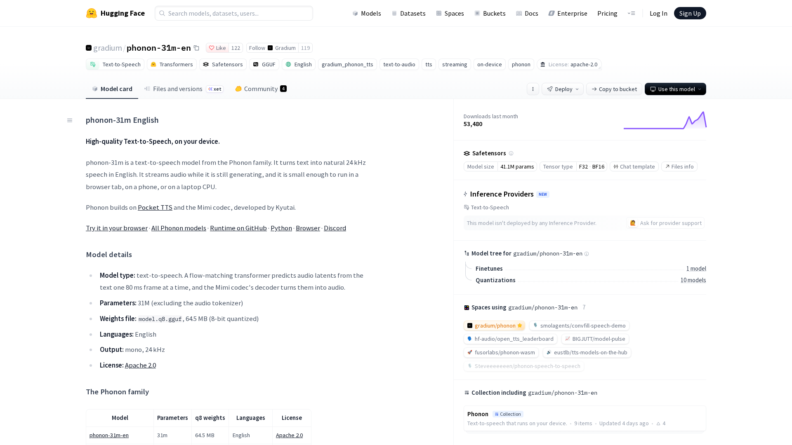
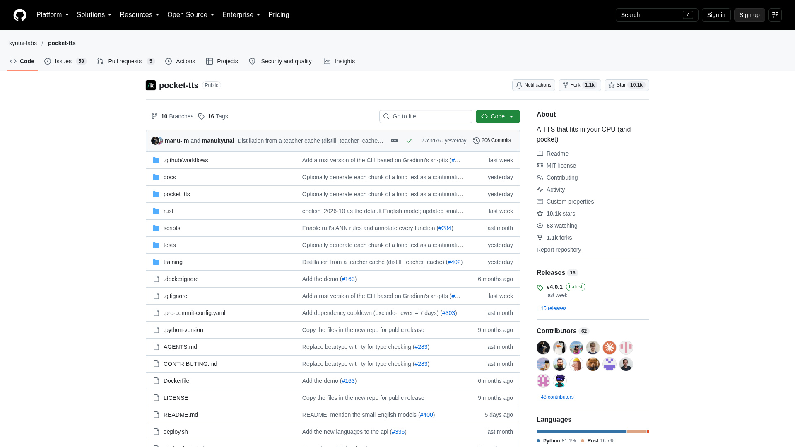
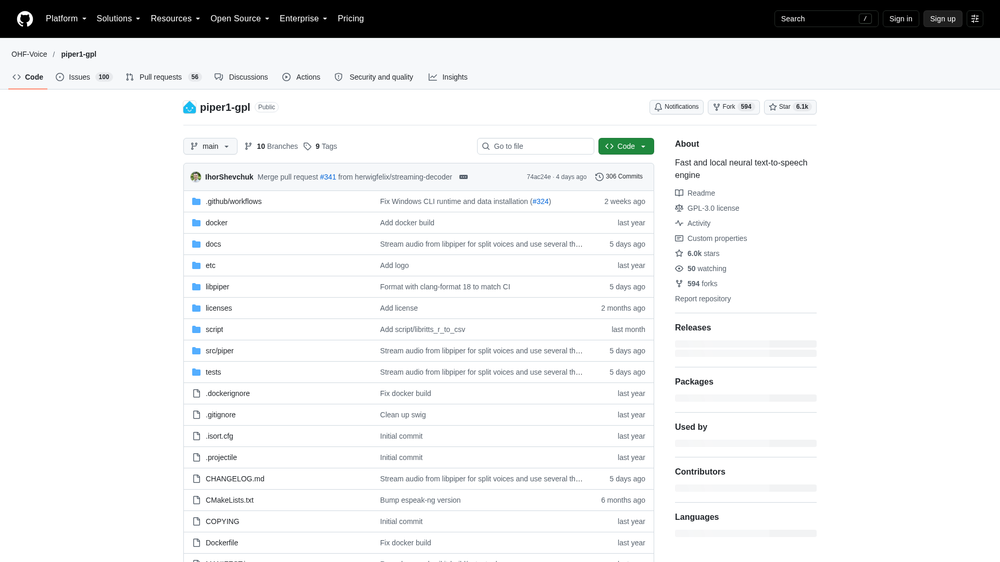
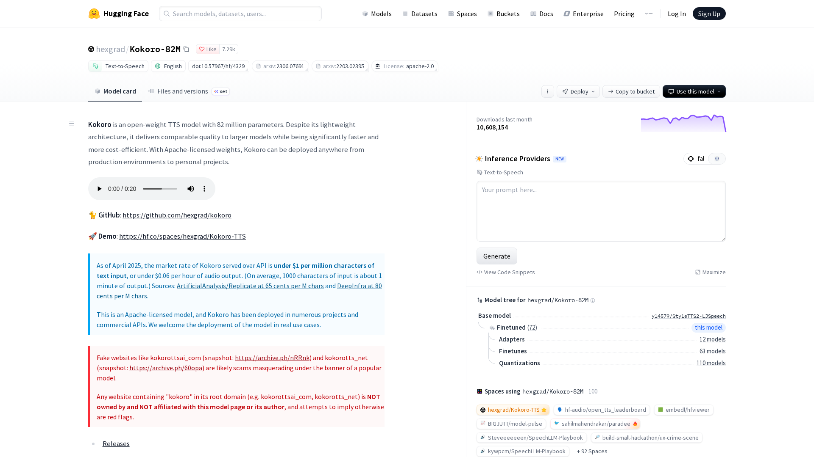
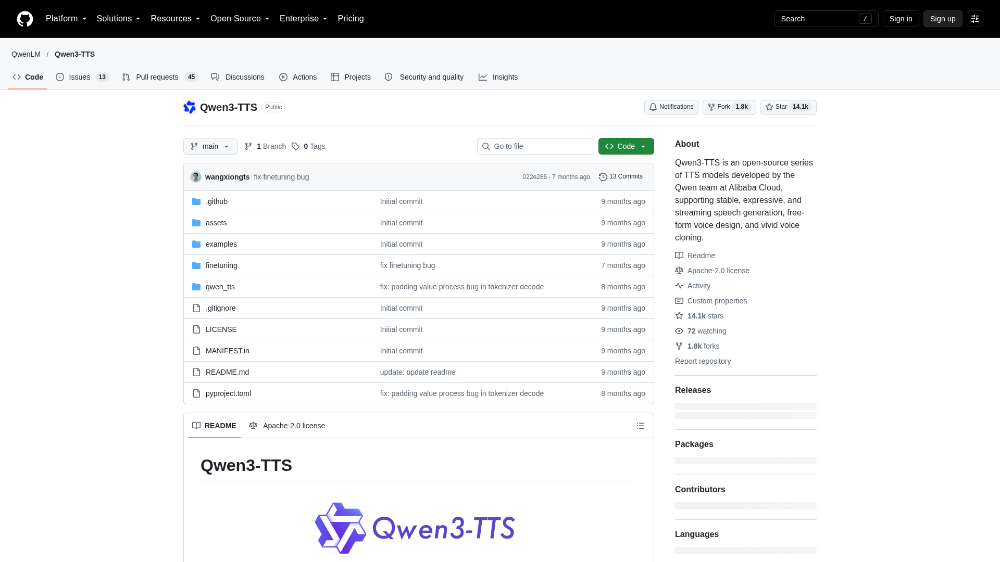
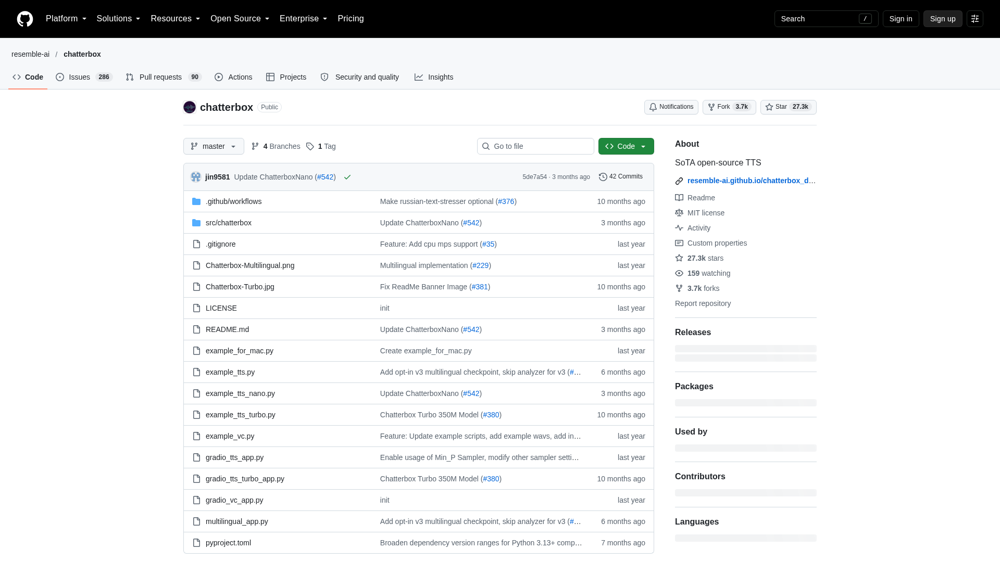
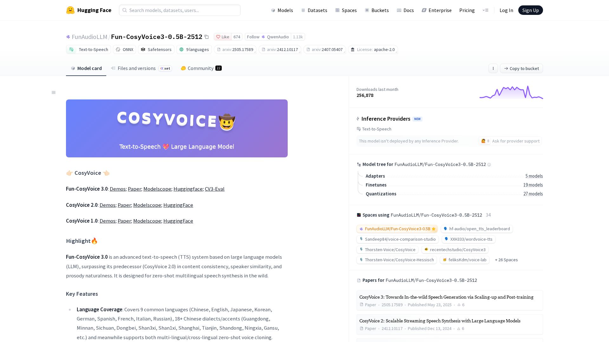
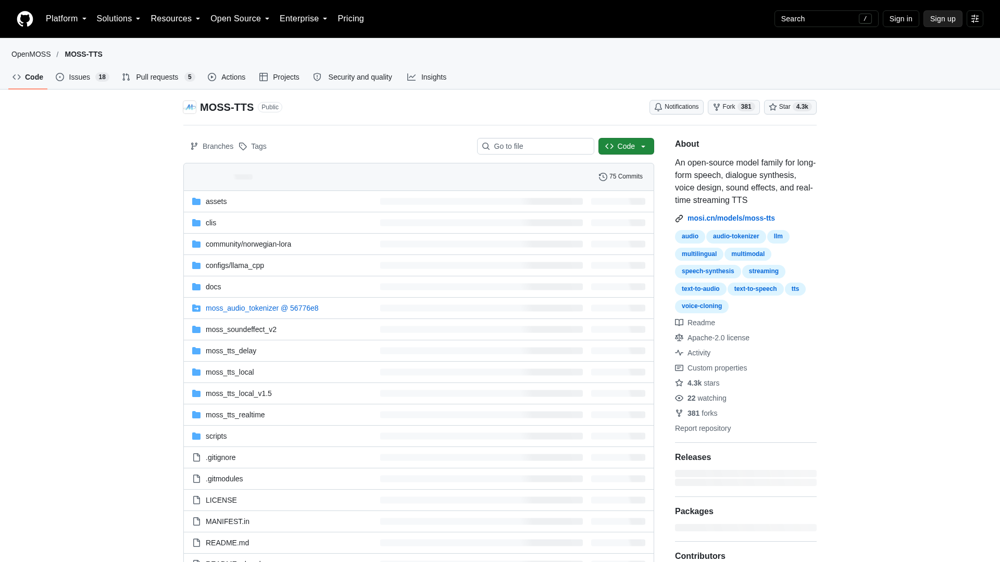
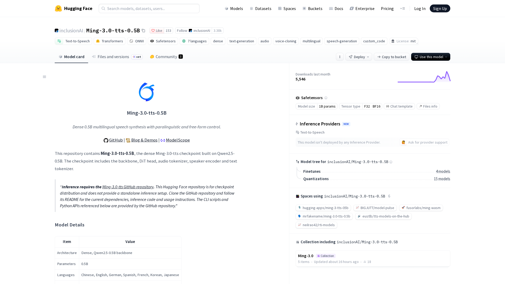
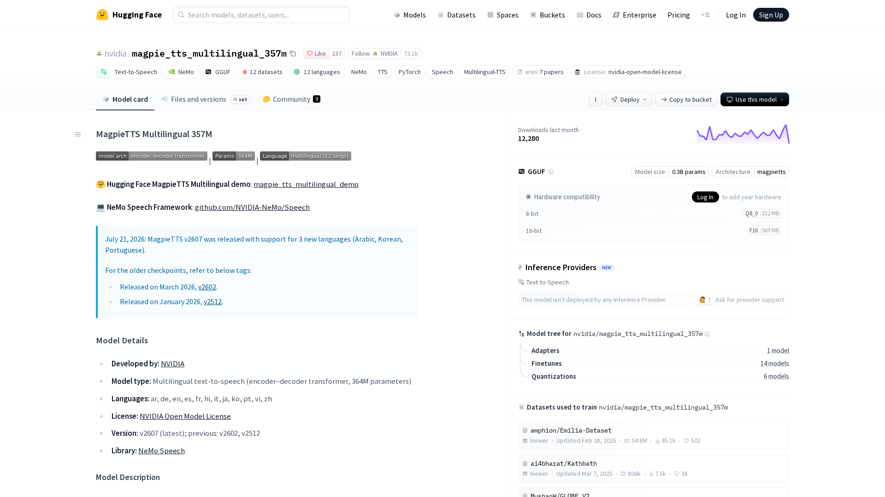

The best open source text to speech model for a real-time voice agent in October 2026 is Phonon 31M when the voice runs on a CPU, and Qwen3-TTS when you can give it a GPU. Phonon, which the Paris voice company Gradium released on 20 October, started speaking 30 to 100 ms after it received a sentence, on one CPU core of a MacBook Pro M2. It speaks English and is licensed Apache 2.0. Qwen3-TTS from Alibaba reads ten languages and clones a voice from three seconds of audio. Alibaba measured its first audio after about 100 ms on a GPU. Pocket TTS, Piper and Kokoro complete the CPU models. Chatterbox, CosyVoice 3, MOSS-TTS-Realtime, Ming-3.0-tts and NVIDIA's Magpie complete the GPU models. This ranking compares ten models with published weights on what the voice of a live agent needs: the delay before the first sound, whether the model streams, the hardware it needs, languages, voice cloning and whether a company can ship the weights as published.

[Micdrop](/), which publishes this ranking, is an open source TypeScript library for real-time voice conversations with AI. It trains no model, so it stays out of the ranking. Micdrop ships integrations for five of the ranked models, Phonon, Pocket TTS, Piper, Kokoro and Qwen3-TTS, and measured all five itself on the same laptop. Those five also hold the top five places, so keep that in mind when you read how the models were ranked. Micdrop also integrates Gradium's hosted voices.

Benchmark scores come from the Artificial Analysis leaderboard, read on 27 October 2026. Model sizes, licenses and vendor latencies come from each model card or repository on the same day. Hosted text to speech APIs such as ElevenLabs and Cartesia stay out, and so does the browser's built-in `speechSynthesis`, since neither publishes weights you can run.

## How the models were ranked

Every model passed one gate first. Its published weights must let a company of any size use them in a commercial voice agent, with no revenue cap, no user cap and no research-only clause. Pocket TTS, which asks for attribution, and Piper, whose engine is copyleft, pass the gate. Strong models that fail it are listed apart, with [the license that blocks each one](#strong-models-whose-license-blocks-a-commercial-agent).

The models that passed then split into a CPU group and a GPU group. A model joins the CPU group when it streams in real time on a laptop CPU, and the GPU group when its publisher targets GPUs, as NVIDIA does for Magpie. The CPU group comes first in the ranking, since a model that runs next to your app saves you a GPU server.

- **CPU models** are ranked by the delay before the first sound, measured by Micdrop on one MacBook Pro M2 with 24 GB of memory, with the model already loaded. A range counts by its middle, so Pocket TTS at 250 to 430 ms comes before Piper at about 390 ms. The [measurement setup and every figure](/docs/ai-integration/local-models/performance) are published. CPU models that Micdrop did not measure on that laptop are listed among the [other small models that run on a CPU](#other-small-models-that-run-on-a-cpu), with the figures their publisher or a third party gives.
- **GPU models** are ranked by the first audio delay their publisher states for a single stream. A model whose publisher states none comes after, ordered by its Artificial Analysis score.

The latency that ranks each GPU model is its vendor's own figure for one request at a time, often measured on a datacenter GPU the vendor does not always name. Independent tests often find slower numbers. On an NVIDIA L4, users of the vLLM-Omni server reported 164 ms for Qwen3-TTS once tuned, and two to three seconds before tuning.

## TTS leaderboards in October 2026

[Artificial Analysis](https://artificialanalysis.ai/text-to-speech/leaderboard) runs the most useful public leaderboard for open models. Listeners compare two voices reading the same text and vote for one. The votes give each model an Elo score, with Zyphra's open Zonos model fixed at 1000. On 27 October 2026 it listed 98 models, 18 of them with open weights. ElevenLabs Eleven v4 led the board at 1336. The best open model, Fish Audio Drama 3 Preview, scored 1245, and Ming-3.0-tts led the open models a company can ship freely, at 1188. Kokoro scored 1061 and Chatterbox 1023. Phonon, Pocket TTS, Piper and the open Qwen3-TTS weights have no score there yet.

The [TTS Arena](https://huggingface.co/spaces/TTS-AGI/TTS-Arena-V2) on Hugging Face now ranks mostly hosted APIs. Kokoro, the best known model it marks as open, is 32nd with an Elo of 1464. The arena no longer collects votes for it, so that score no longer changes.

So for the small CPU models, the only side by side comparisons come from vendors. Gradium published a blind listening test and a word error test of Phonon against Pocket TTS, Kokoro, NeuTTS and Magpie. Picovoice, which sells a closed on-device voice, published a CPU latency test of nine engines. This ranking cites both with their source.

## The comparison at a glance

| Model and publisher | Size | Weights license | Languages | Voice cloning | First audio | Runs on | Artificial Analysis Elo |
|---|---|---|---|---|---|---|---|
| **Phonon 31M**, Gradium | 31M | Apache 2.0 (40M models CC BY-NC 4.0) | English (five with the 40M models) | Through Gradium's API, then local | 30 to 100 ms, M2 CPU, one core | CPU, WebAssembly, Rust, Python, Swift | Not scored |
| **Pocket TTS**, Kyutai | 100M, and English models from 1.9M to 18.2M | CC BY 4.0 | 7 | Yes, from a short recording | 250 to 430 ms, M2 CPU | CPU, Python, ONNX | Not scored |
| **Piper**, Open Home Foundation | 21 to 137 MB per voice | GPL-3.0 engine, each voice licensed separately | 53 | No | About 390 ms, M2 CPU | CPU, binary, Python, C++ | Not scored |
| **Kokoro 82M**, hexgrad | 82M | Apache 2.0 | 9 upstream, English in `kokoro-js` | No | 900 to 1300 ms, M2 CPU, whole sentence | CPU, ONNX, Transformers.js | 1061 |
| **Qwen3-TTS**, Alibaba | 0.6B and 1.7B | Apache 2.0 | 10 | Yes, from 3 seconds | 97 to 101 ms (Alibaba, GPU not named) | GPU, vLLM-Omni, mlx-audio | Not scored |
| **Chatterbox**, Resemble AI | 110M to 0.5B | MIT | English, at least 23 in Multilingual V3 | Yes, from 5 to 10 seconds | 118 ms for Flash (Resemble, GPU not named) | GPU, Python, ONNX for Turbo | 1023 |
| **CosyVoice 3**, Alibaba Tongyi Lab | 0.5B | Apache 2.0 | 9, and 18 Chinese dialects | Yes, across languages | 150 ms (Tongyi Lab, hardware not named) | GPU, vLLM, TensorRT-LLM | Not scored |
| **MOSS-TTS-Realtime**, OpenMOSS | 1.7B | Apache 2.0 | 20 | Yes, from 3 to 10 seconds | 180 ms (OpenMOSS, one L20 GPU) | GPU, SGLang, vLLM-Omni, llama.cpp | Not scored |
| **Ming-3.0-tts**, Ant Group | 0.5B | MIT | 7, and Cantonese and Sichuanese | Yes | Not published | GPU, vLLM-Omni, mlx-audio | 1188 |
| **Magpie TTS Multilingual**, NVIDIA | 357M | NVIDIA Open Model License | 12 | No, five preset voices | Not published | GPU, NeMo, Riva, GGUF | 1066 |

The M2 figures come from Micdrop's measurements. Kokoro's figure counts the whole first sentence, because Kokoro plays nothing before the sentence is finished. Alibaba gives 97 ms for the 0.6B model and 101 ms for the 1.7B one. On that same M2, Micdrop measured about 400 ms for Qwen3-TTS on the Apple Silicon GPU through mlx-audio.

## The ranking

### 1. Phonon 31M by Gradium



[Phonon](https://huggingface.co/gradium/phonon-31m-en) is the on-device text to speech family that Gradium released as open weights on 20 October 2026. Phonon builds on Pocket TTS and Kyutai's Mimi codec, since Gradium was founded in September 2025 by the founding team of Kyutai, the Paris research lab behind Pocket TTS. The 31M English model weighs 64 MB, ships 37 voices and is licensed Apache 2.0. The 40M models, one each for English, French, German, Spanish and Portuguese plus a multilingual one, are gated on Hugging Face under CC BY-NC 4.0, which forbids commercial use.

On a MacBook Pro M2, Phonon 31M started speaking 30 to 100 ms after it received a sentence, on one CPU core, and generated about five times faster than real time while the Node process held about 450 MB. It hands its audio over in 80 ms frames, so playback starts before the sentence is finished.

In Gradium's own tests, Phonon scores above the other small models. In a blind English listening test of 17,270 votes, Phonon 31M scored 2098 against 2056 for Pocket TTS, 2043 for Kokoro, 2034 for NeuTTS and 1939 for Magpie. On 500 hard English sentences full of phone numbers and email addresses, it got 1.70% of words wrong against 3.50% for Kokoro. These are vendor figures, on Gradium's [own test set](https://gradium.ai/blog/release-phonon-open-weight).

Gradium's runtime ships for Rust, Python, Swift, Android and WebAssembly. Its npm package `phonon-tts` targets browsers. Micdrop runs that same WebAssembly build in Node instead, on a worker thread, in [@micdrop/phonon](/docs/ai-integration/provided-integrations/phonon). A custom voice goes through Gradium's API: you send about ten seconds of a recording and get back a voice file that then runs locally.

### 2. Pocket TTS by Kyutai



[Pocket TTS](https://github.com/kyutai-labs/pocket-tts) is a 100 million parameter model from Kyutai, a nonprofit AI lab in Paris, released in January 2026. It is the only ranked CPU model that clones a voice locally from a short recording, with no training step. Its code is MIT and its weights are CC BY 4.0, which allows commercial use with attribution. The main repository on Hugging Face is gated behind terms that require the consent of the person you clone, while a second repository, without cloning, is open to all.

Kyutai states about 200 ms before the first audio and about six times real time on two cores of a MacBook Air M4. On a MacBook Pro M2, Micdrop measured 250 to 430 ms before the first sound and about 600 MB of memory while the model generates. Picovoice's CPU test, run on an AMD Ryzen 7 5700X while simulating an LLM writing its answer, put Pocket TTS at 1,713 ms before the first audio, against 1,720 ms for Piper and 3,658 ms for Kokoro.

Pocket TTS reads English, French, German, Portuguese, Italian, Spanish and Dutch. On 20 October 2026 it released three smaller English models of 18.2M, 6.9M and 1.9M parameters, and says the largest of them matches the quality of the original. The ONNX export Micdrop uses through the sherpa-onnx addon exists for English only, so [Pocket TTS in Node](/docs/ai-integration/provided-integrations/pocket-tts) speaks English today.

### 3. Piper by the Open Home Foundation



[Piper](https://github.com/OHF-Voice/piper1-gpl) is the local voice of Home Assistant, now maintained by the Open Home Foundation. Each voice is a small VITS model of 21 to 137 MB trained on one language. The catalog lists 178 voices in 53 languages, the most of any ranked CPU model. Version 1.8.0 came out on 4 September 2026. The `piper-tts` package was downloaded 1.3 million times from PyPI in the last month.

The original `rhasspy/piper` repository was archived in 2025 under MIT. The maintained engine is GPL-3.0, because it now embeds espeak-ng to turn text into phonemes. Each voice carries the terms of the dataset it was trained on, so read the model card of the voice you pick.

On a MacBook Pro M2, Piper started speaking about 390 ms after receiving a sentence. It generates much faster than real time, so the rest of an answer costs little once the first sentence plays. Piper clones no voice and sounds flatter than the newer models. Its maintainers plan streaming inside the engine for the next release, with first audio after about 0.2 seconds on a long sentence. Micdrop drives the Piper binary as a subprocess in [@micdrop/piper](/docs/ai-integration/provided-integrations/piper).

### 4. Kokoro 82M by hexgrad



[Kokoro](https://huggingface.co/hexgrad/Kokoro-82M) is the most downloaded open text to speech model, with 10.6 million downloads on Hugging Face in the last 30 days. Its 82 million parameters are under Apache 2.0. The `q8` ONNX build weighs 92 MB. Kokoro is the only ranked CPU model with an Artificial Analysis score, 1061, which puts it above Chatterbox at 1023.

Kokoro ships 54 voices in nine languages. `kokoro-js`, its JavaScript port on Transformers.js, runs in Node and in the browser, and lists only the 28 American and British English voices. Kokoro clones no voice.

Kokoro synthesizes a whole sentence before playing any of it. On a MacBook Pro M2, the first sentence took 900 to 1300 ms, against under half a second for Phonon, Pocket TTS and Piper. Gradium, which makes Phonon, measured 517 ms on a MacBook Air M5 with four threads, and about seven seconds before the first sound on a Raspberry Pi 5. The model has had no new version since January 2025. [Kokoro in Node](/docs/ai-integration/provided-integrations/kokoro) installs with one npm command and downloads its weights on first use.

### 5. Qwen3-TTS by Alibaba



[Qwen3-TTS](https://github.com/QwenLM/Qwen3-TTS), released by Alibaba's Qwen team on 22 January 2026, comes in 0.6B and 1.7B sizes under Apache 2.0. It reads ten languages: Chinese, English, Japanese, Korean, German, French, Russian, Portuguese, Spanish and Italian. The Base checkpoints clone a voice from three seconds of audio, the CustomVoice checkpoints have nine speakers that take style instructions, and VoiceDesign creates a voice from a description.

Alibaba's technical report gives 97 ms before the first audio for the 0.6B model and 101 ms for the 1.7B model, at one request, on a GPU it does not name. With three requests at once, the 1.7B model took 195 ms. On an NVIDIA L4, [users of the vLLM-Omni server](https://github.com/vllm-project/vllm-omni/issues/938) reported 164 ms for the 0.6B model once tuned, and two to three seconds before tuning.

The 1.7B Base checkpoint had 3.2 million downloads on Hugging Face in the last 30 days. It runs behind an OpenAI-compatible endpoint with vLLM-Omni, and on Apple Silicon with mlx-audio. On a MacBook Pro M2, Micdrop measured about 400 ms before the first audio through [@micdrop/qwen-tts](/docs/ai-integration/provided-integrations/qwen-tts), with 2.5 GB held by the mlx-audio server.

### 6. Chatterbox by Resemble AI



[Chatterbox](https://github.com/resemble-ai/chatterbox) is a family of models from Resemble AI, all under MIT. The original 0.5B model reads English. Multilingual V3, released on 10 June 2026, reads at least 23 languages. Turbo, Flash and Nano are faster English versions. Every model clones a voice from 5 to 10 seconds of audio and takes an emotion setting. Turbo and Nano also take tags such as `[laugh]`.

Resemble states 118 ms before the first audio for Chatterbox Flash, at its default settings, on a GPU it does not name. Nano, with 110M parameters, generates three times faster than real time on eight CPU cores according to Resemble. In Picovoice's CPU test, Turbo took 48 seconds before the first audio.

Chatterbox scores 1023 on Artificial Analysis. The repository has 27,000 stars on GitHub. The original model had two million downloads on Hugging Face in the last 30 days. Every output carries Resemble's PerTh watermark. Resemble publishes an official ONNX export for Turbo. On Apple Silicon, mlx-audio runs the whole family.

### 7. CosyVoice 3 by Alibaba Tongyi Lab



[CosyVoice 3](https://huggingface.co/FunAudioLLM/Fun-CosyVoice3-0.5B-2512) comes from Tongyi Lab, a second Alibaba team, which released the 0.5B checkpoint in December 2025 under Apache 2.0. It reads Chinese, English, Japanese, Korean, German, Spanish, French, Italian and Russian, plus 18 Chinese dialects and accents. It clones a voice across languages and takes instructions on emotion, speed and volume.

CosyVoice streams in both directions: it accepts text as the language model writes it and returns audio as it goes. Tongyi Lab states a latency as low as 150 ms, without naming the hardware. You can serve it with vLLM or NVIDIA's TensorRT-LLM, as the repository documents, or behind an OpenAI-compatible endpoint with vLLM-Omni.

CosyVoice 3 had 257,000 downloads on Hugging Face in the last 30 days. It gives its best results in Chinese. Its model card also shows lower speaker similarity for the tuned checkpoint than for the base one. It needs several companion models to run, a text frontend, a flow model and a vocoder.

### 8. MOSS-TTS-Realtime by OpenMOSS



[MOSS-TTS](https://github.com/OpenMOSS/MOSS-TTS) is a family of models from the OpenMOSS team at Fudan University and MOSI.AI, released in February 2026 under Apache 2.0. MOSS-TTS-Realtime, with 1.7B parameters, is the member built for voice agents. The family reads 20 languages, 31 in the 8B version released in May. It clones a voice from 3 to 10 seconds of audio and lets you place pauses and control durations.

OpenMOSS gives 180 ms before the first audio, after a warm-up, on one NVIDIA L20 GPU. In the same measurement, with a Qwen3.5 9B language model on vLLM writing the first sentence, the spoken answer starts after 377 ms. Among the ranked GPU models, OpenMOSS is the only publisher that names the GPU behind its latency.

SGLang and vLLM-Omni serve the family, and so does llama.cpp, which needs no PyTorch. The Realtime model had 17,700 downloads on Hugging Face in the last 30 days. The family also includes an 8B dialogue model for up to five speakers and a 100M Nano model, whose card has no license file yet.

### 9. Ming-3.0-tts by Ant Group



[Ming-3.0-tts](https://huggingface.co/inclusionAI/Ming-3.0-tts-0.5B) comes from inclusionAI, the AI research team of Ant Group, which published it in September 2026 under MIT. Its backbone has 0.5 billion parameters. It reads Chinese, English, German, Spanish, French, Korean and Japanese, plus Cantonese and Sichuanese, and outputs 44.1 kHz audio.

Ming-3.0-tts scores 1188 on Artificial Analysis, the best score of any open model a company of any size can ship, and 1071 on the board where every model clones the same voices, also first among open models. It clones a voice, designs one from a description, and takes emotion, speed, pitch and volume settings with 14 tags such as laughter.

Its publisher gives no latency figure and documents no streaming mode, which is why it ranks after the GPU models whose publishers state one. vLLM-Omni and mlx-audio serve it. It had 5,500 downloads on Hugging Face in the last 30 days.

### 10. Magpie TTS Multilingual by NVIDIA



[Magpie TTS Multilingual](https://huggingface.co/nvidia/magpie_tts_multilingual_357m) is NVIDIA's open text to speech model, with 357M parameters, under the NVIDIA Open Model License, which allows commercial use. The July 2026 version reads 12 languages: Arabic, German, English, Spanish, French, Hindi, Italian, Japanese, Korean, Portuguese, Vietnamese and Chinese. Five preset voices keep their identity across all twelve. NVIDIA removed voice cloning for security reasons.

NVIDIA publishes no latency figure and no streaming mode for the open model, and limits a generation to about 20 seconds. Gradium, which makes Phonon, measured 239 ms before the first audio and 2.3 times real time on four threads of a MacBook Air M5 CPU, and 27.51% word errors on its hard English sentences.

Magpie scores 1066 on Artificial Analysis. It runs in NVIDIA's NeMo toolkit and Riva servers, on GPUs down to the L4 and the Jetson boards. NVIDIA also publishes official GGUF files of 332 MB in `Q8_0`.

## Other small models that run on a CPU

These models run on a CPU. Some pass the license gate and some fall short of it, as each line says. They stay out of the ranking because Micdrop did not measure them on the MacBook Pro M2 behind the CPU ranking.

- [Kitten TTS](https://github.com/KittenML/KittenTTS) 0.8 comes in 15M, 40M and 80M sizes under Apache 2.0, with eight English voices. Its smallest file weighs 25 MB. It got 7.40% of the words wrong on the hard sentences of Gradium, which makes Phonon, and Picovoice measured 10.5 seconds before the first audio for the nano model. Kitten TTS 2, released on 30 September 2026, is a different 1.7B model whose license ends free commercial use above USD 1 million of revenue or funding.
- [NeuTTS](https://github.com/neuphonic/neutts) from Neuphonic clones a voice from three seconds of audio. NeuTTS Air is Apache 2.0. NeuTTS Nano, which also reads French, German and Spanish, limits commercial use to companies under USD 5 million of annual revenue. Every NeuTTS repository is gated. Picovoice measured 2,952 ms before the first audio for Nano.
- [Supertonic 3](https://huggingface.co/Supertone/supertonic-3) from Supertone reads 31 languages with about 99M parameters, under the OpenRAIL-M license, which allows commercial use with use restrictions, and ships official examples for Node and the browser. Supertone archived the project on 9 September 2026 and ended support.
- [Soprano](https://github.com/ekwek1/soprano) 1.1, 80M parameters under Apache 2.0, reads English with a single voice. Picovoice measured 1,702 ms before the first audio, close to Pocket TTS and Piper. It has had no release since January 2026.

## Other GPU models worth knowing

- [VoxCPM2](https://github.com/OpenBMB/VoxCPM) from OpenBMB, 2B parameters under Apache 2.0, reads 30 languages, streams, and runs on 8 GB of VRAM. Its repository has 40,700 stars, but OpenBMB publishes no first audio delay.
- [Kyutai TTS 1.6B](https://huggingface.co/kyutai/tts-1.6b-en_fr) starts speaking as soon as the first few words of the answer arrive, which suits a language model that streams its tokens. It reads English and French under CC BY 4.0. Kyutai has not updated it since 2025.
- [Maya2](https://huggingface.co/maya-research/maya2-native) from Maya Research, released on 25 October 2026 under Apache 2.0, reads English and 11 Indian languages. Its publisher states 14 ms before the first audio on an H100, a vendor figure like the other GPU latencies here, published two days before this ranking.
- [VibeVoice](https://github.com/microsoft/VibeVoice) from Microsoft is labeled for research only. Microsoft removed its long-form TTS code in September 2025. The Realtime 0.5B model clones no voice.
- Orpheus, Dia and Sesame CSM, which drew attention in 2025, have had no update since late 2025. The license of Higgs TTS 2 caps commercial use at 100,000 annual active users. IndexTTS 2.5 streams no audio.

## Strong models whose license blocks a commercial agent

- [Fish Audio Drama 3](https://huggingface.co/fishaudio/drama-3) has the best Artificial Analysis score of any open model, 1245, and Fish Audio states 88.9 ms before the first audio on an H200. Its community license allows commercial use under USD 500,000 of annual revenue and never covers resale as a hosted voice API. Fish Audio S2 Pro is research only.
- [Breeze TTS 2](https://huggingface.co/BreezeBlue/Breeze-TTS-2) scores 1228. Its publisher states under 40 ms before the first audio on an H100, but the license covers research and non-commercial use only.
- [Voxtral TTS](https://huggingface.co/mistralai/Voxtral-4B-TTS-2603) from Mistral scores 1090 and reads nine languages, under CC BY-NC 4.0. Commercial use goes through Mistral's API.
- [OmniVoice](https://huggingface.co/k2-fsa/OmniVoice) reads more than 600 languages and had 2.4 million downloads in the last 30 days. Its weights are CC BY-NC because of their training data. F5-TTS and Spark-TTS have the same restriction.
- [XTTS-v2](https://huggingface.co/coqui/XTTS-v2) from Coqui still had 6.1 million downloads in the last 30 days. Its license allows non-commercial use only, and Coqui closed in January 2024, so nobody sells the commercial license anymore. It scores 915 on Artificial Analysis.
- Higgs TTS 3 from Boson AI and the 40M Phonon models are free for non-commercial use only.

## How to choose between them

Start with the language and the license. For a commercial voice in English, all ten models qualify. For French, German, Spanish or Portuguese on a CPU, Piper and Pocket TTS are the commercial options, since Phonon's models for those languages are non-commercial. Pocket TTS reads those languages from Python only, since its ONNX export covers English. On a GPU, Qwen3-TTS, CosyVoice 3, MOSS-TTS, Ming-3.0-tts and Magpie all read French, German and Spanish.

Then look at where the voice runs. A CPU model fits next to your app and costs nothing per call. Phonon, Pocket TTS and Piper start speaking in under half a second on a laptop, while Kokoro takes about a second because it plays nothing before the sentence is finished. A GPU model sounds closer to a hosted voice. Every ranked GPU model except Magpie also clones voices. In exchange you run a GPU server, and the vendor latencies come from datacenter GPUs that your server may not match.

Check the start of the answer, since that is where people notice the delay. A greeting is one sentence, so with a slow model the user waits in silence before the first word. Test with the sentences your agent actually says, phone numbers and dates included. On the hard sentences of Gradium, which makes Phonon, Magpie got 27.51% of words wrong and Phonon 1.70%.

Voice cloning narrows the field again. Pocket TTS clones locally on a CPU. Qwen3-TTS, Chatterbox, CosyVoice 3, MOSS-TTS and Ming-3.0-tts clone on a GPU. Phonon's custom voices are made through Gradium's API and then run locally. Get the consent of the person whose voice you clone, which Pocket TTS requires before you download its cloning model.

In Micdrop, Phonon, Pocket TTS, Piper, Kokoro and Qwen3-TTS all plug into the same `tts` option of `MicdropServer`, so switching from one to another means changing the line that creates the engine:

```typescript
import { KokoroTTS } from '@micdrop/kokoro'
import { PhononTTS } from '@micdrop/phonon'
import { PiperTTS } from '@micdrop/piper'

const tts = new PhononTTS({ voice: 'Easton' })
// const tts = new KokoroTTS({ voice: 'britishFemale' })
// const tts = new PiperTTS({ modelPath: './voices/fr_FR-siwis-medium.onnx' })
```

A local voice can also fail, when the machine runs out of memory or the Piper process crashes. [`FallbackTTS`](/docs/ai-integration/fallback-strategies/tts-fallback) moves to the next engine when one fails and replays the text it had not spoken yet. With this setup, your server speaks with Phonon and falls back to Gradium's hosted voices:

```typescript
import { FallbackTTS } from '@micdrop/server'
import { GradiumTTS } from '@micdrop/gradium'
import { PhononTTS } from '@micdrop/phonon'

const tts = new FallbackTTS({
  factories: [
    () => new PhononTTS({ voice: 'Easton' }),
    () =>
      new GradiumTTS({
        apiKey: process.env.GRADIUM_API_KEY || '',
        voiceId: process.env.GRADIUM_VOICE_ID || '',
      }),
  ],
})
```

When you measure them side by side from Node, the [local TTS engines differ most on latency and languages](/blog/local-tts-node-kokoro-vs-piper). A [French voice for a voice agent](/blog/french-text-to-speech-voice-agent) raises its own license questions. The [choice between the browser, the phone and your server](/blog/on-device-ai-voice-agent) decides where these models can run.

## Frequently asked questions

<FaqList>
  <FaqItem question="What is the best open source text to speech model in 2026?">
    For a real-time voice agent on a CPU, Phonon 31M from Gradium started speaking 30 to 100 ms after receiving a sentence on one core of a MacBook Pro M2, under Apache 2.0, in English. On a GPU, Qwen3-TTS from Alibaba reads ten languages, clones a voice from three seconds of audio, and starts after about 100 ms by Alibaba's measurement. For quality alone, Ming-3.0-tts from Ant Group has the best Artificial Analysis score among open models a company can ship freely, 1188 in October 2026.
  </FaqItem>
  <FaqItem question="Is there a completely free text to speech tool?">
    Yes. The weights of Phonon 31M, Kokoro, Qwen3-TTS, CosyVoice 3, MOSS-TTS, Chatterbox and Ming-3.0-tts are under Apache 2.0 or MIT, so you can run them on your own machine and use them commercially at no cost. The Pocket TTS license, CC BY 4.0, asks for attribution. Piper's engine is GPL-3.0. You pay only for the hardware that runs them.
  </FaqItem>
  <FaqItem question="Is Google text to speech open source?">
    No. Google's Cloud Text-to-Speech and Gemini voices are hosted services billed per character, and Google publishes no weights for them. The Google voices built into Android and Chrome are closed too. Phonon, Kokoro and Qwen3-TTS are open alternatives you can run yourself.
  </FaqItem>
  <FaqItem question="Which open source TTS model runs fastest on a CPU?">
    On a MacBook Pro M2, Phonon 31M started speaking after 30 to 100 ms, Pocket TTS after 250 to 430 ms, Piper after about 390 ms and Kokoro after 900 to 1300 ms. Gradium measured Phonon at 6.9 ms on four threads of a MacBook Air M5, and 38 ms on a Raspberry Pi 5.
  </FaqItem>
  <FaqItem question="Which open source TTS models can clone a voice?">
    Pocket TTS clones a voice locally on a CPU from a short recording, under CC BY 4.0. On a GPU, Qwen3-TTS clones from three seconds of audio, Chatterbox from five to ten seconds, MOSS-TTS from three to ten seconds, and CosyVoice 3 and Ming-3.0-tts from a short clip. Phonon's custom voices are made through Gradium's API and then run locally.
  </FaqItem>
  <FaqItem question="Can I use XTTS-v2 commercially?">
    No. XTTS-v2 is licensed under the Coqui Public Model License, which allows non-commercial use only, and Coqui closed in January 2024, so nobody sells the commercial license anymore. Qwen3-TTS and Chatterbox clone voices under Apache 2.0 and MIT.
  </FaqItem>
  <FaqItem question="Where can I compare open TTS models on a leaderboard?">
    Artificial Analysis runs the most complete public text to speech leaderboard, with 18 open models among 98 in October 2026. Fish Audio Drama 3 scored 1245 and Ming-3.0-tts 1188, against 1336 for ElevenLabs Eleven v4. The TTS Arena on Hugging Face now ranks mostly hosted APIs. Phonon, Pocket TTS, Piper and the open Qwen3-TTS weights appear on neither board.
  </FaqItem>
  <FaqItem question="Which open source TTS model speaks French?">
    For a commercial product on a CPU, Piper has French voices such as fr_FR-siwis-medium, and Pocket TTS reads French from Python. On a GPU, Qwen3-TTS, CosyVoice 3, MOSS-TTS, Ming-3.0-tts and Magpie read French. Phonon's French 40M model and Voxtral TTS read it too, but both are licensed for non-commercial use only.
  </FaqItem>
</FaqList>

## Getting started

Pick Phonon 31M for an English voice that answers fast on a CPU, Pocket TTS when you need a cloned voice without a GPU, and Piper for a commercial voice in another language on any machine. Pick Qwen3-TTS when you have a GPU and want ten languages with cloning, and keep Ming-3.0-tts in mind for quality once someone measures its latency.

Whichever model you choose, play your agent's own sentences through it, phone numbers and dates included, and time the first sound on the machine you will deploy to. Micdrop runs five of these models from Node, next to a local language model and local transcription. You can [run the whole voice pipeline on your own machine](/docs/ai-integration/local-models), then [start a first voice call in about five minutes](/docs/getting-started).

<RankingJsonLd
  name="Best open source text to speech models in 2026"
  description="Open weights text to speech models ranked for real-time voice agents in October 2026, on commercial license, time to first audio and hardware."
>
  <RankingEntry name="Phonon 31M (Gradium)" url="https://huggingface.co/gradium/phonon-31m-en" />
  <RankingEntry name="Pocket TTS (Kyutai)" url="https://github.com/kyutai-labs/pocket-tts" />
  <RankingEntry name="Piper (Open Home Foundation)" url="https://github.com/OHF-Voice/piper1-gpl" />
  <RankingEntry name="Kokoro 82M (hexgrad)" url="https://huggingface.co/hexgrad/Kokoro-82M" />
  <RankingEntry name="Qwen3-TTS (Alibaba)" url="https://github.com/QwenLM/Qwen3-TTS" />
  <RankingEntry name="Chatterbox (Resemble AI)" url="https://github.com/resemble-ai/chatterbox" />
  <RankingEntry name="CosyVoice 3 (Alibaba Tongyi Lab)" url="https://huggingface.co/FunAudioLLM/Fun-CosyVoice3-0.5B-2512" />
  <RankingEntry name="MOSS-TTS-Realtime (OpenMOSS)" url="https://github.com/OpenMOSS/MOSS-TTS" />
  <RankingEntry name="Ming-3.0-tts (Ant Group)" url="https://huggingface.co/inclusionAI/Ming-3.0-tts-0.5B" />
  <RankingEntry name="Magpie TTS Multilingual (NVIDIA)" url="https://huggingface.co/nvidia/magpie_tts_multilingual_357m" />
</RankingJsonLd>
