The best speech to speech API for a voice agent in October 2026 is xAI's Grok Voice 3.0, which tops the Artificial Analysis Speech to Speech Index at 86.9. OpenAI's GPT-Live-1 follows at 83.2 and has the best score on agent tasks, while Google's Gemini 3.8 Live costs the least of the leaders, about $0.012 for a minute of conversation against $0.08 for Grok. OpenAI's GPT-Realtime-2.1, Alibaba's Qwen Audio Realtime, Amazon Nova Sonic, Deepslate Opal and Boson AI's Higgs Realtime complete the eight. Each of these APIs hears the user and answers with a voice over a single connection. This ranking compares them on what a voice agent needs: reasoning on spoken questions, tool calls over a long conversation, the delay before the first word, price per minute, the protocol and where the audio is processed.

Micdrop publishes this ranking. [Micdrop](/) is an open source TypeScript library for real-time voice conversations with AI. It ships integrations for two of the ranked APIs, the OpenAI Realtime API and Gemini Live, so we know first hand how those two behave in a running app. Micdrop trains no model, so it has no place in the ranking.

Scores come from the [Artificial Analysis speech to speech leaderboard](https://artificialanalysis.ai/speech-to-speech). Multi-turn results come from the 16 September 2026 speech table of [aiewf-eval](https://github.com/kwindla/aiewf-eval), a 750 turn benchmark run by the team behind the Pipecat framework. Prices come from each vendor's pricing page. All figures were collected on 17 October 2026. Vendors ship a new voice model every few weeks, so check the model ID and the price again before you commit.

## How the APIs were ranked

[Artificial Analysis](https://artificialanalysis.ai), an independent company that benchmarks AI models, scores each speech to speech model on four tests and averages them into its Speech to Speech Index:

- Big Bench Audio, which asks spoken reasoning questions (shown as speech reasoning)
- τ-Voice, a spoken version of the τ-bench customer service tasks, where the model has to call the right tools over a conversation (shown as agent tasks)
- an arena where listeners pick the answer they prefer
- the share of tasks the model completes

The leaderboard also reports two measures outside the index. Conversational dynamics, a subset of Full Duplex Bench, tests pauses, turn taking, interruptions and backchannels. The other measure is the time from the end of the question to the first audio of the answer. The ranking applies four rules:

- an API qualifies when any developer can use it today at a published price, outside a preview
- its first audio arrives within two seconds on the leaderboard
- each API enters with its highest scoring model and setting, ranked by the index
- APIs the leaderboard has not scored on all four tests come after the others, ranked by their speech reasoning score

OpenAI's two voice APIs enter separately because they use different endpoints, different events and different prices. Products that run a transcription model, a text model and a voice behind one connection get a section of their own, after the ranking. The leaderboard scores none of these products, which answer the same need with a different architecture.

These rules leave out StepFun's StepAudio 3 Realtime, which has the best speech reasoning score on the leaderboard, 99.7%, but takes 8.83 seconds to start speaking and is still a free preview. Hume's EVI stays out too, because Hume is [closing the EVI API](https://dev.hume.ai/docs/speech-to-speech-evi/overview) on 13 November 2026.

## The comparison at a glance

| API and best model | Speech to Speech Index | Speech reasoning | Agent tasks (τ-Voice) | First audio | One minute of conversation | OpenAI Realtime events | EU processing |
|---|---|---|---|---|---|---|---|
| **xAI** Grok Voice 3.0 | 86.9 | 99% | 71.6% | 0.81 s | $0.08 | Yes, with small differences | EU region listed by xAI |
| **OpenAI** GPT-Live-1, Astra backend | 83.2 | 90% | 74.5% | 1.34 s | $0.05 plus the backend | No, its own endpoint | Yes |
| **Google** Gemini 3.8 Live Extended Thinking | 82.6 | 98% | 68.6% | 1.35 s | About $0.012 | No | Vertex AI EU for 3.8 Live |
| **OpenAI** GPT-Realtime-2.1, high reasoning | 75.2 | 96% | 45.7% | 1.21 s | About $0.048, $0.015 on mini | Reference | Yes |
| **Alibaba** Qwen Audio 3.0 Realtime Plus | 69.5 | 99% | 54.6% | 1.54 s | About $0.002 on the leaderboard | Similar events | No, Singapore and Beijing |
| **Amazon** Nova Sonic | No index | 88% (Nova 2) | No score | 1.14 s (Nova 2) | About $0.011 | No | Stockholm |
| **Deepslate** Opal | No index | 85% | 17.5% | 0.44 s | $0.10, $0.02 at launch | No | Germany, or self-hosted |
| **Boson AI** Higgs Realtime | No index | 69% | 18.6% | 1.47 s | About $0.008 plus text tokens | Yes | Not documented |

One minute of conversation means thirty seconds of the user speaking and thirty seconds of the agent answering. Vendors count audio tokens differently, so each figure comes from one of three sources: the vendor's own per-minute rate or estimate, the hourly prices Artificial Analysis lists, or OpenAI's count of 10 audio tokens per second heard and 20 per second spoken. The figures leave out the conversation history, which token-billed APIs charge again on every turn. Artificial Analysis measured the first audio delays from its own test client, so your server and your users' network add to them.

## The ranking

### 1. xAI Grok Voice 3.0

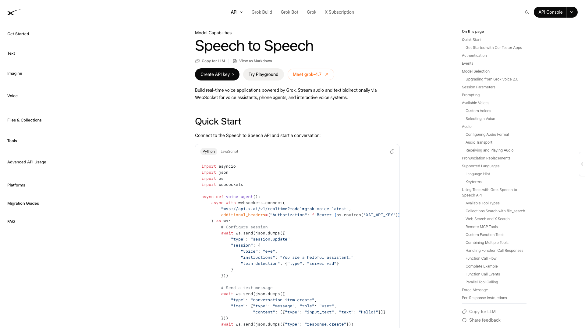

xAI, which merged into SpaceX in February 2026, released [Grok Voice 3.0](https://docs.x.ai/developers/model-capabilities/audio/voice-agent) on 14 October 2026. The model tops the Artificial Analysis index at 86.9. It answered 99% of the spoken reasoning questions and passed 97.0% of the conversation tests on pauses, turn taking and interruptions. Its first audio arrives after 0.81 s, the fastest of the four highest scoring APIs. The previous version, Grok Voice 2.0, started after 0.70 s and is now marked deprecated in xAI's documentation.

xAI ranks Grok Voice 3.0 first on τ-Voice in its documentation. Artificial Analysis and the [τ-bench leaderboard](https://taubench.com) kept by Sierra, the customer service AI company that created the benchmark, both put GPT-Live-1 slightly ahead on those agent tasks, with Grok second.

The API costs a flat $0.08 per minute of session, more than any other ranked API apart from Deepslate Opal at its regular rate. It listens on `wss://api.x.ai/v1/realtime` and accepts the events of the OpenAI Realtime API, with a few event names that differ. Tools include your own functions, remote MCP servers, web search and X search. It detects more than 20 languages on its own and clones a voice from a recording of up to 120 seconds. The number of simultaneous sessions grows with what the account has spent, from 10 to 200. xAI documents a European region, `eu-west-1`, so check that the voice model runs there before you count on it.

The aiewf-eval speech table came out before Grok Voice 3.0, so it has no score for the new model. An earlier Grok model, Grok Voice Think Fast, passed 97.7% of its turns with a median of 2,496 ms between the end of the question and the answer. Starlink runs its phone sales and support on Grok Voice. According to xAI, the line takes about 20,000 calls a day and resolves about 70% of them without a human. LiveKit and Pipecat both ship a plugin for Grok Voice.

### 2. OpenAI GPT-Live-1

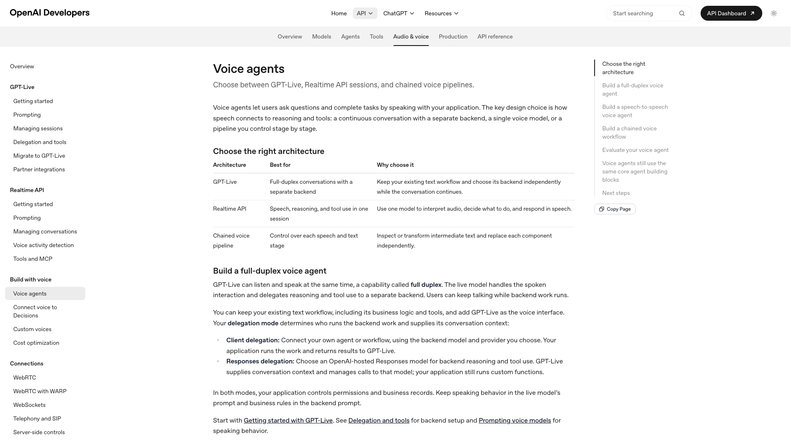

[GPT-Live-1](https://developers.openai.com/api/docs/guides/live) reached the OpenAI API on 10 September 2026, after replacing Advanced Voice Mode in ChatGPT on 8 July. It hears the user while it speaks and decides on its own when to talk, pause or interrupt. Reasoning and tools go to a backend: an OpenAI model such as GPT-6 Astra or GPT-5.6 Terra, or your own agent. With an Astra backend, it scores 83.2 on the Artificial Analysis index and 74.5% on τ-Voice, the best agent score on the leaderboard. Sierra's leaderboard also puts it first, with 78.9%, 82.0% and 84.2% on its retail, airline and telecom tasks. Its first audio arrives after 1.34 s.

In aiewf-eval, GPT-Live-1 with a Terra backend passed 94.3% of turns with a median of 1,696 ms.

OpenAI bills $0.05 per minute of session, by the second, plus the backend model's tokens. GPT-Live-1 has its own endpoint, `v1/live/sessions`, over WebRTC, WebSocket or SIP, with events that differ from the Realtime API's. Your application streams the audio continuously while the model decides when each turn ends. Sessions have a maximum length that OpenAI does not publish. Paid accounts get 50 to 500 simultaneous sessions depending on their tier.

OpenAI added nine voices in German, French, Hindi, Japanese and Korean on 16 October 2026, plus voices you describe in a prompt. GPT-Live-1 can process data in the EU or the US. To weigh its delegation model and its migration path, [compare GPT-Live with GPT-Realtime and Gemini Live](/blog/gpt-live-vs-gpt-realtime-vs-gemini-live).

### 3. Google Gemini 3.8 Live

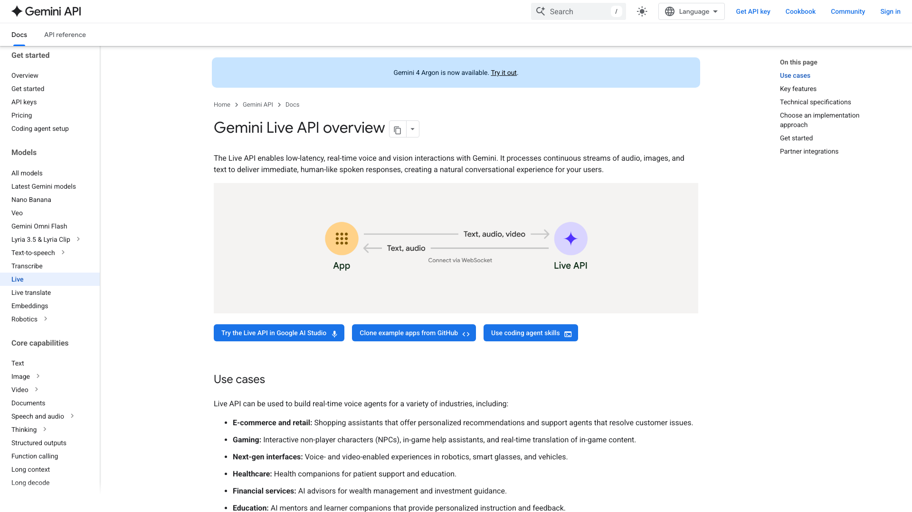

[Gemini 3.8 Live](https://ai.google.dev/gemini-api/docs/live) and Gemini 3.8 Live Extended Thinking have been generally available since 15 September 2026. The Extended Thinking model scores 82.6 on the Artificial Analysis index, with 98% on spoken reasoning and 68.6% on τ-Voice, and starts speaking after 1.35 s. The base model scores 76.0 and starts after 1.18 s. It scores 30.1% on τ-Voice, far below the Extended Thinking model, but listeners in the arena rated its answers higher than those of Grok Voice 3.0 and GPT-Live-1, with an Elo of 1088 against 1070 and 1056.

Both models cost $3 per million audio tokens heard and $12 per million spoken. Google puts that at $0.005 per minute heard and $0.018 per minute spoken, so a minute split evenly costs about $0.012. That makes Gemini about a quarter of the price of GPT-Realtime-2.1 and a seventh of Grok Voice 3.0. In aiewf-eval, both 3.8 models passed 92.9% of turns, with a median of 1,440 ms. The base model failed one conversation out of 26 because it never answered the first turn.

Gemini Live tools run without blocking by default, so the model keeps talking while your function runs. Gemini Live can also ground an answer in Google Search. The Extended Thinking model reasons in the background and takes a thinking level of low, medium or high. Google lists 99 languages and 30 voices.

A connection lasts about ten minutes. Session resumption reopens the session on a new connection within two hours. Context compression then lets a call run with no time limit. The Gemini API runs over WebSocket, with short-lived tokens for a browser. Gemini 3.8 Live has also run in an EU multi-region on Vertex AI since 24 September 2026, at the same price, with up to 1,000 simultaneous sessions on pay-as-you-go. Google has renamed Vertex AI to Gemini Enterprise Agent Platform. Google documents the Extended Thinking model on the Gemini API only.

### 4. OpenAI GPT-Realtime-2.1

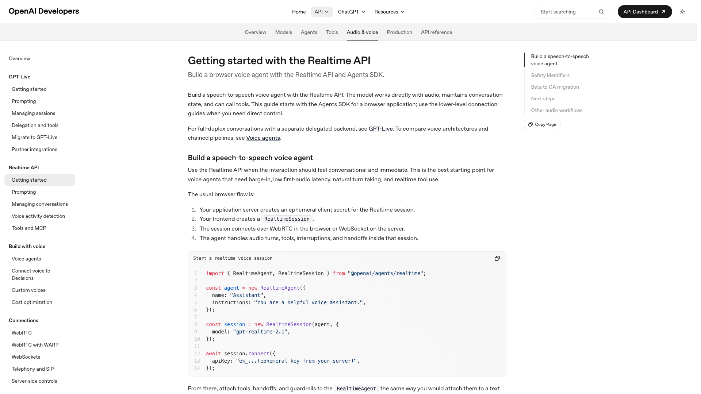

[GPT-Realtime-2.1](https://developers.openai.com/api/docs/guides/realtime), released on 6 July 2026, scores 75.2 on the Artificial Analysis index at high reasoning, with 96% on spoken reasoning, 45.7% on τ-Voice and 1.21 s to the first audio. At minimal reasoning, its first audio arrives after 0.97 s and its index drops to 70.7. In aiewf-eval, GPT-Realtime-2.1 at low reasoning passed 94.4% of turns with a median of 1,568 ms, against 94.3% for GPT-Live-1 with a Terra backend and 92.9% for Gemini 3.8 Live.

Audio costs $32 per million tokens heard and $64 per million spoken, about $0.048 for a minute split evenly. History sent again on each turn costs $0.40 per million cached tokens. GPT-Realtime-2.1-mini costs $10 and $20 per million tokens, about $0.015 a minute, but scores 54.4 at minimal reasoning. A session lasts up to 60 minutes with a 128K token context.

The Realtime API runs over WebRTC, WebSocket or SIP. Grok Voice, Higgs Realtime and Inworld accept its events. You set the reasoning effort from minimal to xhigh, add remote MCP servers that OpenAI calls itself, and keep or turn off OpenAI's own detection of the end of the user's turn. `eu.api.openai.com` processes Realtime sessions in Europe.

Developers on OpenAI's forum report that GPT-Realtime-2.1 [drifts into English](https://community.openai.com/t/gpt-realtime-2-1-exhibits-language-drift/1386953) during Spanish, German, Portuguese and French calls. Test your language before production. OpenAI will shut down the older `gpt-realtime`, `gpt-4o-realtime` and `gpt-realtime-mini` models on 20 January 2027.

### 5. Alibaba Qwen Audio Realtime

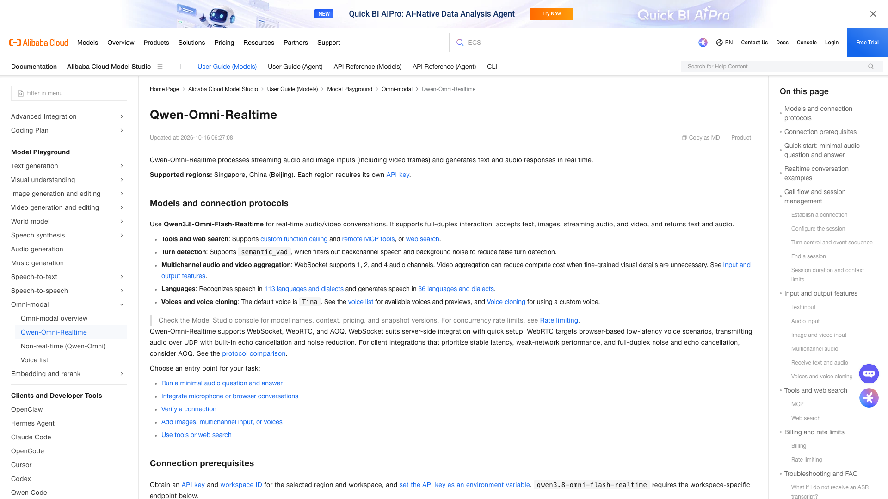

[Qwen Audio 3.0 Realtime Plus](https://www.alibabacloud.com/help/en/model-studio/realtime), served on Alibaba Cloud Model Studio, scores 69.5 on the Artificial Analysis index. It ties Grok Voice 3.0 on spoken reasoning, at 99%, and has the best score of the ranked models on the conversation tests, 98.4%. Listeners in the arena ranked its answers last among the indexed models. Its first audio, after 1.54 s, is also the slowest of the indexed models.

Alibaba released two newer realtime models in September 2026, Qwen Audio 3.1 Realtime Plus and Qwen3.8 Omni Flash Realtime. The Omni model also takes video. The leaderboard has not scored either of them yet. Qwen Audio covers 11 languages and 21 Chinese dialects, with 13 voices and voice cloning on version 3.1. The Omni line recognises 113 languages and dialects and speaks 36. Both call functions.

Artificial Analysis lists Qwen Audio 3.0 Realtime Plus at $0.03 per hour of audio heard and $0.18 per hour spoken, about $0.002 for a minute split evenly, the lowest price in this ranking. Alibaba bills per token, at rates that vary by model and region, so read the price in your console before you budget.

The API runs over WebSocket or WebRTC with event names close to OpenAI's, though Alibaba claims no compatibility. Realtime models run in Singapore and Beijing only. A Qwen Audio session keeps 50 turns and 300 seconds of audio in context.

### 6. Amazon Nova Sonic

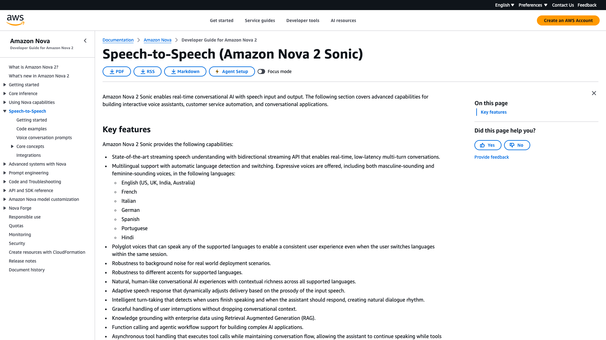

[Amazon Nova 2.5 Sonic](https://docs.aws.amazon.com/nova/latest/nova2-userguide/using-conversational-speech.html) became generally available on Amazon Bedrock on 5 October 2026, ten months after Nova 2 Sonic, launched in December 2025. The leaderboard has not scored 2.5 yet, so the ranking uses the scores of Nova 2 Sonic. That model answered 88% of the spoken reasoning questions and started speaking after 1.14 s, but completed 57.1% of its tasks, against 87% to 95% for the four highest ranked APIs. Amazon says 2.5 improves reasoning, tool calls and latency.

Both versions cost $3 per million speech tokens heard and $12 per million spoken in us-east-1, about $0.011 for a minute split evenly. Artificial Analysis converts that to $0.27 per hour heard and $1.08 per hour spoken. Nova Sonic runs in North Virginia, Oregon, Tokyo and Stockholm. In Stockholm, Nova 2.5 costs about 11% more. It speaks English, French, Italian, German, Spanish, Portuguese and Hindi, with voices that switch language within a session.

The API is Bedrock's bidirectional stream over HTTP/2, so a client written for OpenAI needs rewriting. A connection lasts eight minutes and continues in a new one. Each account gets a fixed quota of 20 simultaneous sessions per region. Tools run without blocking the conversation. Amazon Connect uses Nova Sonic for phone calls. Pipecat and LiveKit have plugins for it. LiveKit users report [agents that stop answering](https://github.com/livekit/agents/issues/5879) after a session renewal.

### 7. Deepslate Opal

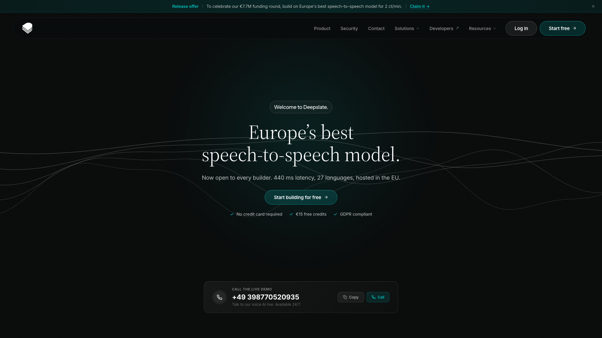

[Deepslate](https://deepslate.eu/), a Berlin company of about 15 people that [raised a €7.7M seed round](https://tech.eu/2026/10/01/deepslate-secures-eur77m-for-its-european-voice-ai-platform/) on 1 October 2026, builds Opal in Europe. Opal has the fastest first audio of any API in this ranking, 0.44 s on the Artificial Analysis leaderboard. It answered 85% of the spoken reasoning questions and passed 17.5% of the τ-Voice tasks, so keep it for short scripts with few tools.

Opal v2.1 is generally available, with v3.0 in preview on request. Deepslate charges $0.10 per minute at its regular rate and $0.02 during its launch offer. It runs in Germany on Telekom's cloud, with self-hosting for enterprise customers and ISO 27001 certification. It speaks 27 languages with hosted or cloned voices, or with an ElevenLabs voice.

Opal connects over WebRTC, SIP or WebSocket. Its WebSocket uses protobuf messages, so OpenAI clients need an adapter. It calls tools. Deepslate maintains plugins for LiveKit, in Python and Node, and for Pipecat.

### 8. Boson AI Higgs Realtime

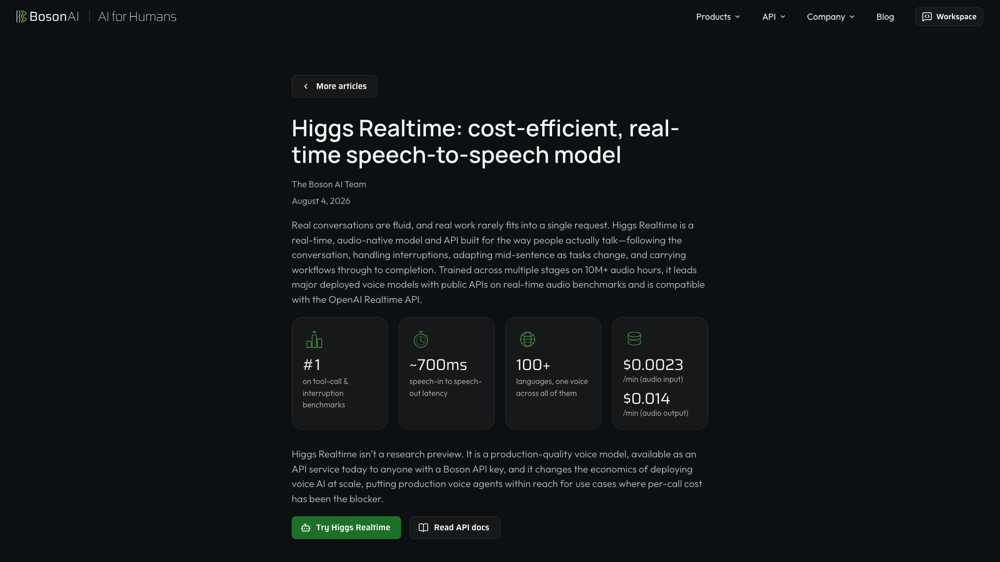

Boson AI, based in Santa Clara and Toronto, was founded in 2023 by Alex Smola and Mu Li, two former Amazon Web Services scientists. Its [Higgs Realtime](https://www.boson.ai/blog/higgs-realtime) model, released on 4 August 2026, is a drop-in for the OpenAI Realtime API. It listens on `wss://api.boson.ai/v1/realtime/` and works with OpenAI's own SDK.

Audio costs $0.0023 per minute heard and $0.014 per minute spoken, plus text tokens at $0.75 and $4.50 per million. A minute split evenly comes to about $0.008 before those tokens. New accounts get $10 of credit.

Boson reports 94.8% on Big Bench Audio and about 0.70 s to the first audio. Artificial Analysis measured 69% and 1.47 s, with 18.6% on τ-Voice. Run your own script before you rely on either set of figures. Higgs Realtime calls tools and switches between more than 100 languages within a sentence, with one default voice. Pipecat has a community plugin for it.

## Speech to speech APIs that run a pipeline

These APIs take audio in and send audio back over one connection, like the ranked models. Behind the connection, a transcription model, a text model and a voice run one after the other. You choose or replace the text model and get the voice at its provider's full quality. In exchange, the text model never hears the tone of the user's voice. Ultravox is the exception, since it hears the audio itself and leaves only the voice to another model.

### Inworld Realtime API

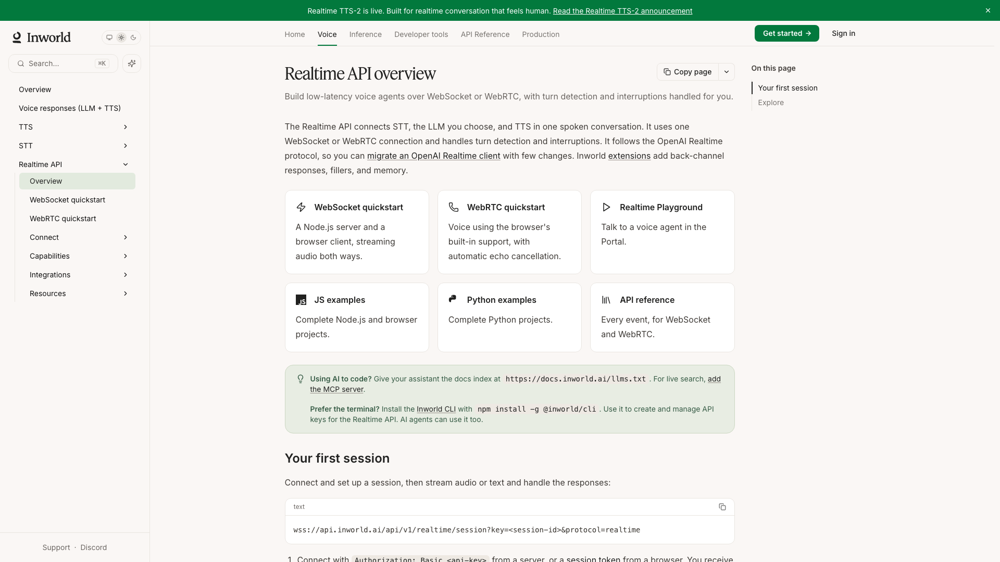

The [Inworld Realtime API](https://docs.inworld.ai/realtime/overview) follows the OpenAI Realtime protocol, with extensions. It chains Inworld's own transcription, a language model you name as `provider/model`, and Inworld TTS-2. Transcription costs $0.15 an hour and TTS-2 $25 per million characters, about one to one and a half cents a minute before the language model. Inworld labels it a research preview. Inworld also bought Ultravox on 1 October 2026.

### Deepgram Voice Agent API

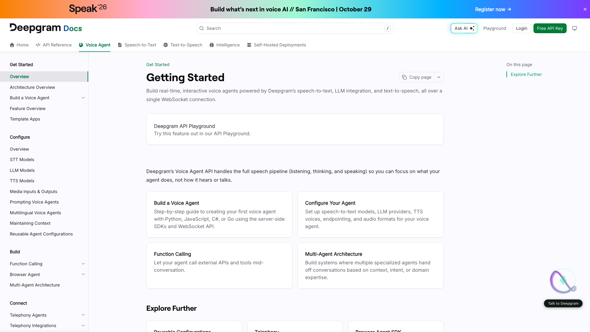

The [Deepgram Voice Agent API](https://developers.deepgram.com/docs/voice-agent) chains Deepgram Flux or Nova-3 transcription, a hosted language model or your own, and Flux TTS or Aura voices over its own WebSocket. It costs $0.075 per minute of connection on the standard tier, or $0.050 when you bring your own language model and voice. An EU endpoint is generally available. Pay-as-you-go accounts get 45 simultaneous connections.

### AssemblyAI Voice Agent API

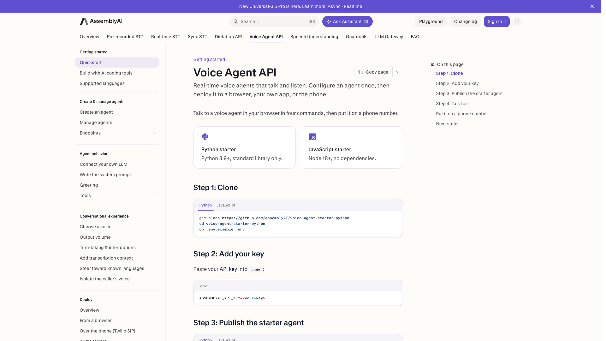

The [AssemblyAI Voice Agent API](https://www.assemblyai.com/docs/voice-agents/voice-agent-api), launched in April 2026, chains AssemblyAI's Universal-3.6 Pro transcription, a language model from its gateway and AssemblyAI's voice over one WebSocket. It works in six languages and costs $0.075 per minute, everything included. AssemblyAI covers HIPAA and PCI requirements.

### Ultravox

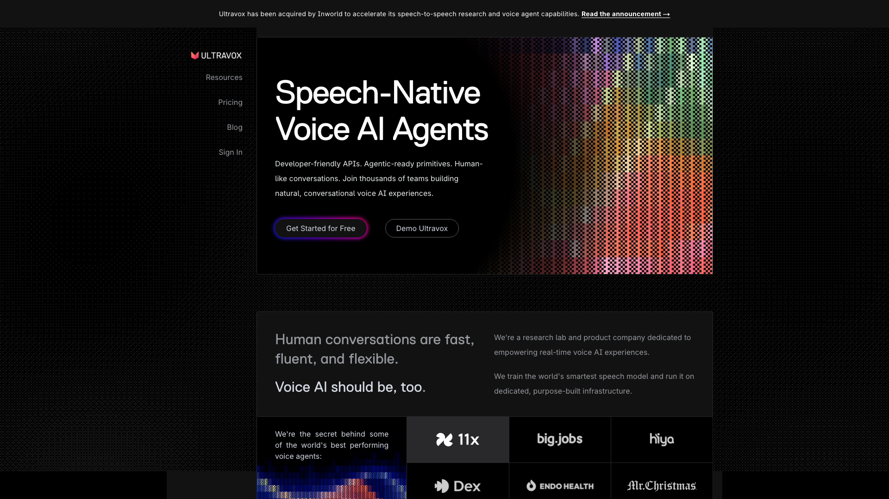

[Ultravox](https://www.ultravox.ai) hears audio directly and writes its answer as text, which a voice from Inworld, ElevenLabs, Cartesia or OpenAI then speaks. The Ultravox v0.7 weights are open under the MIT license. The hosted service costs $0.05 per minute, billed in six second steps, with five simultaneous calls on pay-as-you-go.

## Other options worth knowing

Microsoft's [Azure Voice Live API](https://learn.microsoft.com/en-us/azure/ai-services/speech-service/voice-live) serves GPT-Realtime-2.1 at OpenAI's prices, pipelines built on GPT-5 models and Microsoft's own `azure-realtime` model. That model has been generally available in 11 languages since 25 July 2026, but Artificial Analysis has not scored it yet. The `gpt-realtime-2.1-datazone` deployment in Sweden Central keeps the audio in the EU data zone.

ElevenLabs sells a feature called Speech to Speech that turns one voice into another, for dubbing. Its voice agents product, ElevenLabs Agents, chains transcription, a language model and a voice for $0.08 a minute plus the model, with a dashboard and phone numbers. That makes it closer to the [hosted voice agent platforms](/blog/top-ai-voice-agent-platforms) than to an API.

Four speech to speech models publish their weights: Moshi from the Kyutai lab, StepFun's Step-Audio-R1.1, NVIDIA's Nemotron VoiceChat and Alibaba's Qwen3-Omni. You supply the GPU, the monitoring and the uptime. To run your own pipeline on open components rather than a speech to speech model, compare the [open source voice agent frameworks](/blog/open-source-voice-agent-frameworks).

## How to choose between them

Decide first whether a speech to speech model suits your agent. One model that hears and speaks catches hesitation, irritation and laughter, and starts its answer sooner. A pipeline lets you pick [the language model](/blog/top-llms-voice-agents), the voice and the transcription separately, and often costs less per minute. To weigh both for one provider, see how [the OpenAI Realtime API compares with a pipeline](/blog/openai-realtime-api-vs-pipeline).

Then pick on what your agent needs most:

- GPT-Live-1 for agent tasks and for conversations that have to feel human, with interruptions and backchannels
- Grok Voice 3.0 for the highest overall score and the fastest first audio among the leaders, at $0.08 a minute
- Gemini 3.8 Live for high volumes, at about a quarter of the price of GPT-Realtime-2.1. Its connections last about ten minutes and need session resumption. The base model scores 30.1% on agent tasks, so take the Extended Thinking model when tools matter
- GPT-Realtime-2.1 for remote MCP servers, a reasoning effort you set per call and sessions of up to an hour. Test your own tasks and language first, since it scores 45.7% on τ-Voice and developers report drift into English in other languages
- Qwen Audio Realtime or Higgs Realtime when the price per minute matters most and your users are outside Europe
- for audio processed in Europe, GPT-Live-1 or GPT-Realtime-2.1 on OpenAI's EU endpoint, Gemini 3.8 Live on Vertex AI, Nova Sonic in Stockholm or Deepslate Opal in Germany. Opal answers fastest but scores lowest on agent tasks

Check who decides when the user has finished speaking. GPT-Live-1 decides on its own, which gives it natural turn taking. The Realtime API and Gemini Live let your application take that decision instead, so a call behaves the same when you switch provider. Gemini 3.8 Live keeps proactive audio on, so the model can choose to stay silent. Run your own script to see when it does.

Count the history in your budget. Most of these APIs bill the whole conversation again on every turn, so a thirty-minute call costs more than thirty separate one-minute calls. Grok Voice and Deepslate bill per minute of session instead. GPT-Live-1 does the same for the voice, with its backend model billed per token on top.

Keep the provider swappable. Grok Voice, Higgs Realtime and Inworld accept OpenAI Realtime events, which shortens a migration, though some events, the voices and the tools still differ. [Micdrop](/) runs GPT-Realtime-2.1 and Gemini 3.8 Live behind the same browser client and Node server. You pass the [realtime model](/docs/server/realtime) to the server, so moving to the other provider, or to a pipeline, leaves the front end untouched:

```typescript
import { GeminiLive } from '@micdrop/gemini'
import { OpenaiRealtime } from '@micdrop/openai'
import { MicdropServer } from '@micdrop/server'

const systemPrompt = 'You book appointments. Answer in short spoken sentences.'

const realtime =
  process.env.VOICE_MODEL === 'gemini'
    ? new GeminiLive({
        apiKey: process.env.GEMINI_API_KEY || '',
        model: 'gemini-3.8-live',
        systemPrompt,
        autoEndCall: true,
      })
    : new OpenaiRealtime({
        apiKey: process.env.OPENAI_API_KEY || '',
        model: 'gpt-realtime-2.1',
        systemPrompt,
        autoEndCall: true,
      })

new MicdropServer(socket, { realtime, generateFirstMessage: true })
```

Micdrop's client decides when each turn ends for both models. [Tools](/docs/server/tools) run on your server whichever model you pass. Another API from this ranking needs a class of your own that extends the `Realtime` base class. Micdrop is a library you host yourself, so you store the conversations and build any dashboard on your side.

## Frequently asked questions

<FaqList>
  <FaqItem question="What is the best speech to speech API in 2026?">
    Grok Voice 3.0 from xAI tops the Artificial Analysis Speech to Speech Index in October 2026 at 86.9, ahead of OpenAI's GPT-Live-1 at 83.2 and Gemini 3.8 Live Extended Thinking at 82.6. GPT-Live-1 has the best score on spoken agent tasks, 74.5% on τ-Voice. Gemini 3.8 Live costs the least of the leaders, about $0.012 for a minute of conversation.
  </FaqItem>
  <FaqItem question="What is a speech to speech API?">
    A speech to speech API takes the user's audio and returns a spoken answer over one connection, usually a WebSocket or WebRTC session. A native API such as GPT-Realtime-2.1 or Gemini 3.8 Live hears and speaks with a single model. Other APIs, such as Deepgram's Voice Agent API, chain transcription, a language model and a voice behind the same connection. ElevenLabs uses the name Speech to Speech for a voice changer.
  </FaqItem>
  <FaqItem question="How much does a speech to speech API cost per minute?">
    For a minute where the user and the agent each speak for thirty seconds, Qwen Audio 3.0 Realtime Plus costs about $0.002, Higgs Realtime about $0.008 plus text tokens, Nova Sonic about $0.011, Gemini 3.8 Live about $0.012, GPT-Realtime-2.1-mini about $0.015, GPT-Realtime-2.1 about $0.048, GPT-Live-1 $0.05 plus its backend model, Grok Voice 3.0 $0.08 and Deepslate Opal $0.10 at its regular rate. These figures leave out the conversation history that token-billed APIs charge again on each turn, so longer calls cost more per minute.
  </FaqItem>
  <FaqItem question="How much does the OpenAI speech to speech API cost?">
    GPT-Realtime-2.1 costs $32 per million audio tokens heard and $64 per million spoken, about $0.048 for a minute split evenly, plus $0.40 per million cached tokens for the history. GPT-Realtime-2.1-mini costs $10 and $20 per million tokens, about $0.015 a minute. GPT-Live-1 costs $0.05 per minute of session plus the tokens of its backend model.
  </FaqItem>
  <FaqItem question="What are the alternatives to the OpenAI Realtime API?">
    Grok Voice 3.0 and Boson AI's Higgs Realtime accept the OpenAI Realtime events on their own endpoints. Gemini 3.8 Live, Amazon Nova Sonic and Deepslate Opal use their own protocols. Alibaba's Qwen Audio Realtime uses event names close to OpenAI's without claiming compatibility. Inworld's Realtime API follows the OpenAI protocol over a pipeline of transcription, a language model and a voice. A pipeline you assemble yourself is the other alternative, with a provider of your choice at each step.
  </FaqItem>
  <FaqItem question="Which speech to speech API is the fastest?">
    Deepslate Opal starts speaking after 0.44 s on the Artificial Analysis leaderboard, the fastest of the ranked APIs. Grok Voice 3.0 is the fastest of the four highest scoring APIs, at 0.81 s. GPT-Realtime-2.1 starts after 1.21 s at high reasoning and 0.97 s at minimal reasoning. Gemini 3.8 Live Extended Thinking starts after 1.35 s and the base model after 1.18 s. GPT-Live-1 starts after 1.34 s with an Astra backend.
  </FaqItem>
  <FaqItem question="Which speech to speech APIs can process data in Europe?">
    OpenAI processes GPT-Realtime-2.1 and GPT-Live-1 sessions in Europe through its EU endpoint. Gemini 3.8 Live runs in an EU multi-region on Vertex AI. Amazon Nova Sonic runs in Stockholm, Deepslate Opal in Germany or on your own servers. Azure Voice Live keeps GPT-Realtime-2.1 in the EU data zone from Sweden Central. Deepgram's Voice Agent API, which runs a pipeline, also has a generally available EU endpoint.
  </FaqItem>
  <FaqItem question="Should I use a speech to speech API or a pipeline for a voice agent?">
    A native speech to speech API hears the tone of the voice and starts its answer sooner. A pipeline of transcription, a language model and a voice lets you choose each provider, use any voice and often pay less per minute. Pick a native speech to speech API for natural conversation, and a pipeline when you need a specific voice, a specific language model or the lowest cost.
  </FaqItem>
</FaqList>

## Getting started

Take Grok Voice 3.0 for the highest overall score, GPT-Live-1 for the most human conversation and the best agent tasks, and Gemini 3.8 Live for the lowest price among the leaders. GPT-Realtime-2.1 fits agents that need remote MCP servers and hour-long sessions on the protocol that Grok, Higgs and Inworld also accept. For audio that stays in Europe, OpenAI's EU endpoint, Vertex AI, Nova Sonic in Stockholm and Deepslate Opal all qualify.

Whichever API you shortlist, play your own conversations to it, in your language and with your tools. Micdrop runs GPT-Realtime-2.1 and Gemini 3.8 Live behind one client, so you can compare them on the same calls:

```bash
npm install @micdrop/server @micdrop/web @micdrop/openai @micdrop/gemini
```

[Run a first voice call in about five minutes](/docs/getting-started), then pass the [realtime model](/docs/server/realtime) you want to test.

<RankingJsonLd
  name="Best speech to speech APIs for voice agents in 2026"
  description="Hosted speech to speech APIs ranked for voice agents in October 2026, on the Artificial Analysis Speech to Speech Index."
>
  <RankingEntry name="xAI Grok Voice 3.0" url="https://docs.x.ai/developers/model-capabilities/audio/voice-agent" />
  <RankingEntry name="OpenAI GPT-Live-1" url="https://developers.openai.com/api/docs/guides/live" />
  <RankingEntry name="Google Gemini 3.8 Live" url="https://ai.google.dev/gemini-api/docs/live" />
  <RankingEntry name="OpenAI GPT-Realtime-2.1" url="https://developers.openai.com/api/docs/guides/realtime" />
  <RankingEntry name="Alibaba Qwen Audio Realtime" url="https://www.alibabacloud.com/help/en/model-studio/realtime" />
  <RankingEntry name="Amazon Nova Sonic" url="https://docs.aws.amazon.com/nova/latest/nova2-userguide/using-conversational-speech.html" />
  <RankingEntry name="Deepslate Opal" url="https://deepslate.eu/" />
  <RankingEntry name="Boson AI Higgs Realtime" url="https://www.boson.ai/blog/higgs-realtime" />
</RankingJsonLd>
