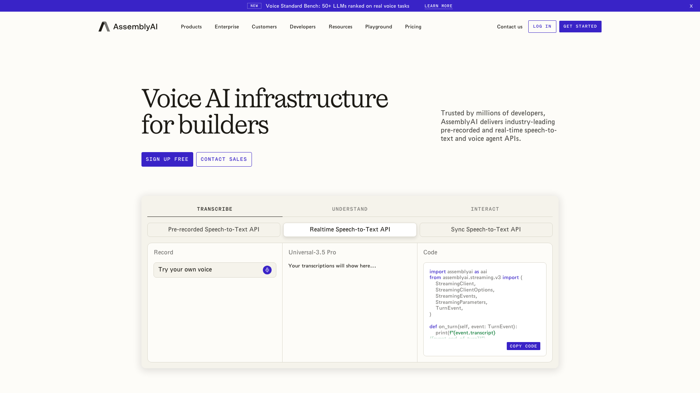
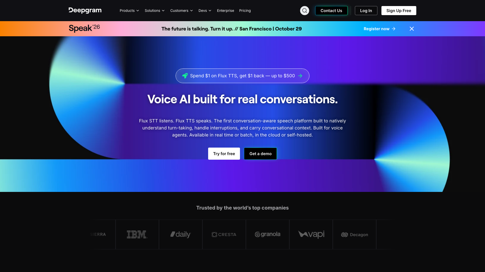
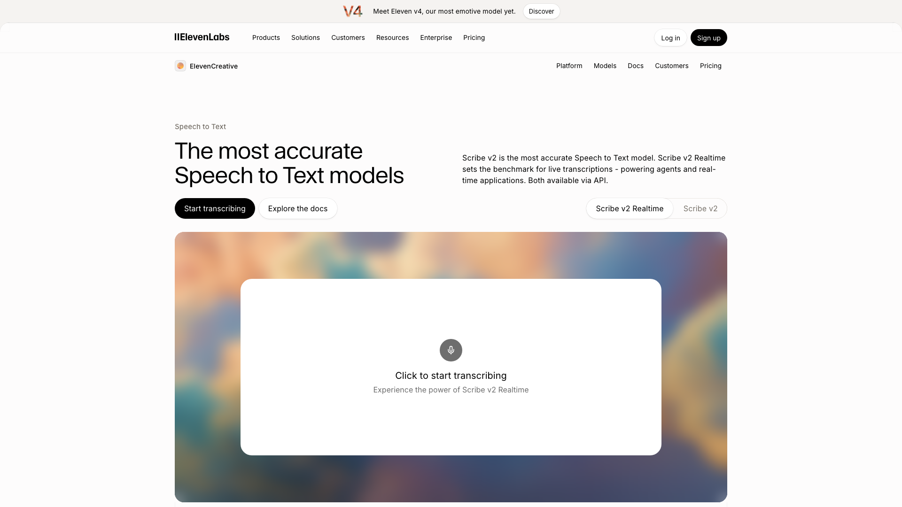
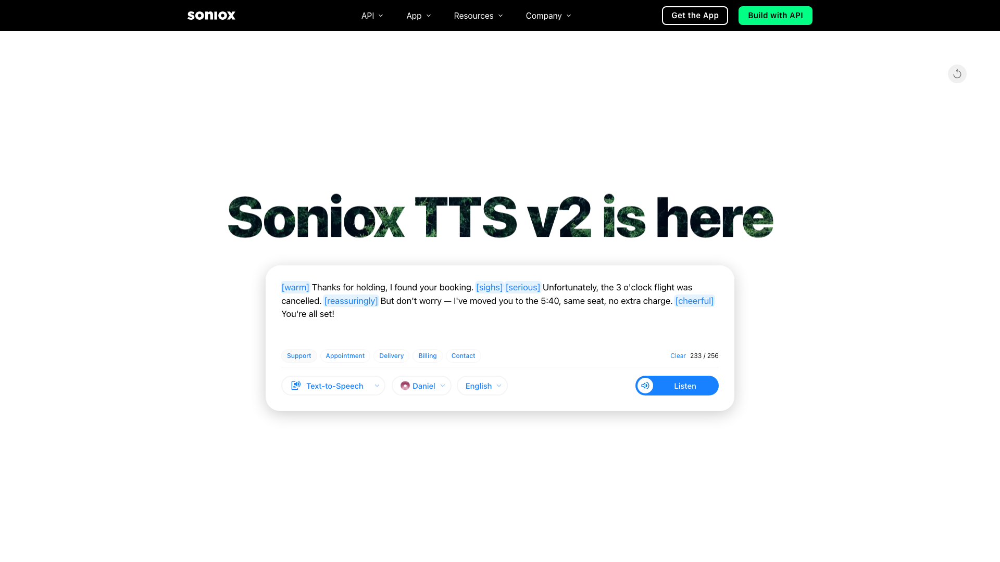
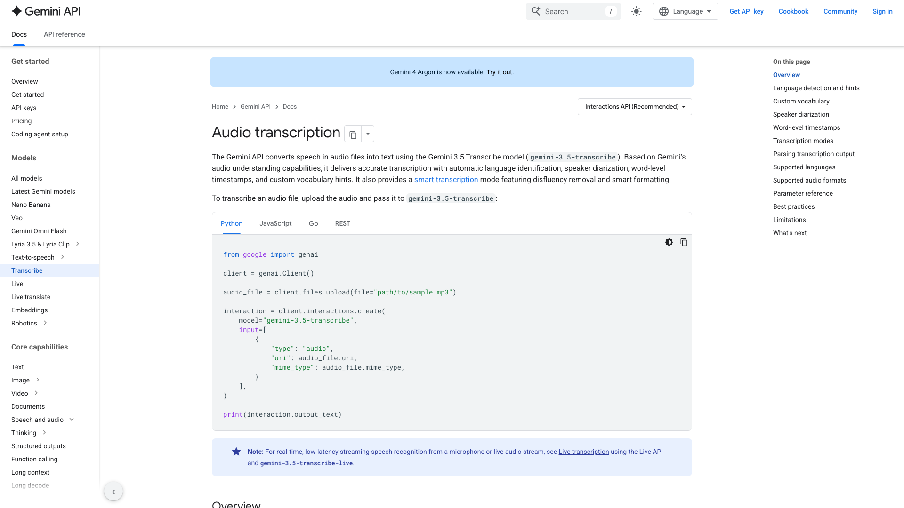
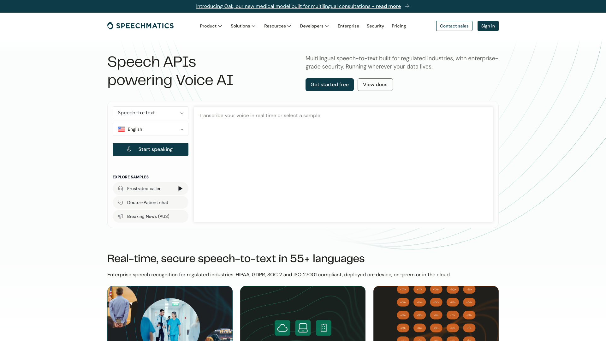
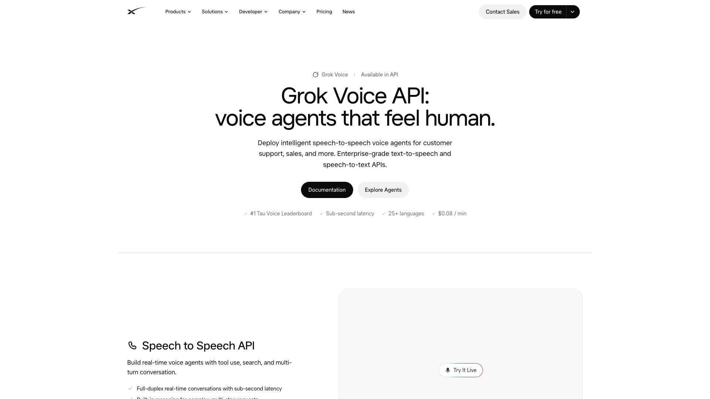
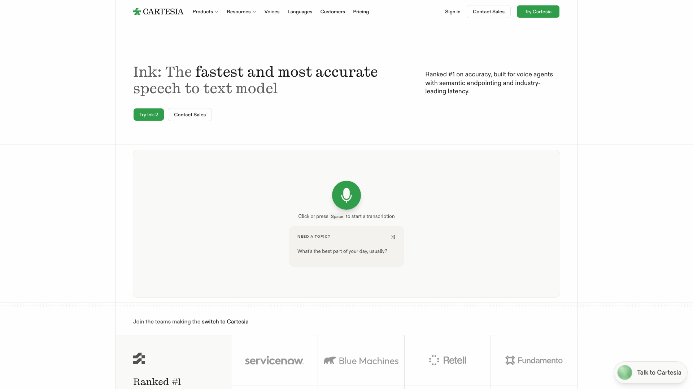
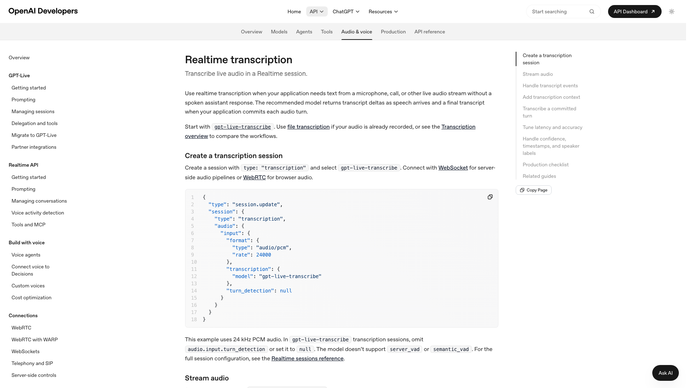
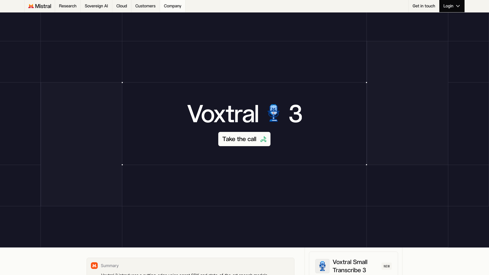

The best speech to text API for a voice agent in 2026 is AssemblyAI Universal-3.6 Pro when accuracy comes first, and Deepgram Flux when your agent should start preparing its answer before the user's turn is confirmed. AssemblyAI had the lowest error rate on the Coval benchmark in November 2026, while Soniox returned the fastest final transcripts of the ranked APIs on that benchmark. ElevenLabs Scribe v3 Live, Soniox, Gemini 3.5 Transcribe and Speechmatics complete the top six. This ranking compares ten streaming speech recognition APIs on what a voice agent needs from transcription: the time to the final transcript, accuracy, built-in turn detection, languages, price per minute and where the audio is processed.

Micdrop publishes this ranking. [Micdrop](/) is an open source TypeScript library for real-time voice conversations with AI. It leaves transcription to the APIs it connects to, so it stays out of the ranking. It ships ready integrations for OpenAI, Gemini, Mistral, Gladia and Gradium, plus one interface for plugging in any other API. Coval measured a higher error rate for Gladia than for every ranked API it covers. Gradium returned its final transcript later than every ranked API in the Pipecat benchmark. Both stay outside the top ten.

Prices come from each vendor's pricing page. Accuracy and speed figures come from independent benchmarks, unless the text marks them as the vendor's own. We collected the figures on 16 October 2026 and checked the benchmarks, prices and sentiment analysis details again on 12 November. Providers release a new model every few weeks, so check the numbers again before you commit.

## How the speech recognition APIs were ranked

A voice agent answers a sentence only once it has its final transcript. The user waits for that transcript, then for [the language model](/blog/top-llms-voice-agents) and the voice. The ranking weighs these criteria:

- the [word error rate (WER)](/blog/what-is-automatic-speech-recognition#word-error-rate-and-what-it-hides) and the time from the end of speech to the final transcript
- whether the API detects the end of the user's turn itself, or leaves that to your code
- the languages it transcribes in streaming, and whether one call can switch between them
- the price per minute of streamed audio
- where the audio can be processed, including a European region, and whether you can host the model yourself

The two main benchmarks are [Coval](https://benchmarks.coval.ai), which tests hosted endpoints continuously and reports 30-day averages, and the [Artificial Analysis streaming leaderboard](https://artificialanalysis.ai/speech-to-text/streaming), which measures from the end of speech detected by a voice detector. They use different audio and start timing from different moments, so compare two APIs within one benchmark only. The [Pipecat benchmark](https://github.com/pipecat-ai/stt-benchmark), run on 1,000 English turns in September 2026, adds a third measure.

An API enters the ranking once it is generally available and documents how it handles the audio, with a processing region or a security certification. That rule leaves out two strong newcomers, Microsoft MAI-Transcribe-2-Streaming and Meta Muse Voice Transcribe, covered after the ranking. The order is our judgement, with no weighted score behind it. The time to the final transcript and the error rate weigh most. When one API is faster and another more accurate, we looked at turn detection, languages and European processing to order them.

## The comparison at a glance

| API and streaming model | Price per minute | Coval WER, time to final | Artificial Analysis WER, time to final | Languages in streaming | Turn detection in the API | EU processing |
|---|---|---|---|---|---|---|
| **AssemblyAI** Universal-3.6 Pro | $0.0075 | 2.1%, 107 ms | Not listed for this model | 32, code switching | Yes | EU endpoint |
| **Deepgram** Flux, Nova-3 | $0.0077 | 5.3 to 5.7%, 88 to 105 ms | 6.7%, 60 ms (Nova-3) | About 63, switching in 10 | Yes, model based (Flux) | EU endpoint |
| **ElevenLabs** Scribe v3 Live | $0.0037 | 2.3%, 94 ms | 2.9%, 81 ms | 90+, code switching | Yes | Enterprise plan only |
| **Soniox** stt-rt-v6 | $0.002 | 3.4%, 59 ms | 4.6%, 80 ms | 60+, code switching | Yes | EU region on request |
| **Google** Gemini 3.5 Transcribe Live | About $0.009 | 2.9%, 371 ms | 4.0%, 395 ms | 85+, code switching | Voice detection | EU endpoint on Google Cloud |
| **Speechmatics** Linden 1 | $0.005 | 3.8%, 235 ms | Not listed | 55+, one per stream | Silence based | EU endpoint, on premises |
| **xAI** Grok Voice Transcribe 2.0 | $0.0033 | Not listed | 2.7%, 490 ms | 38+, switching | Yes | None published |
| **Cartesia** Ink-2 | $0.0065 on Scale | 3.4%, 142 ms | Not verified | 5 | Yes | None published |
| **OpenAI** gpt-4o-transcribe, gpt-live-transcribe | $0.003 to $0.017 | Not listed for these models | 3.9%, 812 ms (gpt-live-transcribe) | Many, set by a hint | gpt-4o-transcribe only | EU endpoint, 10% extra |
| **Mistral** Voxtral Realtime 3 | $0.008 | 5.4%, 468 ms (first version) | 3.6%, 755 ms (version 3) | 40+ | Yes, when turned on | Default, or self-hosted |

The two benchmarks measure on different audio, so compare APIs within one column only. Across every model Coval tracks, the median time to the final transcript is 123 ms.

## The ranking

### 1. AssemblyAI Universal-3.6 Pro



[AssemblyAI](https://www.assemblyai.com) released Universal-3.6 Pro Realtime on 29 September 2026. Coval ranks it first on accuracy out of 32 models, at 2.1% WER, with its final transcript 107 ms after the end of speech.

The model decides from punctuation and meaning when the user has finished. It keeps the turn open while the caller is still spelling out a phone number, an email address or a street name. Booking and support agents often cut the caller off at that moment. You can add up to 100 keyterms and change them in the middle of a stream. Universal-3.6 Pro handles 32 languages and switches between them inside a sentence.

The [price](https://www.assemblyai.com/pricing) is $0.45 an hour, about $0.0075 a minute, keyterms included. AssemblyAI bills the whole length of the session, idle time included, so close the stream between turns. It has an EU streaming endpoint, SOC 2 Type 2 and HIPAA, and sells self-hosted streaming from a $20,000 commitment. Its JavaScript SDK runs on the server only. Retell, LiveKit, Zoom and Metaview appear among its customers.

### 2. Deepgram Flux and Nova-3



[Deepgram](https://deepgram.com) Nova-3 returns its final transcript 88 ms after the end of speech on Coval, second among the ranked APIs after Soniox. Flux takes 105 ms. Twilio, Daily, LiveKit and Granola appear among the customers on Deepgram's homepage.

Flux is the model to pick for a conversation. A neural model, rather than a silence timer, decides when the user is done, and sends `EndOfTurn`, `EagerEndOfTurn` and `TurnResumed` events. The eager event lets the agent start preparing its answer before the turn is confirmed. Deepgram warns that this raises language model calls by 50 to 70%. Nova-3 covers about 63 languages. Both models switch between 10 of them within one call.

Deepgram trails the leaders on accuracy. Coval puts Nova-3 at 5.3% WER, 23rd of 32, and Flux at 5.7%. Streaming [costs $0.0077](https://deepgram.com/pricing) a minute for Flux English and for Nova-3 in one language, and $0.0092 for Nova-3 multilingual. Deepgram runs a generally available EU endpoint and sells self-hosting with an Enterprise licence. Its TypeScript SDK runs in Node and the browser.

### 3. ElevenLabs Scribe v3 Live



[ElevenLabs Scribe v3 Live](https://elevenlabs.io/speech-to-text), released in November 2026, is the second most accurate ranked model on Coval, at 2.3% WER, with its final transcript 94 ms after the end of speech. Coval has tested it on fewer calls than the older models so far. Artificial Analysis gives 2.9% and 81 ms. It transcribes more than 90 languages and, in multilingual mode, follows a speaker who switches language mid-sentence.

By default, Scribe commits a transcript when your code tells it to. It can also commit after a silence threshold, or when a turn prediction model judges the speaker has finished. Version 3 also labels speakers while it streams. Turn prediction, the multilingual mode and the keyterm library work over a direct WebSocket connection for now, outside the official SDKs.

Scribe v3 Live [costs $0.22 an hour](https://elevenlabs.io/pricing/api), about $0.0037 a minute, like Scribe v2 Realtime. Keyterms add $0.08 an hour. The keyterm library holds up to 10,000 terms. The JavaScript and React SDKs issue single-use tokens, so a browser can connect without exposing the API key. ElevenLabs holds SOC 2, ISO 27001 and PCI DSS Level 1, but reserves European data residency and zero retention for Enterprise contracts.

### 4. Soniox



[Soniox](https://soniox.com) is the cheapest ranked API by a wide margin, at [$0.12 an hour](https://soniox.com/pricing), about $0.002 a minute, with speaker labels and language identification included. Its stt-rt-v6 model, released on 3 November 2026, also returns the fastest final transcripts of the ranked APIs on Coval, 59 ms after the end of speech, at 3.4% WER. Artificial Analysis gives 4.6% and 80 ms.

One model covers more than 60 languages and follows a speaker who changes language within a session. Soniox detects the end of a turn from pauses, intonation and context, with an adjustable sensitivity. It accepts up to 8,000 tokens of context for names and domain terms. SDKs cover Node, the browser, React and React Native.

Soniox publishes no latency or accuracy figure of its own and names a single customer, the German voicebot company mobilApp. The previous model, [stt-rt-v5](https://docs.soniox.com/stt/models), retires on 15 December 2026. Soniox can process and store the audio in an EU region if you ask its sales team. It holds SOC 2 Type 2, HIPAA and ISO 27001.

### 5. Google Gemini 3.5 Transcribe Live



[Gemini 3.5 Transcribe](https://ai.google.dev/gemini-api/docs/transcribe), released on 26 August 2026, is the third most accurate ranked model on Coval, at 2.9% WER, with its final transcript 371 ms after the end of speech. Artificial Analysis gives 4.0% and 395 ms. Google reports that its final transcript arrives 70% faster than with Chirp 3, the model it replaces.

The live version, `gemini-3.5-transcribe-live`, streams over the Gemini Live API and recognises more than 85 languages, including several in the same session. It accepts up to 1,000 custom vocabulary terms. Turn detection runs on voice activity, automatic or driven by your own signal.

The [price](https://ai.google.dev/gemini-api/docs/pricing) is $3.50 per million audio tokens in and $21 per million tokens out, which Google estimates at about $0.009 a minute. A live session lasts ten minutes at most, so your code has to open a new one for a longer call. The model is in public preview on the Gemini API and generally available on Google Cloud's Gemini Enterprise Agent Platform, with an `eu` endpoint there. The `@google/genai` SDK issues ephemeral tokens for the browser.

### 6. Speechmatics Linden 1



[Speechmatics](https://www.speechmatics.com) launched Agent STT on its Linden 1 model on 17 September 2026. Coval measures it at 3.8% WER and 235 ms. It scored 1.05% semantic WER in the Pipecat benchmark, among the lowest in that run, with a median of 369 ms to the final transcript.

Linden 1 costs [$0.30 an hour](https://www.speechmatics.com/pricing), $0.005 a minute, and $0.15 an hour with volume. It covers more than 55 languages, takes a custom dictionary of up to 1,000 words and labels speakers at no extra cost. Speechmatics has the widest deployment choice of the ranked providers: cloud endpoints in the EU, the US and Australia, containers on your own servers, or on device. It holds ISO 27001, SOC 2 Type II and HIPAA. Vapi, LiveKit and the medical assistant Nabla use it.

Each stream handles one language, except bilingual packs such as Spanish and English. Speechmatics lists semantic turn detection as coming soon. Until then, end of turn detection relies on silence, so an agent that needs semantic turn detection has to run it in its own code.

### 7. xAI Grok Voice Transcribe 2.0



[Grok Voice Transcribe 2.0](https://docs.x.ai/developers/model-capabilities/audio/speech-to-text), released by xAI on 18 September 2026, has the lowest error rate of the generally available models on Artificial Analysis, at 2.7% WER. Its final transcript arrives 490 ms after the end of speech, slower than Deepgram, ElevenLabs, Soniox and Gemini on that benchmark.

It costs $0.20 an hour, about $0.0033 a minute, with speaker labels, timestamps and up to 100 keyterms included. It handles more than 38 languages and follows a switch in the middle of a recording. A `smart_turn` setting adds a model that predicts the end of the turn. Loom, at Atlassian, transcribes every video with it.

xAI holds SOC 2 Type 2, offers HIPAA on request, and keeps data 30 days by default unless you choose zero retention. It has no European region. With no ephemeral token, a browser has to reach the API through your own server. The documentation shows only raw WebSocket examples.

### 8. Cartesia Ink-2



[Cartesia](https://cartesia.ai/ink), the San Francisco company behind the Sonic voices, built Ink-2 for voice agents. Ink-2 sends its own turn events, `turn.start`, `turn.eager_end`, `turn.resume` and `turn.end`, so the agent needs no separate voice detector. Coval measures it at 3.4% WER and 142 ms. It scored 1.02% semantic WER in the Pipecat benchmark, among the lowest in that run, with a median of 299 ms to the final transcript.

Ink-2 covers fewer languages than any other ranked API, five: English, French, Hindi, Japanese and Spanish. The older Ink-Whisper model still covers 100. In the same Pipecat run, the slowest 1% of Ink-2 turns took 1,584 ms, five times the median.

Cartesia bills [three credits per second](https://cartesia.ai/pricing), about $0.39 an hour on the $299 Scale plan, with 20,000 free credits to start. Cartesia has Python and TypeScript SDKs and integrations for LiveKit, Vapi and Pipecat. Cartesia holds SOC 2 Type II and sells on-premises or VPC deployment, without a published European region. ServiceNow, HeyGen and Synthesia appear on its Ink-2 announcement.

### 9. OpenAI gpt-4o-transcribe and gpt-live-transcribe



[OpenAI](https://developers.openai.com/api/docs/guides/realtime-transcription) has two kinds of streaming models. `gpt-4o-transcribe`, at about $0.006 a minute, and `gpt-4o-mini-transcribe`, at $0.003, run inside a Realtime transcription session with OpenAI's own voice detection, including a semantic mode that waits for the sentence to make sense.

`gpt-live-transcribe`, released on 29 July 2026, is the model OpenAI now recommends for live audio. Its `delay` setting trades speed for accuracy. It accepts a `keywords` list as well as a free text prompt. OpenAI reports 9.6% WER on its own real-world set across nine languages. Artificial Analysis measures 3.9% WER, with the final transcript 812 ms after the end of speech, the slowest of the ranked APIs. It costs [$0.017 a minute](https://developers.openai.com/api/docs/pricing), the most expensive ranked option, and has no server-side voice detection, so your code has to detect the end of speech and commit the audio.

OpenAI processes data in Europe through `eu.api.openai.com`, at 10% extra for models released since March 2026. OpenAI sells no self-hosted option. Its realtime models return no speaker labels or timestamps.

### 10. Mistral Voxtral Realtime 3



[Mistral](https://mistral.ai/news/voxtral-3) released Voxtral Mini Transcribe Realtime 3 on 20 October 2026, as `voxtral-mini-transcribe-realtime-3-0`. It recognises more than 40 languages in streaming, against 13 for the first version, although the benchmark Mistral publishes covers 35. Mistral announces a final transcript in under 500 ms. [We measured a median of about 590 ms](/blog/gpt-4o-transcribe-vs-gemini-vs-voxtral) on 22 October. Artificial Analysis measures version 3 at 3.6% WER, with its final transcript 755 ms after the end of speech at the 480 ms delay setting.

The hosted API costs [$0.008 a minute](https://docs.mistral.ai/models/voxtral-mini-transcribe-realtime-3-0). A streaming delay setting sets how long the model waits before writing a word, from 80 ms to 2.4 seconds, and Mistral charts its error rate on FLEURS at 240, 480, 960 and 2,400 ms. Version 3 detects the end of the turn from sound and meaning when you turn it on. It can also label speakers in streaming, in a session without turn detection, and accepts context biasing. The [Micdrop Mistral integration](/docs/ai-integration/provided-integrations/mistral) uses version 3 by default.

Mistral publishes the weights of the first version, `voxtral-mini-transcribe-realtime-2602`, under Apache 2.0. It is the only ranked model you can download and run on your own GPU, through vLLM with an OpenAI-compatible endpoint, and its 4 billion parameters fit on a single GPU. Coval measures that first version at 5.4% WER and 468 ms to the final transcript. Version 3 runs on Mistral's API, or on your servers through a deal with Mistral. Mistral, based in Paris, processes data in Europe by default.

## Strong newcomers outside the ranking

[Microsoft MAI-Transcribe-2-Streaming](https://learn.microsoft.com/en-us/azure/ai-services/speech-service/mai-transcribe-2-streaming) took first place on Artificial Analysis on 1 October 2026, at 2.5% WER with its final transcript 128 ms after the end of speech. It is still a public preview with no SLA, served from four regions including Sweden Central. [TestingCatalog reports](https://www.testingcatalog.com/microsoft-launches-mai-transcribe-2-streaming/) an introductory price of $0.54 an hour. Once the model is generally available, it could enter this ranking near the top.

[Meta Muse Voice Transcribe](https://dev.meta.ai/models/muse-voice-transcribe/), launched on 1 September 2026, costs $0.18 an hour. Artificial Analysis measures it at 3.1% WER with its final transcript 163 ms after the end of speech. Meta documents no processing region, certification or customer for it yet, which keeps it out of this ranking. Its examples cover Python only.

## Other speech to text APIs worth knowing

[Gladia](https://www.gladia.io), a French company acquired by OVHcloud on 31 July 2026, recognises more than 100 languages and stores data in Europe or the United States. Real-time transcription costs from €0.68 an hour. Coval measures its Solaria-1 model at 6.1% WER and 399 ms.

[Gradium](https://gradium.ai), a Paris spin-off of the Kyutai lab, transcribes five European languages, with an EU endpoint and a self-hosted option. The Pipecat benchmark measured a median of 585 ms to its final transcript. [Reson8](https://reson8.dev), in Amsterdam, runs 10 European languages on its own GPUs in the Netherlands.

[Amazon Transcribe](https://aws.amazon.com/transcribe/) at $0.01 a minute, Azure AI Speech at $1 an hour and Google Cloud's Chirp 3 from $0.016 a minute all take more than 600 ms to the final transcript on independent benchmarks. They mostly suit teams already running on that cloud. [Rev AI](https://www.rev.ai) streams nine languages and scored 10.1% WER on Artificial Analysis.

Open source engines such as Whisper, Moonshine and Kyutai STT can [transcribe speech locally in Node](/blog/local-speech-to-text-node), with no per-minute bill. A [ranking of open source speech to text models](/blog/top-open-source-speech-to-text-models) compares ten open models, from Whisper to NVIDIA's Nemotron family, on streaming, accuracy and license. The browser's own [Web Speech API](/blog/web-speech-api) costs nothing but behaves differently from one browser to the next.

## Which APIs add sentiment analysis to real-time transcription

None of the ten ranked APIs returns sentiment or emotion on its streaming connection, according to their documentation on 12 November 2026. AssemblyAI and [Speechmatics](https://docs.speechmatics.com/speech-to-text/batch/speech-intelligence/sentiment-analysis) offer sentiment analysis on recorded files only. Deepgram marks its [sentiment analysis](https://developers.deepgram.com/docs/sentiment-analysis), intent and topic detection as unavailable in streaming. Speechmatics tags laughter, applause and music as [audio events](https://docs.speechmatics.com/speech-to-text/features/audio-events) in its standard real-time API, but Agent STT, the Linden 1 service ranked here, returns none of them.

Two APIs outside the ranking score sentiment during the call:

- [Gladia](https://docs.gladia.io/chapters/audio-intelligence/sentiment-analysis) returns a sentiment (positive, negative, neutral or mixed) and an emotion label such as anger or amusement for each sentence of a live session, once you turn on `sentiment_analysis` in its real-time processing settings.
- [Amazon Transcribe Call Analytics](https://docs.aws.amazon.com/transcribe/latest/dg/call-analytics-streaming.html) rates each speech segment of a streamed call as positive, neutral, mixed or negative.

[Hume AI](https://dev.hume.ai/expression-measurement/docs/audio/realtime) reads emotion from the sound of the voice instead of the words. Its real-time API, in limited release since October 2026, sends emotion scores every few seconds with no transcript, so you run it alongside your speech to text API.

A voice agent rarely needs an extra service to read the caller's mood. It already sends every final transcript to a language model, which can return the mood in its structured output. A small model can also [classify the mood and intent of each turn](/blog/intent-classification-voice-agent) before the agent answers. Pick a service that reads the voice, such as Hume, when the tone matters more than the words, as in coaching or when reviewing sales calls.

## How to choose between them

Start from the language of your calls. An English agent can use any ranked API. When callers switch language mid-call, pick AssemblyAI, Soniox, Gemini, ElevenLabs or xAI, or Deepgram within its 10 switching languages. Cartesia covers five languages and Mistral more than 40.

Then look at the time to the final transcript, measured from where your server runs. Soniox, Deepgram, ElevenLabs and AssemblyAI return it in under 110 ms on Coval, against 812 ms for OpenAI gpt-live-transcribe on Artificial Analysis. In [Micdrop](/docs/ai-integration), the voice detection in the browser closes the turn and tells the API the sentence is complete, so the delay that counts is the one after that signal. On 28 September 2026 we measured that delay for two of the integrated providers, with [Gemini at about 320 ms median and Gladia at about 480 ms](/blog/gpt-4o-transcribe-vs-gemini-vs-voxtral). Coval gives 371 ms for Gemini and 399 ms for Gladia, so Gemini came out faster in our test and Gladia slower.

Built-in turn detection saves code when your stack has none. Deepgram Flux, AssemblyAI and Soniox decide the end of turn from meaning as well as silence. Micdrop already closes the turn in the browser and adds [semantic end of turn detection](/docs/server/semantic-turn-detection) on the server, so a model without turn detection, such as gpt-live-transcribe, needs no extra code in Micdrop.

Price matters at volume. A thousand hours of calls costs $120 on Soniox, $200 on xAI, $220 on ElevenLabs, $300 on Speechmatics, $450 on AssemblyAI and $1,020 on gpt-live-transcribe.

European teams can narrow the list by where the audio is processed. AssemblyAI, Deepgram, Speechmatics, Soniox, Google and OpenAI can process audio in Europe, Mistral by default. ElevenLabs reserves European residency for Enterprise plans. xAI and Cartesia publish no European region. You can [keep every step of the pipeline in Europe](/docs/ai-integration/sovereign-voice-ai) with Mistral, Gladia and Gradium.

Plan for outages too, since a voice agent stops answering when its transcription provider goes down. In Micdrop, every integration implements the same interface, so switching from Gemini to Mistral means replacing one line. [`FallbackSTT`](/docs/ai-integration/fallback-strategies/stt-fallback) moves to a second provider when the first one fails, and replays the audio of the sentence in progress. Raconte, a voice interview product built by Micdrop's maintainer, runs Gladia first with OpenAI as its fallback. You can connect an API without a ready integration, such as AssemblyAI or Deepgram, by writing a [custom speech to text class](/docs/ai-integration/custom-integrations/custom-stt) with a single `transcribe()` method.

## Frequently asked questions

<FaqList>
  <FaqItem question="What is the best speech to text API for voice agents in 2026?">
    AssemblyAI Universal-3.6 Pro had the lowest error rate on the Coval benchmark in November 2026, at 2.1%, with its final transcript 107 ms after the end of speech. ElevenLabs Scribe v3 Live follows at 2.3% and 94 ms. Deepgram Flux detects the end of turn with a model and can signal it early. Soniox returns the fastest final transcripts on Coval, at the lowest price. Gemini 3.5 Transcribe suits multilingual agents.
  </FaqItem>
  <FaqItem question="Which speech to text API has the lowest latency?">
    On Coval, Soniox stt-rt-v6 returns the final transcript 59 ms after the end of speech, Deepgram Nova-3 88 ms, ElevenLabs Scribe v3 Live 94 ms and Deepgram Flux 105 ms. On Artificial Analysis, Deepgram Nova-3 measures 60 ms, Soniox stt-rt-v6 80 ms and Scribe v3 Live 81 ms. The network distance between your server and the provider adds to these figures, so measure from where your agent runs.
  </FaqItem>
  <FaqItem question="What is the cheapest streaming speech to text API?">
    Soniox costs $0.12 an hour of streamed audio, about $0.002 a minute. OpenAI gpt-4o-mini-transcribe and Meta Muse Voice Transcribe cost about $0.18 an hour, xAI Grok Voice Transcribe 2.0 $0.20 and ElevenLabs Scribe $0.22. Running Whisper or the first Voxtral Realtime on your own hardware removes the per-minute bill but adds the cost of the machine.
  </FaqItem>
  <FaqItem question="Who does Deepgram compete with?">
    Deepgram competes with AssemblyAI, ElevenLabs Scribe, Soniox, Speechmatics, Google Gemini Transcribe, OpenAI's transcription models, Cartesia Ink and xAI Grok Voice Transcribe for streaming speech to text. AssemblyAI and ElevenLabs Scribe v3 Live are the two most accurate ranked APIs on the Coval benchmark. Soniox returns final transcripts faster on Coval and costs less. Speechmatics has more deployment options. Deepgram Flux sends an early end of turn event, which lets the agent prepare its answer sooner.
  </FaqItem>
  <FaqItem question="Which speech to text APIs can process audio in the EU?">
    AssemblyAI, Deepgram and Speechmatics run EU endpoints. Soniox opens an EU region on request. OpenAI processes data in Europe at 10% extra on recent models. Google offers an EU endpoint for Gemini 3.5 Transcribe on its Gemini Enterprise Agent Platform. Mistral processes data in Europe by default. Outside the ranking, Gladia can store data in Europe and Gradium has an EU endpoint. ElevenLabs reserves EU residency for Enterprise plans. xAI and Cartesia publish no European region.
  </FaqItem>
  <FaqItem question="Can I self-host a streaming speech to text model?">
    Mistral publishes its first Voxtral Realtime model under Apache 2.0, so you can run it on your own GPU through vLLM. Voxtral Realtime 3 runs on your servers through a deal with Mistral. Speechmatics, Deepgram, AssemblyAI and Cartesia sell self-hosted or on-premises deployments, AssemblyAI from a $20,000 commitment.
  </FaqItem>
  <FaqItem question="Do I need end of turn detection in the speech to text API?">
    A voice agent needs end of turn detection somewhere, but it can come from the API or from your own code. Deepgram Flux, AssemblyAI, Soniox, ElevenLabs, Cartesia and xAI detect it themselves, and Mistral Voxtral Realtime 3 when you turn it on. OpenAI gpt-live-transcribe expects your code to say when the sentence is over, for instance with voice activity detection in the browser.
  </FaqItem>
  <FaqItem question="Which speech to text APIs return sentiment analysis in real time?">
    Gladia returns a sentiment and an emotion label for each sentence of a live transcription. Amazon Transcribe Call Analytics rates the sentiment of each segment of a streamed call. None of the ten APIs ranked here returns sentiment while streaming. AssemblyAI, Deepgram and Speechmatics offer sentiment analysis on recorded audio only. In a voice agent, the language model that reads each transcript can also return the caller's mood.
  </FaqItem>
  <FaqItem question="Is Whisper good enough for a real-time voice agent?">
    Whisper reads up to thirty seconds of audio at a time and was built for files, so streaming it means re-running it on a growing buffer or transcribing each sentence after it ends. OpenAI's gpt-4o-transcribe costs $0.006 a minute, the price of Whisper on OpenAI's API, and streams over the Realtime API. Whisper remains useful on your own server, where it costs nothing per minute and no audio leaves the machine.
  </FaqItem>
  <FaqItem question="What is the difference between a speech recognition API and the Web Speech API?">
    A speech recognition API, like the ten ranked here, is a hosted service billed by the minute: your server streams the audio to it with an API key. The Web Speech API is [the `SpeechRecognition` interface built into the browser](/blog/web-speech-api). It costs nothing, but by default Chrome sends the audio to Google and Safari to Apple. Firefox ships the interface turned off. Each browser also writes the same sentence its own way. A voice agent usually streams the microphone to its server instead, so every caller gets a transcript from the same model, ready for the language model.
  </FaqItem>
</FaqList>

## Getting started

Pick AssemblyAI when accuracy on names, numbers and addresses comes first, Deepgram Flux when the agent should start preparing its answer before the turn is confirmed, and Soniox when speed and the bill matter most. Gemini 3.5 Transcribe suits a multilingual agent, and Voxtral Realtime a European team that may host the open weights version itself later.

Whichever you choose, test it on your own calls, with real callers who pause, interrupt and switch language. Micdrop lets you swap the speech to text provider without touching the browser or the rest of the pipeline:

```bash
npm install @micdrop/server @micdrop/web @micdrop/gemini @micdrop/openai
```

You can [compare the transcription, agent and voice integrations](/docs/ai-integration), then [run a first voice call in about five minutes](/docs/getting-started).

<RankingJsonLd
  name="Best speech to text APIs for voice agents in 2026"
  description="Streaming speech to text APIs ranked for real-time voice agents in November 2026."
>
  <RankingEntry name="AssemblyAI" url="https://www.assemblyai.com" />
  <RankingEntry name="Deepgram" url="https://deepgram.com" />
  <RankingEntry name="ElevenLabs Scribe v3 Live" url="https://elevenlabs.io/speech-to-text" />
  <RankingEntry name="Soniox" url="https://soniox.com" />
  <RankingEntry name="Google Gemini 3.5 Transcribe" url="https://ai.google.dev/gemini-api/docs/transcribe" />
  <RankingEntry name="Speechmatics" url="https://www.speechmatics.com" />
  <RankingEntry name="xAI Grok Voice Transcribe" url="https://docs.x.ai/developers/model-capabilities/audio/speech-to-text" />
  <RankingEntry name="Cartesia Ink" url="https://cartesia.ai/ink" />
  <RankingEntry name="OpenAI" url="https://developers.openai.com/api/docs/guides/realtime-transcription" />
  <RankingEntry name="Mistral Voxtral Realtime" url="https://mistral.ai/news/voxtral-3" />
</RankingJsonLd>
