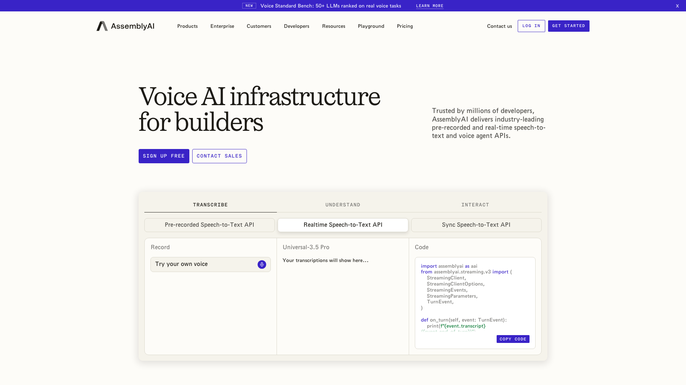
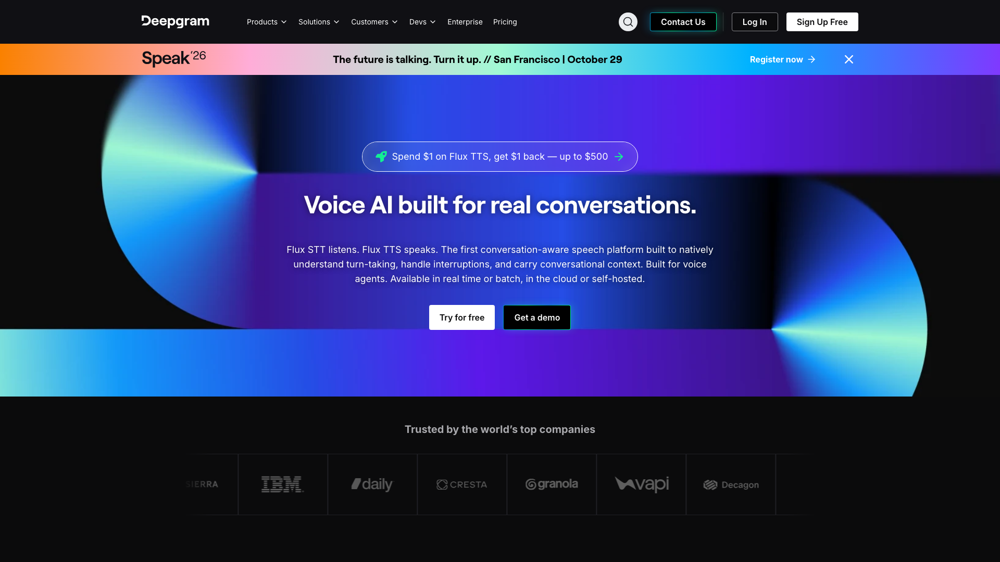
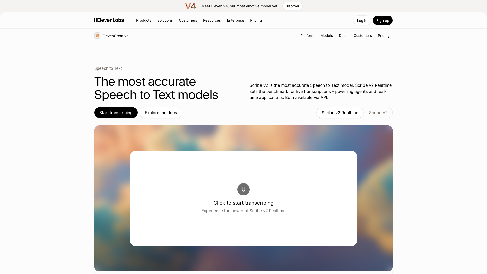
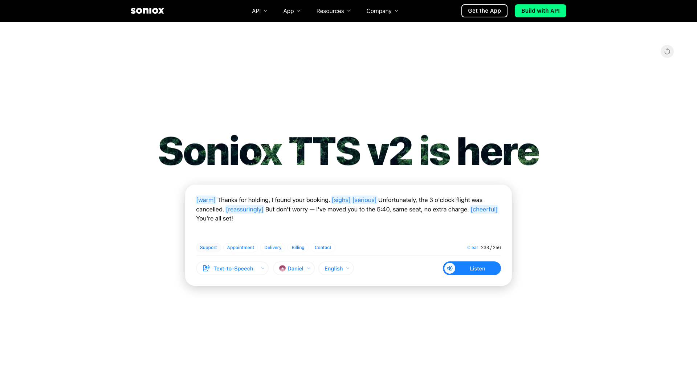
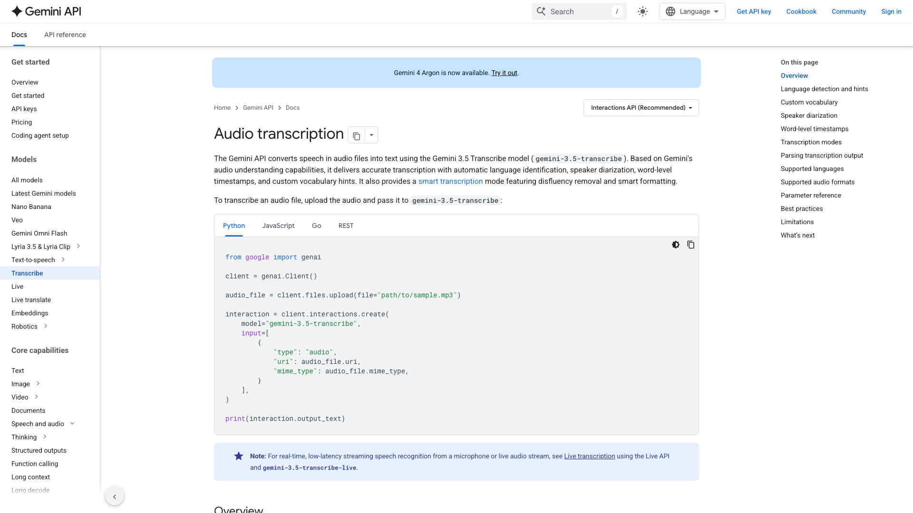
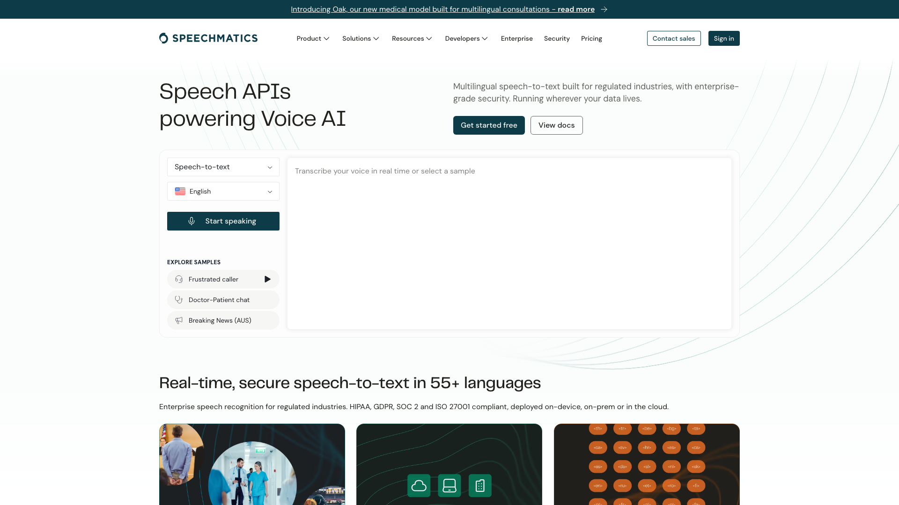
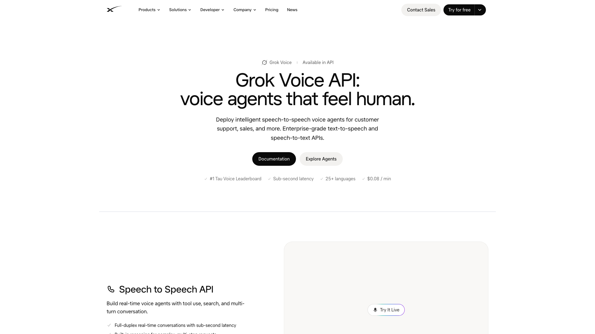
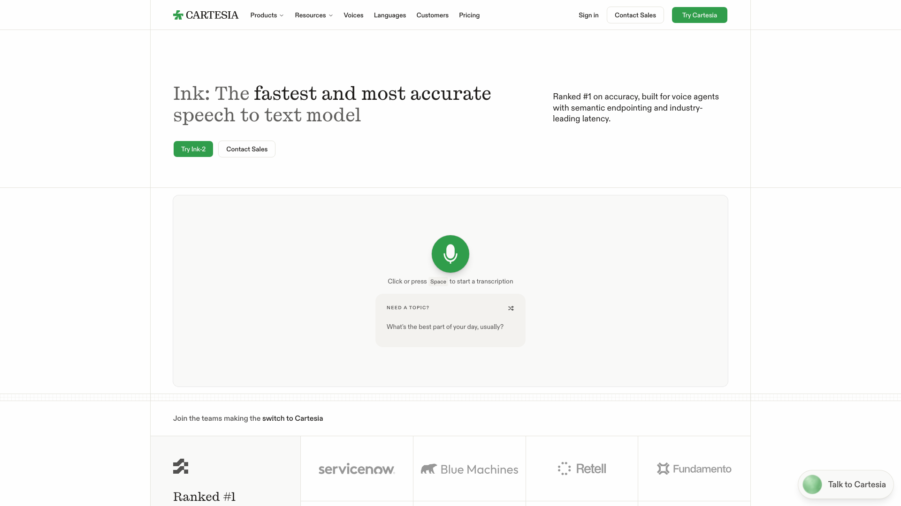
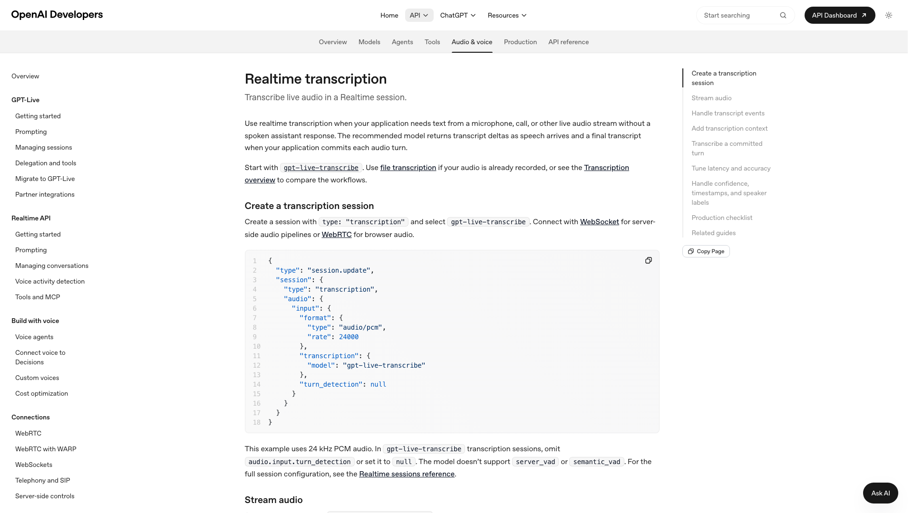
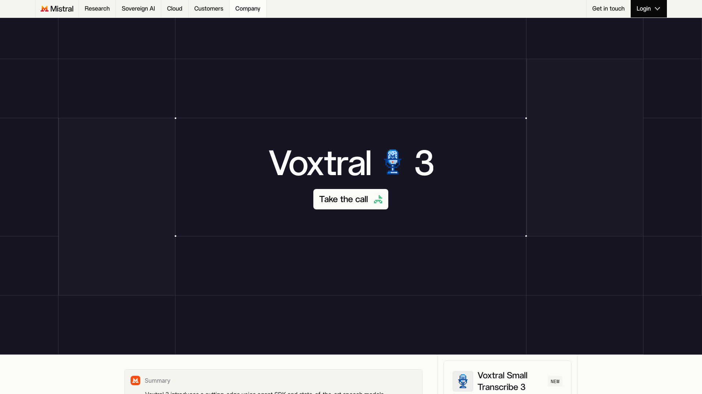

The best speech to text API for a voice agent in 2026 is AssemblyAI Universal-3.6 Pro when accuracy comes first, and Deepgram Flux when every millisecond counts. AssemblyAI had the lowest error rate on the Coval benchmark in October 2026, while Deepgram returned its final transcripts fastest there. ElevenLabs Scribe v2 Realtime, Soniox, Gemini 3.5 Transcribe and Speechmatics complete the top six. This ranking compares ten streaming APIs on what a voice agent needs from transcription: the time to the final transcript, accuracy, built-in turn detection, languages, price per minute and where the audio is processed.

Micdrop publishes this ranking. [Micdrop](/) is an open source TypeScript library for real-time voice conversations with AI. It does no transcription itself, so it has no place in the ranking. It ships ready integrations for OpenAI, Gemini, Mistral, Gladia and Gradium, plus one interface for plugging in any other API. Coval measured a higher error rate for Gladia than for every ranked API it covers. Gradium returned its final transcript later than every ranked API in the Pipecat benchmark. Both stay outside the top ten.

Prices come from each vendor's pricing page. Accuracy and speed figures come from independent benchmarks, unless the text marks them as the vendor's own. All figures were collected on 16 October 2026. Providers release a new model every few weeks, so check the numbers again before you commit.

## How the APIs were ranked

A voice agent answers a sentence only once it has its final transcript. The user waits for that transcript, then for [the language model](/blog/top-llms-voice-agents) and the voice. The ranking weighs these criteria:

- the word error rate (WER) and the time from the end of speech to the final transcript
- whether the API detects the end of the user's turn itself, or leaves that to your code
- the languages it transcribes in streaming, and whether one call can switch between them
- the price per minute of streamed audio
- where the audio can be processed, including a European region, and whether you can host the model yourself

The two main benchmarks are [Coval](https://benchmarks.coval.ai), which tests hosted endpoints continuously and reports 30-day averages, and the [Artificial Analysis streaming leaderboard](https://artificialanalysis.ai/speech-to-text/streaming), which measures from the end of speech detected by a voice detector. They use different audio and start timing from different moments, so compare two APIs within one benchmark only. The [Pipecat benchmark](https://github.com/pipecat-ai/stt-benchmark), run on 1,000 English turns in September 2026, adds a third measure, and the only one for Cartesia.

An API enters the ranking once it is generally available and documents how it handles the audio, with a processing region or a security certification. That rule leaves out two strong newcomers, Microsoft MAI-Transcribe-2-Streaming and Meta Muse Voice Transcribe, covered after the ranking. The order is our judgement, with no weighted score behind it. The time to the final transcript and the error rate weigh most. When one API is faster and another more accurate, we looked at turn detection, languages and European processing to order them.

## The comparison at a glance

| API and streaming model | Price per minute | Coval WER, time to final | Artificial Analysis WER, time to final | Languages in streaming | Turn detection in the API | EU processing |
|---|---|---|---|---|---|---|
| **AssemblyAI** Universal-3.6 Pro | $0.0075 | 2.1%, 134 ms | Not listed for this model | 32, code switching | Yes | EU endpoint |
| **Deepgram** Flux, Nova-3 | $0.0048 to $0.0065, promotional | 5.3 to 5.8%, 85 to 98 ms | 6.7%, 60 ms (Nova-3) | About 63, switching in 10 | Yes, model based (Flux) | EU endpoint |
| **ElevenLabs** Scribe v2 Realtime | $0.0065 | 4.3%, 121 ms | 3.6%, 140 ms | 90+ | Yes | Enterprise plan only |
| **Soniox** stt-rt-v5 | $0.002 | Not listed | 4.5%, 54 ms | 60+, code switching | Yes | EU region on request |
| **Google** Gemini 3.5 Transcribe Live | About $0.009 | 3.0%, 321 ms | 4.0%, 400 ms | 85+, code switching | Voice detection | EU endpoint on Google Cloud |
| **Speechmatics** Linden 1 | $0.005 | 3.9%, 275 ms | Not listed | 55+, one per stream | Silence based | EU endpoint, on premises |
| **xAI** Grok Voice Transcribe 2.0 | $0.0033 | Not listed | 2.7%, 490 ms | 38+, switching | Yes | None published |
| **Cartesia** Ink-2 | $0.0065 on Scale | Not listed | Not verified | 5 | Yes | None published |
| **OpenAI** gpt-4o-transcribe, gpt-live-transcribe | $0.003 to $0.017 | 3.7%, 786 ms (gpt-4o-transcribe) | Not listed for these models | Many, set by a hint | gpt-4o-transcribe only | EU endpoint, 10% extra |
| **Mistral** Voxtral Realtime | $0.006 | 5.3%, 418 ms | 5.3% | 13 | No | Default, or self-hosted |

The two benchmarks measure on different audio, so compare APIs within one column only. Across every model Coval tracks, the median time to the final transcript is 195 ms.

## The ranking

### 1. AssemblyAI Universal-3.6 Pro



[AssemblyAI](https://www.assemblyai.com) released Universal-3.6 Pro Realtime on 29 September 2026. Coval ranks it first on accuracy out of 31 models, at 2.1% WER, with its final transcript 134 ms after the end of speech.

The model decides from punctuation and meaning when the user has finished. It keeps the turn open while the caller is still spelling out a phone number, an email address or a street name. Booking and support agents often cut the caller off at that moment. You can add up to 100 keyterms and change them in the middle of a stream. Universal-3.6 Pro handles 32 languages and switches between them inside a sentence.

The [price](https://www.assemblyai.com/pricing) is $0.45 an hour, about $0.0075 a minute, keyterms included. AssemblyAI bills the whole length of the session, idle time included, so close the stream between turns. It has an EU streaming endpoint, SOC 2 Type 2 and HIPAA, and sells self-hosted streaming from a $20,000 commitment. Its JavaScript SDK runs on the server only. Retell, LiveKit, Zoom and Metaview appear among its customers.

### 2. Deepgram Flux and Nova-3



[Deepgram](https://deepgram.com) returns final transcripts faster than any other ranked API on Coval, 85 ms after the end of speech for Nova-3 and 98 ms for Flux. Twilio, Daily, LiveKit and Granola appear among the customers on Deepgram's homepage.

Flux is the model to pick for a conversation. A neural model, rather than a silence timer, decides when the user is done, and sends `EndOfTurn`, `EagerEndOfTurn` and `TurnResumed` events. The eager event lets the agent start preparing its answer before the turn is confirmed. Deepgram warns that this raises language model calls by 50 to 70%. Nova-3 covers about 63 languages. Both models switch between 10 of them within one call.

Deepgram trails the leaders on accuracy. Coval puts Nova-3 at 5.3% WER, 20th of 31, and Flux at 5.8%. The [streaming prices](https://deepgram.com/pricing) are promotional: Flux English costs $0.0065 a minute against a list price of $0.0077, and Nova-3 $0.0048 against $0.0077. Deepgram runs a generally available EU endpoint and sells self-hosting with an Enterprise licence. Its TypeScript SDK runs in Node and the browser.

### 3. ElevenLabs Scribe v2 Realtime



[ElevenLabs Scribe v2 Realtime](https://elevenlabs.io/speech-to-text) has the lowest error rate of the ranked models that finalise in under 150 ms on Artificial Analysis, 3.6% WER with the final transcript 140 ms after the end of speech. Coval measures it at 4.3% and 121 ms. It transcribes more than 90 languages. Its `secondary_languages` setting lists the other languages to expect in the same call.

Scribe commits a transcript in one of three ways: on your signal, after a silence threshold, or, since October 2026, through a turn prediction model that returns a turn probability.

The [price](https://elevenlabs.io/pricing/api) is $0.39 an hour, about $0.0065 a minute, on every plan, plus $0.08 an hour for keyterms. The JavaScript and React SDKs issue single-use tokens, so a browser can connect without exposing the API key. ElevenLabs holds SOC 2, ISO 27001 and PCI DSS Level 1, but reserves European data residency and zero retention for Enterprise contracts. Its first partial word arrives late, 2.2 seconds on Coval, which matters only to an interface that shows words while the user speaks.

### 4. Soniox



[Soniox](https://soniox.com) is the cheapest ranked API by a wide margin, at [$0.12 an hour](https://soniox.com/pricing), about $0.002 a minute, with speaker labels and language identification included. Its stt-rt-v5 model, released in June 2026, also returns the fastest final transcripts on Artificial Analysis, 54 ms after the end of speech, at 4.5% WER.

One model covers more than 60 languages and follows a speaker who changes language within a session. Soniox detects the end of a turn from pauses, intonation and context, with an adjustable sensitivity. It accepts up to 8,000 tokens of context for names and domain terms. SDKs cover Node, the browser, React and React Native.

Soniox publishes no latency or accuracy figure of its own and names a single customer, the German voicebot company mobilApp. Artificial Analysis rated the previous version at 11.9% WER in June 2026, so expect these numbers to keep moving. Soniox processes and stores the audio in an EU region when you ask its sales team. Soniox holds SOC 2 Type 2, HIPAA and ISO 27001.

### 5. Google Gemini 3.5 Transcribe Live



[Gemini 3.5 Transcribe](https://ai.google.dev/gemini-api/docs/transcribe), released on 26 August 2026, is the second most accurate ranked model on Coval, at 3.0% WER, with its final transcript 321 ms after the end of speech. Artificial Analysis gives 4.0% and 400 ms. Google reports that its final transcript arrives 70% faster than with Chirp 3, the model it replaces.

The live version, `gemini-3.5-transcribe-live`, streams over the Gemini Live API and recognises more than 85 languages, including several in the same session. It accepts up to 1,000 custom vocabulary terms, the most in this ranking along with Speechmatics. Turn detection runs on voice activity, automatic or driven by your own signal.

The [price](https://ai.google.dev/gemini-api/docs/pricing) is $3.50 per million audio tokens in and $21 per million tokens out, which Google estimates at about $0.009 a minute. A live session lasts ten minutes at most, so your code has to open a new one for a longer call. The model is in public preview on the Gemini API and generally available on Google Cloud's Gemini Enterprise Agent Platform, with an `eu` endpoint there. The `@google/genai` SDK issues ephemeral tokens for the browser.

### 6. Speechmatics Linden 1



[Speechmatics](https://www.speechmatics.com) launched Agent STT on its Linden 1 model on 17 September 2026. Coval measures it at 3.9% WER and 275 ms. It scored 1.05% semantic WER in the Pipecat benchmark, among the lowest in that run, with a median of 369 ms to the final transcript.

Linden 1 costs [$0.30 an hour](https://www.speechmatics.com/pricing), $0.005 a minute, and $0.15 an hour with volume. It covers more than 55 languages, takes a custom dictionary of up to 1,000 words and labels speakers at no extra cost. Speechmatics has the widest deployment choice of the ranked providers: cloud endpoints in the EU, the US and Australia, containers on your own servers, or on device. It holds ISO 27001, SOC 2 Type II and HIPAA. Vapi, LiveKit and the medical assistant Nabla use it.

Each stream handles one language, except bilingual packs such as Spanish and English. Speechmatics lists semantic turn detection as coming soon. Until then, end of turn detection relies on silence, so an agent that needs semantic turn detection has to run it in its own code.

### 7. xAI Grok Voice Transcribe 2.0



[Grok Voice Transcribe 2.0](https://docs.x.ai/developers/model-capabilities/audio/speech-to-text), released by xAI on 18 September 2026, has the lowest error rate of the generally available models on Artificial Analysis, at 2.7% WER. Its final transcript arrives 490 ms after the end of speech, slower than Deepgram, ElevenLabs and Soniox on that benchmark.

It costs $0.20 an hour, about $0.0033 a minute, with speaker labels, timestamps and up to 100 keyterms included. It handles more than 38 languages and follows a switch in the middle of a recording. A `smart_turn` setting adds a model that predicts the end of the turn. Loom, at Atlassian, transcribes every video with it.

xAI holds SOC 2 Type 2, offers HIPAA on request, and keeps data 30 days by default unless you choose zero retention. It has no European region. With no ephemeral token, a browser has to reach the API through your own server. The documentation shows only raw WebSocket examples.

### 8. Cartesia Ink-2



[Cartesia](https://cartesia.ai/ink), the San Francisco company behind the Sonic voices, built Ink-2 for voice agents. Ink-2 sends its own turn events, `turn.start`, `turn.eager_end`, `turn.resume` and `turn.end`, so the agent needs no separate voice detector. It scored 1.02% semantic WER in the Pipecat benchmark, among the lowest in that run, with a median of 299 ms to the final transcript.

Ink-2 covers fewer languages than any other ranked API, five: English, French, Hindi, Japanese and Spanish. The older Ink-Whisper model still covers 100. In the same Pipecat run, the slowest 1% of Ink-2 turns took 1,584 ms, five times the median.

Cartesia bills [three credits per second](https://cartesia.ai/pricing), about $0.39 an hour on the $299 Scale plan, with 20,000 free credits to start. Cartesia has Python and TypeScript SDKs and integrations for LiveKit, Vapi and Pipecat. Cartesia holds SOC 2 Type II and sells on-premises or VPC deployment, without a published European region. ServiceNow, HeyGen and Synthesia appear on its Ink-2 announcement.

### 9. OpenAI gpt-4o-transcribe and gpt-live-transcribe



[OpenAI](https://developers.openai.com/api/docs/guides/realtime-transcription) has two kinds of streaming models. `gpt-4o-transcribe`, at about $0.006 a minute, and `gpt-4o-mini-transcribe`, at $0.003, run inside a Realtime transcription session with OpenAI's own voice detection, including a semantic mode that waits for the sentence to make sense. Coval measures gpt-4o-transcribe at 3.7% WER with its final transcript 786 ms after the end of speech, the slowest of the ranked APIs.

`gpt-live-transcribe`, released on 29 July 2026, is the model OpenAI now recommends for live audio. Its `delay` setting trades speed for accuracy. It accepts a `keywords` list as well as a free text prompt. OpenAI reports 9.6% WER on its own real-world set across nine languages. It costs [$0.017 a minute](https://developers.openai.com/api/docs/pricing), the most expensive ranked option, and has no server-side voice detection, so your code has to detect the end of speech and commit the audio.

OpenAI processes data in Europe through `eu.api.openai.com`, at 10% extra for models released since March 2026. OpenAI sells no self-hosted option. Its realtime models return no speaker labels or timestamps.

### 10. Mistral Voxtral Realtime



[Mistral](https://mistral.ai/news/voxtral-transcribe-2) released Voxtral Realtime on 4 February 2026 with its weights under Apache 2.0. It is the only ranked model you can download and run on your own GPU, through vLLM with an OpenAI-compatible endpoint. The 4 billion parameter model fits on a single GPU.

The hosted API costs [$0.006 a minute](https://docs.mistral.ai/models/voxtral-mini-transcribe-realtime-26-02). A `target_streaming_delay_ms` setting sets how long the model waits before writing a word, from under 200 ms to 2.4 seconds. Mistral reports that at 480 ms the error rate stays within one or two points of its file model. Coval measures 5.3% WER and 418 ms to the final transcript. Artificial Analysis also gives 5.3%.

Voxtral Realtime recognises 13 languages, among them English, French, German, Spanish, Arabic, Hindi and Chinese. It detects no end of turn, so your code decides when a sentence is over. Only the file model accepts context biasing. Mistral, based in Paris, processes data in Europe by default and sells on-premises deployment.

## Strong newcomers outside the ranking

[Microsoft MAI-Transcribe-2-Streaming](https://learn.microsoft.com/en-us/azure/ai-services/speech-service/mai-transcribe-2-streaming) took first place on Artificial Analysis on 1 October 2026, at 2.5% WER with its final transcript 128 ms after the end of speech. It is still a public preview with no SLA, served from four regions including Sweden Central. [TestingCatalog reports](https://www.testingcatalog.com/microsoft-launches-mai-transcribe-2-streaming/) an introductory price of $0.54 an hour. Once the model is generally available, it could enter this ranking near the top.

[Meta Muse Voice Transcribe](https://dev.meta.ai/models/muse-voice-transcribe/), launched on 1 September 2026, costs $0.18 an hour. Artificial Analysis measures it at 3.1% WER with its final transcript 160 ms after the end of speech. Meta documents no processing region, certification or customer for it yet, which keeps it out of this ranking. Its examples cover Python only.

## Other speech to text APIs worth knowing

[Gladia](https://www.gladia.io), a French company acquired by OVHcloud on 31 July 2026, recognises more than 100 languages and stores data in Europe or the United States. Real-time transcription costs from €0.68 an hour. Coval measures its Solaria-1 model at 6.1% WER and 556 ms.

[Gradium](https://gradium.ai), a Paris spin-off of the Kyutai lab, transcribes five European languages, with an EU endpoint and a self-hosted option. The Pipecat benchmark measured a median of 585 ms to its final transcript. [Reson8](https://reson8.dev), in Amsterdam, runs 10 European languages on its own GPUs in the Netherlands.

[Amazon Transcribe](https://aws.amazon.com/transcribe/) at $0.01 a minute, Azure AI Speech at $1 an hour and Google Cloud's Chirp 3 from $0.016 a minute all take more than 600 ms to the final transcript on independent benchmarks. They mostly suit teams already running on that cloud. [Rev AI](https://www.rev.ai) streams nine languages and scored 10.1% WER on Artificial Analysis.

Open source engines such as Whisper, Moonshine and Kyutai STT can [transcribe speech locally in Node](/blog/local-speech-to-text-node), with no per-minute bill. The browser's own [Web Speech API](/blog/web-speech-api) costs nothing but behaves differently from one browser to the next.

## How to choose between them

Start from the language of your calls. An English agent can use any ranked API. When callers switch language mid-call, pick AssemblyAI, Soniox, Gemini, ElevenLabs or xAI, or Deepgram within its 10 switching languages. Cartesia covers five languages and Mistral 13.

Then look at the time to the final transcript, measured from where your server runs. Deepgram, ElevenLabs, AssemblyAI and Soniox return it in about 150 ms or less, against 786 ms for OpenAI gpt-4o-transcribe. In [Micdrop](/docs/ai-integration), the voice detection in the browser closes the turn and tells the API the sentence is complete, so the delay that counts is the one after that signal. On 28 September 2026 we measured that delay for two of the integrated providers, with [Gemini at about 320 ms median and Gladia at about 480 ms](/blog/gpt-4o-transcribe-vs-gemini-vs-voxtral). Gemini's figure matches Coval's 321 ms. Gladia came out faster in our test than on Coval, which gives 556 ms.

Built-in turn detection saves code when your stack has none. Deepgram Flux, AssemblyAI and Soniox decide the end of turn from meaning as well as silence. Micdrop already closes the turn in the browser and adds [semantic end of turn detection](/docs/server/semantic-turn-detection) on the server, so a model without turn detection, such as Voxtral, needs no extra code in Micdrop.

Price matters at volume. A thousand hours of calls costs $120 on Soniox, $200 on xAI, $300 on Speechmatics, $390 on ElevenLabs, $450 on AssemblyAI and $1,020 on gpt-live-transcribe.

European teams can narrow the list by where the audio is processed. AssemblyAI, Deepgram, Speechmatics, Soniox, Google and OpenAI can process audio in Europe, Mistral by default. ElevenLabs reserves European residency for Enterprise plans. xAI and Cartesia publish no European region. You can [keep every step of the pipeline in Europe](/docs/ai-integration/sovereign-voice-ai) with Mistral, Gladia and Gradium.

Plan for outages too, since a voice agent stops answering when its transcription provider goes down. In Micdrop, every integration implements the same interface, so switching from Gemini to Mistral means replacing one line. [`FallbackSTT`](/docs/ai-integration/fallback-strategies/stt-fallback) moves to a second provider when the first one fails, and replays the audio of the sentence in progress. Raconte, a voice interview product built by Micdrop's maintainer, runs Gladia first with OpenAI as its fallback. You can connect an API without a ready integration, such as AssemblyAI or Deepgram, by writing a [custom speech to text class](/docs/ai-integration/custom-integrations/custom-stt) with a single `transcribe()` method.

## Frequently asked questions

<FaqList>
  <FaqItem question="What is the best speech to text API for voice agents in 2026?">
    AssemblyAI Universal-3.6 Pro had the lowest error rate on the Coval benchmark in October 2026, at 2.1%, with its final transcript 134 ms after the end of speech. Deepgram Flux returns final transcripts faster, in about 100 ms, and detects the end of turn with a model. ElevenLabs Scribe v2 Realtime and Soniox combine low error rates with very fast final transcripts. Gemini 3.5 Transcribe suits multilingual agents with a long custom vocabulary.
  </FaqItem>
  <FaqItem question="Which speech to text API has the lowest latency?">
    On Artificial Analysis, Soniox returns the final transcript 54 ms after the end of speech and Deepgram Nova-3 60 ms. On Coval, Deepgram Nova-3 measures 85 ms, Flux 98 ms and ElevenLabs Scribe v2 Realtime 121 ms. The network distance between your server and the provider adds to these figures, so measure from where your agent runs.
  </FaqItem>
  <FaqItem question="What is the cheapest streaming speech to text API?">
    Soniox costs $0.12 an hour of streamed audio, about $0.002 a minute. OpenAI gpt-4o-mini-transcribe and Meta Muse Voice Transcribe cost about $0.18 an hour, and xAI Grok Voice Transcribe 2.0 $0.20. Running Whisper or Voxtral Realtime on your own hardware removes the per-minute bill but adds the cost of the machine.
  </FaqItem>
  <FaqItem question="Who does Deepgram compete with?">
    Deepgram competes with AssemblyAI, ElevenLabs Scribe, Soniox, Speechmatics, Google Gemini Transcribe, OpenAI's transcription models, Cartesia Ink and xAI Grok Voice Transcribe for streaming speech to text. AssemblyAI is more accurate on the Coval benchmark, Soniox is cheaper, and Speechmatics has more deployment options. Deepgram remains the fastest to the final transcript on Coval.
  </FaqItem>
  <FaqItem question="Which speech to text APIs can process audio in the EU?">
    AssemblyAI, Deepgram and Speechmatics run EU endpoints. Soniox opens an EU region on request. OpenAI processes data in Europe at 10% extra on recent models. Google offers an EU endpoint for Gemini 3.5 Transcribe on its Gemini Enterprise Agent Platform. Mistral processes data in Europe by default. Outside the ranking, Gladia can store data in Europe and Gradium has an EU endpoint. ElevenLabs reserves EU residency for Enterprise plans. xAI and Cartesia publish no European region.
  </FaqItem>
  <FaqItem question="Can I self-host a streaming speech to text model?">
    Mistral publishes Voxtral Realtime under Apache 2.0, so you can run it on your own GPU through vLLM. Speechmatics, Deepgram, AssemblyAI and Cartesia sell self-hosted or on-premises deployments, AssemblyAI from a $20,000 commitment.
  </FaqItem>
  <FaqItem question="Do I need end of turn detection in the speech to text API?">
    A voice agent needs end of turn detection somewhere, but it can come from the API or from your own code. Deepgram Flux, AssemblyAI, Soniox, ElevenLabs, Cartesia and xAI detect it themselves. Mistral Voxtral Realtime and OpenAI gpt-live-transcribe expect your code to say when the sentence is over, for instance with voice activity detection in the browser.
  </FaqItem>
  <FaqItem question="Is Whisper good enough for a real-time voice agent?">
    Whisper reads up to thirty seconds of audio at a time and was built for files, so streaming it means re-running it on a growing buffer or transcribing each sentence after it ends. OpenAI's gpt-4o-transcribe costs $0.006 a minute, the price of Whisper on OpenAI's API, and streams over the Realtime API. Whisper remains useful on your own server, where it costs nothing per minute and no audio leaves the machine.
  </FaqItem>
</FaqList>

## Getting started

Pick AssemblyAI when accuracy on names, numbers and addresses comes first, Deepgram when the time to answer matters most, and Soniox when the bill does. Gemini 3.5 Transcribe suits a multilingual agent, and Voxtral Realtime a team that wants to host the model itself later.

Whichever you choose, test it on your own calls, with real callers who pause, interrupt and switch language. Micdrop lets you swap the speech to text provider without touching the browser or the rest of the pipeline:

```bash
npm install @micdrop/server @micdrop/web @micdrop/gemini @micdrop/openai
```

You can [compare the transcription, agent and voice integrations](/docs/ai-integration), then [run a first voice call in about five minutes](/docs/getting-started).

<RankingJsonLd
  name="Best speech to text APIs for voice agents in 2026"
  description="Streaming speech to text APIs ranked for real-time voice agents in October 2026."
>
  <RankingEntry name="AssemblyAI" url="https://www.assemblyai.com" />
  <RankingEntry name="Deepgram" url="https://deepgram.com" />
  <RankingEntry name="ElevenLabs Scribe v2 Realtime" url="https://elevenlabs.io/speech-to-text" />
  <RankingEntry name="Soniox" url="https://soniox.com" />
  <RankingEntry name="Google Gemini 3.5 Transcribe" url="https://ai.google.dev/gemini-api/docs/transcribe" />
  <RankingEntry name="Speechmatics" url="https://www.speechmatics.com" />
  <RankingEntry name="xAI Grok Voice Transcribe" url="https://docs.x.ai/developers/model-capabilities/audio/speech-to-text" />
  <RankingEntry name="Cartesia Ink" url="https://cartesia.ai/ink" />
  <RankingEntry name="OpenAI" url="https://developers.openai.com/api/docs/guides/realtime-transcription" />
  <RankingEntry name="Mistral Voxtral Realtime" url="https://mistral.ai/news/voxtral-transcribe-2" />
</RankingJsonLd>
