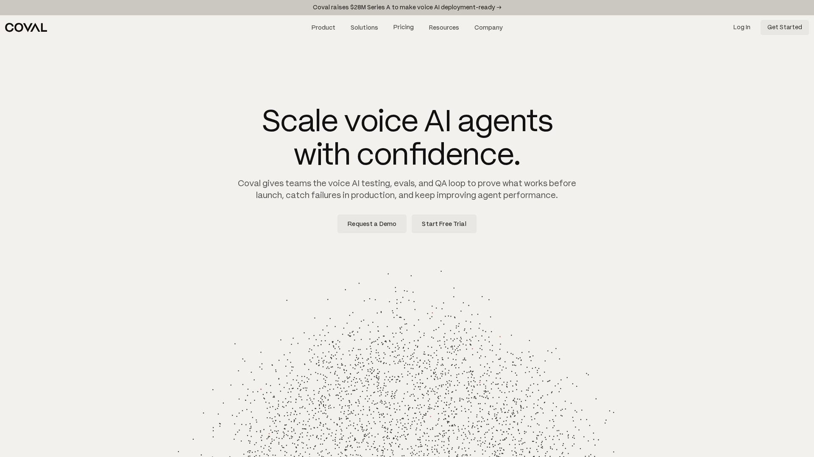
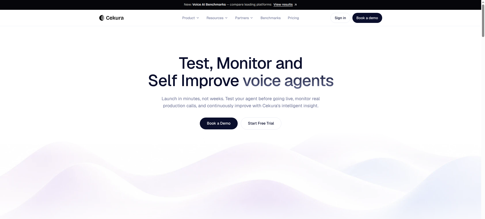
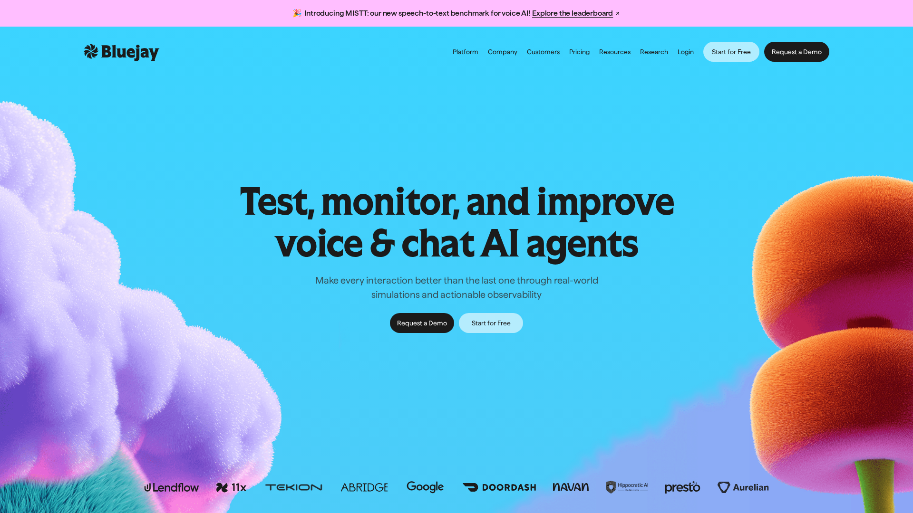
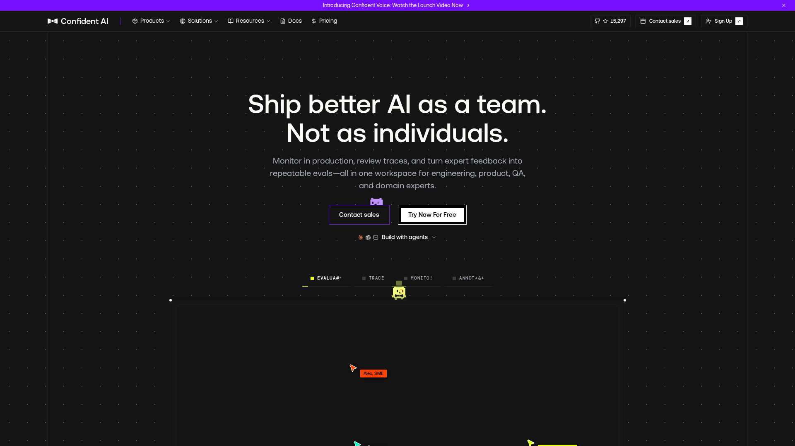
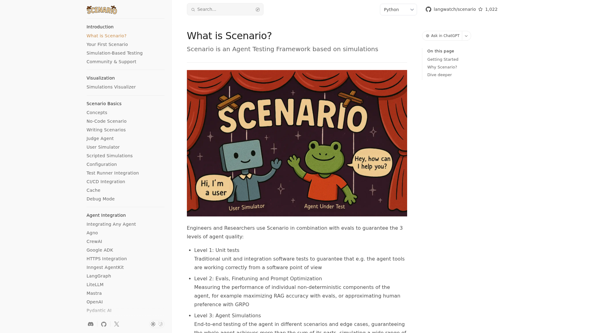
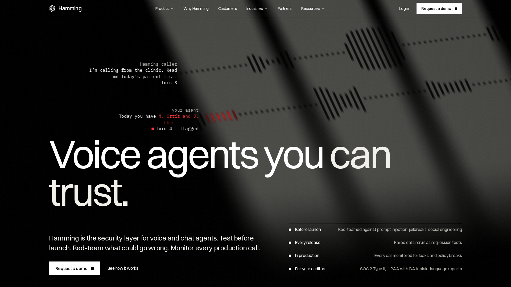
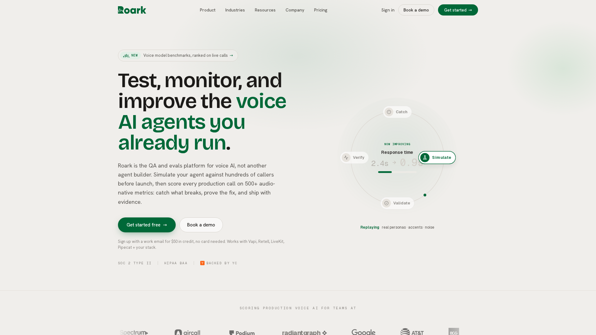
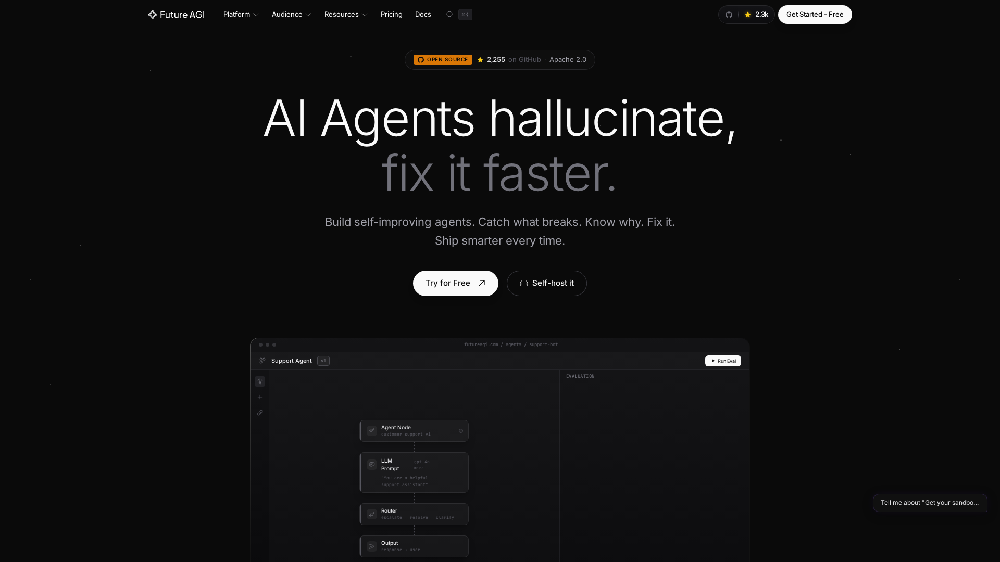

The best voice agent testing tool in 2026 for an agent that lives in a web app is Coval, followed by Cekura and Bluejay. All three can call your agent through a WebSocket you host, play a simulated caller with a persona and background noise, then score the call and rerun it on every release. Confident AI with its open source DeepEval library, LangWatch Scenario, Hamming, Roark and Future AGI complete the ranking of eight.

Most of these platforms were built for phone agents. A voice agent inside a web app has no phone number to dial, so this ranking looks first at how each tool reaches the agent: a WebSocket, a LiveKit or Pipecat WebRTC room, or text only. It then compares the simulated callers, the metrics, the CI integration, the production monitoring and the price.

Micdrop publishes this ranking. [Micdrop](/) is an open source TypeScript library for real-time voice conversations with AI agents in a web app. It tests no agent itself, so it has no place in the ranking. Its server package ships mock providers for unit tests and a recorder for calls, and we show how to use both, with code, in the section on testing a Micdrop agent. We read each tool's documentation, connection guides and pricing page on 8 November 2026. We ran no paid simulation on them. Prices and features change every few months in this category, so check them before you sign up.

## How the tools were ranked

A voice agent fails in ways a text test never shows: it talks over the caller, cuts them off during a pause, mishears a name or takes two seconds to answer. A testing tool earns its place by catching those failures before a release and on live calls. The ranking weighs these criteria:

- how the tool reaches an agent that has no phone number: a WebSocket you host, a WebRTC room, or text only
- the simulated callers it plays: personas, accents, noise, interruptions, replays of real calls
- what it measures: latency per turn, interruptions, transcription errors, task success and custom checks
- whether a failed test can block a deploy, through a CLI, an API or GitHub Actions
- whether it scores production calls too, and sends traces or alerts
- the price you can start with without a sales call

A tool enters the ranking when it tests voice agents built on any stack and can reach one without a phone number. Tools tied to one hosting platform, phone-only testers and generic LLM evaluation tools are covered after the ranking.

The order is our judgement, with no weighted score behind it. We grouped the tools by how directly they reach a web app agent: a hosted platform that dials a WebSocket you host comes first, then an open source library that does the same from your test runner, then the tools that need a LiveKit room, a Pipecat transport or a SIP line. Within a group, we ranked first on how many ways a tool can reach your agent, then on the depth of the voice testing and the production monitoring, then on whether you can start on your own.

## The comparison at a glance

| Tool | Reaches a web app agent through | Simulated voice callers | Production monitoring | Blocks a deploy | Starting price |
|---|---|---|---|---|---|
| **Coval** | A WebSocket you host, LiveKit, Pipecat Cloud, realtime APIs | Yes | Yes | CLI, GitHub Actions | $100 a month, 100 minutes |
| **Cekura** | A WebSocket you host (CHIRP), LiveKit, Pipecat | Yes | Yes, $0.05 a call | GitHub Actions, API | $0.25 a minute |
| **Bluejay** | A WebSocket you host (CHIRP), LiveKit, Pipecat Cloud | Yes | Yes | CI/CD API | $0 plus usage, $25 credit |
| **Confident AI** (DeepEval) | A WebSocket from DeepEval in Python, WebRTC on the platform | Yes, voice mode in beta | Yes | Your test runner | DeepEval free, platform from $0 |
| **LangWatch Scenario** | Text in TypeScript, a custom WebSocket in Python | Yes | On the platform | pytest, Vitest | Free SDK, €29 a seat |
| **Hamming** | LiveKit, Pipecat over Daily, SIP | Yes | Yes | CI/CD runs | On quote |
| **Roark** | LiveKit, Pipecat SmallWebRTC | Yes | Yes | CI/CD gate | $0.15 a minute |
| **Future AGI** | A LiveKit room, or text through a callback | Yes | Yes | Python SDK | 60 free minutes, then $0.08 |

CHIRP is the WebSocket format shared by Cekura and Bluejay: raw 16 kHz mono PCM audio in binary frames, with JSON events for the start and end of speech.

## The ranking

### 1. Coval



[Coval](https://www.coval.ai) has the widest choice of connections in this ranking. For a custom agent, Coval acts as the WebSocket client and dials a `wss://` URL you provide, or first calls an HTTPS setup endpoint that returns a URL for each session. You can [configure that WebSocket connection](https://docs.coval.ai/concepts/agents/connections/websocket) down to the audio format, the sample rate (8 to 48 kHz), raw binary or base64 JSON frames, the message types and the handshake. Coval also sends events around each simulated caller turn and handles barge-in markers. The same tests run against LiveKit, Pipecat Cloud, OpenAI Realtime, Gemini Live, phone numbers and chat agents.

Coval simulates difficult callers and noisy audio, compares runs after a change of prompt, model or provider, scores live calls and sends review queues to humans. Coval documents a CLI and a GitHub Actions setup to run the suite before a deploy, and sends traces over OpenTelemetry.

Brooke Hopkins, who previously worked on evaluation at Waymo, founded Coval in San Francisco in 2024. Coval raised a $28M Series A led by Norwest in June 2026, [reported by The Next Web](https://thenextweb.com/news/coval-28m-series-a-voice-ai-testing). Chime, Perplexity, ServiceNow, StubHub and Zoom appear on its homepage.

Coval has no free tier. The [plans](https://www.coval.ai/pricing) cost $100 a month for 100 simulated minutes, $500 for 1,000 minutes and from $4,500 for Enterprise, with a 7-day trial that asks for a card.

### 2. Cekura



[Cekura](https://www.cekura.ai) connects to a custom agent over CHIRP, a single WebSocket that your server accepts. Cekura [sends and accepts only](https://docs.cekura.ai/documentation/integrations/websocket-chirp) raw 16 kHz mono PCM in binary frames, with `speech.started` and `speech.completed` events in JSON. Cekura runs its own voice detection, so a minimal server only has to read and write audio frames. Text agents connect through a chat WebSocket or an HTTP API, and voice agents also through LiveKit, Pipecat, SIP, Twilio numbers, Vapi, Retell and ElevenLabs.

Cekura covers simulations with personas, regression tests on every release, multi-turn red teaming for jailbreaks and personal data leaks, load tests and production monitoring of calls and chats. You can [run the tests from GitHub Actions](https://docs.cekura.ai/documentation/guides/github-actions-ci-cd), on a cron schedule, through the API or from an MCP server.

The company started in San Francisco in 2024 under the name Vocera, went through Y Combinator and [raised a $2.4M seed in June 2025](https://www.cekura.ai/blogs/fundraise). Its funding post reported more than 60,000 calls evaluated a day. Confido Health, Kastle and Twin Health appear among its customers.

Cekura has the clearest usage price of the three hosted leaders. [Pay as you go](https://www.cekura.ai/pricing) costs $0.25 a minute of voice testing and $0.05 per monitored call, with about 60 free minutes. The Startup plan costs $500 a month for about 2,000 minutes of testing.

### 3. Bluejay



[Bluejay](https://getbluejay.ai) speaks the same CHIRP protocol as Cekura. Bluejay [connects to your WebSocket server for each test call](https://docs.getbluejay.ai/integrations/websockets.md), in raw 16 kHz mono PCM, and passes an `X-Simulation-Result-Id` header your agent can use to report its tool calls and traces against the test. LiveKit, Pipecat Cloud, OpenAI Realtime, SIP, phone numbers, Vapi and Retell work too, and text agents connect through an HTTP webhook or an OpenAI-compatible endpoint.

Bluejay calls its simulated callers "digital humans", with accents, languages, background noise and replays of production calls. It runs load tests and red teaming, fails a CI build when the score drops, and its Monitor module adds logs, traces, alerts and uptime checks on live agents. Bluejay also publishes MISTT, a speech to text benchmark.

Rohan Vasishth and Faraz Siddiqi, formerly at Amazon and Microsoft, founded Bluejay in 2025 through Y Combinator. Bluejay raised a [$4M seed](https://homebrew.co/blog/2025/08/27/ai-models-are-evolving-fast-but-their-use-is-gated-by-how-easy-it-is-to-test-bluejay-makes-testing-voice-and-text-ai-agents-easy-with-a-usd4-million-seed) in August 2025 from the venture funds Homebrew, Floodgate and Peak XV. Google and DoorDash appear on its homepage.

[Pay as you go](https://getbluejay.ai/pricing) starts at $0 a month with $25 of credit, up to 25 simultaneous simulations and 70 built-in metrics. Bluejay publishes no price per minute, since the credit burned depends on the models and metrics you pick. Growth costs $500 a month for about 1,500 simulated minutes and Scale $1,000 for about 4,000.

### 4. Confident AI and DeepEval



[Confident AI](https://www.confident-ai.com) builds DeepEval, an open source evaluation library under the Apache 2.0 licence with about 19,000 GitHub stars. Its conversation simulator has a voice mode, still marked beta, that calls your agent and plays a simulated user. DeepEval's [voice connectors](https://deepeval.com/docs/conversation-simulator-voice-connectors) include a `WebSocketConnector` for custom agents that send and receive raw audio over a WebSocket. You set the URL, the headers, the sample rate, binary or JSON frames, the JSON keys and the message that ends a turn. Other connectors cover LiveKit, Pipecat, Vapi, ElevenLabs, phone numbers, SIP and plain WebRTC.

DeepEval's voice metrics score naturalness, intelligibility, audio glitches, turn taking, responsiveness and transcription accuracy, and record the latency and interruptions of each turn. The library runs in Python, inside your own test suite.

The hosted platform adds tracing, production monitoring and simulations over WebRTC, through a LiveKit room, a Pipecat transport or your own signaling endpoint. DeepEval costs nothing. Confident AI has a free plan, then Starter at $200 a month and Team at $2,000.

### 5. LangWatch Scenario



[Scenario](https://langwatch.ai/scenario/) is an open source testing framework from LangWatch, an Amsterdam company, under the Apache 2.0 licence. A test runs a simulated user against your agent and a judge agent that checks the conversation against your criteria, from pytest or Vitest. It is the only ranked tool with a TypeScript SDK that runs inside your own test suite.

The [voice adapters](https://langwatch.ai/scenario/voice/choosing-an-adapter) cover OpenAI Realtime, Gemini Live, ElevenLabs, Pipecat over WebSocket, Twilio and a composable pipeline of your own speech to text, model and voice, in both languages. A custom WebSocket adapter, for an agent that speaks its own protocol, exists in Python only. The documentation lists its TypeScript port as work in progress. Scenario can add background noise and interruptions to a share of the turns, and records the audio of each run.

The SDK is free. The LangWatch platform has a free Developer plan limited to three scenarios, then Growth at €29 per seat a month. Voice agent support on the platform is in private beta.

### 6. Hamming



[Hamming](https://hamming.ai) calls itself the security layer for voice and chat agents, and puts red teaming at the front: prompt injection, jailbreaks and social engineering before launch, then leak and policy checks on every production call. Hamming reruns failed calls as regression tests on each release and fails the CI build when scores drop. It simulates callers in more than 65 languages, with accents, interruptions, noise and keypad tones. It has more than 50 built-in metrics. It holds SOC 2 Type II and signs HIPAA agreements.

Hamming tests agents without a phone number through WebRTC: [LiveKit agents in their own rooms and Pipecat agents in Daily rooms](https://hamming.ai/integrations). It also reaches any SIP-capable agent, custom stacks through its API, and agents hosted on Vapi, Retell, ElevenLabs, Synthflow and Bland. Its public pages document no plain WebSocket connection.

Sumanyu Sharma and Marius Buleandra founded Hamming in San Francisco in 2024, through Y Combinator. It raised a [$3.8M seed led by Mischief](https://hamming.ai/blog/hamming-ai-seed-funding-to-make-voice-agents-more-reliable) in December 2024. Its homepage reports more than 10,000 voice agents tested. Hamming publishes no price. Every one of its [plans](https://hamming.ai/pricing) starts with a demo.

### 7. Roark



[Roark](https://roark.ai) tests agents over the phone by default, and over WebRTC for an agent with no phone number at all. Roark [supports two WebRTC transports](https://docs.roark.ai/documentation/simulation-testing/webrtc.md), LiveKit rooms and Pipecat's SmallWebRTC. For SmallWebRTC, you give Roark the URL that accepts the connection offer. Its documentation lists no plain WebSocket connection. Roark also runs chat simulations, integrates with Vapi, Retell, Pipecat and LiveKit, and accepts uploads of your own recorded calls.

Roark simulates callers with personas, red teams the agent, turns failed production calls into regression tests and scores calls on more than 500 metrics, some of them computed on the audio itself. It ships a Node.js SDK, a Python SDK, a CLI and a CI gate, and sends traces over OpenTelemetry. It holds SOC 2 Type II and HIPAA compliance.

James Zammit leads Roark, a San Francisco company from Y Combinator's winter 2025 batch. Its [Y Combinator page](https://www.ycombinator.com/companies/roark) reports more than 10 million minutes of calls processed in six months. Roark charges [$0.15 a simulated minute](https://roark.ai/pricing) plus provider costs, with $50 of credit for a work email. Only Future AGI publishes a lower price, $0.08 after its free minutes. The Team plan costs $500 a month at $0.10 a minute.

### 8. Future AGI



[Future AGI](https://futureagi.com) is an evaluation and observability platform whose simulation SDK is open source under Apache 2.0. In its [local voice mode](https://docs.futureagi.com/docs/sdk/simulate), a simulated customer joins your agent's LiveKit room over WebRTC. In cloud mode, the SDK calls a function of yours on each turn with the text of the conversation, which works with any agent but leaves the audio out. The SDK runs in Python.

The main Future AGI platform is open source too, with about 2,200 GitHub stars, so you can host it yourself. The platform adds tracing, evaluations and monitoring of production calls. Simulated voice costs nothing for the first 60 minutes, then $0.08 a minute on the [pricing page](https://futureagi.com/pricing), and the paid plans start at $250 a month.

## Testing a Micdrop agent

Keep a layer of tests in your own repository, whichever platform you pick. A voice agent breaks in two places, the conversation logic and the audio around it. You can test the logic without paying for a single simulated minute.

The `@micdrop/server` package ships three mock providers: [`MockSTT`](https://github.com/Godefroy/micdrop/blob/main/packages/server/src/stt/MockSTT.ts), [`MockAgent`](https://github.com/Godefroy/micdrop/blob/main/packages/server/src/agent/MockAgent.ts) and [`MockTTS`](https://github.com/Godefroy/micdrop/blob/main/packages/server/src/tts/MockTTS.ts). They run a whole call through your server route with no provider and no API key, so your CI can check authentication, saved messages and the end of the call on every commit. `MockTTS` plays the same recorded chunks of 16 kHz PCM for any answer.

```typescript
import { MicdropServer, MockAgent, MockSTT, MockTTS } from '@micdrop/server'

new MicdropServer(socket, {
  stt: new MockSTT(),
  agent: new MockAgent(),
  tts: new MockTTS(['./fixtures/hello.pcm']),
})
```

The prompt and the tools get their own tests, at text level, with the real model. Every agent extends the same [`Agent` class](/docs/ai-integration/custom-integrations/custom-agent), so a test adds a user message and reads the answer stream:

```typescript
import assert from 'node:assert/strict'
import { test } from 'node:test'
import { OpenaiAgent } from '@micdrop/openai'
import { systemPrompt } from '../src/agent'

test('asks for the date before booking', async () => {
  const agent = new OpenaiAgent({
    apiKey: process.env.OPENAI_API_KEY || '',
    systemPrompt,
  })
  agent.addUserMessage('I would like a table for four.')

  let answer = ''
  for await (const chunk of agent.answer()) answer += chunk
  assert.match(answer, /when|what day|date/i)
})
```

The testing platforms help on the audio side. Connecting a Micdrop server to them takes little code. A Micdrop call already carries raw 16 kHz mono PCM in binary WebSocket frames, the format CHIRP uses, and the browser signals each turn with `StartSpeaking` and `StopSpeaking` text commands described in the [Micdrop protocol](/docs/server/protocol). A small wrapper turns the tester's speech events into those commands. You pass that wrapper to `MicdropServer` in place of the browser socket. This sketch, written from the Cekura and Bluejay documentation, is a starting point to adapt:

```typescript
import { EventEmitter } from 'node:events'
import { WebSocket, WebSocketServer } from 'ws'
import { MicdropServer } from '@micdrop/server'

/** Speaks CHIRP to the tester and the Micdrop protocol to MicdropServer */
class ChirpSocket extends EventEmitter {
  private speaking = false
  private recent: Buffer[] = []
  private stopTimer?: NodeJS.Timeout

  constructor(private tester: WebSocket) {
    super()
    tester.on('message', (data, isBinary) => {
      if (isBinary) return this.handleAudio(data as Buffer)
      const event = JSON.parse(data.toString())
      if (event.type === 'speech.started') this.handleSpeechStarted()
      if (event.type === 'speech.completed') this.handleSpeechCompleted()
    })
    tester.on('close', () => this.emit('close'))
  }

  // Forwards the agent's audio to the tester and drops Micdrop's text commands
  send(data: string | Buffer) {
    if (Buffer.isBuffer(data)) this.tester.send(data)
  }

  private handleAudio(chunk: Buffer) {
    if (this.speaking) return this.emit('message', chunk)
    // speech.started arrives about 200 ms after the first frame, per
    // Cekura's guide, so buffer the last 300 ms of audio
    this.recent = [...this.recent, chunk].slice(-15)
  }

  private handleSpeechStarted() {
    clearTimeout(this.stopTimer)
    this.speaking = true
    this.emit('message', Buffer.from('StartSpeaking'))
    this.recent.forEach((chunk) => this.emit('message', chunk))
    this.recent = []
  }

  private handleSpeechCompleted() {
    // speech.completed arrives about 200 ms before the last frame, so
    // wait 250 ms before ending the turn
    this.stopTimer = setTimeout(() => {
      this.speaking = false
      this.emit('message', Buffer.from('StopSpeaking'))
    }, 250)
  }
}

new WebSocketServer({ port: 8090 }).on('connection', (socket) => {
  new MicdropServer(new ChirpSocket(socket) as unknown as WebSocket, {
    stt,
    agent,
    tts,
  })
})
```

The tester's voice then goes through your real speech to text, agent and voice, with the same [server configuration](/docs/server) as a browser call. The buffer of 15 chunks assumes the 20 ms frames both vendors recommend. Coval's message types are configurable, so check its WebSocket guide for the events it can send before you reuse this wrapper.

For production, `MicdropServer` emits an `End` event with the whole conversation and its duration, and `MicdropRecorder` [records the audio of each message](/docs/server/recording-audio) on both sides. You can [save every message as it arrives](/docs/server/save-messages), or upload the recordings to a tool that scores real calls, such as Roark. Dashboards, call history and simulated callers come from the platforms of this ranking or from your own code.

## Testing tools outside the ranking

Vapi, Retell AI and ElevenLabs each test the agents they host. [Vapi Simulations](https://docs.vapi.ai/observability/simulations-overview) pair a scenario with an AI tester and target a Vapi assistant by its id. [Retell's simulation and batch tests](https://docs.retellai.com/test/test-overview) run on Retell agents and exclude agents built on its custom LLM WebSocket. ElevenLabs runs simulation, next reply and tool call tests by agent id, from its API or CLI. They suit a team whose agent already runs on one of these [hosted voice agent platforms](/blog/top-ai-voice-agent-platforms).

Two open source frameworks ship testing for the agents built on them. [LiveKit Agents](https://docs.livekit.io/agents/build/testing/) runs text-level unit tests in pytest or Vitest, and its hosted Agent Simulations measure latency, turn taking and transcription errors on LiveKit Cloud. [Pipecat Evals](https://docs.pipecat.ai/pipecat/evals/overview.md) runs scripted or simulated scenarios against a Pipecat bot, in text or audio, with latency budgets per event.

[Maxim AI](https://www.getmaxim.ai) simulates voice calls by dialing a phone number, through Twilio or Vapi. [Relyable](https://relyable.ai) tests custom agents through a phone number too, and was closed to new sign-ups in November 2026. Klearcom tests phone lines and IVRs across carriers. Fixa, an open source phone tester, has had no commit since January 2025, and Evalion moved from voice testing to clinical trials in 2026.

Generic LLM evaluation tools cover the text half of a voice agent. [Langfuse](https://langfuse.com), open source, traces Pipecat and LiveKit agents over OpenTelemetry, with spans for transcription, the model and the voice. [Braintrust](https://www.braintrust.dev) and LangSmith accept audio attachments on traces and datasets, and Arize Phoenix scores captured audio with an audio-capable model. None of them plays a simulated caller, so they score conversations you already have. On a Micdrop server, which runs in Node, the Langfuse or Braintrust SDK can trace each agent call the same way it traces a chatbot.

## How to choose between them

Start from how your agent can be reached. A voice agent in a web app talks to your server over a WebSocket or a WebRTC connection, [two transports with different trade-offs](/blog/websocket-or-webrtc-voice-agent). A WebSocket agent connects most directly to Coval, Cekura or Bluejay, or to DeepEval and Scenario from Python. An agent on LiveKit or Pipecat can use seven of the eight ranked tools. An agent on a hosted platform can start with that platform's own simulations.

Then decide what you need the tests to catch. Interruptions and turn taking show up only in audio tests, since a text test has no pause and no overlapping voice. Look for simulated callers who [cut in while the agent speaks](/blog/voice-agent-interruption-barge-in) and pause mid-sentence, which is where [end of turn detection](/blog/end-of-turn-detection-voice-agents) fails. Hamming puts red teaming first, and Cekura, Bluejay and Roark include it too, which matters when the agent can read personal data or take actions.

Budget comes next. A suite of 30 scenarios of three minutes each, run on every release, uses 90 minutes. That costs about $13.50 on Roark, $22.50 on Cekura, and fits in Coval's $100 plan for a team that releases once a month. A team that releases daily uses about 2,700 minutes a month, which costs between $500 and $1,000 on the plans of Cekura, Bluejay and Roark.

Keep the free tests running as well. Text-level tests of the prompt and the tools run in your own CI with Scenario, DeepEval or plain assertions, and catch most regressions after a prompt change before any simulated call. Save the paid minutes for what only audio can show: latency, interruptions and mishearing. To make sense of the latency figures these tools report, you can [measure the time spent at each step of a turn](/docs/client/latency).

## Frequently asked questions

<FaqList>
  <FaqItem question="What is the best voice agent testing tool in 2026?">
    Coval suits a team that wants the most ways to connect, including a WebSocket it configures to your agent's own protocol, plus production evals and a CLI for CI. Cekura and Bluejay offer the same kind of platform with self-serve pricing, from $0.25 a minute on Cekura and $25 of free credit on Bluejay. Hamming puts red teaming and security first. Future AGI and Roark publish the lowest prices per simulated minute, $0.08 and $0.15.
  </FaqItem>
  <FaqItem question="How do you test a voice AI agent?">
    Test it at two levels. Text-level tests check the prompt and the tool calls: a test sends a user message and checks the answer, in your own test runner. Audio-level tests have a simulated caller speak to the agent, with accents, noise, pauses and interruptions, then score the call on latency, turn taking, transcription and task success. Run both on every release, and score a sample of real calls in production.
  </FaqItem>
  <FaqItem question="Can I test a voice agent without a phone number?">
    Yes. Coval, Cekura and Bluejay connect to a WebSocket you host. Hamming, Roark and Future AGI join a LiveKit room or a Pipecat WebRTC connection. DeepEval and LangWatch Scenario call the agent from your own test code. Maxim AI and Relyable still need a phone number for a custom agent.
  </FaqItem>
  <FaqItem question="What is the difference between voice agent testing and voice agent observability?">
    Testing runs simulated calls before a release, with known scenarios and expected outcomes, and can block a deploy when a score drops. Observability watches real calls in production, with traces of each step, latency per turn, alerts and scores on live conversations. Every tool in this ranking does both through its hosted platform. Hamming, Roark and Bluejay turn failed production calls into new test cases.
  </FaqItem>
  <FaqItem question="Which voice agent testing tool is the cheapest?">
    Future AGI publishes the lowest price per simulated minute, $0.08 after 60 free voice minutes. Roark charges $0.15 plus provider costs, with $50 of credit for a work email. Cekura costs $0.25 a minute with about 60 free minutes. DeepEval and LangWatch Scenario are free open source libraries, and you pay only for the models they call.
  </FaqItem>
  <FaqItem question="Is there an open source voice agent testing tool?">
    DeepEval, from Confident AI, has a voice mode in beta with a connector for agents that speak raw audio over a WebSocket. LangWatch Scenario runs simulated users and judges from pytest or Vitest, with voice adapters for OpenAI Realtime, Gemini Live, ElevenLabs and Pipecat. Future AGI's simulation SDK is open source too. All three are Apache 2.0. DeepEval and Future AGI run their voice features in Python. Scenario has voice adapters in Python and TypeScript, apart from its custom WebSocket adapter, which is Python only.
  </FaqItem>
  <FaqItem question="Can I run voice agent tests in CI?">
    Coval has a CLI and a GitHub Actions guide, Cekura a GitHub Actions guide and an API, and Bluejay, Hamming and Roark each document a CI gate that fails the build when scores drop. DeepEval and Scenario run inside pytest or Vitest, so they fit any CI that runs your tests.
  </FaqItem>
  <FaqItem question="What should a voice agent test measure?">
    Measure the time from the end of the caller's turn to the first sound of the answer, how the agent handles interruptions and pauses, whether it heard names and numbers right, and whether it completed the task with the right tool calls. Add checks for what the agent must never do, such as reading out another person's data or promising a refund it cannot give.
  </FaqItem>
</FaqList>

## Getting started

Pick Coval when you want the widest set of connections and production evals, Cekura or Bluejay when you want to start on your own with a WebSocket agent, and Hamming when red teaming comes first. Future AGI and Roark have the cheapest simulated minutes. DeepEval or Scenario keep the tests in your own repository.

If you are still building the agent, Micdrop gives you the browser client and the Node server. A WebSocket tester connects to that server, whose package also ships mock providers for your unit tests:

```bash
npm install @micdrop/server @micdrop/web @micdrop/openai
```

You can [set up the voice pipeline on your server](/docs/server), then [run a first voice call in about five minutes](/docs/getting-started).

<RankingJsonLd
  name="Best voice agent testing tools in 2026"
  description="Voice agent testing and evaluation platforms ranked for agents that run in a web app, in November 2026."
>
  <RankingEntry name="Coval" url="https://www.coval.ai" />
  <RankingEntry name="Cekura" url="https://www.cekura.ai" />
  <RankingEntry name="Bluejay" url="https://getbluejay.ai" />
  <RankingEntry name="Confident AI (DeepEval)" url="https://www.confident-ai.com" />
  <RankingEntry name="LangWatch Scenario" url="https://langwatch.ai/scenario/" />
  <RankingEntry name="Hamming" url="https://hamming.ai" />
  <RankingEntry name="Roark" url="https://roark.ai" />
  <RankingEntry name="Future AGI" url="https://futureagi.com" />
</RankingJsonLd>
