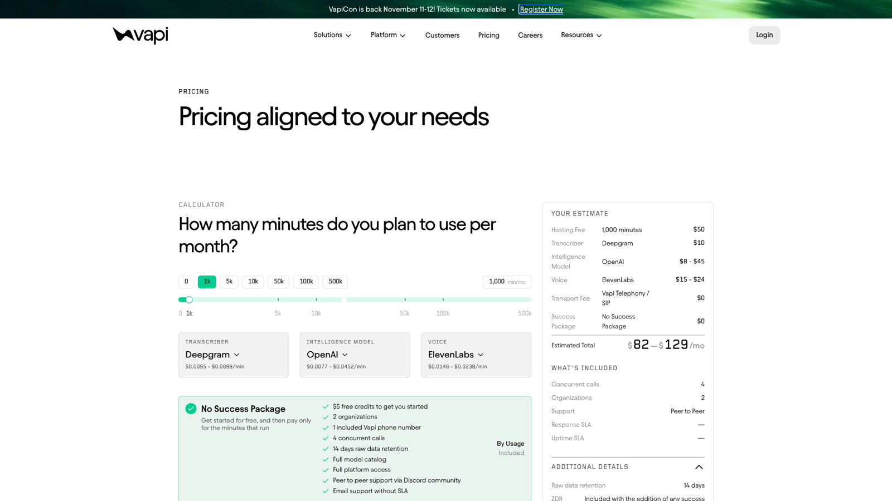
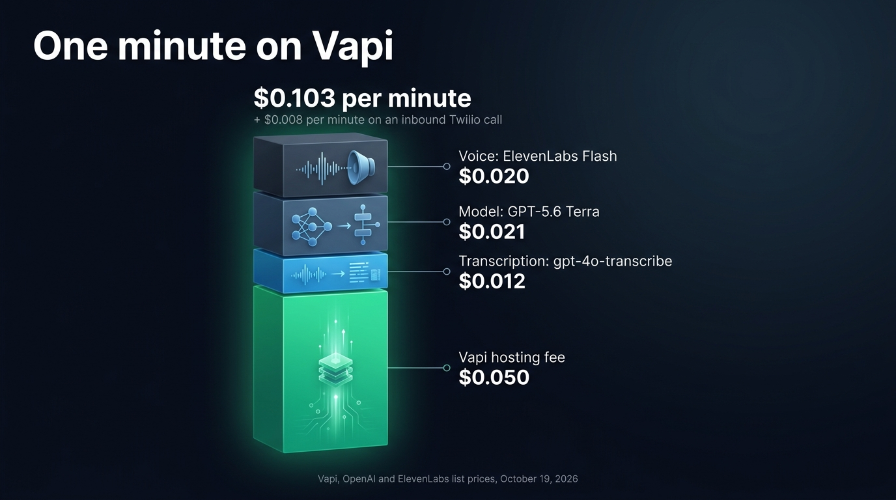
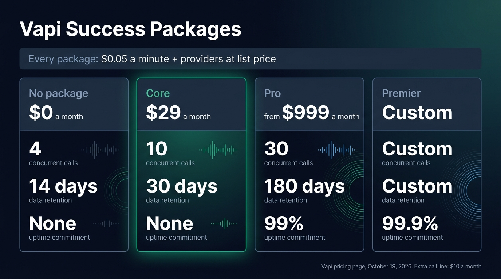
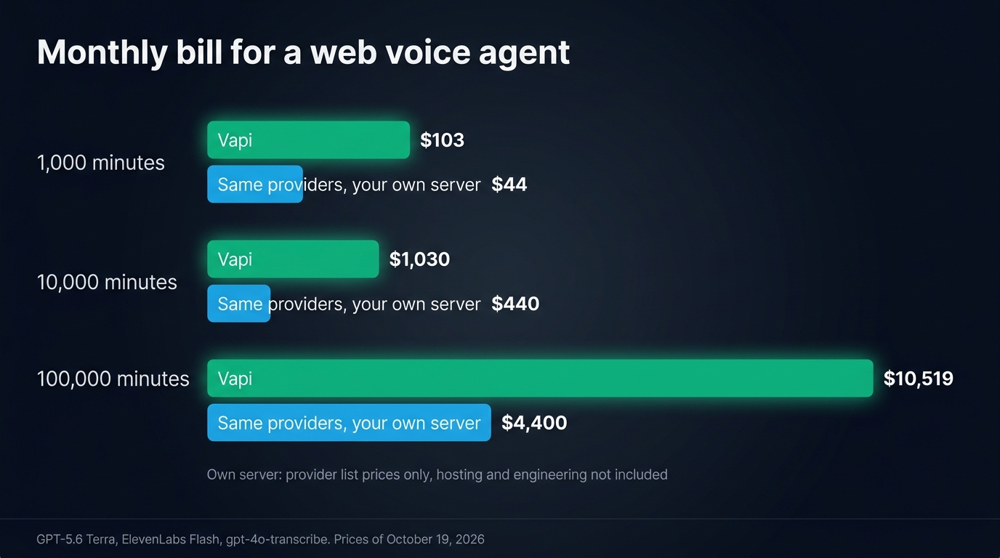

[Vapi](https://vapi.ai) costs $0.05 a minute in hosting fees, plus the speech to text, model, voice and telephony providers at their own list prices, according to [Vapi's published prices](https://vapi.ai/pricing) on October 19, 2026. Vapi's calculator puts 1,000 minutes on Deepgram, OpenAI and ElevenLabs at $82 to $129 a month, so $0.08 to $0.13 a minute all in. You start for free with $5 of credits. The paid Success Packages add support, concurrency and data controls, from $29 a month.

Vapi is a hosted platform for voice AI agents. You configure an assistant with a transcriber, a model and a voice, then Vapi runs the conversation on its servers, over a phone line or from its web and mobile SDKs. We split the Vapi bill into lines below, work out one minute of conversation and the monthly bill at 1,000, 10,000 and 100,000 minutes, then price the same conversation on your own server.

## Vapi pricing in short

A typical web agent comes to about $0.10 a minute on Vapi in October 2026, before the monthly fees for concurrency, support and compliance.

| Line | Price on October 19, 2026 | Billed |
| --- | --- | --- |
| Vapi hosting fee | $0.05 | per minute of call |
| Transcriber | provider price, $0.005 to $0.012 a minute in Vapi's calculator | per minute of audio |
| Model | provider price, $0.006 to $0.045 a minute in Vapi's calculator | per token |
| Voice | provider price, $0.007 to $0.024 a minute in Vapi's calculator | per character |
| Transport | free on Vapi numbers, Vapi WebSockets and Daily WebRTC, $0.0055 to $0.014 on Telnyx, Vonage and Twilio | per minute |
| Success Package | $0, $29, or 10% of hosting fees with a $999 minimum, or custom | per month |
| Extra concurrent call line | $10 | per month |
| Extra organization | $20 | per month |
| HIPAA | $2,000 per organization | per month |



## What the $0.05 hosting fee pays for

The hosting fee pays for the conversation loop Vapi runs on its servers, with turn-taking and interruptions. Every plan also includes unlimited agents, call logs, monitoring and simulated test calls. Vapi bills the same fee whatever the stack, for every minute the call runs, silences and the user's turns included.

Everything that turns speech into text, text into an answer and the answer into a voice comes on top. Vapi's pricing FAQ lists four components in the per-minute cost: "speech-to-text, the language model, text-to-speech, and transport. Each is billed at the provider's listed price with no markup. Vapi's $0.05/min hosting fee is added on top."

You can also plug your own keys into Vapi for each provider. Vapi's documentation on [provider keys](https://docs.vapi.ai/customization/provider-keys) states that once a key is validated, "you won't be charged when using that provider through Vapi". The provider then bills you directly, at the same list price or at whatever rate your contract gives you. The hosting fee stays, since it pays for Vapi's own work.

Transcription costs more on Vapi than the provider's price per minute suggests. Vapi's documentation on [how it calculates cost](https://docs.vapi.ai/assistants/model-intelligence/understanding-cost) states that Vapi "transcribes audio from both the caller and the assistant", so its estimate counts two audio channels. Its calculator puts OpenAI transcription at $0.0118 to $0.0122 a minute of call, about twice the $0.006 per minute of audio that [OpenAI lists for gpt-4o-transcribe](https://developers.openai.com/api/docs/pricing).

## A minute of conversation, line by line

Take a voice agent inside a web app. It runs on GPT-5.6 Terra, speaks with ElevenLabs Flash and transcribes with gpt-4o-transcribe, the same stack we used to [price a minute on Retell AI](/blog/retell-ai-pricing), so the two bills compare line for line. The call starts from the browser, so the transport is free. A typical minute holds 25 seconds of user speech, 30 seconds of agent speech and four turns. The model reads a 1,500 token system prompt and the whole history again on every turn, so it takes about 10,000 input tokens and returns 100 output tokens a minute.

| Line | Basis | Per minute |
| --- | --- | --- |
| Vapi hosting fee | every minute of the call | $0.050 |
| gpt-4o-transcribe | caller and assistant audio, at Vapi's calculator rate | $0.012 |
| GPT-5.6 Terra | 10,000 input and 100 output tokens at $2 and $12 per million | $0.021 |
| ElevenLabs Flash | about 500 characters at $40 per million | $0.020 |
| Transport | Vapi WebSockets or Daily WebRTC | $0 |
| Total, web call | | $0.103 |
| Total, inbound call on a Twilio number | plus $0.008 of transport | $0.111 |

The model and voice prices come from [OpenAI's API prices](https://developers.openai.com/api/docs/pricing) and [ElevenLabs' API prices](https://elevenlabs.io/pricing/api), both read on October 19, 2026. ElevenLabs counts about 1,000 characters per minute of audio, so 30 seconds of agent speech is about 500 characters. Vapi's own estimate assumes five model requests per turn and 150 output tokens a minute, so its calculator gives a higher model cost than this example.

The hosting fee makes up half of this minute, a share that grows as the providers get cheaper. With a cheap model and a cheap voice, the $0.05 can make up three quarters of the bill.

{/* IMAGE regen: api.py image, infographic, 1600x900. Scene: "Infographic showing how one minute of a Vapi web call adds up. A single vertical stacked bar on the left, built from four segments, bottom to top, each with its label and price to its right, connected by thin lines: 'Vapi hosting fee' '$0.050', 'Transcription: gpt-4o-transcribe' '$0.012', 'Model: GPT-5.6 Terra' '$0.021', 'Voice: ElevenLabs Flash' '$0.020'. The hosting fee segment is the largest, about half of the bar, in bright emerald. The three provider segments are sky blue and slate, their heights strictly proportional to their prices. At the top of the bar, a bold total: '$0.103 per minute'. Below it, a smaller secondary line: '+ $0.008 per minute on an inbound Twilio call'. Title at top left, in a modern clean bold sans-serif: 'One minute on Vapi'. Footer small text: 'Vapi, OpenAI and ElevenLabs list prices, October 19, 2026'. Wide 16:9 layout, lots of breathing room, labels in white and light slate."
    Infographic only: regenerate if Vapi changes its hosting fee or OpenAI or ElevenLabs change the prices used in the worked example. Last data sync: 2026-10-19. */}


## Plans and add-ons that change the bill

Vapi replaced its Build and Scale plans with Success Packages in September 2026, a change the usagepricing.com tracker [first recorded on September 20](https://www.usagepricing.com/blueprint/activity/vapi-2026-09-20-success-packages-replace-build-scale). Vapi's documentation on [billing and Success Packages](https://docs.vapi.ai/billing/pricing-and-success-packages) states that the packages apply to new customers, while accounts on the old pricing keep their terms. Every package keeps the same usage billing, $0.05 a minute plus the providers. What a package adds is support, concurrency, data retention and compliance.

| | No package | Core | Pro | Premier |
| --- | --- | --- | --- | --- |
| Monthly price | $0 | $29 | 10% of Vapi hosting fees, $999 minimum | Custom |
| Concurrent calls | 4 | 10 | 30 | Custom |
| Organizations | 2 | 2 | 10 | Custom |
| Vapi phone numbers | 1 | 5 | 10 | Custom |
| Raw data retention | 14 days | 30 days | 180 days | Custom |
| Zero data retention | No | Yes | Yes | Yes |
| Support response | No commitment | 2 business days | 1 business day | 1 hour for P0 |
| Uptime commitment | None | None | 99% | 99.9% |
| EU region | No | No | No | On request |

Three add-ons are available with any package, and without one:

- Each concurrent call line past the package default costs $10 a month.
- Each extra organization, a separate workspace with its own agents, numbers and keys, costs $20 a month.
- HIPAA costs $2,000 a month per organization, with a data processing agreement and a business associate agreement.

Three changes from the old plans matter for a budget. Zero data retention used to be a $1,000 monthly add-on and now comes with the $29 Core package. The free credits went from $10 to $5. A new account without a package gets 4 concurrent calls, where the old Build plan included 10.

Pro bills 10% of your hosting fees, so the $999 minimum applies until those fees pass $9,990 a month, about 200,000 minutes. Pro is a flat $999 a month below that volume, for the uptime commitment, the Slack support and the 30 lines.

Vapi gives you one free US phone number, five with Core and ten with Pro. Free Vapi numbers only take inbound calls. Outbound calls and campaigns need a number imported from Twilio, Vonage or Telnyx, which charge $0.0055 to $0.014 a minute of transport.

{/* IMAGE regen: api.py image, infographic, 1600x900. Scene: "Infographic of four pricing cards side by side, of equal width, each with a header and three large figures stacked vertically with a small caption under each. Card 1 header 'No package', price '$0 a month', figures: '4' caption 'concurrent calls', '14 days' caption 'data retention', 'None' caption 'uptime commitment'. Card 2 header 'Core', price '$29 a month', figures: '10' caption 'concurrent calls', '30 days' caption 'data retention', 'None' caption 'uptime commitment'. Card 3 header 'Pro', price 'from $999 a month', figures: '30' caption 'concurrent calls', '180 days' caption 'data retention', '99%' caption 'uptime commitment'. Card 4 header 'Premier', price 'Custom', figures: 'Custom' caption 'concurrent calls', 'Custom' caption 'data retention', '99.9%' caption 'uptime commitment'. The Core card has a thin emerald outline, the others a slate outline. A band across the top of all four cards reads: 'Every package: $0.05 a minute + providers at list price'. Title at top left, in a modern clean bold sans-serif: 'Vapi Success Packages'. Footer small text: 'Vapi pricing page, October 19, 2026. Extra call line: $10 a month'. Wide 16:9 layout, generous spacing, labels in white and light slate."
    Infographic only: regenerate if Vapi changes its Success Packages, their prices or their limits. Last data sync: 2026-10-19. */}


## What Vapi costs at 1,000, 10,000 and 100,000 minutes a month

Multiply the $0.103 minute by the volume, then add the concurrent call lines you need. The number of lines depends on when people call. This example spreads the calls over 22 working days of 8 hours, with three times the average load in the busiest hour, so the peak reaches one call at once at 1,000 minutes, about 3 at 10,000 and about 29 at 100,000.

| Minutes per month | Usage at $0.103 | Package and extra lines | Vapi bill |
| --- | --- | --- | --- |
| 1,000 | $103 | none, 4 lines cover the peak | $103 |
| 10,000 | $1,030 | none, 4 lines cover the peak | $1,030 |
| 100,000 | $10,300 | Core at $29 and 19 extra lines at $10, so $219 | $10,519 |

Core with 19 extra lines costs less at 100,000 minutes than 25 extra lines without a package ($250) or Pro's $999 minimum. A team that wants the 99% uptime commitment would pick Pro, for a total of $11,299 a month. The hosting fee alone comes to $5,000 a month at that volume.

The same stack costs $0.159 a minute on Retell AI before add-ons, since Retell resells the model and the voice at a flat price per minute where Vapi passes tokens and characters through. You can [compare Retell AI's price for each provider](/blog/retell-ai-pricing) line by line.

## Running the same pipeline on your own server

The alternative to a platform fee is to call speech to text, the model and text to speech from your own server, on your own keys. The hosting fee disappears and the provider bills stay. Transcription costs less too, since the pipeline sends audio to the transcriber only while the user speaks.

| Line | Basis | Per minute |
| --- | --- | --- |
| gpt-4o-transcribe | 25 s of audio at $0.006 a minute | $0.0025 |
| GPT-5.6 Terra | 10,000 input and 100 output tokens | $0.021 |
| ElevenLabs Flash | about 500 characters at $40 per million | $0.020 |
| Total in provider fees | | about $0.044 |

The provider fees come to about $44, $440 and $4,400 a month at 1,000, 10,000 and 100,000 minutes. The gap with Vapi is about $0.06 a minute: the $0.05 hosting fee, plus transcription of the whole call on both channels. Those figures leave out the server and the engineering time, which are now yours. The [providers you choose](/docs/ai-integration) then set the price of each minute. A speech to speech model such as GPT-Realtime-2.1 replaces transcription, model and voice with audio tokens, about $0.048 for a minute shared evenly between the user and the agent, as we computed when comparing [the OpenAI Realtime API with a pipeline](/blog/openai-realtime-api-vs-pipeline).

{/* TODO ANECDOTE: compare this computed example with the provider bill per minute Raconte pays in production, if the owner allows it to be published (question 03d8f118). */}

{/* IMAGE regen: api.py image, infographic, 1600x900. Scene: "Infographic comparing a monthly bill at three volumes, as grouped horizontal bars. Title at top left, in a modern clean bold sans-serif: 'Monthly bill for a web voice agent'. Three rows, each with two bars: an emerald bar labeled 'Vapi' and a sky-blue bar labeled 'Same providers, your own server'. Row '1,000 minutes': Vapi '$103', your own server '$44'. Row '10,000 minutes': Vapi '$1,030', your own server '$440'. Row '100,000 minutes': Vapi '$10,519', your own server '$4,400'. Bar lengths proportional within each row. A small note under the chart: 'Own server: provider list prices only, hosting and engineering not included'. Footer small text: 'GPT-5.6 Terra, ElevenLabs Flash, gpt-4o-transcribe. Prices of October 19, 2026'. Wide 16:9 layout, labels in white and light slate."
    Infographic only: regenerate if Vapi, OpenAI or ElevenLabs change the prices used in the worked example. Last data sync: 2026-10-19. */}


You then run on your own server what Vapi ran for you: the hosting, turn-taking and interruptions, transcripts, the call history and a dashboard for whoever reviews calls, plus phone numbers if you need them. [Micdrop](/) is an open source TypeScript library for real-time voice conversations with AI. It takes care of the turn-taking and the interruptions. `@micdrop/client` handles the microphone, voice activity detection and playback in the browser, while `@micdrop/server` runs the conversation in your Node server with the providers you choose. Micdrop is MIT licensed, so the library itself is free. This server runs the stack of the worked example:

```typescript
import { MicdropServer } from '@micdrop/server'
import { OpenaiAgent, OpenaiSTT } from '@micdrop/openai'
import { ElevenLabsTTS } from '@micdrop/elevenlabs'
import { WebSocketServer } from 'ws'

const wss = new WebSocketServer({ port: 8081 })

wss.on('connection', (socket) => {
  new MicdropServer(socket, {
    firstMessage: 'Hi, what can I help you with?',
    agent: new OpenaiAgent({
      apiKey: process.env.OPENAI_API_KEY,
      model: 'gpt-5.6-terra',
      systemPrompt: 'You answer questions about our product.',
    }),
    stt: new OpenaiSTT({
      apiKey: process.env.OPENAI_API_KEY,
      model: 'gpt-4o-transcribe',
    }),
    tts: new ElevenLabsTTS({
      apiKey: process.env.ELEVENLABS_API_KEY,
      voiceId: process.env.ELEVENLABS_VOICE_ID,
      modelId: 'eleven_flash_v2_5',
    }),
  })
})
```

Vapi's fallback plans switch to a backup voice, transcriber or model when a provider fails. Micdrop's [`FallbackTTS`](/docs/ai-integration/fallback-strategies/tts-fallback) and its STT and agent counterparts do the same on your own server.

You can run a first call in about five minutes. Wiring Micdrop into an existing application takes a few hours. Transcript storage, the call history, the dashboard, telephony and hosting take longer, since you build them yourself. Micdrop has a single maintainer and no support contract. Products like [Raconte.ai](https://raconte.ai), built by Micdrop's maintainer, and [Cibli](https://cibli.fr) run on it in production. If you are weighing the move, we compared [Vapi and Micdrop on architecture and migration](/blog/alternative-to-vapi).

## When Vapi is worth its fee

Vapi is worth its fee when the product is phone calls. It gives you a US number for free, imports numbers from Twilio, Vonage and Telnyx, and comes with SIP, outbound campaigns and call routing already built. Rebuilding that telephony yourself would cost more than the hosting fee for a long time.

Vapi is also worth it when you need commitments you cannot give yourself yet: a 99% uptime commitment on Pro, 99.9% on Premier, a named support team, and a HIPAA business associate agreement for $2,000 a month. Check the region first if your data has to stay in Europe, since Vapi offers its EU region only with Premier.

Vapi also makes sense at low volume, or before you know the feature will hold up. The gap with your own pipeline is about $59 at 1,000 minutes a month, less than a day of engineering. It reaches about $6,100 a month at 100,000 minutes, enough to pay for the hosting, the dashboard and the person who maintains them. The other hosted platforms differ widely on [price per minute, telephony and EU hosting](/blog/top-ai-voice-agent-platforms).

## Frequently asked questions

<FaqList>
  <FaqItem question="Is Vapi AI free?">
    Vapi charges no monthly fee without a Success Package. Each new account also gets $5 of free credits and one free US phone number for inbound calls. The credits cover about 50 minutes of calls when Vapi bills the providers at about $0.10 a minute. They last about 100 minutes with your own provider keys, since they then pay only the $0.05 hosting fee. After that every minute is billed.
  </FaqItem>
  <FaqItem question="Does Vapi charge the $0.05 when you bring your own keys?">
    Yes. Your own keys move the transcriber, model and voice bills to your accounts at those providers, and Vapi stops charging for them. The $0.05 hosting fee stays on every minute of call, since it pays for Vapi's orchestration.
  </FaqItem>
  <FaqItem question="How much does Vapi cost per minute?">
    Vapi charges $0.05 a minute in hosting fees, plus the providers at their list price. Its calculator gives $0.08 to $0.13 a minute with Deepgram, OpenAI and ElevenLabs. A web agent on GPT-5.6 Terra, ElevenLabs Flash and gpt-4o-transcribe comes to about $0.103 a minute in October 2026, or $0.111 on an inbound Twilio number.
  </FaqItem>
  <FaqItem question="How much does Vapi cost per month?">
    Vapi bills usage with no minimum. An account without a package pays no monthly fee, Core costs $29 a month, Pro 10% of hosting fees with a $999 minimum, and Premier a custom price. A web agent at $0.103 a minute comes to about $1,030 a month for 10,000 minutes. Extra concurrent call lines cost $10 a month each.
  </FaqItem>
  <FaqItem question="Is Vapi cheaper than Retell AI?">
    Usually it is, when both run the same providers. Vapi charges $0.05 a minute and passes tokens and characters through at list price, while [Retell AI charges $0.055 of infrastructure](/blog/retell-ai-pricing) and resells the model and the voice at a flat price per minute. With GPT-5.6 Terra and ElevenLabs Flash, a web call costs about $0.103 a minute on Vapi and $0.159 on Retell before add-ons. Retell includes 20 concurrent calls and charges $8 per extra line, while Vapi includes 4 to 30 depending on the package and charges $10.
  </FaqItem>
  <FaqItem question="Is Vapi a startup?">
    Yes. Vapi is a San Francisco company founded by Jordan Dearsley and Nikhil Gupta. It raised a [$50 million Series B led by the investment firm Peak XV in May 2026](https://techcrunch.com/2026/05/12/vapi-hits-500m-valuation-as-amazon-ring-chose-its-ai-platform-over-40-rivals/), and reports more than a billion calls on its platform.
  </FaqItem>
  <FaqItem question="How much does a text to speech API cost?">
    Voice APIs bill per character. ElevenLabs Flash costs $40 per million characters in October 2026, so [about $0.04 for each minute the agent speaks](/blog/elevenlabs-api-pricing-voice-agent). Vapi's calculator puts ElevenLabs, Cartesia and Vapi's own voices between $0.007 and $0.024 per minute of call. Local engines such as Kokoro or Piper cost nothing per character, since they run on your own server.
  </FaqItem>
</FaqList>

---

Vapi's price is simple once you split it: $0.05 a minute of hosting, the providers at list price, then a package for support and concurrency. When the product is phone calls, or when you need an uptime commitment this quarter, you pay for work Vapi has already done. A voice feature inside a web app at volume costs less than half the Vapi bill with the same providers called from your own server, though you build the hosting and the dashboard yourself. [Micdrop](/) runs the conversation inside your Node server. You can [start a first call in five minutes](/docs/getting-started) with your own provider keys.
