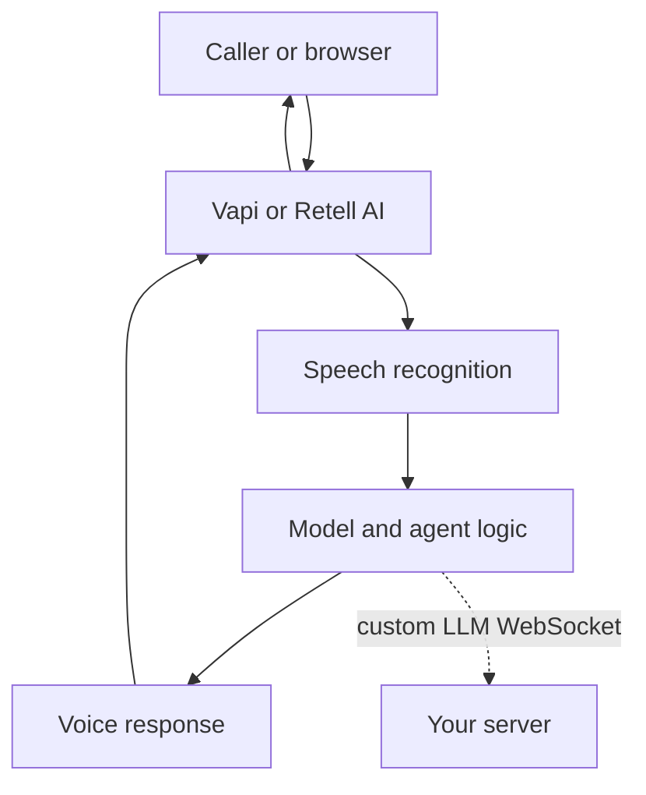
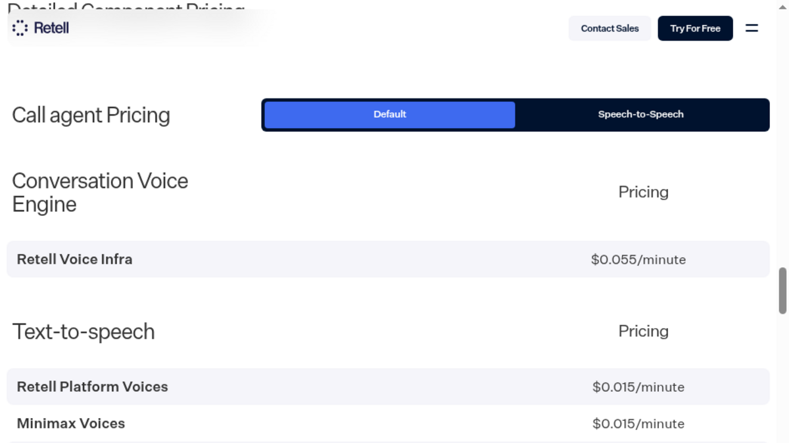

[Vapi](https://vapi.ai) and [Retell AI](https://www.retellai.com) both run hosted voice agents, but they package the work differently. Vapi separates its $0.05 per-minute hosting fee from the speech, model and voice costs. Retell AI combines the voice engine, model and voice into a single metered call price, with phone and workflow features around it. For a developer choosing between the two, the deciding question is whether provider choice and a configurable API matter more than call-center features and a ready-made agent workspace.

This comparison uses the vendors’ published pricing pages and product documentation checked on October 30, 2026. The vendors document features and billing, while your own setup determines latency, so the article avoids claiming one platform is faster.

## The short answer

Choose Vapi when you want to select the speech, model and voice providers, manage agents through an API, and keep each provider’s bill visible. Choose Retell AI when phone calls are the product and you want call flows, simulation, analytics, concurrency and telephony options in one managed service. For a voice interface inside a web app, either can work. A self-hosted library is another option when the team wants the conversation in its own server and is prepared to build the surrounding operations.

| Need | Vapi | Retell AI |
|---|---|---|
| Main product shape | Developer-oriented hosted voice platform | Hosted voice and phone-agent platform |
| Published usage model | $0.05 per call minute for hosting, plus provider costs | $0.07 to $0.31 per call minute, depending on model, voice and add-ons |
| Provider choice | Choose from supported transcriber, model and voice providers, or use your own keys | Choose from its supported models and voices, or connect a custom LLM server |
| Agent workflow | API, configuration, tools, webhooks and dashboard | Visual conversation flows, prompts, tools and dashboard |
| Browser calls | Web and mobile integrations, including WebRTC and WebSockets | Browser calls through its Web SDK |
| Phone operations | Phone numbers, SIP and telephony integrations | Phone numbers, SIP integrations, transfers and call-center features |
| Self-hosted deployment | No, Vapi runs the orchestration | No, Retell runs the voice engine |

## What each platform does

A voice agent listens to audio, turns speech into text or model input, generates a reply, speaks it and manages the conversation as the person interrupts or pauses. Vapi and Retell AI both host this loop. The difference is how much of the loop you configure, which costs appear separately, and what the product gives your team around each call.

Vapi centres the developer on an assistant configuration. You choose the transcriber, model, voice and transport, then connect tools and your own server logic. Vapi offers APIs and client integrations for calls from an application, alongside phone and SIP options. Its [provider key documentation](https://docs.vapi.ai/customization/provider-keys) says you can add your own credentials. Once a key is validated, that provider bills you directly rather than through Vapi.

Retell AI gives teams a hosted agent platform with API access, a visual flow builder, simulation tests, webhooks, transcripts and call analytics. You can configure a prompt-based agent or lay out a conversation as a flow. For custom response generation, Retell opens a WebSocket to a server you operate, sends it conversation events and expects streamed responses. Its [custom LLM guide](https://docs.retellai.com/integrate-llm/overview) explains that Retell still handles the call, transcription, turn taking and speech synthesis around that model connection.

## API and agent design

Vapi suits a team that wants its voice agent configuration to live close to application code. Its API lets you create and manage assistants, tools, phone numbers and calls. You can tune the model, voice and transcriber independently, then use a custom endpoint for logic that belongs in your own service. The dashboard remains useful for inspection and manual work, but the integration model centres on configuration and API calls.

Retell also has a developer API and SDKs, though its product experience puts more emphasis on the agent workspace. Teams can build a prompt-based agent or draw the conversation flow in the visual editor, test calls with simulations, and inspect calls through transcripts and analytics. When the built-in model setup does not fit, the custom LLM WebSocket lets your server generate responses while Retell handles the phone and voice layer.

That WebSocket is an important distinction, not a small implementation detail. Your server must keep a secure connection available for Retell, handle its event protocol and stop work when an answer is discarded. In return, the model logic can use your own services. With Vapi, custom model and provider integrations are also possible, but the provider configuration remains more central to its day-to-day setup.

For a developer-led product where agents are maintained as code and provider selection matters, Vapi is the more natural first evaluation. For operations teams who need people to author flows, run simulations and review calls in the platform, Retell presents a fuller workspace.

## Models and providers

Vapi’s main advantage is its mix-and-match approach. It documents separate provider choices for transcription, language models and voices. Its own pricing page currently estimates a sample stack with Deepgram, OpenAI and ElevenLabs. The provider catalog and compatibility still matter, so check the exact model and voice options you plan to use rather than assuming every provider supports every feature.

Retell offers a broad catalog of models and voices with each component’s rate listed in its pricing details. You choose from that catalog and can also provide a custom LLM through your server. In that arrangement, Retell remains responsible for the voice engine and call, while your service writes the model response. That is useful when your system prompt, retrieval or tools need to use an existing backend, though it means your agent depends on an always-available WebSocket service.

Provider integrations have different audio formats, streaming behavior, tool calling and interruption handling. Run the same realistic prompts and tool calls through both platforms before moving a production agent. The [voice-agent platform comparison](/blog/top-ai-voice-agent-platforms) covers broader deployment and provider trade-offs.

## What the pricing pages show

Vapi lists a $0.05 hosting fee for every call minute, with provider usage separate. Its [pricing page](https://vapi.ai/pricing), checked October 30, 2026, estimated $82 to $129 for 1,000 minutes using Deepgram transcription, an OpenAI model and an ElevenLabs voice. The estimate depends on its selected provider ranges and does not represent a quote for every configuration.

Vapi’s plans add fixed monthly charges and different service limits. The no-package option starts without a monthly charge and includes four concurrent calls. Core costs $29 a month and includes ten concurrent calls. Pro costs ten percent of Vapi hosting fees, with a $999 monthly minimum, and includes thirty concurrent calls. A further concurrent call line costs $10 a month. Vapi lists HIPAA handling at $2,000 a month. Teams should check the current package terms and their own expected concurrency before budgeting.

Retell AI’s [pricing page](https://www.retellai.com/pricing), checked October 30, 2026, lists pay-as-you-go voice agents at $0.07 to $0.31 per call minute. The exact rate depends on the selected model, voice and call options. Its pricing page currently lists voice infrastructure at $0.055 a minute, several voices at $0.015 and ElevenLabs Flash at $0.040. Its model rates vary, with GPT 5.6 Terra listed at $0.064 a minute. Telephony is free for custom telephony and varies by selected number provider. The first 20 concurrent calls are included, then additional concurrency costs $8 per call line each month.

Retell also lists call add-ons, including knowledge base use at $0.005 a minute, advanced denoising at $0.005, safety guardrails at $0.005 and PII removal at $0.01. AI quality assurance costs $0.10 per minute after the first 100 minutes. Phone numbers, SMS and knowledge bases can add monthly charges too.

The headline rates describe different billing bundles. Vapi’s $0.05 pays for hosting and orchestration, while the providers bill separately. Retell’s headline range combines multiple per-minute components and optional add-ons. A voice that speaks for half a call, a custom provider key, a phone number and a call that uses a large model all change the total.

For a specific web-call example, Micdrop’s own pricing posts calculated a Vapi call at about $0.103 per minute and a Retell call at about $0.159 per minute in October 2026, using the same model and voice assumptions and excluding Retell add-ons. Those are editorial calculations, not vendor quotes or a universal cost result. Vapi’s calculator separately showed $0.082 to $0.129 per minute for its current sample provider ranges. Recalculate with your expected talk time, model, voice and transport before treating either figure as your budget.

{/* TODO ANECDOTE: compare these calculated web-call costs with Raconte’s measured provider bill per minute, if the owner allows publication (question 03d8f118). */}

## Latency, interruptions and turn taking

Published pricing pages do not establish how quickly your particular agent will answer. The model, speech providers, network route, prompt length and the way a person speaks all affect the result. Vapi and Retell both describe real-time call handling and interruption support, but those descriptions are not a benchmark across the same audio, region and provider setup.

Test with the conversation that matters to your product. Include people who pause mid-sentence, interrupt the assistant, speak over background noise and ask for a tool action. Measure the time from the end of a user turn to the first audible response, and note whether interruptions cancel the previous response cleanly. Repeat the test on the browser and phone paths if you will use both.

## Data location and compliance

Both companies publish security and compliance information, though a certificate or policy statement does not certify your application’s entire data flow. Retell AI says it is HIPAA and GDPR compliant and SOC 2 Type 1 and Type 2 certified. Its [compliance documentation](https://docs.retellai.com/general/compliance) also says that Retell does not currently operate services within the European Union. Retell provides controls for data retention and agreements such as a DPA and SCCs. Teams handling EU residents’ data should review those documents, subprocessors and deployment details with their own privacy or legal team.

Vapi’s [EU region documentation](https://docs.vapi.ai/security-and-privacy/eu-region) describes a separate region for voice agents. Access requires the Premier Success Package, and the organization must use the EU dashboard, API and SIP endpoints. That qualification matters for a team whose requirement is European hosting. Vapi also describes its data flows and HIPAA settings in its security documentation. Check which region, providers and storage settings apply to the exact assistant you deploy.

A vendor’s regional infrastructure does not by itself establish compliance. The chosen transcription, model, voice, recording storage, retention period and the data your own tools send all contribute to the data map.

## When neither platform fits

A hosted service is compelling when your team wants call routing, phone numbers, a dashboard, call records and vendor support without building those systems. Both Vapi and Retell can make sense there. The trade is that the call loop runs on a vendor’s infrastructure and your bill includes the managed service.

For a browser-based voice feature inside a TypeScript product, a self-hosted library is another route. [Micdrop](/) is an open source TypeScript library for real-time voice conversations with AI. Its browser client connects to a Node server where your application runs the agent, and it supports separate STT, model and TTS providers as well as speech-to-speech integrations. That can keep the conversation next to the application’s own authentication and data.

With a library, your team runs the server and builds the operational tools it needs, such as phone numbers, a customer dashboard and call history. It also owns the service commitment. Micdrop is a fit for an in-app voice mode, rather than a replacement for a call-center platform. The [open source framework comparison](/blog/open-source-voice-agent-frameworks) also covers Dograh, a self-hostable platform with telephony, and broader frameworks such as LiveKit and Pipecat.

## How to choose

Choose Vapi if your team wants to keep the model, transcription and voice as separate choices, prefers API-driven configuration and accepts a distinct platform fee plus provider charges. Its EU region may fit a European deployment when the Premier package and region-specific setup work for your organization.

Choose Retell AI if you need a call-focused workspace, built-in flow authoring, simulations, analytics and a broad set of phone integrations. It is particularly suited to teams that want their staff to manage agents and review calls in the same product. Confirm the data-location constraints before using it for a workload that requires EU-hosted services.

Start with the use case. If your feature lives in an app instead of a phone line, compare the cost of a managed agent with the work of operating a library yourself. Include the server, provider usage, transcript storage, call history, monitoring and the time your team will spend maintaining them.

Evaluate one real use case on each finalist. Configure the same voice and model where possible, test phone and browser calls, trigger interruptions and tool calls, and record the bill for a known number of minutes. Choose the platform whose trade-offs match the product you are building.

## Frequently asked questions

<FaqList>
  <FaqItem question="Which is better, Vapi or Retell AI?">
    Vapi is a better starting point when a developer wants to select providers and configure agents through an API. Retell AI is a better starting point when a team wants a visual call-flow builder, simulations, analytics and phone operations in one hosted service. The better fit depends on the project, and actual call costs depend on providers, minutes and add-ons.
  </FaqItem>
  <FaqItem question="How much does Vapi cost compared with Retell AI?">
    Vapi charges $0.05 per call minute for hosting, with transcription, model and voice charges billed separately. Retell AI lists $0.07 to $0.31 per minute depending on its selected model, voice and add-ons. On October 30, 2026, Vapi’s calculator estimated $82 to $129 for 1,000 minutes with its sample providers. Check both calculators with your own configuration.
  </FaqItem>
  <FaqItem question="Can I use my own LLM with Vapi or Retell AI?">
    Vapi supports your own provider keys and custom model connections. Retell AI supports a custom LLM through a WebSocket server that generates responses while Retell handles the call and voice engine. The implementation differs, so test the event and tool behavior your agent needs.
  </FaqItem>
  <FaqItem question="Which platform is better for phone calls?">
    Both support phone-agent use cases. Retell AI puts more emphasis on call-center workflows, visual conversation flows, call analytics, transfers and a large set of telephony integrations. Vapi offers phone numbers, SIP and telephony providers with a developer-oriented configuration model. Compare the exact country coverage and carrier setup you need.
  </FaqItem>
  <FaqItem question="Does Vapi host agents in the European Union?">
    Yes. Vapi’s documentation describes an EU region for organizations on the Premier Success Package. The organization must use the EU dashboard, API and SIP endpoints. Confirm the package and data-flow requirements with Vapi before deployment.
  </FaqItem>
  <FaqItem question="Does Retell AI operate services in the European Union?">
    Retell AI’s compliance documentation says it does not currently operate services within the European Union. It also describes GDPR agreements and data-retention controls. A team with EU data requirements should check the current documentation and its own legal obligations.
  </FaqItem>
  <FaqItem question="What does Vapi do?">
    Vapi is a hosted voice-agent platform that runs the conversation loop and lets developers configure transcription, a language model, a voice, tools and telephony. It charges a hosting fee per call minute, while provider costs are billed separately.
  </FaqItem>
  <FaqItem question="Who are Vapi’s main competitors?">
    Retell AI is one of Vapi’s closest hosted competitors for developer-built voice agents. Bland and Synthflow also sell hosted phone-agent services, while LiveKit, Pipecat and Dograh cover open source approaches. Their differences in price, deployment and telephony are compared across [voice agent platforms](/blog/top-ai-voice-agent-platforms).
  </FaqItem>
  <FaqItem question="Who are Retell AI’s main competitors?">
    Vapi is one of Retell AI’s closest hosted competitors for developer-built voice agents. Bland and Synthflow also run hosted phone-agent services. Teams that want to run the pipeline themselves can evaluate Dograh, LiveKit or Pipecat, depending on whether they need a self-hosted platform or a framework.
  </FaqItem>
  <FaqItem question="Can I run a voice agent without Vapi or Retell AI?">
    Yes. A team can assemble an open source framework or library and run the voice loop on its own infrastructure. That removes a hosted platform fee, while the team takes responsibility for deployment, monitoring, call records and any phone features it needs.
  </FaqItem>
</FaqList>

## Try the in-app option

Vapi and Retell AI make sense when your team wants a managed voice platform, especially for phone calls. A browser-based voice feature can also run in your own TypeScript application if you want to own the server and provider choices. [Start a first Micdrop call](/docs/getting-started) to see how that setup works, then compare the work of running it with the hosted service your team would otherwise use.
