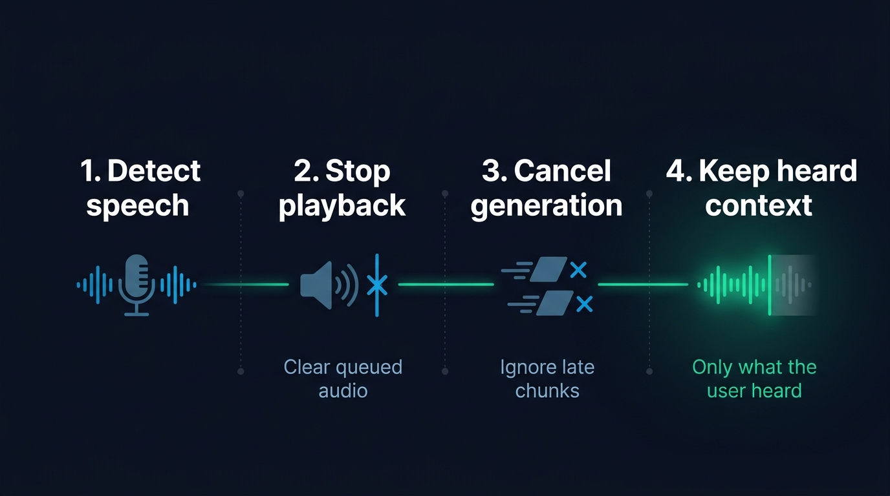
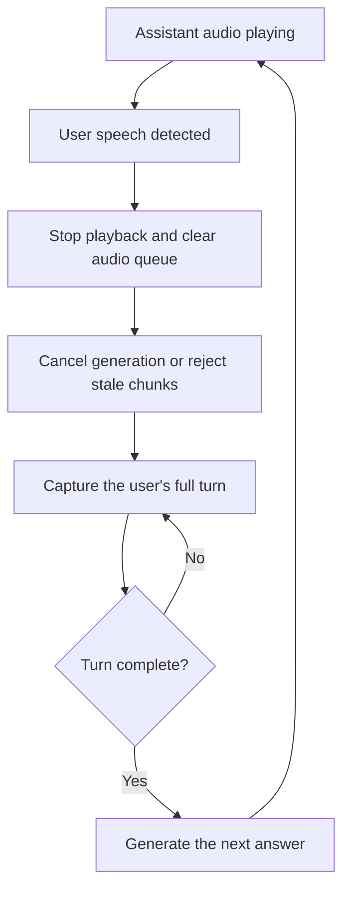
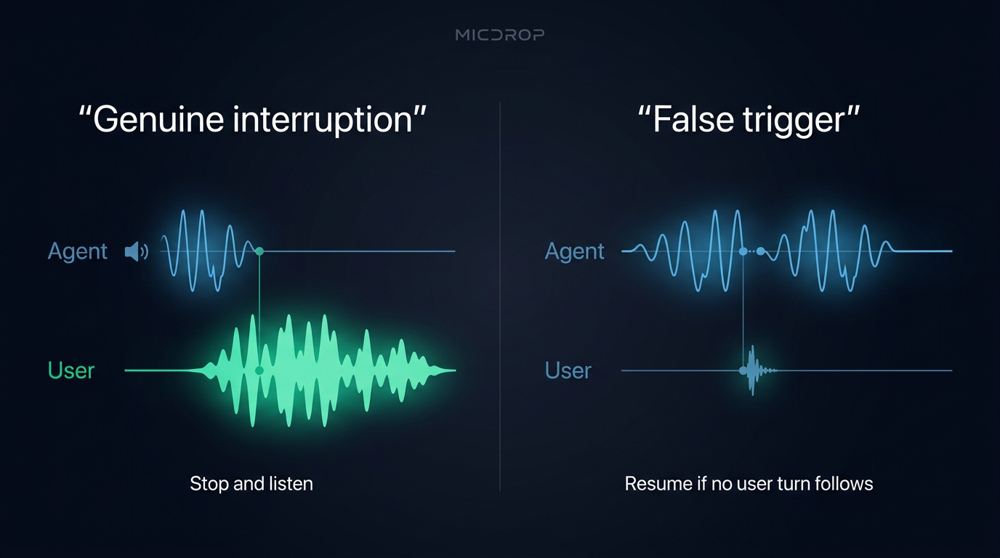

A voice agent that keeps talking after you interrupt feels like a recording, not a conversation. To handle an interruption, or barge-in, detect the user’s speech while the agent is playing audio, stop playback, cancel or ignore the unfinished response, and keep listening to the new utterance. Then make the conversation history match what the user actually heard. Voice activity detection (VAD) detects speech. Turn detection decides when the user has finished.

## What barge-in means in a voice agent

Barge-in is the user speaking while the agent is still talking. A working interruption path does three things: detects speech during playback, stops the current answer, and passes the new speech into the next turn. If one part is missing, the agent may talk over the user, resume speaking from a stale audio buffer, or answer as though the user heard words that never played.

Keep interruption detection separate from end-of-turn detection. VAD answers “Is there speech now?” End-of-turn detection answers “Has the speaker finished?” The first decision should stop the assistant promptly. The second can wait for a pause or for a sentence to sound complete. [Voice activity detection](/blog/voice-activity-detection-browser) and [turn detection](/blog/end-of-turn-detection-voice-agents) cover those jobs in more detail. A client-side [turn detector](/docs/client/turn-detection) can keep the user’s turn open while the sentence sounds unfinished. A server-side [semantic turn detector](/docs/server/semantic-turn-detection) can hold back the answer.

## Detect the user while the agent speaks

A voice agent needs to keep listening to the microphone during playback if it should be interruptible. Detecting speech only after the assistant finishes makes barge-in impossible. In a browser app, run VAD on incoming microphone audio and watch for a confirmed speech event while the speaker is playing.

The microphone also hears the agent’s own voice through speakers. Echo cancellation helps separate that output from the user’s voice. Without it, the VAD can mistake the assistant’s speech for a new user turn and interrupt itself. Headphones can help when the device’s echo cancellation does not remove enough playback echo. Learn [how browser VAD handles echo cancellation](/docs/client/vad) alongside volume and Silero speech detection.

VAD can also react to a cough, a door closing or a short “mm-hm.” A simple system can require confirmed speech before stopping playback, then use a noise filter to ignore a turn that carries no conversational meaning. A noise filter can ask the agent to classify sounds such as “uh” or “hmm” and ignore them. That decision happens after a turn reaches the agent, so it cannot prevent the initial playback interruption. The [noise filter for meaningless user sounds](/docs/server/noise-filtering) explains that distinction.

Some voice frameworks offer an adaptive interruption classifier that distinguishes a genuine request to take the floor from a backchannel. [LiveKit’s adaptive interruption documentation](https://docs.livekit.io/agents/logic/turns/adaptive-interruption-handling/) describes how it filters short acknowledgements, while its [turn-handling options](https://docs.livekit.io/reference/agents/turn-handling-options/) include resuming after a false interruption. That approach can make sense when acknowledgements such as “right” should not stop the response. It also adds a classification decision to tune. For a first implementation, start with confirmed speech and real recordings of the room and microphone you support.

## Stop playback, TTS and model generation

When speech is confirmed during the agent’s reply, stop the audio that the user hears first. Cancel the active TTS stream or model response, clear audio already queued in the browser or telephony provider, and ignore late chunks from the interrupted generation. Cancelling the model alone leaves audio already buffered for playback. Clearing the player alone lets the model or TTS keep sending more.

Use this sequence when a user interrupts a streamed answer:

1. Detect and confirm new speech while the agent is playing audio.
2. Stop the local player immediately and clear queued audio.
3. Cancel the active model and TTS work, or mark its response ID stale so late chunks are ignored.
4. Continue capturing the user’s audio until the turn detector confirms the turn has ended.
5. Start a new response from the updated conversation.

{/* IMAGE regen: api.py image, infographic, 1600x900. Scene: "Create a clear four-step left-to-right technical infographic about voice-agent barge-in. Render these exact short English labels: “1. Detect speech”, “2. Stop playback”, “3. Cancel generation”, “4. Keep heard context”. Connect four simple geometric icons with a thin emerald line: microphone waveform, speaker with an immediate stop marker, two separate stream blocks being cancelled, a short retained audio waveform followed by a clearly cut-off remainder. Under step 2 add the exact small caption “Clear queued audio”. Under step 3 add “Ignore late chunks”. Under step 4 add “Only what the user heard”. Keep the first three stages in blue accents and make step 4 the emerald focal point. Straight-on vector layout, large readable modern bold sans-serif headings, ample spacing and dark margins, no extra text, no UI, no people. Landscape 1600x900 composition."
    Regenerate if the interruption sequence or implementation guidance changes. Last data sync: 2026-10-31. */}


A state machine helps keep these events in order. Treat playback and generation as separate states because the model can finish generating before its audio finishes playing. Give each response an identifier so a delayed chunk from an earlier answer cannot restart playback after the user has interrupted.



## Keep the conversation aligned with what the user heard

A voice agent’s generated output can run ahead of playback. If the user interrupts after the first clause, the model may already have generated a full paragraph, and the client may already have received several audio chunks. Keeping that full answer in the conversation can make the next reply refer to information the user never heard.

Track the played portion of the answer, not just the generated text or the audio sent across the network. When the user interrupts, preserve the words or audio that reached playback and remove the unplayed tail from the model’s conversation state. OpenAI’s guidance on [interrupting a realtime response and truncating unheard audio](https://developers.openai.com/api/docs/guides/realtime-conversations) spells out the WebSocket path: the client stops and clears audio, measures how much played, then sends `conversation.item.truncate` with that duration. WebRTC and SIP connections can let the server manage the playback buffer instead.

A text-to-speech pipeline has a related problem. If your application records the complete assistant text as soon as generation finishes, that record may overstate what the user heard. Save playback progress or retain a clear interruption marker so the next model request can distinguish a complete answer from an interrupted one. If the interface also displays the response as it streams, a [partial-message stream](/docs/server/partial-messages) can carry the text before the final assistant message lands. The exact solution depends on whether your TTS provider returns alignment data, whether you can measure playback, and how you store messages.

## Avoid false interruptions without making real ones sluggish

There is no universal speech-duration threshold that separates an interruption from every cough or acknowledgement. A longer confirmation window filters brief sounds, but also makes a genuine interruption take longer to register. A second classifier can tell some backchannels apart from requests to speak, although it may miss a brief correction or a short answer at the edge of the assistant’s turn.

Test with recordings from the actual microphone and environment. Include users who speak softly, background voices, keyboard and room noise, coughs, “mm-hm,” brief corrections and users who interrupt with a full sentence. Track false stops and missed interruptions separately. If a short sound stops the assistant, consider stronger VAD confirmation or a noise classifier. If users cannot cut in quickly, shorten the confirmation path or run detection closer to the microphone.

When an interruption turns out to be noise, decide whether the agent should resume the previous answer or wait for the user. Resuming can feel natural after a cough, but it can also surprise someone who paused intentionally. LiveKit’s turn-handling documentation describes a configurable false-interruption timeout and resumption behavior. A noise filter can let an agent ignore a message classified as meaningless. It does not replay the interrupted audio. Pick behavior deliberately and test it with people who will use the call.

{/* IMAGE regen: api.py image, infographic, 1600x900. Scene: "Create a side-by-side comparison infographic with two wide panels, showing the difference between a genuine barge-in and a false trigger. Use exactly these labels: “Genuine interruption” above the left panel, “False trigger” above the right panel. Left: a long, clear user speech waveform overlaps the agent output, the agent waveform stops and the user waveform continues, with small caption “Stop and listen”. Right: a tiny cough-like waveform meets the agent output, the output pauses briefly, then resumes from the same point, with small caption “Resume if no user turn follows”. Use abstract waveforms and a simple speaker glyph only, no cough icon or person. Emerald highlights the useful speech, muted sky blue marks audio in progress. Clean legible sans-serif labels, simple geometry, dark background, no extra text, no UI, landscape 1600x900."
    Regenerate if interruption filtering or resumption behavior changes. Last data sync: 2026-10-31. */}


## What changes with a speech-to-speech model?

A speech-to-speech model hears audio and returns audio over one session. Its provider may handle speech detection and interruption internally, but the client still has to stop local playback and clear any audio already queued. The application also needs to know how the provider treats the interrupted answer in conversation history.

OpenAI Realtime can cancel a response and truncate the unheard portion of an output item. OpenAI’s [instructions for stopping playback and reporting the played duration](https://developers.openai.com/api/docs/guides/realtime-conversations) explain this client-side step. Gemini Live and other speech-to-speech APIs have their own turn-control behavior, so avoid layering separate turn detectors without deciding which one owns the decision.

A speech-to-speech model removes the separate STT, LLM and TTS stages, but it does not remove playback state from your application. Keep one owner for turn detection. If both your client and the provider independently detect speech and start responses, they can disagree about when a turn begins or ends.

## How the Micdrop implementation handles interruptions

[Micdrop](/), an open source TypeScript library for real-time voice conversations, handles the client and server parts of interruption flow. In the client, confirmed VAD speech sends a start-speaking command, clears the partial assistant text, updates processing state and stops the speaker. The server closes the previous user stream and calls `cancel()` on the agent and TTS, which also clears queued server operations. The new microphone audio then enters the next user stream.

For speech-to-speech calls, Micdrop turns off the provider’s own turn detection and uses the client’s VAD to open and close turns. Its `OpenaiRealtime` integration cancels the response and truncates the answer when the user starts a new turn. The shared realtime class drops output that arrives after cancellation. `GeminiLive` uses the next turn’s activity start to stop the model and drops output that is still arriving. Read [how Micdrop handles realtime turns](/docs/server/realtime) and what differs between OpenAI Realtime and Gemini Live.

The client option `disableInterruption` prevents the user from interrupting during playback. Micdrop’s `autoIgnoreUserNoise` option lets the agent classify sounds such as “uh” or “hmm” and ignore a turn that carries no conversational meaning. The classifier acts after the client has already stopped playback. Micdrop also disables interruptions when the microphone reports that echo cancellation is off, because the assistant’s audio could otherwise return as apparent user speech. In that mode, the client pauses VAD during playback and resumes it after a short echo tail. For non-realtime agents, the server cancels generation and TTS, but it does not calculate an exact spoken-text boundary for each pipeline answer. If your application stores generated text separately from playback, reconcile that history in your own storage layer.

Set `disableInterruption` when starting the browser client:

```typescript
import { Micdrop } from '@micdrop/web'

await Micdrop.start({
  url: 'ws://localhost:8081',
  vad: 'silero',
  disableInterruption: false,
})
```

Set `disableInterruption: true` when a response must play without interruption. By default, Micdrop permits interruptions when echo cancellation is available. [Start a voice call with Micdrop](/docs/getting-started), then [connect an agent, TTS and speech-to-text on the server](/docs/server).

## Frequently asked questions

<FaqList>
  <FaqItem question="What is barge-in in a voice agent?">
    Barge-in is when a user starts speaking while a voice agent is playing its answer. The agent detects the new speech, stops playback, cancels or ignores the unfinished response, and listens to the user’s new turn.
  </FaqItem>
  <FaqItem question="How do I stop a voice agent from talking over the user?">
    Run speech detection on microphone audio during playback. When speech is confirmed, stop the player and clear queued audio immediately, cancel the active generation or reject its late chunks, then continue capturing the user until their turn ends.
  </FaqItem>
  <FaqItem question="Does cancelling a response stop audio already queued in the browser?">
    Not necessarily. Model cancellation prevents more output from being generated, while the audio player may still have chunks waiting to play. Stop playback and clear the queue separately.
  </FaqItem>
  <FaqItem question="How can I prevent coughs or acknowledgements from interrupting an agent?">
    Confirm speech before triggering an interruption, test VAD against the environment, and consider a classifier for backchannels such as “mm-hm” or “right.” Longer confirmation can reduce brief false triggers, though real interruptions will take longer to register.
  </FaqItem>
  <FaqItem question="Should VAD or turn detection handle interruptions?">
    VAD detects when speech starts, which lets the agent stop playback quickly. Turn detection decides whether the user has finished speaking. Use VAD to detect a likely interruption, then turn detection to decide when to answer.
  </FaqItem>
</FaqList>

Barge-in works when confirmed user speech stops the audio, stale output stays out of the next turn, and the conversation remembers only what the user heard. Test the full path from microphone detection through playback and stored context. If you are building that path in TypeScript, [start a voice call with Micdrop](/docs/getting-started) and [connect your agent and audio providers on the server](/docs/server).
