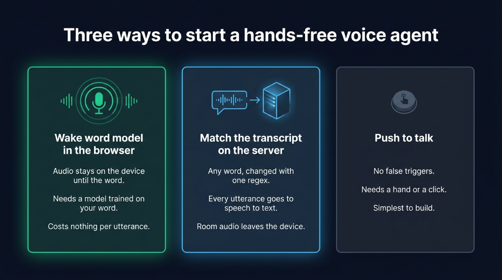
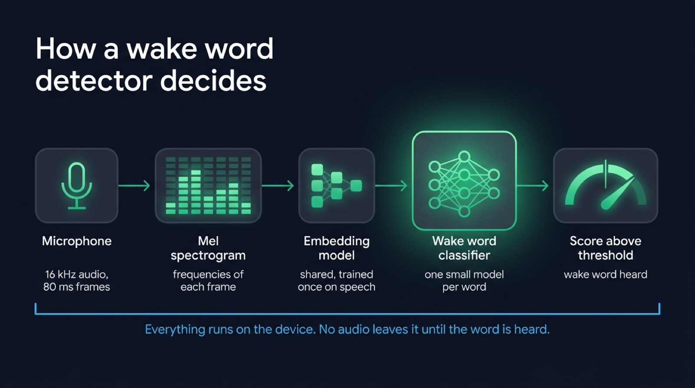
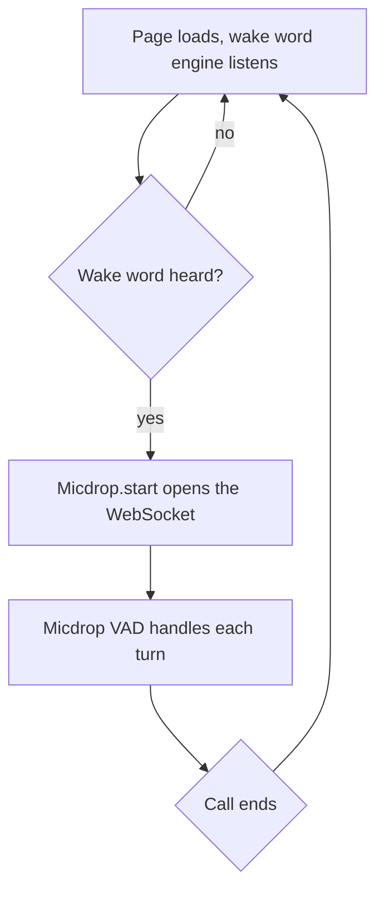

Wake word detection relies on a small model, running on the device, that listens to the microphone all the time and fires when it hears one phrase such as "hey Jarvis". In a web app you have three ways to start a voice agent without a tap: a keyword spotting model in the browser (openWakeWord through ONNX Runtime Web, or Porcupine Web from Picovoice), a check on the transcript once the server has turned speech into text, or no wake word at all and a push to talk button. Pick the browser model for a kiosk or a public page that listens for hours, the transcript check for an internal tool where any word must work today, and push to talk whenever a hand is free. This post compares the three with their licenses, costs and code, then wires a detector to [Micdrop](/), an open source TypeScript library for real-time voice conversations with AI.

## Three ways to start listening

The three designs differ on where the audio goes before the word is heard.

| | Wake word model in the browser | Transcript matched on the server | Push to talk |
|---|---|---|---|
| Where the audio goes before the word | Nowhere, it stays on the device | To your server and your speech to text provider | Nowhere, the microphone is closed |
| Changing the word | Train a new model (openWakeWord) or create one in the Picovoice Console | Edit a regular expression | Not applicable |
| Cost while waiting | CPU on the device | Speech to text billed on every utterance heard | None |
| False triggers | Tuned with a threshold | Rare, the text has to contain the word | None |
| Fits | Kiosks, in-car and kitchen apps, accessibility | Prototypes, internal tools, a word that changes often | Anything with a screen within reach |

Push to talk deserves a mention because it is so often the right answer. A large button that calls `Micdrop.start()` costs one line, never triggers on a television, and still gives a hands-free conversation once the call runs, since [voice activity detection in the browser](/blog/voice-activity-detection-browser) takes over the turns. A wake word is worth its complexity only when nobody can reach the screen.

{/* IMAGE regen: api.py image, infographic, 1600x900. Scene: "Three tall side-by-side cards of equal width on the dark background, each with a heading in a modern clean bold sans-serif and three short lines under it. All labels in English, rendered exactly as written. A title across the top reads: Three ways to start a hands-free voice agent. Card 1, outlined in bright emerald, the focal card, with a small microphone and concentric rings glyph at its top. Heading: Wake word model in the browser. Lines: Audio stays on the device until the word. Needs a model trained on your word. Costs nothing per utterance. Card 2, outlined in sky blue, with a small glyph of a speech bubble travelling to a server block. Heading: Match the transcript on the server. Lines: Any word, changed with one regex. Every utterance goes to speech to text. Room audio leaves the device. Card 3, outlined in dim slate grey, with a small round button glyph. Heading: Push to talk. Lines: No false triggers. Needs a hand or a click. Simplest to build. Flat vector geometric rendering, straight-on frontal view, even spacing between cards, generous dark margins, all typography perfectly legible."
    Regenerate if the comparison of the three designs changes. Last data sync: 2026-10-23. */}


## How wake word detection works

A wake word detector, also called keyword spotting or hotword detection, answers one question many times a second: did the last second of audio contain this phrase? It scores the audio against the one word it was trained on, without transcribing anything.

openWakeWord shows the usual design well, in three stages:

1. The microphone audio arrives as 16 kHz PCM, cut into frames of 80 ms (1,280 samples).
2. A melspectrogram model turns each frame into frequency bands, and a shared embedding model, trained once on a large amount of speech, turns a window of those bands into a vector of 96 numbers.
3. A small classifier, one per wake word, reads the last second or so of vectors and returns a score between 0 and 1.

When the score crosses a threshold (0.5 by default in both openWakeWord and Porcupine), the detector fires. Because the embedding model is shared, each new word adds only a small classifier: `hey_jarvis` weighs 1.2 MB, while the melspectrogram and embedding models it shares with every other word add about 2.3 MB.

The threshold trades two errors against each other. A false accept fires on a phrase that only sounds close, or on the television. A false reject misses the user, who then repeats the word louder. openWakeWord aims for under 5% false rejects and under 0.5 false accepts per hour on its pretrained models. Users forgive a missed word far more easily than a kiosk that starts talking on its own, so most apps raise the threshold until false accepts disappear and accept a few repeats.

The detector runs on the device because streaming a room's audio to a server all day costs bandwidth and money, records people who never addressed the app, and adds a round trip at the moment the user waits for a reaction.

{/* IMAGE regen: api.py image, infographic, 1600x900. Scene: "A horizontal left-to-right pipeline of five connected rounded modules on the dark background, joined by thin glowing emerald arrows. All labels in English, rendered exactly as written. A heading at the top left in a modern clean bold sans-serif reads: How a wake word detector decides. Module 1, a stylised microphone glyph, label under it: Microphone, caption: 16 kHz audio, 80 ms frames. Module 2, a small grid of vertical bars like a spectrogram, label: Mel spectrogram, caption: frequencies of each frame. Module 3, a compact stack of small squares, label: Embedding model, caption: shared, trained once on speech. Module 4, larger and brighter than the others, the focal point, label: Wake word classifier, caption: one small model per word. Module 5, a horizontal gauge with a vertical threshold line at its middle and the needle past it glowing emerald, label: Score above threshold, caption: wake word heard. Under the whole row, a thin sky-blue band reads: Everything runs on the device. No audio leaves it until the word is heard. Flat vector geometric rendering, straight-on frontal view, even spacing, generous dark margins, all typography perfectly legible."
    Regenerate if the openWakeWord pipeline changes. Last data sync: 2026-10-23. */}


## openWakeWord in the browser

[openWakeWord](https://github.com/dscripka/openWakeWord) is the open source wake word project most developers start with. Its code is under the Apache 2.0 license, its models run on ONNX Runtime, and its last release (v0.6.0) dates from February 2024. Home Assistant uses it for its voice assistants.

The project itself targets Python. Its FAQ says a JavaScript port is not on the roadmap, so the browser ports come from the community, on top of [ONNX Runtime Web](https://github.com/microsoft/onnxruntime/tree/main/js/web), the same runtime that runs Silero VAD in a page:

- [openwakeword-wasm-browser](https://github.com/dnavarrom/openwakeword_wasm) (MIT, version 0.1.1 on npm) wraps the models in a `WakeWordEngine` class with a `detect` event, a threshold and a cooldown between detections.
- [openwakeword-web](https://www.npmjs.com/package/openwakeword-web) (Apache 2.0, version 0.1.0) comes from a fork of the main repository, proposed upstream as a pull request.

Both packages are young and maintained by one person each, so read their source before shipping them. The openwakeword-wasm-browser package, short enough to read in an evening, opens its own microphone stream:

```typescript
import { WakeWordEngine } from 'openwakeword-wasm-browser'

const engine = new WakeWordEngine({
  baseAssetUrl: '/openwakeword/models', // melspectrogram, embedding and word models
  keywords: ['hey_jarvis'],
  detectionThreshold: 0.5,
  cooldownMs: 2000,
})

await engine.load()
engine.on('detect', ({ keyword, score }) => {
  console.log(`Heard ${keyword} (${score.toFixed(2)})`)
})
await engine.start()
```

Check the licenses before anything else. The code is Apache 2.0, but the pretrained models (`alexa`, `hey_jarvis`, `hey_mycroft`, `hey_rhasspy` and the timer and weather phrases) are under CC BY-NC-SA 4.0, a noncommercial license. They work for a prototype. A product needs its own word.

Training that word is the project's strong point. Its Google Colab notebook generates thousands of spoken examples of your phrase with text to speech, mixes them with noise and negative speech, and trains a classifier on top of the shared embedding model. The README puts a basic model at under an hour of training, with lower accuracy than the pretrained ones in some settings. The output is an ONNX file that the browser packages load like any other word. The datasets the notebook downloads come with their own terms, so read them before you ship the model in a commercial product.

## Porcupine Web from Picovoice

[Porcupine](https://picovoice.ai/platform/porcupine/) is the commercial option, and the most finished one in a browser. Picovoice publishes a web SDK that runs the engine in a Web Worker:

```bash
npm install @picovoice/porcupine-web @picovoice/web-voice-processor
```

```typescript
import { PorcupineWorker } from '@picovoice/porcupine-web'
import { WebVoiceProcessor } from '@picovoice/web-voice-processor'

const porcupine = await PorcupineWorker.create(
  ACCESS_KEY,
  [{ publicPath: '/porcupine/hey-kiosk.ppn', label: 'hey kiosk', sensitivity: 0.6 }],
  (detection) => console.log('Heard', detection.label),
  { publicPath: '/porcupine/porcupine_params.pv' }
)

await WebVoiceProcessor.subscribe(porcupine)
```

Built-in words such as "Computer", "Jarvis" or "Porcupine" work with no training. A custom word is typed as text in the Picovoice Console, which returns a `.ppn` file per platform. With openWakeWord, you run a training notebook for the same result, which makes custom words the biggest difference between the two. The `sensitivity` option, between 0 and 1 with 0.5 by default, plays the role of the threshold. Higher values miss fewer words and fire more often by mistake.

Porcupine needs a Picovoice account. The page creates the engine with an AccessKey from the Picovoice Console, so the key ends up in its JavaScript. Picovoice counts usage in monthly active users. Its FAQ defines a user as "a unique device, app, or browser instance that initializes the engine within a 30-day period". On a public web page, every visitor who loads the detector therefore counts. The FAQ describes a one-time free trial and subscriptions for businesses, with no plan for personal or noncommercial use. Third-party listings quote a Foundation plan at $6,000 a year for 100 monthly users, so check that figure against Picovoice's pricing page before you plan a launch. {/* TODO PRICING: replace the Foundation plan figure with the price and user count read on picovoice.ai/pricing, or drop the third-party figure. */}

Porcupine fits a kiosk fleet or an app whose users log in, since you know in advance how many users you pay for. openWakeWord costs nothing per visitor, which suits a public page with thousands of anonymous visitors.

## Other wake word engines

- [LiveKit wakeword](https://github.com/livekit/livekit-wakeword) (Apache 2.0, April 2026) is a trainer that generates synthetic speech, augments it and exports an ONNX model in the openWakeWord format, so openwakeword-wasm-browser and openwakeword-web can load it. LiveKit reports 0.08 false accepts per hour against 8.50 for openWakeWord on its own benchmark. It runs in Python, Rust and Swift, with no browser runtime of its own.
- [microWakeWord](https://github.com/kahrendt/microWakeWord) (Apache 2.0) targets microcontrollers such as the ESP32-S3 used in Home Assistant's voice hardware. It suits a device far better than a web page.
- The Wake Word Collective of the Open Home Foundation gathers voice recordings in the browser to train better multilingual models for microWakeWord. It builds a dataset that anyone can contribute to, and offers no library for a web app.
- Snowboy and Mycroft Precise appear in many older tutorials. KITT.AI shut Snowboy down at the end of 2020, and Mycroft AI stopped development in early 2023. Skip both for a new project.

## Matching the transcript on the server instead

Since Micdrop ships no wake word detector, you listen for the word in one of two places: in the browser, where your code calls `Micdrop.start()` once a detector hears the word, or on the server, where the call is already running and the agent stays silent until the transcript contains the word.

In the transcript approach, the call starts silent, the browser sends each utterance once its voice activity detection hears speech, and the agent checks the transcript before its first answer. Micdrop documents it as the [wake word option of the first message](/docs/server/first-message):

```typescript
const WAKE_WORD = /hey kiosk/i
const FIRST_MESSAGE = 'Hello! How can I help you today?'

new OpenaiAgent({
  apiKey: process.env.OPENAI_API_KEY,
  systemPrompt: 'You are a helpful assistant.',
  onBeforeAnswer(stream) {
    const isFirstAnswer = !this.conversation.some(
      (message) => message.role === 'assistant'
    )
    if (!isFirstAnswer) return

    const lastUserMessage = this.conversation.findLast(
      (message) => message.role === 'user'
    )
    if (!lastUserMessage) return

    if (!WAKE_WORD.test(lastUserMessage.content)) {
      // Forget what was said and stay silent
      this.cancelLastUserMessage()
      return true
    }

    this.addAssistantMessage(FIRST_MESSAGE)
    stream.write(FIRST_MESSAGE)
    return true
  },
})
```

Any word works, in any language your speech to text model handles. You change it by editing a regular expression. False accepts are rare because the text has to contain the phrase.

You pay for everything said before the word. Micdrop's client sends audio only while someone speaks, so silence costs nothing, but every sentence spoken near the microphone travels to your server and to the speech to text provider, which bills it. In a busy kitchen or a shop, that is hours of chatter transcribed for nothing. The audio of people who never addressed the app leaves the device too. The WebSocket also stays open the whole time. Use this approach for a prototype, an internal tool or a quiet room, and move to a browser model when the app listens all day.

## Starting a Micdrop call when the word is heard

The browser approach chains two detectors. The wake word engine listens while the app is idle. When it fires, the page starts a Micdrop call, and from then on Micdrop's own voice activity detection decides when each turn starts and ends.



```typescript
import { WakeWordEngine } from 'openwakeword-wasm-browser'
import { Micdrop } from '@micdrop/web'

const engine = new WakeWordEngine({
  baseAssetUrl: '/openwakeword/models',
  keywords: ['hey_kiosk'], // your own trained model
  detectionThreshold: 0.6,
  cooldownMs: 2000,
})
await engine.load()
await engine.start()

engine.on('detect', async () => {
  // Ignore the word while a call is running
  if (Micdrop.isStarted || Micdrop.isStarting) return
  await Micdrop.start({
    url: 'wss://example.com/call',
    vad: ['volume', 'silero'],
  })
})

// The agent can end the call, the engine is still listening
Micdrop.on('EndCall', () => Micdrop.stop())
```

On the server, give the call a [first message](/docs/server/first-message) so the agent greets the user as soon as the word is heard. The wake word engine only picks the moment the call begins. [Starting and stopping the call](/docs/client/start-stop-call) then work as in any other Micdrop app.

Both libraries open their own microphone stream, and this example keeps both open during the call. That looks wasteful, but stopping the detector and restarting it after each call breaks on Firefox: a microphone requested again within about 15 seconds of its release comes back without echo cancellation or noise suppression, while its settings still report them on. Micdrop waits out that delay for its own streams but cannot know when another library has closed one. Keeping the detector open and ignoring its events during the call avoids the problem in every browser.

Both streams must use the same microphone. When the user picks one in your settings, pass the same `deviceId` to the engine and to Micdrop's [microphone selection](/docs/client/devices-management).

## Privacy, battery and false triggers

A browser detector keeps the audio on the device until the word is heard. Say so in your interface: a visible "listening for the wake word" state and a way to turn it off do more for trust than any privacy policy. The browser shows its own microphone indicator the whole time, so users will notice and ask why.

The cost on the device is real but small. The openWakeWord README reports that a single core of a Raspberry Pi 3 runs 15 to 20 models in real time, so a laptop or a recent tablet barely notices one. Phones are another matter: a mobile browser may suspend a page in the background, which stops the detector with it. A kiosk or a tablet kept in the foreground works, while a phone in a pocket only listens inside a native app, where Porcupine and openWakeWord also run.

False triggers come from three places:

- A wake word that sounds like common words makes the detector fire on them. Pick a phrase of three or four syllables with uncommon sounds. "Hey kiosk" triggers less often than "OK".
- A television or a radio fires the detector when a voice on it says something close to the word. Raise the threshold until a long recording of background noise produces no detection, then check that the word still fires from across the room.
- The agent's own voice can fire it too. When the agent says the wake word in an answer, a detector without echo cancellation can hear it. Ignoring detections during the call, as the Micdrop example does, removes the risk. Browsers also apply echo cancellation by default on `getUserMedia` streams.

Record ten minutes of the real room, play it to the detector, and count the detections. You learn more about a threshold from that test than from any benchmark.

## Frequently asked questions

<FaqList>
  <FaqItem question="What is a wake word?">
    A wake word, or wake up word, is a short phrase that makes a voice assistant start listening, such as "hey Jarvis" or "computer". A small model on the device listens for that phrase only, and the assistant opens the conversation once the model hears it. Before that, nothing is transcribed and nothing leaves the device.
  </FaqItem>
  <FaqItem question="How does wake word detection work?">
    A wake word detector cuts the microphone audio into short frames, about 80 ms each, turns them into frequency features, and passes the last second or so to a small neural network trained on one phrase. The network returns a score between 0 and 1. When the score crosses a threshold, usually 0.5, the detector fires. The threshold trades missed words against false triggers.
  </FaqItem>
  <FaqItem question="Can ChatGPT have a wake word?">
    The ChatGPT app has no wake word: its voice mode starts when you tap the voice icon. You can build a hands-free assistant on OpenAI's models by running a wake word detector such as openWakeWord or Porcupine in your own app and starting the voice session when it fires. With Micdrop, the detector calls `Micdrop.start()` and the call runs on the model you configured on the server.
  </FaqItem>
  <FaqItem question="Is openWakeWord free for commercial use?">
    The openWakeWord code is under the Apache 2.0 license and free for commercial use. Its pretrained models, such as hey_jarvis and alexa, are under CC BY-NC-SA 4.0, a noncommercial license. For a commercial product, train your own wake word with the project's notebook and check the terms of the datasets the training uses.
  </FaqItem>
  <FaqItem question="Does openWakeWord run in the browser?">
    The official project runs in Python and lists no browser port on its roadmap. Community packages such as openwakeword-wasm-browser and openwakeword-web run the same ONNX models in the browser with ONNX Runtime Web, entirely on the device. They are young projects, so read their code before shipping them.
  </FaqItem>
  <FaqItem question="How do I create a custom wake word?">
    With openWakeWord, run the training notebook: it generates thousands of spoken examples of your phrase with text to speech and trains a basic classifier in under an hour. LiveKit wakeword offers a similar trainer from the command line and exports models in the openWakeWord format. With Porcupine, type the phrase in the Picovoice Console and download the generated .ppn file.
  </FaqItem>
  <FaqItem question="Should the wake word run in the browser or on the server?">
    Run it in the browser when the app listens for long periods, since the audio stays on the device and nothing is billed while waiting. Check the transcript on the server when you need any word in any language with no training, and the room is quiet enough that sending each utterance to speech to text costs little.
  </FaqItem>
</FaqList>

## Getting started

A wake word decides when a conversation begins, and Micdrop runs everything after that moment: the microphone, voice activity detection, interruptions, and the speech to text, LLM and text to speech pipeline on your server. Try the transcript approach first, since it needs no model, then move the detection into the browser once you know which word your users say.

```bash
npm install @micdrop/web @micdrop/server
```

You can [run a first voice call in about five minutes](/docs/getting-started), then add the wake word on top.
