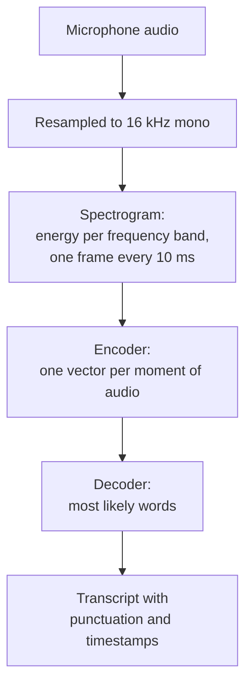
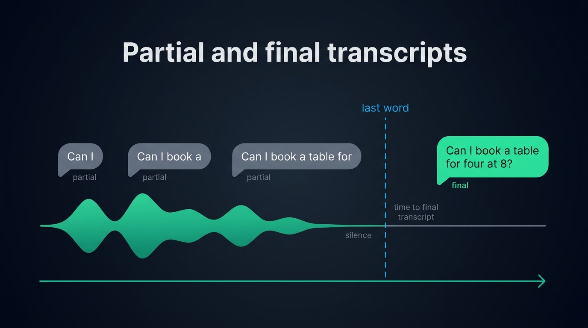
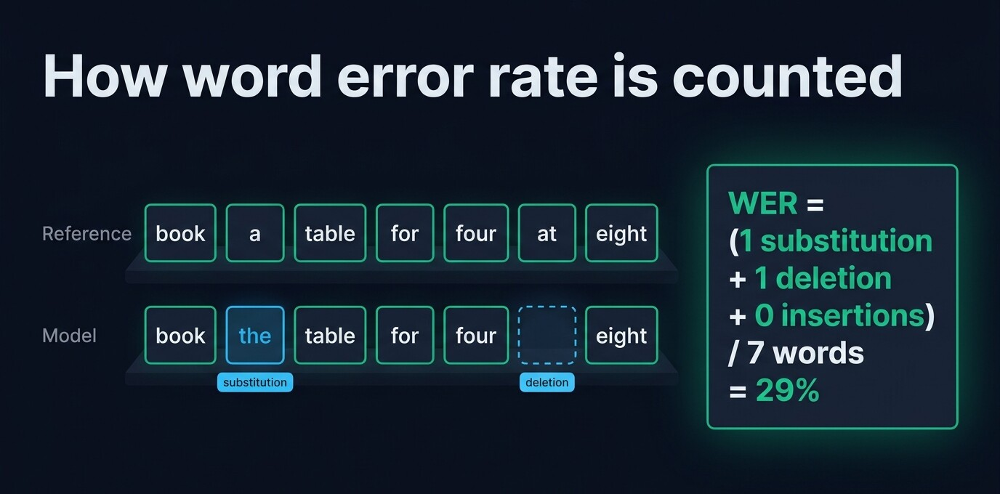
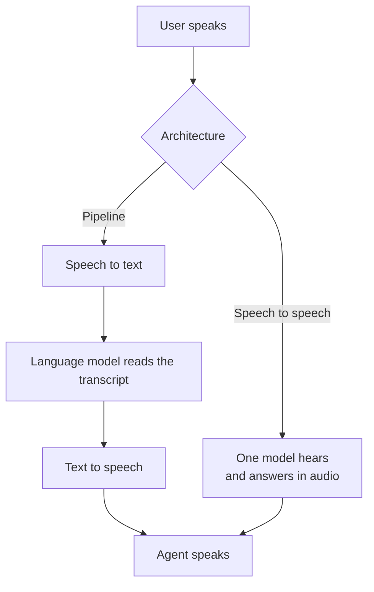

Automatic speech recognition (ASR) is software that turns spoken audio into written text. You will also see it called speech to text, or STT. Modern ASR systems are neural networks trained on thousands of hours of recorded speech paired with its transcript. For a developer building a voice agent, ASR is the first step of the call: the agent can only answer what the model heard. This guide explains how an ASR model turns sound into words, the difference between batch and streaming recognition, what partial and final transcripts are, what word error rate measures and what it misses, and how to choose between a cloud API and an open model you run yourself.

## What ASR means

ASR stands for automatic speech recognition. The model receives audio and returns the words spoken in it, usually with punctuation and capitals, sometimes with a timestamp for each word. Speech to text is another name for the same thing, the one most API vendors use.

Three neighbouring terms describe jobs other than ASR:

- Voice recognition, or speaker recognition, identifies **who** is speaking. ASR identifies **what** was said.
- Natural language understanding works on the transcript afterwards, to find the intent or the facts in it. In a voice agent, a language model usually does that job.
- Text to speech goes the other way and turns text into a voice.

Today ASR is a form of artificial intelligence, but the first recognizers compared the sound with patterns built by hand. In 1952, Bell Labs researchers described a machine that [recognized the ten digits spoken by one person over a telephone line](https://doi.org/10.1121/1.1906946), with 97 to 99% accuracy once tuned to that voice. For decades afterwards, recognizers combined statistical models of sounds with dictionaries and word probabilities. Neural networks replaced those pieces in the 2010s. OpenAI's Whisper, released in 2022, learned from [680,000 hours of audio collected from the web](https://arxiv.org/abs/2212.04356) with the transcripts that came with it. One Whisper model transcribes about a hundred languages.

## How speech recognition works

The audio goes through four stages between the microphone and the transcript.

1. The audio is resampled. Most models were trained on mono audio at 16 kHz, a rate high enough to capture a voice. Read why [16 kHz suits speech recognition](/blog/audio-sample-rate-voice-agent) and when a provider asks for another rate.
2. The audio becomes a spectrogram. The model slices the sound into short overlapping windows and measures the energy of each frequency band in each one. Whisper computes 80 bands on windows of 25 ms, one every 10 ms. The result looks like an image of the voice over time.
3. An encoder turns the spectrogram into vectors. The encoder is a neural network, usually a transformer, sometimes with convolution layers added (a Conformer). It outputs a sequence of vectors that describe which sounds are present at each moment.
4. A decoder turns the vectors into text. It picks the most likely words, using what it learned about the language as well as about the sound, so it can write "their" or "there" from context.



The decoder is where model families differ:

- CTC models predict a letter or a piece of a word for each frame of audio, then merge the repeats. They are fast, simple and good at streaming, but they rely less on context than the other families.
- Transducers add a small language model that predicts the next token from the tokens already written. NVIDIA's Parakeet TDT uses this design. Many streaming models do too, since a transducer works frame by frame and still uses context.
- Encoder-decoder models such as Whisper write the transcript one token at a time while looking at the whole encoded clip. They are accurate on a finished recording and awkward to stream, because they expect the clip to be complete.
- Some recent models put an audio encoder in front of a large language model. Mistral's Voxtral and IBM's Granite Speech work this way. Voxtral can also answer questions about the audio.

You rarely pick a decoder yourself, but a model's family affects whether it can stream and how much hardware it needs.

## Batch and streaming recognition

Batch recognition reads a recording that is already complete. The model sees the beginning, the middle and the end, can look ahead to correct itself, and returns the text when it is done. Meeting notes, subtitles for a video and voicemail transcription all work this way.

Streaming recognition transcribes audio while it is still being spoken. The client sends small chunks, often 20 to 100 ms each, over a WebSocket and receives the text as the model writes it. A voice agent usually needs this mode, because the person is still talking when the first chunk leaves the browser and nobody knows yet how long the sentence will last.

| | Batch recognition | Streaming recognition |
| --- | --- | --- |
| Input | A complete file | A live stream of small audio chunks |
| Output | The full transcript at the end | Partial transcripts, then a final one per sentence |
| Accuracy | Higher, the model sees the whole sentence | Usually a little lower for the same model |
| Typical delay | Seconds to minutes | A few hundred milliseconds after the last word |
| Typical use | Recordings, subtitles, meeting notes | Voice agents, live captions, dictation |
| Examples | Whisper, Cohere Transcribe, Parakeet | Deepgram Flux, AssemblyAI, Gemini Transcribe Live, Voxtral Realtime |

Whisper is the classic batch model. Its encoder always reads thirty seconds of audio, so a two second sentence gets padded with silence first. You can still use it in a live call by cutting the audio into sentences and [streaming them to Whisper over a WebSocket](/blog/real-time-transcription-websocket-typescript), one sentence at a time. Re-running Whisper on a growing buffer, as some projects do, adds delay.

## Partial and final transcripts

A streaming model sends two kinds of results. A partial transcript is its current guess about the sentence being spoken. The next partial can still rewrite that guess. A final transcript is the version the model commits to once the sentence is over.

Say the user is asking "Can I book a table for four at eight?". The partials might read "Can I", then "Can I book a", then "Can I book a table for". The final arrives a few hundred milliseconds after the last word, with punctuation, and maybe with "eight" written as "8".

- Partials suit two uses: live captions that a person reads along with, and a page that shows the user they were heard.
- The final transcript is what a voice agent sends to its language model. An agent that answers a partial may answer half a question, or a guess that the next partial rewrites.

So the delay that counts for a voice agent is the one between the last word and the final transcript. The person waits for that transcript, then for the language model to start writing, then for the voice to start speaking. [Coval](https://benchmarks.coval.ai), a benchmark that tests hosted speech to text APIs continuously, measured a median time to the final transcript of 195 ms across every model it tracked in October 2026, with the fastest APIs under 100 ms. You can compare ten [streaming speech to text APIs for voice agents](/blog/top-speech-to-text-apis-voice-agents) on that delay and on accuracy.

{/* IMAGE regen: api.py image, infographic, 1600x900. Scene: "A horizontal timeline on a dark surface, reading from left to right, with a thin unlabelled emerald arrow along the bottom showing time passing. Above that arrow, a soft audio waveform shape runs across the first two thirds, then flattens into a straight line labelled 'silence'. Above the waveform, three small grey rounded speech bubbles appear in sequence, each a little wider than the previous one, with the texts 'Can I', 'Can I book a', 'Can I book a table for', each tagged with the small label 'partial'. At the point where the waveform ends, a thin vertical sky blue line with the label 'last word' written once, at its top end only. Further right, past a short gap labelled 'time to final transcript', one larger bright emerald speech bubble with the text 'Can I book a table for four at 8?' tagged 'final'. Each text is written once and only once. Title at the top in a modern clean bold sans-serif: 'Partial and final transcripts'. Generous spacing, flat vector style."
    Infographic only: no data to sync. Last data sync: 2026-11-10. */}


## Endpointing and turn detection

Endpointing is how a streaming system decides that a sentence is over and the final transcript can go out. It is the same decision as turn detection in a voice agent: when the person stopped talking, and whether they finished their thought.

Most systems wait for a stretch of silence, which forces a compromise. A short silence cuts off people who pause to find a word, while a long one slows down every answer. Micdrop, for instance, closes a turn about 760 ms after the last word with the default settings of its browser voice detector. That is usually longer than the model needs to return the final text. A voice agent can detect [the end of a turn](/blog/end-of-turn-detection-voice-agents) from three signals: a length of silence, the sound of the sentence, or its words.

Several streaming APIs now detect the end of turn themselves, from silence and from meaning. Others expect your code to send a signal that the sentence is over, under a different name at each provider. Either works, as long as one part of the system owns the decision. When the detection runs in the browser, only speech travels to the provider, which also lowers the bill on a model priced per minute of audio.

## Word error rate, and what it hides

Word error rate (WER) is the standard measure of ASR accuracy. It aligns the model's transcript with a reference written by a person, then counts three kinds of mistakes:

- substitutions, a wrong word in place of the right one
- deletions, a word the model missed
- insertions, a word the model added

WER is the sum of the three divided by the number of words in the reference. Take the reference "book a table for four at eight". If the model writes "book the table for four eight", it made one substitution ("the" for "a") and one deletion ("at"), so its WER is 2 errors over 7 words, about 29%. Because insertions have no ceiling, a model that writes words over silence can score [above 100%](https://huggingface.co/learn/audio-course/chapter5/evaluation).

{/* IMAGE regen: api.py image, infographic, 1600x900. Scene: "Two rows of word tiles stacked on a dark surface, aligned word by word in columns. Top row labelled 'Reference' on its left edge, with seven tiles: 'book', 'a', 'table', 'for', 'four', 'at', 'eight'. Bottom row labelled 'Model' on its left edge, with tiles aligned under them: 'book', 'the', 'table', 'for', 'four', an empty dashed tile, 'eight'. The tile 'the' has a sky blue outline and a small tag 'substitution' under it. The empty dashed tile has a sky blue outline and a small tag 'deletion' under it. Every other tile has a thin emerald outline. On the right, a large emerald formula block reading 'WER = (1 substitution + 1 deletion + 0 insertions) / 7 words = 29%'. Each label and each word is written once and only once. Title at the top in a modern clean bold sans-serif: 'How word error rate is counted'. Generous spacing, flat vector style."
    Infographic only: no data to sync. Last data sync: 2026-11-10. */}


For a voice agent, a single WER figure hides four things:

- Every word weighs the same. Missing "the" costs as much as writing the wrong street name or the wrong amount. An agent that takes bookings or payments breaks on names and numbers, so test those words in particular.
- Text normalization changes the score. Benchmarks usually lowercase both texts and remove punctuation before comparing them, and some also write numbers out as words. A model that writes "8" where the reference says "eight" scores worse without that step. You can compare two WER figures only when both used the same normalization.
- Benchmark audio differs from your calls. Models make far fewer errors on read audiobooks than on phone calls with background noise and accents. The Hugging Face Open ASR Leaderboard dropped LibriSpeech, a set of read audiobooks, from its average on 2 November 2026 and added meetings, earnings calls and accented English, so the error rates on it went up. Compare two models within one benchmark and one version of it.
- WER says nothing about speed. A batch model and a streaming model can have the same error rate and a very different delay before the final transcript.

AssemblyAI Universal-3.6 Pro, the most accurate streaming API on Coval in October 2026, had a word error rate of 2.1%. NVIDIA Nemotron 3.5 Transcribe, the best open model on the Open ASR Leaderboard in November 2026, averaged 6.10% in English. Those two figures come from different benchmarks, so you cannot compare them with each other. Both mean that the leading models get more than nine words in ten right on these benchmarks. The errors left can still fall on the names and numbers your agent cares about.

## Cloud API or an open model in Node

| | Hosted streaming API | Open model you run |
| --- | --- | --- |
| Cost | Per minute of audio, from $0.002 on Soniox to $0.017 on OpenAI gpt-live-transcribe in 2026 | The machine, with no bill per minute |
| Streaming | Built in on most APIs | A few models only, such as Nemotron Speech Streaming, Voxtral Realtime, Moonshine and Kyutai STT |
| Accuracy | The lowest error rates on public benchmarks | A few points behind on English, close on some languages |
| Where the audio goes | The provider's servers, sometimes with a European region | Your server, or the user's device |
| Setup | An API key | A runtime, model weights, and a GPU for the larger models |

Hosted APIs are the default for a voice agent that has to answer quickly in many languages. To choose one, [compare streaming speech to text APIs](/blog/top-speech-to-text-apis-voice-agents) on price, delay, languages and European processing.

Open models make sense when the audio must stay on your machines, when the agent runs offline, or when you have servers with spare capacity. Some run inside a Node process. Whisper base, for instance, transcribes a three second sentence in about 440 ms on the CPU of a MacBook Pro M2 through Transformers.js. Moonshine and Parakeet read audio at its real length instead of padding it to thirty seconds. You can [run Whisper and its alternatives locally in Node](/blog/local-speech-to-text-node) and compare ten [open source speech to text models](/blog/top-open-source-speech-to-text-models) on streaming, error rate, hardware and license.

## Where ASR sits in a voice agent

A voice agent built as a pipeline chains three models. Speech to text turns each sentence into text, a language model writes the answer, and text to speech reads it out loud. Each step is a separate provider you can swap.

A speech to speech model, such as OpenAI's Realtime API or Gemini Live, takes the audio straight in and answers with audio. ASR still happens inside it, but you cannot pick the transcription model separately. Most of these models return a transcript of what the user said.



The pipeline gives you the choice of each provider, a fallback for each step and a transcript you control. The price is one extra hop, plus a language model that receives only the words, without the tone of the voice. A speech to speech model hears hesitation and tone and answers in one connection, but you inherit its voices, its prices and its regions. You can weigh [the OpenAI Realtime API against a pipeline](/blog/openai-realtime-api-vs-pipeline) in more detail.

## Plugging ASR into a voice agent with Micdrop

[Micdrop](/) is an open source TypeScript library for real-time voice conversations with AI, in the browser and in Node. It leaves the transcription to a model you choose. It ships ready integrations for hosted ASR (OpenAI, Gemini, Mistral, Gladia and Gradium) and for Whisper running in the Node process, behind one `stt` option of the server:

```typescript
import { MicdropServer, FallbackSTT } from '@micdrop/server'
import { GeminiSTT } from '@micdrop/gemini'
import { WhisperSTT } from '@micdrop/whisper'

const stt = new FallbackSTT({
  factories: [
    () => new GeminiSTT({ apiKey: process.env.GEMINI_API_KEY || '' }),
    () => new WhisperSTT({ model: 'base', language: 'en' }),
  ],
})

new MicdropServer(socket, {
  stt,
  // ... agent and tts
})
```

In Micdrop, the browser client runs voice detection, so only speech reaches the provider. The client also decides when each sentence ends. Each integration sends the end of sentence signal its provider expects and waits four seconds at most for the final transcript, then passes on whatever text it has. [`FallbackSTT`](/docs/ai-integration/fallback-strategies/stt-fallback) moves to the next provider when one fails and replays the audio of the sentence in progress. Write a [custom speech to text class](/docs/ai-integration/custom-integrations/custom-stt) with a single `transcribe()` method to connect Deepgram, AssemblyAI or any other provider without a ready integration.

Micdrop passes the final transcript of each sentence to your agent, which answers it. Since Micdrop is a library, you run the server yourself, keep your own provider keys, and store the transcripts and the call history.

## Frequently asked questions

<FaqList>
  <FaqItem question="What is automatic speech recognition?">
    Automatic speech recognition (ASR) is software that converts spoken audio into written text.
    Modern ASR systems are neural networks trained on thousands of hours of transcribed speech.
    They power dictation, subtitles, meeting notes and voice agents, where the transcript of each
    sentence goes to a language model that writes the answer.
  </FaqItem>
  <FaqItem question="What does ASR mean?">
    ASR stands for automatic speech recognition. It means the same as speech to text (STT): a model
    that hears audio and returns the words spoken in it. Voice recognition identifies who is
    speaking rather than what was said.
  </FaqItem>
  <FaqItem question="Is ASR considered AI?">
    Yes. Today's ASR systems are neural networks that learned from large amounts of recorded speech
    and its transcripts, the same family of machine learning as language models. OpenAI's Whisper,
    for instance, was trained on 680,000 hours of audio. Early recognizers from the 1950s compared
    the sound with patterns built by hand, and knew only a handful of words.
  </FaqItem>
  <FaqItem question="How does speech recognition work?">
    The model resamples the audio, usually to 16 kHz, and turns it into a spectrogram, a map of the
    energy of each frequency over time. An encoder converts the spectrogram into vectors that
    describe the sounds. A decoder then picks the most likely words from those sounds and from what
    it knows of the language. Streaming models do this on small chunks while the person speaks.
  </FaqItem>
  <FaqItem question="What is an ASR model?">
    An ASR model is the trained neural network that does the transcription, such as Whisper,
    NVIDIA Parakeet or Mistral Voxtral. You either call it through a hosted API, which bills per
    minute of audio, or download its weights and run it on your own hardware. Models differ on
    accuracy, languages, whether they stream, and the hardware they need.
  </FaqItem>
  <FaqItem question="What is a good word error rate?">
    A good word error rate depends on the audio. The most accurate streaming APIs scored around 2 to 4% on the Coval
    benchmark in October 2026. Phone calls with noise and accents get a higher error rate than read speech.
    Compare models on the same benchmark only, then test them on your own recordings, especially on
    names and numbers.
  </FaqItem>
  <FaqItem question="What is the difference between ASR and NLP?">
    ASR turns speech into text. Natural language processing works on that text, to find the intent,
    extract facts or write an answer. In a voice agent, a language model reads the ASR transcript
    and writes the answer. A speech to speech model does both jobs by itself.
  </FaqItem>
</FaqList>

## Getting started

Automatic speech recognition gives a voice agent its ears. For a live call, pick a model that streams or one that is fast on a short sentence, judge it on the time to the final transcript as much as on word error rate, and decide which part of your system owns the end of the turn. Then try two providers on your own calls before you commit. With Micdrop, you can [start with a first voice call in five minutes](/docs/getting-started), then [mix and swap speech to text providers](/docs/ai-integration) behind one server option without touching the browser.
