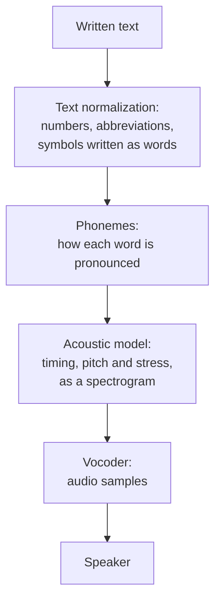
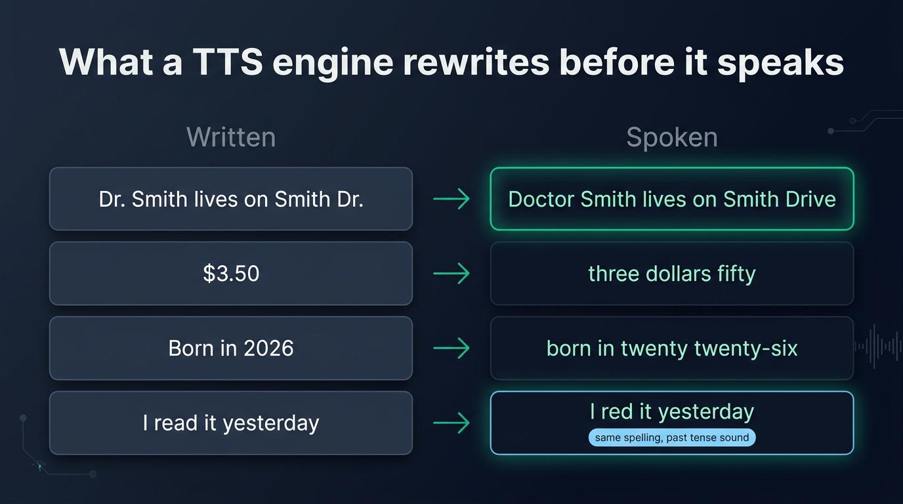
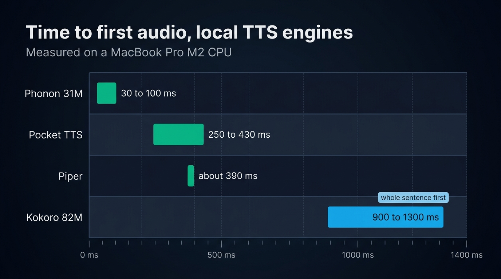

Text to speech (TTS) is software that reads written text out loud in a synthetic voice. You will also see it called speech synthesis. A TTS system first rewrites the text the way a person would say it, then a neural network trained on hours of recorded speech turns those words into audio. Screen readers, audiobook apps, navigation systems and voice agents all run on it. Developers adding a voice to a product care about three things: how quickly the voice starts speaking, which voices they can use, and how they pay for it. This guide explains how a TTS model turns text into sound, what changed with the models that write audio as tokens, why streaming matters in a live conversation, and how to choose between a hosted API and an open model you run yourself.

## What TTS means

TTS stands for text to speech. The system receives text and returns audio of a voice reading it, usually as a WAV, MP3 or raw PCM stream. Speech synthesis means the same thing and is the name the browser API uses.

A few neighbouring terms describe other jobs:

- Speech to text, or automatic speech recognition, goes the other way and turns a voice into text. Read how [automatic speech recognition works](/blog/what-is-automatic-speech-recognition) for that half of a conversation.
- A screen reader is an application that decides what to read on screen and when. It uses a TTS engine to produce the sound.
- Voice cloning makes a TTS model speak with the timbre of a specific person, from a recording of that person.
- A speech to speech model hears audio and answers directly with audio, in a voice of its own.

Every operating system ships a TTS engine, which browsers expose to web pages for free through `speechSynthesis`. Each device reads with its own voices, so the same page sounds different on Windows, a Mac and an Android phone. When the voice is part of the product, you [generate the audio yourself in JavaScript](/blog/text-to-speech-javascript), so every device plays the same voice.

## A short history of speech synthesis

The first electronic voice was played by hand. Bell Labs showed the [Voder](https://en.wikipedia.org/wiki/Voder) at the 1939 New York World's Fair. A trained operator played this console with fifteen keys and a pedal, shaping tones and noise into words. Visitors found the Voder hard to understand.

For the next seventy years, TTS systems followed two main approaches:

- Concatenative synthesis glued together short pieces of recordings of one speaker. It sounded natural as long as the recordings covered the words well. On the words the recordings missed, you could hear the joins.
- Parametric synthesis generated the sound from a model of the voice. It could say anything, with the buzzy, flat tone people still associate with "robot voices".

Neural networks changed the sound in three steps. DeepMind's [WaveNet](https://arxiv.org/abs/1609.03499), published in September 2016, generated the audio waveform one sample at a time. Listeners rated its voice far more natural than both older approaches. In December 2017, Google's [Tacotron 2](https://arxiv.org/abs/1712.05884) combined a network that predicts a spectrogram from text with a WaveNet that turns the spectrogram into audio. Listeners gave it a mean opinion score of 4.53 out of 5, against 4.58 for professional recordings. Most TTS systems built in the following years kept that two-stage design.

The third step came in January 2023, when Microsoft researchers described [VALL-E](https://arxiv.org/abs/2301.02111), which treats speech synthesis as language modelling. It writes audio tokens one after another, the way a chatbot writes text, and copies a voice from a three second recording. Many of the models released since then work the same way.

## How text to speech works

A sentence goes through four stages between the text and the speaker.

1. The text is normalized. The system rewrites numbers, abbreviations and symbols into the words a person would say. "Dr. Smith" becomes "doctor Smith" while "Smith Dr." becomes "Smith drive", "$3.50" becomes "three dollars fifty", and "2026" becomes "twenty twenty-six" in a date but "two thousand twenty-six" in a count.
2. The words become sounds. A pronunciation dictionary and letter-to-sound rules turn each word into phonemes, the units of sound of the language. When a word has two pronunciations, the system picks one from the context: "read" sounds different in "I read it yesterday" and "I read every day".
3. An acoustic model predicts how the sentence sounds. It decides the timing, the pitch and the stress of each phoneme, which together are called prosody, and outputs a spectrogram, a map of the energy of each frequency over time.
4. A vocoder turns the spectrogram into audio samples the speaker can play, often 16,000 to 48,000 per second.



Recent models merge some of these stages. Piper and Kokoro still convert the text to phonemes before the neural model runs. Many large models read characters or text tokens directly and learn pronunciation from their training data. Text normalization stays a separate step in most engines, because a model that sees "$3.50" rarely guesses the spoken form as reliably as a set of rules. Phonon, for instance, exposes its normalization rules as an option, with separate rules for numbers, currencies, email addresses, web addresses, abbreviations, phone numbers, times and dates.

Normalization errors are the ones your users notice first. A voice that reads "St. Louis" as "street Louis" or a price as a string of digits sounds broken, however natural the timbre is. Test the names, amounts, dates and abbreviations your product actually says.

{/* IMAGE regen: api.py image, infographic, 1600x900. Scene: "A two-column table drawn as clean rounded cards on a dark surface, four rows. Left column header 'Written', right column header 'Spoken'. Between the two columns of each row, a thin emerald arrow pointing right. Row 1: left 'Dr. Smith lives on Smith Dr.', right 'Doctor Smith lives on Smith Drive'. Row 2: left '$3.50', right 'three dollars fifty'. Row 3: left 'Born in 2026', right 'born in twenty twenty-six'. Row 4: left 'I read it yesterday', right 'I red it yesterday', with a small sky blue tag under it reading 'same spelling, past tense sound'. Left cards in muted slate, right cards with a bright emerald outline. Each text is written once and only once. Title at the top in a modern clean bold sans-serif: 'What a TTS engine rewrites before it speaks'. No subtitle, and no text other than the labels listed here. Generous spacing, flat vector style."
    Infographic only: no data to sync. Last data sync: 2026-11-17. */}


## Models that write speech as tokens

A neural audio codec compresses audio into a sequence of tokens, far fewer per second than audio samples, and can rebuild the sound from them. Once speech is a sequence of tokens, a transformer can learn to write it, the same way a large language model writes text.

That is how VALL-E worked, on top of Meta's EnCodec codec, and how many current models work. Alibaba's [Qwen3-TTS](https://arxiv.org/abs/2601.15621) writes 12.5 tokens per second of speech, each token covering 80 ms of audio across 16 layers of detail. Alibaba measured 97 ms before the first audio with the smaller of the two Qwen3-TTS models.

These models changed three things for developers:

- They stream naturally. Each token becomes audio as soon as it is written, so the voice starts before the sentence is finished.
- They clone a voice from a short sample. The recording goes in as the first tokens, then the model continues in the same voice. Qwen3-TTS needs about three seconds.
- They take instructions. Gemini TTS and OpenAI's `gpt-4o-mini-tts` accept a description of the tone in plain words, such as "slower, and warm". ElevenLabs Eleven v4 Turbo acts out tags written in the text, such as `[laughs]`.

They also brought a failure the older pipelines rarely had. A model that writes tokens one after another can occasionally repeat a word, skip one, or keep going after the end of the text, the way a chatbot sometimes rambles. Vendors work to reduce it. Include very short sentences and unusual text in your tests.

## Streaming and time to first audio

A TTS system can return the audio in two ways. It can synthesize the whole text and return one file, which suits an audiobook or a saved announcement. Or it can stream the audio in small chunks as it produces them, which a live voice agent needs, because the listener starts hearing the answer while the rest is still being generated.

For a voice agent, the delay before the first sound counts more than the total synthesis time. Micdrop's maintainer measured [very different first audio delays for local engines](/docs/ai-integration/local-models/performance) on one MacBook Pro M2:

| Engine | First audio on a MacBook Pro M2 CPU | How it produces audio |
| --- | --- | --- |
| Phonon 31M | 30 to 100 ms, on one core | Streams frames as it generates |
| Pocket TTS | 250 to 430 ms | Streams frames as it generates |
| Piper | About 390 ms | Synthesizes short pieces quickly |
| Kokoro 82M | 900 to 1300 ms | Synthesizes the whole sentence first |

Kokoro sounds good, but it plays the first sound only once the whole sentence is synthesized, so the listener waits about a second on a long sentence. Hosted voices built for agents start much sooner. The [first audio delay of hosted voice providers](/docs/ai-integration) is about 100 ms for ElevenLabs Eleven v4 Turbo and about 150 ms for Cartesia.

{/* IMAGE regen: api.py image, infographic, 1600x900. Scene: "A horizontal range chart on a dark surface, four rows read from top to bottom, each with its label on the left and a horizontal bar spanning its range on a shared time axis from 0 ms to 1400 ms, with tick marks labelled '0 ms', '500 ms', '1000 ms' and '1400 ms' along the bottom. Row 1 labelled 'Phonon 31M', bar from 30 to 100 ms, bright emerald, value text '30 to 100 ms' at the end of the bar. Row 2 labelled 'Pocket TTS', bar from 250 to 430 ms, emerald, value text '250 to 430 ms'. Row 3 labelled 'Piper', a short bar centred on 390 ms, emerald, value text 'about 390 ms'. Row 4 labelled 'Kokoro 82M', bar from 900 to 1300 ms, sky blue, value text '900 to 1300 ms', with a small tag 'whole sentence first'. Bar positions strictly proportional to the axis. Title at the top in a modern clean bold sans-serif: 'Time to first audio, local TTS engines'. Subtitle: 'Measured on a MacBook Pro M2 CPU'. Each text is written once and only once. Flat vector style, generous spacing."
    Infographic only: regenerate if the local model measurements in /docs/ai-integration/local-models/performance change. Last data sync: 2026-11-17. */}


In a voice agent, the text itself also arrives in pieces, because the language model writes its answer word by word. Some TTS APIs accept that text while it is being written, over a WebSocket. Others need a complete sentence, so the agent splits the answer into sentences and sends each one as soon as it ends. Either approach works for [streaming text to speech from an LLM](/blog/streaming-text-to-speech-llm). Compare them on the delay between the end of the user's sentence and the first sound.

## Voices and voice cloning

A TTS product gives you voices in one of three ways:

- A catalog of preset voices. ElevenLabs lists more than a thousand, Gemini TTS has 30, Kokoro ships 28 English voices and Piper publishes one or more trained voices for each of its 53 languages.
- A designed voice, generated from a description of the age, accent and tone you want.
- A cloned voice, made from a recording of a real person. Pocket TTS clones from a few seconds of audio on a CPU, Qwen3-TTS from three seconds on a GPU, and Phonon turns ten seconds of clear speech into a voice file you reuse on every call.

With older engines like Piper, a new voice means training a small model on hours of recordings. Every serious provider and lab asks for the consent of the person whose voice you clone. Kyutai even makes it a condition of use of its Pocket TTS weights. Record that consent in writing. The [open source voice cloning models](/blog/open-source-voice-cloning) differ on the length of sample they need, their license and their speed.

The language of the text is a separate question from the voice. Some voices speak only the language they were trained on. Others, such as the Gemini voices, follow the language of the text but keep some of the accent of the language they were tuned for. A French agent usually sounds better with a voice recorded by a French speaker.

## Hosted API or open model

| | Hosted TTS API | Open model you run |
| --- | --- | --- |
| Examples | ElevenLabs, Cartesia, Gradium, Gemini TTS, OpenAI, Mistral Voxtral Speech | Phonon, Pocket TTS, Piper, Kokoro, Qwen3-TTS, Chatterbox |
| Cost | Per character or per audio token spoken | The machine, with no bill per minute |
| Voice quality | The best scores in public listening tests | A few steps behind, close on the best GPU models |
| Languages | Dozens on most APIs | From English only (Kokoro, Pocket TTS) to 53 (Piper) |
| Where the text goes | The provider's servers, sometimes with a European region | Your server, or the user's device |
| Setup | An API key | A runtime and model weights, plus a GPU for the larger models |

Listeners on the [Artificial Analysis leaderboard](https://artificialanalysis.ai/text-to-speech/leaderboard) vote between two voices reading the same text. ElevenLabs Eleven v4 led it with an Elo score of 1336 in October 2026. Ming-3.0-tts, the best open model a company can ship freely, scored 1188, and Kokoro 1061.

Hosted APIs are the default when voice quality and language coverage come first. Open models make sense when the text must stay on your machines, when the product runs offline, or when the volume makes a bill per minute expensive. The ten leading [open source text to speech models](/blog/top-open-source-text-to-speech-models) differ on first audio delay, hardware, languages, cloning and license. For five of them, you can compare [local text to speech latency in Node](/blog/local-tts-node-kokoro-vs-piper).

## TTS APIs bill per character or per token

The unit depends on the model family:

- Per character of text. ElevenLabs charges $40 per million characters on Flash v2.5 and $80 on Eleven v3 at its October 2026 list prices. Cartesia bills about one credit per character.
- Per token. OpenAI's `gpt-4o-mini-tts` [costs $0.60 per million text tokens and $12 per million audio tokens](https://developers.openai.com/api/docs/models/gpt-4o-mini-tts). Gemini TTS also bills text tokens in and audio tokens out.

To compare the two, convert both to a minute of speech. ElevenLabs counts about 1,000 characters per minute of audio, so Flash v2.5 costs about [$0.04 per minute your agent speaks](/blog/elevenlabs-api-pricing-voice-agent). Gradium counts 45,000 characters per hour of its voices, or 750 a minute. The cost of a token-billed model depends on how many audio tokens a second of speech uses, which varies by model, so measure a few of your real sentences before you budget.

A TTS API bills only what the voice says. In a conversation, the user's turns and the silences cost nothing on the TTS side, so a minute of call costs less than a minute of agent speech. Hosted voice agent platforms often bill the whole call by the minute instead, whether the agent speaks or listens.

## Where TTS sits in a voice agent

A voice agent built as a pipeline chains three models. Speech to text turns the user's sentence into text, a language model writes the answer, and text to speech reads it out loud. TTS is the last step before the user hears anything, so its first audio delay adds directly to the wait after every question.

A speech to speech model, such as OpenAI's Realtime API or Gemini Live, hears the audio and answers in audio by itself. You get a lower delay and a model that hears the tone of the user's voice, but you can only use its own voices. In a pipeline, you pick the voice and its provider separately, so you can switch to another provider when one fails. You can weigh [the OpenAI Realtime API against a pipeline](/blog/openai-realtime-api-vs-pipeline) in more detail.

## Adding a voice with Micdrop

[Micdrop](/) is an open source TypeScript library for real-time voice conversations with AI, in the browser and in Node. You choose the voice engine. Micdrop ships ready integrations for hosted TTS (ElevenLabs, Cartesia, Gradium, Gemini, OpenAI and Mistral) and for local engines that run in or next to the Node process (Phonon, Kokoro, Piper, Pocket TTS and Qwen3-TTS). The server takes any of them through its `tts` option, here Cartesia with Phonon as a fallback:

```typescript
import { MicdropServer, FallbackTTS } from '@micdrop/server'
import { CartesiaTTS } from '@micdrop/cartesia'
import { PhononTTS } from '@micdrop/phonon'

const tts = new FallbackTTS({
  factories: [
    () =>
      new CartesiaTTS({
        apiKey: process.env.CARTESIA_API_KEY || '',
        modelId: 'sonic-3.6',
        voiceId: process.env.CARTESIA_VOICE_ID || '',
      }),
    () => new PhononTTS({ voice: 'Easton' }),
  ],
})

new MicdropServer(socket, {
  tts,
  // ... stt and agent
})
```

Micdrop passes the agent's text to the TTS engine as the language model writes it. Providers that accept text over a WebSocket, such as ElevenLabs, Cartesia and Gradium, receive it in pieces. Engines that need a complete sentence receive one sentence at a time. Micdrop then streams the audio to the browser and stops it when the user interrupts. When an engine fails, [`FallbackTTS`](/docs/ai-integration/fallback-strategies/tts-fallback) moves to the next one and replays the pending text. To connect a provider without a ready integration, write a [custom TTS class](/docs/ai-integration/custom-integrations/custom-tts) with a `cancel()` method and a `speak()` method that receives the text stream.

Since Micdrop is a library, you run the server yourself, with your own provider keys and the voices of the engines you choose. Micdrop has no hosted version and no dashboard.

## Frequently asked questions

<FaqList>
  <FaqItem question="What is TTS?">
    TTS, or text to speech, is software that reads written text out loud in a synthetic voice.
    It rewrites numbers and abbreviations as words, works out how each word is pronounced, then
    uses a neural network to generate the audio. Screen readers, audiobook apps, navigation
    systems and voice agents all use it.
  </FaqItem>
  <FaqItem question="What does TTS stand for?">
    TTS stands for text to speech. It means the same as speech synthesis. Its opposite is speech
    to text (STT), also called automatic speech recognition, which turns a voice into text.
  </FaqItem>
  <FaqItem question="How does text to speech work?">
    A TTS engine first normalizes the text, so "$3.50" becomes "three dollars fifty". It then
    converts the words into phonemes, predicts the timing and pitch of the sentence, and generates
    the audio, either through a vocoder or by writing audio tokens that a codec turns back into
    sound. Streaming engines send the first audio before the sentence is complete.
  </FaqItem>
  <FaqItem question="Is text to speech AI?">
    Modern text to speech is AI: the voices come from neural networks trained on many hours of
    recorded speech. Older systems either glued together pieces of recordings or generated the
    sound from a hand-built model of the voice. Those hand-built models gave the flat tone of "robot
    voices".
  </FaqItem>
  <FaqItem question="What is a TTS API?">
    A TTS API is a hosted service that takes text in an HTTP or WebSocket request and returns the
    audio of a voice reading it. ElevenLabs, Cartesia, Google, OpenAI and Mistral sell one. They
    bill per character of text or per audio token, for example about $0.04 per minute of speech on
    ElevenLabs Flash v2.5.
  </FaqItem>
  <FaqItem question="Is there free text to speech?">
    Yes. Every browser can speak through the speechSynthesis API, with the voices of the operating
    system. Open models such as Phonon, Piper and Kokoro run on your own CPU with no bill per minute.
    Most hosted APIs also include a small free allowance each month.
  </FaqItem>
  <FaqItem question="What is the difference between TTS and STT?">
    TTS turns text into a voice. STT turns a voice into text. A voice agent built as a pipeline uses
    both: STT transcribes what the user said, a language model writes the answer, and TTS reads it
    out loud.
  </FaqItem>
</FaqList>

## Getting started

For a live conversation, pick an engine that streams, judge it on the time to its first sound as much as on how natural it is, and test it on the names, prices and dates your product says. Then compare a hosted voice and an open model on your own sentences before you commit. With Micdrop, you can [start a first voice call in about five minutes](/docs/getting-started), then [mix and swap text to speech providers](/docs/ai-integration) behind one server option while the browser code stays the same.
