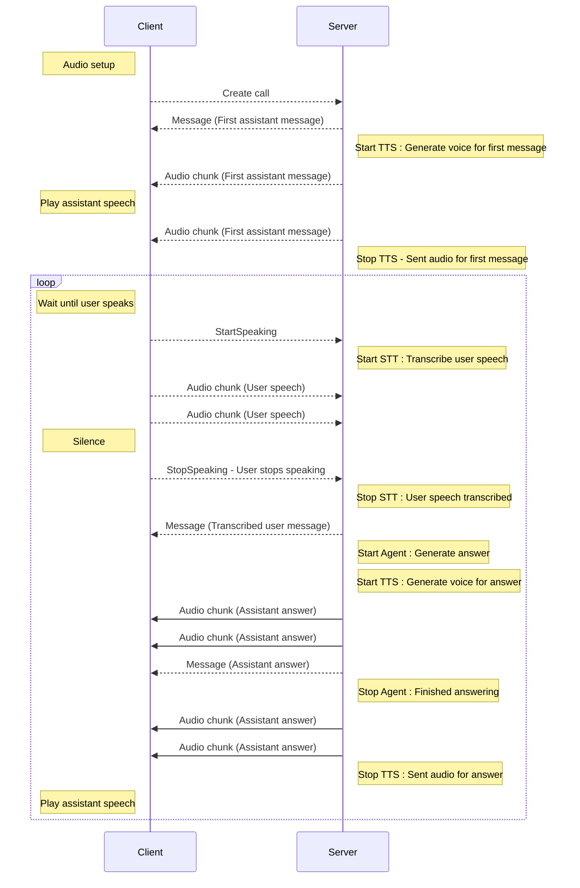

# Micdrop Protocol

## WebSocket Protocol

Micdrop uses a simple custom protocol over WebSocket for real-time communication between the client and server.

## Why WebSocket?

Micdrop talks to its server over a WebSocket because a browser calling your own backend needs just the server you already deploy. The browser [detects speech](../client/vad) and sends audio only while someone speaks, which keeps bandwidth low. [WebRTC is worth its extra servers](/blog/websocket-or-webrtc-voice-agent) for group calls, video, phone lines and users on weak mobile networks.

## Calls without a voice

A call configured without a text to speech carries no audio chunk back. The
answer arrives as a `Message`, followed by `SkipAnswer`, which is what tells the
client to stop waiting and listen again. A call configured without an agent
sends `SkipAnswer` right after the transcribed user message.

See [Dictation and text-only calls](./dictation).

## Client Commands

The client can send the following commands to the server:

- `MicdropClientCommands.StartSpeaking` - The user starts speaking
- `MicdropClientCommands.StopSpeaking` - The user stops speaking
- `MicdropClientCommands.Mute` - The user mutes the microphone

## Server Commands

The server can send the following commands to the client:

- `MicdropServerCommands.Message` - A settled message, from the user or the assistant.
- `MicdropServerCommands.PartialAssistantMessage` - The answer being written, before it is finished. Sent when [`partialMessages`](./partial-messages) is on.
- `MicdropServerCommands.CancelLastUserMessage` - Cancel the last user message.
- `MicdropServerCommands.SkipAnswer` - Notify that the last generated answer was ignored, it's listening again.
- `MicdropServerCommands.EndCall` - End the call.
- `MicdropServerCommands.ToolCall` - A tool the agent called, with its result.
- `MicdropServerCommands.Classification` - What the [classifier](./classifier) made of the user turn, as JSON. Sent when the server has a classifier and `classifierOptions.sendToClient` is on.
