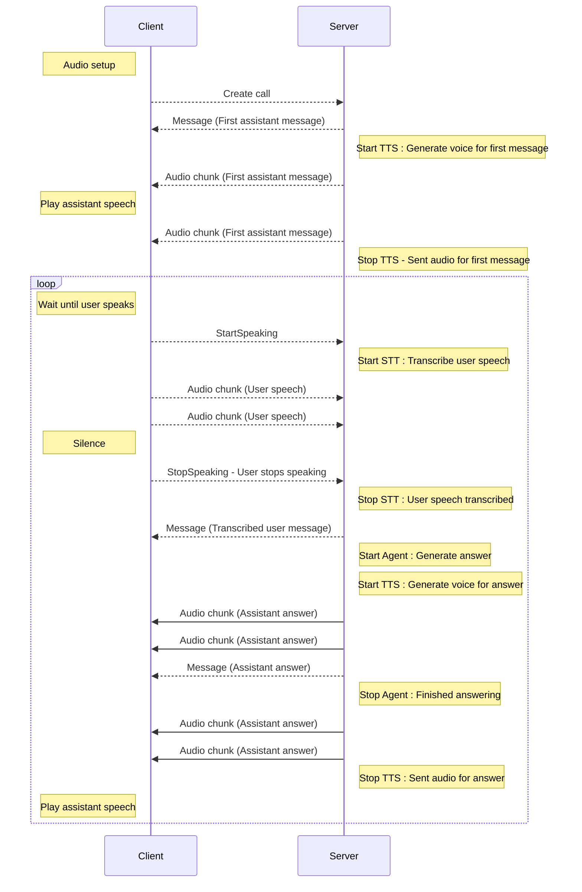

# Micdrop WebSocket Protocol Between Client and Server

A Micdrop call runs over a single WebSocket between `@micdrop/client` and
`@micdrop/server`. This page describes every frame of that connection, so you
can read a call in the network tab of your browser or write a client in
another language.



## Why WebSocket?

Micdrop talks to its server over a WebSocket because a browser calling your own backend needs just the server you already deploy. The browser [detects speech](../client/vad) and sends audio only while someone speaks, which keeps bandwidth low. [WebRTC is worth its extra servers](/blog/websocket-or-webrtc-voice-agent) for group calls, video, phone lines and users on weak mobile networks.

A text answer that only travels from the server to the browser can stream over a plain HTTP response, while a voice call also sends microphone audio upstream. [SSE and WebSocket have different trade-offs](/blog/sse-vs-websocket-ai-streaming) that follow from this direction of travel.

## Two kinds of frames

Binary frames carry audio, in both directions. Text frames carry commands. A
command is its name alone, such as `SkipAnswer`, or its name followed by a
space and a JSON payload:

```text
Message {"role":"user","content":"What time is it?"}
```

The server sorts the frames of the client by size. It reads a frame under 15
bytes as a command, and anything longer as audio. It keeps audio only between
`StartSpeaking` and `StopSpeaking`, and drops a chunk that arrives outside a
turn. A client of your own therefore sends audio only between a
`StartSpeaking` and the `StopSpeaking` that follows it.

## Opening a call

The client connects to the URL you give it. When the client has `params`, the
first frame it sends after the connection opens is a text frame holding them
as JSON:

```text
{"authorization":"Bearer eyJhbGciOi...","lang":"en"}
```

The server reads this frame with `waitForParams`, before it creates the
`MicdropServer`. It closes the connection with code 4400 when nothing arrives
within 3 seconds or when your validation rejects the params. A browser cannot
set headers on a WebSocket, which is why
[a token travels in the params](./auth-and-parameters).

Once the `MicdropServer` exists, the server speaks first when you give it a
`firstMessage` or `generateFirstMessage`. It sends that message as a `Message`
command, followed by its audio.

## A turn, frame by frame

Here is what crosses the connection when the user asks a question, with `→`
for a frame the client sends and `←` for a frame the server sends:

```text
→ StartSpeaking
→ <binary, 3200 bytes>
→ <binary, 3200 bytes>
→ <binary, 1240 bytes>
→ StopSpeaking
← Message {"role":"user","content":"What time is it?"}
← SampleRate 24000
← <binary>
← Message {"role":"assistant","content":"It is ten past four."}
← <binary>
← <binary>
```

The client sends `StartSpeaking` once its voice activity detection confirms
speech, then the audio in chunks of 100 ms, the last one shorter. The server
starts transcribing as soon as `StartSpeaking` arrives, so the transcript is
often ready a moment after `StopSpeaking`. When the transcript is ready while
the user still speaks, the server waits for `StopSpeaking` before answering.

The assistant message often arrives in the middle of its own audio, since the
text to speech starts on the first words the agent writes. With
[`partialMessages`](./partial-messages) on, `PartialAssistantMessage` frames
come before it, each one carrying the whole answer written so far.

## Interruptions

The user interrupts the assistant by speaking over it. The client then sends
`StartSpeaking`, stops its speaker at once, and drops the assistant audio that
still arrives while the user speaks. On its side, the server cancels the
answer in progress, agent and text to speech alike, then transcribes the new
turn. On the wire, the whole interruption is that one `StartSpeaking` sent
while the assistant speaks.

## When the server sends SkipAnswer

`SkipAnswer` tells the client that this turn ends without a voice and that it
can listen again. The server sends it in these cases:

- `StopSpeaking` arrives with no audio received since `StartSpeaking`
- the speech to text returns an empty transcript
- a [turn detector](./semantic-turn-detection) hears an unfinished sentence and waits for the rest
- the agent skips its answer, after a tool declared with `skipAnswer` for instance
- the call has no text to speech, after the answer text has been sent

A client that ignores `SkipAnswer` stays in its processing state until the next
turn.

## Calls without a voice

A call configured without a text to speech sends no audio back. The answer
arrives as a `Message`, followed by `SkipAnswer`, so the client stops waiting
and listens again. A call configured without an agent sends `SkipAnswer` right
after the transcribed user message, which is how
[dictation works over the same connection](./dictation).

## Audio format

Audio travels as binary messages of raw PCM, 16 bits little endian, mono, with
no header. The client sends the microphone at 16 kHz, so a full chunk of 100 ms
holds 1600 samples, or 3200 bytes. The server sends the assistant voice at the
rate its text to speech or realtime model produces it, and announces that rate
with a `SampleRate` command before the first chunk at a rate other than 16 kHz.
A `FallbackTTS` switching to a provider at another rate sends a new one in the
middle of the call. Each connection starts again at 16 kHz.

The client resamples the voice once, to the rate of its audio output, so a
provider at 24 kHz reaches the speaker without a detour through 16 kHz. Use a
client at least as recent as the server, since an older one ignores
`SampleRate` and plays a 24 kHz voice too slow.

## Client commands

| Command | When the client sends it |
| --- | --- |
| `StartSpeaking` | The user starts speaking. Audio chunks follow. |
| `StopSpeaking` | The user has finished the turn. |
| `Mute` | The call is paused with `pause()`. The server ends the turn in progress and cancels the answer it was preparing. |

`mute()` acts in the browser only. It stops the voice activity detection, so
the server receives no more turns.

## Server commands

| Command | Payload | Meaning |
| --- | --- | --- |
| `Message` | A conversation item as JSON | A complete message, from the user or the assistant. Tool calls and their results also arrive this way, with the role `tool_call` or `tool_result`. |
| `PartialAssistantMessage` | The answer so far, as a JSON string | The answer being written, sent when [`partialMessages`](./partial-messages) is on. |
| `CancelLastUserMessage` | None | The client removes the last user message from its conversation, a noise the agent chose to ignore for instance. |
| `SkipAnswer` | None | This turn ends without a voice, so the client listens again. |
| `EndCall` | None | The agent ends the call. The client emits `EndCall`, and your page decides when to stop. |
| `ToolCall` | An object with `name`, `parameters` and `output`, as JSON | A tool the agent called, with its result, sent for the tools declared with `emitOutput`, so the client can [handle the tool call](../client/handling-tool-calls). |
| `SampleRate` | A number of Hz | The rate of the audio chunks that follow, sent when it changes, as in `SampleRate 24000`. |
| `Classification` | The classification as JSON | What the [classifier](../classifiers) made of the user turn. Sent when the server has a classifier and `classifierOptions.sendToClient` is on. |

## Closing and reconnecting

The client reads the close code to decide whether to reconnect:

| Code | Sent when | What the client does |
| --- | --- | --- |
| 1000, 1005 | The call ended normally, `stop()` included | Stops |
| 1001 | The server shuts down, during a deploy for instance | Reconnects |
| 1006 | The connection dropped with no close frame | Reconnects |
| 1011 | `handleError` caught an unexpected error | Reconnects |
| 4400 | Missing or invalid params | Stops, with a `BadRequest` error |
| 4401 | `MicdropError` with `Unauthorized` | Stops, with an `Unauthorized` error |
| 4404 | `MicdropError` with `NotFound` | Stops, with a `NotFound` error |

The client reconnects every second, with no limit on attempts by default, and
gives up on an attempt after 5 seconds. Set `reconnect` on the client to change
these values. On the server, `handleError` closes with the code of a
`MicdropError` and with 1011 for [any other error](./error-handling).

Each connection reaches a new `MicdropServer`. The client sends its params
again, and the server starts from an empty conversation at 16 kHz. To carry on
where the call stopped, store the messages and
[replay them into the agent](./resume-conversation) of the new connection.
