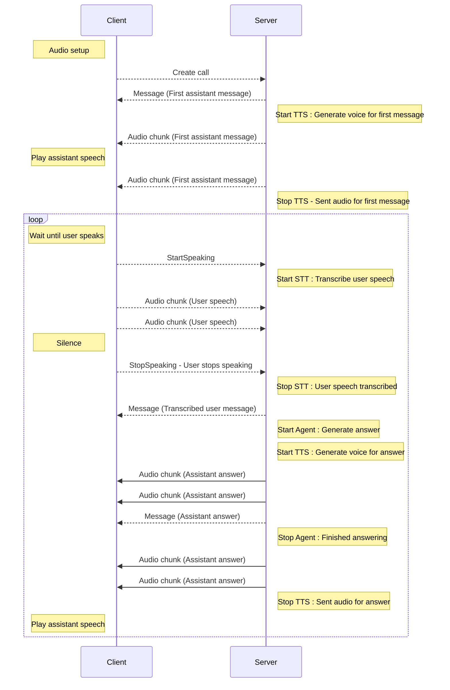

# Micdrop WebSocket Protocol Between Client and Server

## WebSocket Protocol

Micdrop uses a simple custom protocol over WebSocket for real-time communication between the client and server.

## Why WebSocket?

Micdrop talks to its server over a WebSocket because a browser calling your own backend needs just the server you already deploy. The browser [detects speech](../client/vad) and sends audio only while someone speaks, which keeps bandwidth low. [WebRTC is worth its extra servers](/blog/websocket-or-webrtc-voice-agent) for group calls, video, phone lines and users on weak mobile networks.

## Calls without a voice

A call configured without a text to speech carries no audio chunk back. The
answer arrives as a `Message`, followed by `SkipAnswer`, which is what tells the
client to stop waiting and listen again. A call configured without an agent
sends `SkipAnswer` right after the transcribed user message.

See [Dictation and text-only calls](./dictation).

## Audio format

Audio travels as binary messages of raw PCM, 16 bits, mono. The client sends
the microphone at 16 kHz. The server sends the assistant voice at the rate its
text to speech or realtime model produces it, and announces that rate with a
`SampleRate` command before the first chunk at a rate other than 16 kHz. A
`FallbackTTS` switching to a provider at another rate sends a new one in the
middle of the call. Each connection starts again at 16 kHz.

The client resamples the voice once, to the rate of its audio output, so a
provider at 24 kHz reaches the speaker without a detour through 16 kHz. Use a
client at least as recent as the server, since an older one ignores
`SampleRate` and plays a 24 kHz voice too slow.

## Client Commands

The client can send the following commands to the server:

- `MicdropClientCommands.StartSpeaking` - The user starts speaking
- `MicdropClientCommands.StopSpeaking` - The user stops speaking
- `MicdropClientCommands.Mute` - The user mutes the microphone

## Server Commands

The server can send the following commands to the client:

- `MicdropServerCommands.Message` - A settled message, from the user or the assistant.
- `MicdropServerCommands.PartialAssistantMessage` - The answer being written, before it is finished. Sent when [`partialMessages`](./partial-messages) is on.
- `MicdropServerCommands.CancelLastUserMessage` - Cancel the last user message.
- `MicdropServerCommands.SkipAnswer` - Notify that the last generated answer was ignored, it's listening again.
- `MicdropServerCommands.EndCall` - End the call.
- `MicdropServerCommands.ToolCall` - A tool the agent called, with its result.
- `MicdropServerCommands.SampleRate` - Rate in Hz of the audio chunks that follow, sent when it changes, for instance `SampleRate 24000`.
- `MicdropServerCommands.Classification` - What the [classifier](../classifiers) made of the user turn, as JSON. Sent when the server has a classifier and `classifierOptions.sendToClient` is on.
